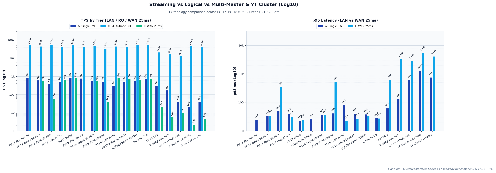

<p align="center">
  <a href="https://www.lightpath.fr">
    <picture>
      <source media="(prefers-color-scheme: dark)" srcset="assets/lightpath-logo-dark.svg">
      <source media="(prefers-color-scheme: light)" srcset="assets/lightpath-logo-light.svg">
      
    </picture>
  </a>
</p>

# ClusterPostgreSQL-Series : Étude comparative, PoCs reproductibles et benchmarks PostgreSQL Multi-Maîtres

> **Auteur** : Jean-Marie Renouard (`jmrenouard`) - [LightPath](https://www.lightpath.fr) | **Licence** : MIT | [English Version (`README.md`)](README.md)

Étude d'ingénierie reproductible sur **15 solutions PostgreSQL** (7 familles) et **10 topologies Docker opérationnelles** (appuyées sur le sous-module [`jmrenouard/multi-db-docker-env`](https://github.com/jmrenouard/multi-db-docker-env)), incluant **18 tests fonctionnels/limites (`L1–L8` + `T11–T18`)**, **187 mesures empiriques (`pgbench`, `sysbench`, `tc netem 10/25/50 ms`, `c=1..32`)** et l'[**Explorateur HTML interactif hors-ligne (`dashboard/index.html`)**](dashboard/index.html).

---

## 1. Synthèse des résultats empiriques (`PG_SCALE = 2`)

Tous les tests ont été exécutés séquentiellement sur hôte Docker WSL2 (20 vCPU, 16,4 Go RAM) à l'intérieur d'un pont réseau Docker isolé (sans biais NAT Windows), avec clé primaire artificielle sur `pgbench_history`.

| Topologie | Famille (`#`) | Suite A : Single RW (TPS) | Suite B2 : Overlap RW (TPS) | Suite D : Hot 50c (TPS) | Dérive solde (`Suite D`) | Suite E : `sysbench` (TPS) | Suite F : `netem 25ms` (TPS) | Limites `SQLSTATE` vérifiées |
|:---|:---|---:|---:|---:|---:|---:|---:|:---|
| **`pg17-standalone`** | Baseline (`#15`) | 866,82 | 879,01 | 3 128,63 | **0** | 1 129,51 | N/A | `23505` |
| **`pg17-async-streaming`** | Stream Async (`#15`) | 610,15 | 584,80 | 2 081,26 | **0** | 962,84 | **599,61** | `25006` RO ; seq `66\|true` |
| **`pg17-sync-streaming`** | Stream Sync (`#15`) | 409,48 | 465,22 | 1 370,10 | **0** | 819,36 | **57,00** (-86 %) | `23505`, `25006` |
| **`pg17-logical`** | Logique Uni (`#14`) | 532,38 | 355,57 | 2 386,93 | **0** | 595,81 | **654,11** | `55000`, piège seq `23505` |
| **`pg-birep`** | Logique natif (`#1`) | 875,91 | 1 228,60 | 1 231,15 | **-71 063** (Diverge) | 1 105,32 | **824,04** | `23505`, `55000` |
| **`pgedge` (LWW)** | Extension (`#2`) | 556,06 | 818,65 | 2 280,11 | **-278 698** (Lost Upd.) | 888,56 | **646,77** | `23505` (`transdiscard`) |
| **`pgedge-delta-apply`** | CRDT (`#2`) | - | - | **1 837,64** | **0** (Exact x3 nœuds) | - | - | Protège `+delta` |
| **`bucardo`** | Triggers Perl (`#9`) | 735,38 | 1 267,77 | 1 378,79 | **-531 620** (Lost Upd.) | 1 232,84 | **763,23** | `23505`, rejet sans PK |
| **`citus`** | Sharding MPP (`#7`) | 309,04 | 312,98 | 1 691,45 | **0** | 189,44 | **21,67** (-93 %) | `0A000`, `40001` |
| **`yugabyte`** | Raft DocDB (`#5`) | 173,64 | 170,19 | 832,65 | **0** | 128,24 | **5,78** (-97 %) | `40001`, `23505`, `0A000` |
| **`cockroach`** | Raft Pebble (`#6`) | 42,08 | 74,17 | 471,61 | **0** | 44,84 | **10,06** (-76 %) | `40001`, `XCEXF`, `42601`, `57014` |

---

## 1b. Explorateur HTML interactif et graphiques logarithmiques (`log10`)

Ouvrez [**`dashboard/index.html`**](dashboard/index.html) hors-ligne dans tout navigateur (sélecteur multi-solutions, bascule `log10`/linéaire, interface EN/FR, matrice `L1–L8` + `T11–T18`, export CSV) ou consultez les 7 graphiques dans le [Chapitre 09](docs/fr/09_methodologie_benchmarks_et_graphiques.md) :




### Trois conclusions clés
1. **L'illusion de la performance asynchrone** : En écriture concurrente sur des clés partagées (`B2` et `D`), les solutions asynchrones LWW sans CRDT perdent silencieusement jusqu'à **50,8 %** des mises à jour (`bucardo`: `-531 620`) ou divergent (`pg-birep`: `-71 063`). Seul **`spock.delta_apply`** (`#2`) préserve une dérive `0` à 1 837,64 TPS sur compteurs numériques.
2. **Le mur physique de la latence WAN** : L'injection de 25 ms de latence (`Suite F`) effondre tous les moteurs **PC/EC** (`yugabyte` à 5,78 TPS, `cockroach` à 10,06 TPS, `citus` à 21,67 TPS, `pg17-sync-streaming` à 57,00 TPS), tandis que les piles asynchrones **PA/EL** restent entre 646 et 824 TPS localement.
3. **La robustesse du mono-primaire** : Hors besoin impératif d'écriture multi-régions à faible latence ou de sharding horizontal massif, **Patroni + etcd + HAProxy (`#15`)** demeure le seul modèle offrant 100 % de compatibilité PostgreSQL (`PostGIS`, `pgvector`, `SERIAL`, `LISTEN/NOTIFY`, `pg_advisory_lock`, PITR `pgBackRest`) sans conflit Write-Write.

---

## 2. Plan complet de l'étude (Français / Anglais)

| # | Document Français (`docs/fr/`) | Document Anglais (`docs/en/`) | Thème couvert |
|:-:|:---|:---|:---|
| **01** | [Synthèse exécutive et taxonomie](docs/fr/01_synthese_et_taxonomie.md) | [Executive Summary & Taxonomy](docs/en/01_executive_summary_and_taxonomy.md) | Problématique WAL unique, taxonomie 7 familles / 15 solutions, Mermaid |
| **02** | [Fondements théoriques (CAP, PACELC, conflits)](docs/fr/02_fondements_theoriques_cap_pacelc_conflits.md) | [Theoretical Foundations](docs/en/02_theoretical_foundations_cap_pacelc_conflicts.md) | CAP/PACELC, 4 classes de conflits, équations RPO/RTO, RTT WAN, HLC |
| **03a** | [Catalogue : natif PG, extensions et baselines](docs/fr/03a_catalogue_natif_et_extensions.md) | [Native & Extension Solutions](docs/en/03a_solutions_native_and_extensions.md) | `#1` PG natif, `#2` pgEdge/Spock 5, `#3` pglogical 2, `#4` EDB PGD (Com.), `#15` Baselines |
| **03b** | [Catalogue : SQL distribué, MPP, triggers, Cloud](docs/fr/03b_catalogue_distribue_triggers_cloud.md) | [Distributed, Triggers & Cloud](docs/en/03b_solutions_distributed_triggers_cloud.md) | `#5` Yugabyte, `#6` Cockroach, `#7` Citus, `#8` OpenTenBase, `#9`–`#14` Triggers/Proxys/Cloud |
| **04** | [Étude comparative fonctionnelle (36 critères)](docs/fr/04_etude_comparative_fonctionnalites.md) | [Feature Comparison (36 Criteria)](docs/en/04_comprehensive_feature_comparison.md) | 5 matrices croisant les 15 solutions sur 36 critères techniques |
| **05** | [Architectures PoC et protocole de test](docs/fr/05_architectures_poc_et_protocole_de_test.md) | [PoC Architectures & Test Protocol](docs/en/05_poc_architectures_and_test_protocol.md) | Hôte WSL2, réseau Docker isolé, surrogate PK, protocoles 10/8 points, biais |
| **06** | [Résultats empiriques des tests et benchmarks](docs/fr/06_resultats_tests_et_benchmarks.md) | [Empirical Test & Benchmark Results](docs/en/06_empirical_test_and_benchmark_results.md) | Suites A–F (`pgbench`, `sysbench`, `netem 25ms`), `delta_apply`, dérives |
| **07** | [Guide de choix, anti-patterns et architecture](docs/fr/07_guide_de_choix_et_architecture_cible.md) | [Decision Framework & Guide](docs/en/07_decision_framework_and_production_guide.md) | Arbre de décision Mermaid, 5 anti-patterns, dimensionnement, PITR, migration |
| **08** | [Limites empiriques et modes de défaillance](docs/fr/08_limites_et_modes_de_defaillance.md) | [Limits & Failure Modes](docs/en/08_limits_and_failure_modes.md) | Catalogue `L1`–`L8` + `T11`–`T18`, `SQLSTATE` vérifiés (`23505`, `55000`, `40001`, `25006`) |
| **09** | [Méthodologie benchmarks et graphiques Log10](docs/fr/09_methodologie_benchmarks_et_graphiques.md) | [Benchmarks Methodology & Charts](docs/en/09_benchmarks_methodology_and_charts.md) | Protocole `pgbench`/`sysbench`/`netem`, échelles `log10`, 7 PNG et `dashboard/` |
| **10** | [Streaming Physique vs Logique vs Multi-Maîtres](docs/fr/10_comparatif_streaming_logique_multimaster.md) | [Streaming vs Logical vs Multi-Master](docs/en/10_streaming_vs_logical_vs_multimaster.md) | 5 niveaux, matrice 25 critères, piège séquences `23505`, upgrades PG 15->17->18 |

---

## 3. Démarrage rapide, sous-module `multi-db-docker-env` et `Makefile`

Les piles opérationnelles, la suite étendue (`T11–T18`) et les benchmarks V2 s'appuient exclusivement sur le dépôt [`jmrenouard/multi-db-docker-env`](https://github.com/jmrenouard/multi-db-docker-env) intégré comme sous-module Git sous **`env/multi-db-docker-env`** (voir [`stacks/README.md`](stacks/README.md) pour la délégation source unique de vérité et `results/` pour les jeux de données bruts).

### Commandes `Makefile` essentielles

```bash
make init-env        # Initialise le sous-module Git env/multi-db-docker-env
make test && make lint  # Valide gouvernance, sécurité, LaTeX, artefacts, Bash et Compose
cp .env.example .env
make up-pgedge && make test-pgedge && make down-pgedge
make bench-all && make charts && make dashboard  # Benchmarks, 7 PNG Log10 et dashboard HTML
```

### Piles Docker disponibles (`env/multi-db-docker-env` — voir [`stacks/README.md`](stacks/README.md))

- `pg17-baseline` / `pg-streaming` / `pg-logical` (Standalone, Streaming Async/Sync, Logique Uni)
- `pg-birep` (`#1` PG 17 natif `origin = none`), `pgedge-spock` (`#2` Spock 5 + Snowflake), `bucardo` (`#9` Bucardo 5.6)
- `citus` (`#7` Citus 14.2), `yugabytedb` (`#5` YugabyteDB 2026.1.3 RF=3), `cockroachdb` (`#6` CockroachDB v24.3.0 RF=3)

Les sorties brutes sont publiées dans `results/` (`benchmark_summary.csv`, `benchmark_extended_workloads.csv`, `benchmark_wan_sweep.csv`, `benchmark_concurrency_sweep.csv`, `functional_limits_matrix.csv`, `extended_functional_matrix.csv`).

---

## 4. Transparence méthodologique et gouvernance

- **Honnêteté expérimentale** : Les échecs et limitations (`XCEXF`, `0A000`, `55000`, `42601`, `57014`, perte de mises à jour en LWW) sont conservés tels quels dans les matrices et analysés sans masquage.
- **Registres vivants** : Les décisions, incidents et pistes d'évolution sont maintenus dans [docs/ACTION_LOGBOOK.md](docs/ACTION_LOGBOOK.md) et [docs/RCA_REGISTER.md](docs/RCA_REGISTER.md).
- **Licence** : Distribué sous licence MIT ([LICENSE](LICENSE)) - Copyright (c) 2026 Jean-Marie Renouard ([LightPath](https://www.lightpath.fr)).
