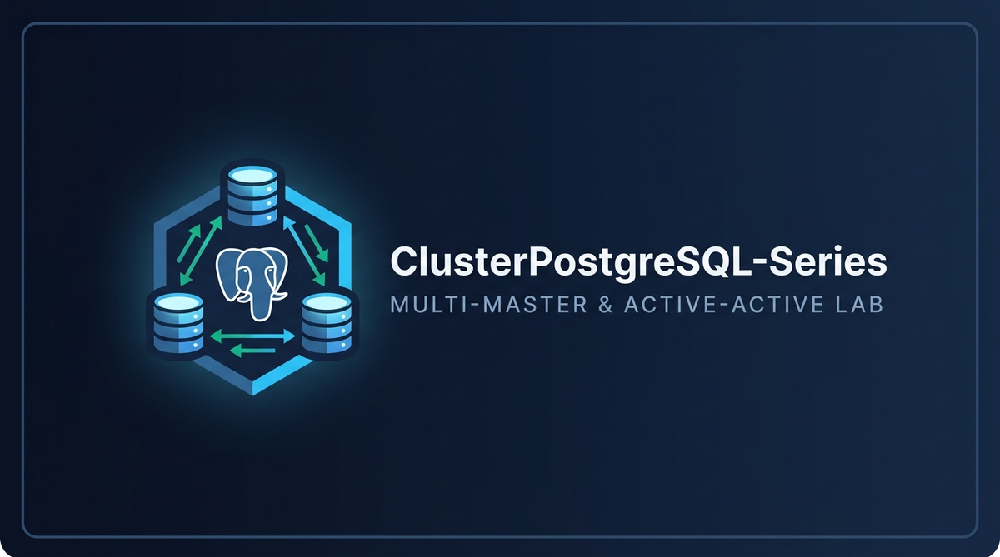
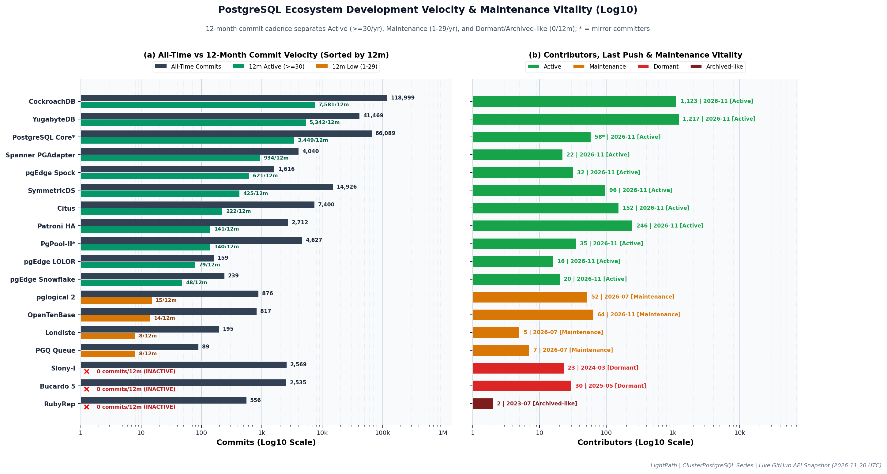
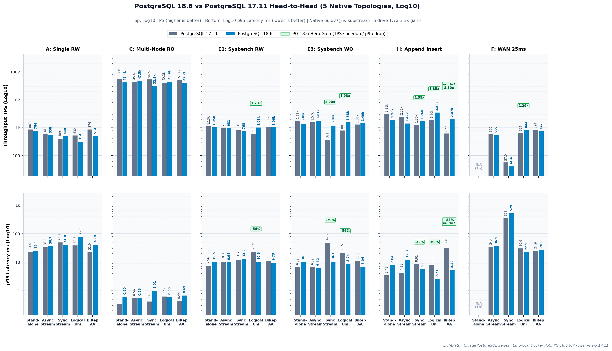
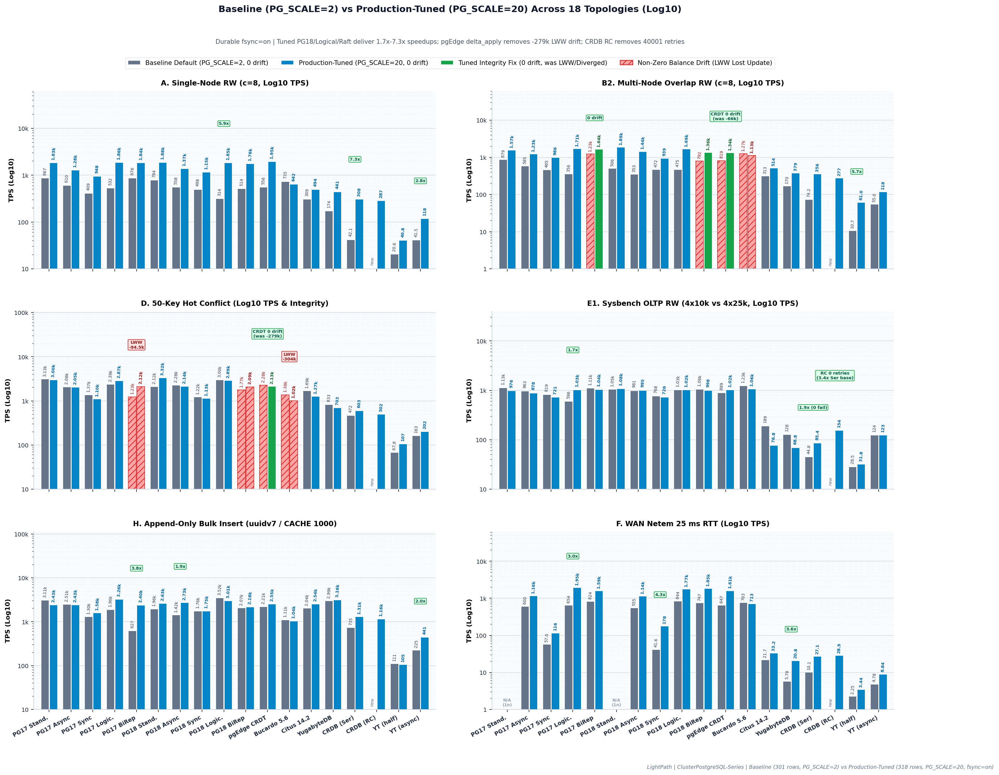

<p align="center">
  
</p>

# ClusterPostgreSQL-Series : Étude comparative, PoCs reproductibles et benchmarks PostgreSQL Multi-Maîtres

> **Auteur** : Jean-Marie Renouard (`jmrenouard`) | **Soutenu par** : [LightPath](https://www.lightpath.fr) | **Licence** : MIT | [English Version (`README.md`)](README.md)

Étude d'ingénierie reproductible sur **16 solutions PostgreSQL** (7 familles, **19 fiches d'architecture**) et **18 topologies Docker opérationnelles** (`10` PG 17/distribuées + `5` PostgreSQL 18.6 + `2` YT Cluster 1.21.3 + `cockroach-rc` via [`jmrenouard/multi-db-docker-env`](https://github.com/jmrenouard/multi-db-docker-env) `v2.6.1`, `13` piles), incluant **18 tests fonctionnels/limites (`L1–L8` + `T11–T18`)** plus les sondes PG 18.6 AIO/`uuidv7()`/conflits et `T_REVERT` YT Cluster, **628 mesures empiriques brutes** (**310 baseline `PG_SCALE=2`** / **301 dédupliquées** + **318 V5 optimisées `PG_SCALE=20`** : `pgbench -M prepared`, `sysbench`, `tc netem 10/25/50 ms`, `c=1..32`), **22 entrées de télémétrie GitHub** (`19` dépôts publics + `3` fermés/managés), **13 graphiques `log10`** et l'[**Explorateur HTML interactif hors-ligne (`dashboard/index.html`)**](dashboard/index.html).

---

## 1. Synthèse des résultats empiriques (`PG_SCALE = 2`)

Tous les tests ont été exécutés séquentiellement sur hôte Docker WSL2 (20 vCPU, 16,4 Go RAM) à l'intérieur d'un pont réseau Docker isolé (sans biais NAT Windows), avec clé primaire artificielle sur `pgbench_history`.

| Topologie | Famille (`#`) | Suite A : Single RW (TPS) | Suite B2 : Overlap RW (TPS) | Suite D : Hot 50c (TPS) | Dérive solde (`Suite D`) | Suite E : `sysbench` (TPS) | Suite F : `netem 25ms` (TPS) | Limites `SQLSTATE` vérifiées |
|:---|:---|---:|---:|---:|---:|---:|---:|:---|
| **`pg17-standalone`** | Baseline (`#15`) | 866,82 | 879,01 | 3 128,63 | **0** | 1 129,51 | N/A | `23505` |
| **`pg17-async-streaming`** | Stream Async (`#15`) | 610,15 | 584,80 | 2 081,26 | **0** | 962,84 | **599,61** | `25006` RO ; seq `66\|true` |
| **`pg17-sync-streaming`** | Stream Sync (`#15`) | 409,48 | 465,22 | 1 370,10 | **0** | 819,36 | **57,00** (-86 %) | `23505`, `25006` |
| **`pg17-logical`** | Logique Uni (`#16`) | 532,38 | 355,57 | 2 386,93 | **0** | 595,81 | **654,11** | `55000`, piège seq `23505` |
| **`pg-birep`** | Logique natif (`#1`) | 875,91 | 1 228,60 | 1 231,15 | **-71 063** (Diverge) | 1 105,32 | **824,04** | `23505`, `55000` |
| **`pgedge` (LWW)** | Extension (`#2`) | 556,06 | 818,65 | 2 280,11 | **-278 698** (Lost Upd.) | 888,56 | **646,77** | `23505` (`transdiscard`) |
| **`pgedge-delta-apply`** | CRDT (`#2`) | - | - | **1 837,64** | **0** (Exact x3 nœuds) | - | - | Protège `+delta` |
| **`bucardo`** | Triggers Perl (`#9`) | 735,38 | 1 267,77 | 1 378,79 | **-531 620** (Lost Upd.) | 1 232,84 | **763,23** | `23505`, rejet sans PK |
| **`citus`** | Sharding MPP (`#7`) | 309,04 | 312,98 | 1 691,45 | **0** | 189,44 | **21,67** (-93 %) | `0A000`, `40001` |
| **`yugabyte`** | Raft DocDB (`#5`) | 173,64 | 170,19 | 832,65 | **0** | 128,24 | **5,78** (-97 %) | `40001`, `23505`, `0A000` |
| **`cockroach`** | Raft Pebble (`#6`) | 42,08 | 74,17 | 471,61 | **0** | 44,84 | **10,06** (-76 %) | `40001`, `XCEXF`, `42601`, `57014` |

### Topologies cibles PostgreSQL 18.6 (`results/benchmark_pg18.csv`, `PG_SCALE = 2`)

Mesures séquentielles dans le même harnais Docker isolé sur `PostgreSQL 18.6 (Debian 18.6-1.pgdg13+2)` avec `io_method=worker` (`io_workers=3`) et `data_checksums=on` par défaut (voir [Fiche #17](docs/fr/solutions/pg18_native_clustering.md) et [Chapitre 12](docs/fr/12_clustering_postgresql_18_et_benchmarks.md)) :

| Topologie (`#17` PG 18.6) | `A_single_rw` (TPS) | `B2_overlap_rw` TPS (`Dérive`) | `D_hot_conflict` TPS (`Dérive`) | `E_sysbench_oltp_rw` TPS (`Échecs`) | `H_append_only_insert` (TPS) | `F_wan_netem_25ms` (TPS) | Limites `SQLSTATE` vérifiées |
|:---|---:|---:|---:|---:|---:|---:|:---|
| **`pg18-standalone`** | 784,43 | 506,21 (`0`) | 2 117,66 (`0`) | 1 046,67 (`74`) | 1 956,76 | N/A | `23505`, `42601` (`FOR ALL SEQUENCES`) |
| **`pg18-async-streaming`** | 558,34 | 353,30 (`0`) | 2 277,43 (`0`) | 980,72 (`75`) | 1 423,07 | **554,93** | `25006` RO ; WAL seq `66\|true` |
| **`pg18-sync-streaming`** | 497,94 | 472,20 (`0`) | 1 223,75 (`0`) | 767,63 (`76`) | 1 760,26 | **41,56** | `25006`, gel `SyncRep`, `25,60` @ `50ms` |
| **`pg18-logical`** | 314,26 | 475,08 (`0`) | 2 998,37 (`0`) | 1 027,84 (`79`) | **3 518,49** | **844,10** | `23505`, `42601`, `55000` (`substream=p`) |
| **`pg18-birep`** (`uuidv7()`) | 514,28 | 792,45 (**`-338`**) | 1 774,11 (**`-83 252`**) | 1 055,55 (`76`) | **2 066,70** (`3,30x`) | **747,42** | `23503`, `23505`, `42601`, `55000`, 7 `confl_*` |
| **`yt-cluster`** (`#18` `cc=half`) | 20,63 | 10,69 (`0`) | 67,76 (`0`) | 28,48 (`12`) | 110,53 | 2,25 | `0A000`, `40001`, `55409`, `57P03` (`T_REVERT` OK) |
| **`yt-cluster-async`** (`#18` `nodes>=0`) | 41,45 | 55,03 (`0`) | 163,01 (`0`) | 124,05 (`34`) | 224,93 | 4,78 | `40001`, `55000`, `55409` (`2,0x-5,1x` vs `half`, dérive `0`) |

*Note : `yt-cluster` / `yt-cluster-async` exécutés sur 3 nœuds `dbinvent/yt:1.21.3` (PG 18.7 + `yt_cluster 1.21` / `ytserv`, `results/benchmark_yt_cluster.csv`, `36` lignes sur les 18 suites ; voir [Fiche #18](docs/fr/solutions/yt_cluster_lite.md) et [Chapitre 06 §7](docs/fr/06_resultats_tests_et_benchmarks.md)).*

---

## 1b. Explorateur HTML interactif et graphiques logarithmiques (`log10`)

Ouvrez [**`dashboard/index.html`**](dashboard/index.html) hors-ligne dans tout navigateur (**bascule Baseline `PG_SCALE=2` (`301` lignes) / Optimisé Production `PG_SCALE=20` (`318` lignes)**, vue comparée Avant/Après `compare`, sélecteur 18 topologies dont `YT vs Multi-Maître`, bascule `log10`/linéaire, interface EN/FR, matrices `L1–L8` / `T11–T18` / `PG 18.6` / `YT`, onglet Popularité à 22 entrées, export CSV) ou consultez les **13 graphiques** et la matrice de traçabilité complète dans les [Chapitre 09](docs/fr/09_methodologie_benchmarks_et_graphiques.md) (`chart_01`–`07`), [Chapitre 11](docs/fr/11_popularite_et_vitalite_ecosysteme.md) (`chart_08`–`09`), [Chapitre 12](docs/fr/12_clustering_postgresql_18_et_benchmarks.md) (`chart_10`), [Chapitre 06 §7–§8](docs/fr/06_resultats_tests_et_benchmarks.md) (`chart_11`) et [**Chapitre 13 — Optimisation Production (`PG_SCALE=20`)**](docs/fr/13_optimisation_production_et_benchmarks_realistes.md) (`chart_12`–`13`) :

> **Explorateur GitHub Pages & Sélecteur PACELC :** Accédez à l'[**Explorateur GitHub Pages**](https://jmrenouard.github.io/ClusterPostgreSQL-Series/) (workflow Pages suivi dans `#506`) ou ouvrez l'onglet **Sélecteur PACELC** en local pour classer les 17 topologies + variantes V5/CRDT selon `RPO`, `WAN RTT`, conflits d'écriture et `TCO`, avec commandes `Makefile` / `./mdb` copiables et liens fiches EN/FR.








> **Synthèse V5 Optimisé (`PG_SCALE=20`, `318` lignes, `fsync=on`, `v2.6.1`) :** L'activation des réglages durables (`fillfactor=90`, `wal_compression=lz4`, PG 18/YT `io_method=worker`/`4`, `-M prepared`, chauffe `5s`, Spock `delta_apply`, Citus 1-shard, Yugabyte `RC + CACHE 1000` + HAProxy `:15470`, CockroachDB `v25.4` HAProxy `:15480` + rôle `bench` `cockroach-rc`, YT `YT_MAX_PREPARED=300` + `ytctl` parallèle + affinité Leader + hook Lua `55409`) propulse `pg18-birep` `G_c32` à `4 163,31 TPS`, maintient `pgedge` à **`0` dérive** (`2 125,19 TPS` `D`), accélère CockroachDB `v25.4` de **`7,32x`** en `A` (`307,95 TPS`) avec `0` retry `40001` pour `cockroach-rc` en `sysbench` (`153,70 TPS`), et porte `yt-cluster-async` `E4` à **`189 286,48 TPS`** (`0` dérive) — voir [Chapitre 13](docs/fr/13_optimisation_production_et_benchmarks_realistes.md).

### Trois conclusions clés
1. **L'illusion de la performance asynchrone** : En écriture concurrente sur des clés partagées (`B2` et `D`), les solutions asynchrones LWW sans CRDT perdent silencieusement jusqu'à **50,8 %** des mises à jour (`bucardo`: `-531 620`) ou divergent (`pg-birep`: `-71 063`). Seul **`spock.delta_apply`** (`#2`) préserve une dérive `0` à 1 837,64 TPS sur compteurs numériques.
2. **Le mur physique de la latence WAN** : L'injection de 25 ms de latence (`Suite F`) effondre tous les moteurs **PC/EC** (`yugabyte` à 5,78 TPS, `cockroach` à 10,06 TPS, `citus` à 21,67 TPS, `pg17-sync-streaming` à 57,00 TPS), tandis que les piles asynchrones **PA/EL** restent entre 646 et 824 TPS localement.
3. **La robustesse du mono-primaire** : Hors besoin impératif d'écriture multi-régions à faible latence ou de sharding horizontal massif, **Patroni + etcd + HAProxy (`#15`)** demeure le seul modèle offrant 100 % de compatibilité PostgreSQL (`PostGIS`, `pgvector`, `SERIAL`, `LISTEN/NOTIFY`, `pg_advisory_lock`, PITR `pgBackRest`) sans conflit Write-Write.

---

## 2. Plan complet de l'étude (Français / Anglais)

| # | Document Français (`docs/fr/`) | Document Anglais (`docs/en/`) | Thème couvert |
|:-:|:---|:---|:---|
| **01** | [Synthèse exécutive et taxonomie](docs/fr/01_synthese_et_taxonomie.md) | [Executive Summary & Taxonomy](docs/en/01_executive_summary_and_taxonomy.md) | Problématique WAL unique, taxonomie 7 familles / 15 solutions, Mermaid |
| **02** | [Fondements théoriques (CAP, PACELC, conflits)](docs/fr/02_fondements_theoriques_cap_pacelc_conflits.md) | [Theoretical Foundations](docs/en/02_theoretical_foundations_cap_pacelc_conflicts.md) | CAP/PACELC, 4 classes de conflits, équations RPO/RTO, RTT WAN, HLC |
| **03a** | [Catalogue : natif PG, extensions et baselines](docs/fr/03a_catalogue_natif_et_extensions.md) | [Native & Extension Solutions](docs/en/03a_solutions_native_and_extensions.md) | `#1` PG natif, `#2` pgEdge/Spock 5, `#3` pglogical 2, `#4` EDB PGD (Com.), `#15` Baselines |
| **03b** | [Catalogue : SQL distribué, MPP, triggers, Cloud](docs/fr/03b_catalogue_distribue_triggers_cloud.md) | [Distributed, Triggers & Cloud](docs/en/03b_solutions_distributed_triggers_cloud.md) | `#5` Yugabyte, `#6` Cockroach, `#7` Citus, `#8` OpenTenBase, `#9`–`#14` Triggers/Proxys/Cloud |
| **04** | [Étude comparative fonctionnelle (36 critères)](docs/fr/04_etude_comparative_fonctionnalites.md) | [Feature Comparison (36 Criteria)](docs/en/04_comprehensive_feature_comparison.md) | 5 matrices croisant les 15 solutions sur 36 critères techniques |
| **05** | [Architectures PoC et protocole de test](docs/fr/05_architectures_poc_et_protocole_de_test.md) | [PoC Architectures & Test Protocol](docs/en/05_poc_architectures_and_test_protocol.md) | Hôte WSL2, réseau Docker isolé, surrogate PK, protocoles 10/8 points, biais |
| **06** | [Résultats empiriques des tests et benchmarks](docs/fr/06_resultats_tests_et_benchmarks.md) | [Empirical Test & Benchmark Results](docs/en/06_empirical_test_and_benchmark_results.md) | Suites A–F (`pgbench`, `sysbench`, `netem 25ms`), `delta_apply`, dérives |
| **07** | [Guide de choix, anti-patterns et architecture](docs/fr/07_guide_de_choix_et_architecture_cible.md) | [Decision Framework & Guide](docs/en/07_decision_framework_and_production_guide.md) | Arbre de décision Mermaid, 5 anti-patterns, dimensionnement, PITR, migration |
| **08** | [Limites empiriques et modes de défaillance](docs/fr/08_limites_et_modes_de_defaillance.md) | [Limits & Failure Modes](docs/en/08_limits_and_failure_modes.md) | Catalogue `L1`–`L8` + `T11`–`T18`, `SQLSTATE` vérifiés (`23505`, `55000`, `40001`, `25006`) |
| **09** | [Méthodologie benchmarks et graphiques Log10](docs/fr/09_methodologie_benchmarks_et_graphiques.md) | [Benchmarks Methodology & Charts](docs/en/09_benchmarks_methodology_and_charts.md) | Protocole `pgbench`/`sysbench`/`netem`, échelles `log10`, 7 PNG et `dashboard/` |
| **10** | [Streaming Physique vs Logique vs Multi-Maîtres](docs/fr/10_comparatif_streaming_logique_multimaster.md) | [Streaming vs Logical vs Multi-Master](docs/en/10_streaming_vs_logical_vs_multimaster.md) | 5 niveaux, matrice 25 critères, piège séquences `23505`, upgrades PG 15->17->18 |
| **11** | [Popularité, Présence Git et Vitalité de l'Écosystème](docs/fr/11_popularite_et_vitalite_ecosysteme.md) | [Ecosystem Popularity & Vitality](docs/en/11_ecosystem_popularity_and_vitality.md) | Télémétrie GitHub API (21 entrées, 18 dépôts publics), étoiles, commits 12m, `chart_08`–`09` |
| **12** | [Évolution du Clustering PostgreSQL 18.6 et Benchmarks](docs/fr/12_clustering_postgresql_18_et_benchmarks.md) | [PostgreSQL 18.6 Clustering & Benchmarks](docs/en/12_postgresql_18_clustering_and_benchmarks.md) | PG 16->17->18, AIO `worker`/`io_uring`, `uuidv7()`, 7 `confl_*`, 87 mesures PG 18.6, `chart_10` |
| **13** | [Optimisation de Production et Benchmarks Réalistes (`PG_SCALE=20`)](docs/fr/13_optimisation_production_et_benchmarks_realistes.md) | [Production Tuning & Realistic Scale Benchmarks](docs/en/13_production_tuning_and_realistic_benchmarks.md) | `fillfactor=90`, `lz4`, `-M prepared`, `delta_apply`, Citus 1-shard, CRDB `v25.4`/RC, YT `v2.6.1`, `chart_12`–`13` |

---

## 2b. Catalogue des solutions et fiches techniques (`19` fiches FR + EN)

Chaque solution étudiée dispose d'une fiche technique dédiée d'environ 1 à 2 pages A4 en français (`docs/fr/solutions/`) et en anglais (`docs/en/solutions/`) incluant schémas Mermaid, principes internes, modes d'implémentation, forces/faiblesses et métriques vérifiées (ou références d'exclusion architecturale).

> **Désambiguïsation des ID (`#16` vs `#14`) :** `pg17-logical` porte l'ID **`#16`** (`N3`, réplication logique unidirectionnelle native), tandis que **`#14`** est réservé aux systèmes historiques à triggers (`Slony-I / Londiste / RubyRep`) ; certains tableaux CSV historiques mentionnent encore `#14 Baseline` pour `pg17-logical`.

| Solution et fiche dédiée | Lien produit / doc | Dépôt GitHub | Description brève |
| :--- | :--- | :--- | :--- |
| **[#1 — PG 17 Logique Bidirectionnelle](docs/fr/solutions/pg17_bidirectional_logical.md)** | [Doc PG 17](https://www.postgresql.org/docs/17/logical-replication-subscription.html) | [`postgres/postgres`](https://github.com/postgres/postgres) | Maillage actif-actif natif PG 16/17+ via `origin = none` (`PA/EL`) sans extension externe, s'arrêtant sur collision `23505` faute de résolution automatique. |
| **[#2 — Plateforme pgEdge / Spock v5](docs/fr/solutions/pgedge_spock.md)** | [Doc pgEdge](https://docs.pgedge.com/) | [`pgEdge/spock`](https://github.com/pgEdge/spock) · [`snowflake`](https://github.com/pgEdge/snowflake) | Extension logique multi-maîtres open-source (`PA/EL`) intégrant résolution `LWW`, colonnes `CRDT` `delta_apply`, identifiants Snowflake et réplication DDL automatique. |
| **[#3 — pglogical 2](docs/fr/solutions/pglogical2.md)** | [Doc pglogical](https://www.enterprisedb.com/docs/pglogical/latest/) | [`2ndQuadrant/pglogical`](https://github.com/2ndQuadrant/pglogical) | Extension historique de réplication logique asynchrone (`PA/EL`) offrant jeux sélectifs, politiques de conflits et `replicate_ddl_command` sans CRDT. |
| **[#4 — EDB Postgres Distributed (PGD/BDR)](docs/fr/solutions/edb_pgd.md)** | [Doc EDB PGD](https://www.enterprisedb.com/docs/pgd/latest/) | Propriétaire / N/A | Plateforme commerciale `bdr` combinant réplication logique asynchrone/CRDT (`PA/EL`) et consensus Raft embarqué (`CAMO`, Eager, Write-Lead `PC/EC`) via `pgd-proxy`. |
| **[#5 — YugabyteDB (YSQL + DocDB)](docs/fr/solutions/yugabytedb.md)** | [Doc YugabyteDB](https://docs.yugabyte.com/) | [`yugabyte/yugabyte-db`](https://github.com/yugabyte/yugabyte-db) | SGBD SQL distribué (`PC/EC`) associant un fork C PostgreSQL (`YSQL`) au moteur transactionnel `DocDB` Raft par tablet (`RF=3`), horloge HLC et `READ COMMITTED` pessimiste. |
| **[#6 — CockroachDB](docs/fr/solutions/cockroachdb.md)** | [Doc CockroachDB](https://www.cockroachlabs.com/docs/stable/) | [`cockroachdb/cockroach`](https://github.com/cockroachdb/cockroach) | Moteur SQL distribué en Go compatible `pgwire` sur stockage `Pebble` Multi-Raft (`RF=3`, `PC/EC`), imposant l'isolation stricte `SERIALIZABLE` (boucles `40001`). |
| **[#7 — Citus](docs/fr/solutions/citus.md)** | [Doc Citus](https://docs.citusdata.com/en/stable/) | [`citusdata/citus`](https://github.com/citusdata/citus) | Extension pure PostgreSQL de sharding horizontal (`PC/EC`) orchestrant Coordinateur et Workers par hachage, 2PC distribué, tables de référence et routage `Citus MX`. |
| **[#8 — OpenTenBase / Postgres-XL / XC](docs/fr/solutions/opentenbase_pgxl.md)** | [Doc OpenTenBase](https://docs.opentenbase.org/) | [`OpenTenBase/OpenTenBase`](https://github.com/OpenTenBase/OpenTenBase) | Fork MPP *shared-nothing* (`PC/EC`) articulé autour de Coordinateurs, Datanodes shardés et d'un *Global Transaction Manager* (`GTM`) pour MVCC/2PC global (XC retiré, XL gelé). |
| **[#9 — Bucardo 5](docs/fr/solutions/bucardo.md)** | [Site Bucardo](https://bucardo.org/) | [`bucardo/bucardo`](https://github.com/bucardo/bucardo) | Daemon Perl externe (`PA/EL`) capturant les mutations par triggers `PL/Perl` dans `bucardo_delta` pour une synchronisation multi-maîtres asynchrone (PK obligatoire). |
| **[#10 — SymmetricDS](docs/fr/solutions/symmetricds.md)** | [Doc SymmetricDS](https://symmetricds.org/docs/overview/) | [`jumpmindinc/symmetric-ds`](https://github.com/jumpmindinc/symmetric-ds) | Moteur Java JVM asynchrone par triggers (`PA/EL`) accumulant les changements dans `sym_data` pour la synchronisation hétérogène par lots HTTP/HTTPS. |
| **[#11 — PgPool-II](docs/fr/solutions/pgpool_ii.md)** | [Doc PgPool-II](https://www.pgpool.net/docs/latest/en/html/) | [`pgpool/pgpool2`](https://github.com/pgpool/pgpool2) | Proxy SQL en C gérant répartition de charge et HA Watchdog en `streaming_replication` mono-primaire, ainsi que les modes diffusion SQL et `snapshot_isolation` (`PC/EC`). |
| **[#12 — AWS Aurora Limitless (& MM v1)](docs/fr/solutions/aws_aurora_limitless.md)** | [Doc AWS Limitless](https://docs.aws.amazon.com/AmazonRDS/latest/AuroraUserGuide/limitless.html) | Propriétaire / N/A | Moteur shardé managé AWS (`PC/EC`) associant *Transaction Routers*, *Data Access Shards*, quorum stockage 4/6 AZ et MVCC Time Sync 2PC (succédant à Aurora MM v1 retiré). |
| **[#13 — GCP Spanner PG & AlloyDB](docs/fr/solutions/gcp_spanner_alloydb.md)** | [Spanner PG](https://cloud.google.com/spanner/docs/postgresql-interface) · [AlloyDB](https://cloud.google.com/alloydb/docs) | Propriétaire / N/A | Distingue l'interface PG de Cloud Spanner (`PGAdapter`, Multi-Paxos + TrueTime `PC/EC`) du modèle mono-primaire à stockage désagrégé d'AlloyDB. |
| **[#14 — Systèmes historiques à triggers (EOL)](docs/fr/solutions/legacy_triggers.md)** | [Slony-I](https://slony.info/) · [Londiste](https://wiki.postgresql.org/wiki/Londiste_Tutorial_%28Skytools_2%29) | [`slony1-engine`](https://github.com/ssinger/slony1-engine) · [`londiste`](https://github.com/pgq/londiste) · [`rubyrep`](https://github.com/rubyrep/rubyrep) | Réplicateurs historiques pré-`pgoutput` en fin de vie (`PA/EL`) — arbres mono-origine Slony-I/Londiste+PGQ et RubyRep abandonné — conservés à titre de référence historique. |
| **[#15a — PostgreSQL 17 Standalone](docs/fr/solutions/pg17_standalone.md)** | [Doc PG 17](https://www.postgresql.org/docs/17/index.html) | [`postgres/postgres`](https://github.com/postgres/postgres) | Ligne de base mono-écrivain PostgreSQL 17 sur WAL local (`CA`) sans surcharge de réplication, servant à mesurer le coût de coordination multi-maîtres. |
| **[#15b — PG 17 Streaming Physique & Patroni](docs/fr/solutions/pg17_physical_streaming_patroni.md)** | [PG 17 HA](https://www.postgresql.org/docs/17/high-availability.html) · [Patroni](https://patroni.readthedocs.io/en/latest/) | [`postgres/postgres`](https://github.com/postgres/postgres) · [`patroni/patroni`](https://github.com/patroni/patroni) | Streaming physique WAL par blocs mono-primaire (`async` `PA/EL` ou `sync` `PC/EC` `RPO=0`) orchestré par Patroni, `etcd` Raft et HAProxy. |
| **[#16 — PG 17 Logique Unidirectionnelle](docs/fr/solutions/pg17_logical_unidirectional.md)** | [Doc PG 17 Logique](https://www.postgresql.org/docs/17/logical-replication.html) | [`postgres/postgres`](https://github.com/postgres/postgres) | Réplication logique native unidirectionnelle par publication/abonnement (`pgoutput`, `PA/EL`) découplant stockage et versions majeures (`N3`, upgrades sans coupure). |
| **[#17 — Clustering Natif PostgreSQL 18.6 (AIO, uuidv7, Streaming & Logique)](docs/fr/solutions/pg18_native_clustering.md)** | [Doc PG 18](https://www.postgresql.org/docs/18/index.html) | [`postgres/postgres`](https://github.com/postgres/postgres) | Pile cible native PG 18.6 sur les 5 niveaux ajoutant AIO `worker`, `data_checksums=on`, clés `uuidv7()` actif-actif, 7 compteurs `confl_*`, `substream=p` et report `42601` de synchro des séquences. |
| **[#18 — YT Cluster & YT Cluster Lite](docs/fr/solutions/yt_cluster_lite.md)** | [Aperçu YT](https://dbinvent.com/30p) · [Docker Hub](https://hub.docker.com/r/dbinvent/yt) · [agent.md](https://dbinvent.com/agent.md) · [Jepsen](https://dbinvent.com/cluster/articles/jepsen) | [`DBinvent/yt-cluster-lite`](https://github.com/DBinvent/yt-cluster-lite) | PG 18 non modifié + triggers + daemon Rust `ytserv` XA 2PC (`cc=half`), dérive zéro (`55409`/`40001`), réversibilité `DROP EXTENSION` ; feuille/ext embarquée MIT vs `dbinvent/yt` PolyForm/Commercial. |

---

## 3. Démarrage rapide, sous-module `multi-db-docker-env` et `Makefile`

Les piles opérationnelles, la suite étendue (`T11–T18`) et les benchmarks V2 s'appuient exclusivement sur le dépôt [`jmrenouard/multi-db-docker-env`](https://github.com/jmrenouard/multi-db-docker-env) intégré comme sous-module Git sous **`env/multi-db-docker-env`** (voir [`stacks/README.md`](stacks/README.md) pour la délégation source unique de vérité et `results/` pour les jeux de données bruts).

### Commandes `Makefile` essentielles

```bash
make init-env        # Initialise le sous-module Git env/multi-db-docker-env (13 piles; harnais v2.6.1)
make test && make lint  # Valide gouvernance, sécurité, LaTeX, 13 graphiques, Bash et 13 Compose
cp .env.example .env
make build-bench-image  # Construit multi-db-pgbench-sysbench:latest (scripts/Dockerfile.bench)
make up-pgedge && make test-pgedge && make down-pgedge
make bench-all && make bench-pg18 && make bench-yt-cluster && make bench-optimized && make popularity && make charts && make dashboard
make pages-build && make pages-check  # Génère et vérifie le bundle statique hors-ligne GitHub Pages (_site/)
```

### Piles Docker disponibles (`env/multi-db-docker-env` `v2.6.1` — voir [`stacks/README.md`](stacks/README.md))

- `pg17-baseline` / `pg-streaming` / `pg-logical` (Standalone, Streaming Async/Sync, Logique Uni PG 17)
- `pg-birep` (`#1` PG 17 natif `origin = none`), `pgedge-spock` (`#2` Spock 5 + Snowflake), `bucardo` (`#9` Bucardo 5.6)
- `citus` (`#7` Citus 14.2), `yugabytedb` (`#5` YugabyteDB 2026.1.3 RF=3 + HAProxy `:15470`), `cockroachdb` (`#6` CockroachDB `v25.4.21` RF=3 + HAProxy `:15480` + `cockroach-rc`)
- `pg18-streaming` / `pg18-logical` / `pg18-birep` (PostgreSQL 18.6 : Standalone, Async/Sync, Logique Uni, BiRep `uuidv7()`)
- `yt-cluster` (`#18` YT Cluster 1.21.3 sur PG 18.7 : 3 nœuds `dbinvent/yt:1.21.3` XA 2PC `cc=half` / `nodes>=0`)

Les sorties brutes sont publiées dans `results/` (`benchmark_summary.csv`, `benchmark_extended_workloads.csv`, `benchmark_wan_sweep.csv`, `benchmark_concurrency_sweep.csv`, `benchmark_pg18.csv`, `benchmark_yt_cluster.csv`, `benchmark_optimized.csv`, `functional_limits_matrix.csv`, `extended_functional_matrix.csv`, `functional_limits_pg18.csv`, `functional_limits_yt_cluster.csv`, `project_popularity.csv`).

---

## 4. Transparence méthodologique et gouvernance

- **Honnêteté expérimentale** : Les échecs et limitations (`XCEXF`, `0A000`, `55000`, `42601`, `57014`, perte de mises à jour en LWW) sont conservés tels quels dans les matrices et analysés sans masquage.
- **Registres vivants** : Les décisions, incidents et pistes d'évolution sont maintenus dans [docs/ACTION_LOGBOOK.md](docs/ACTION_LOGBOOK.md) et [docs/RCA_REGISTER.md](docs/RCA_REGISTER.md).
- **Licence** : Distribué sous licence MIT ([LICENSE](LICENSE)) - Copyright (c) 2026 Jean-Marie Renouard.

---

## 5. Soutien et attribution

Cette série technique open-source indépendante est réalisée par **Jean-Marie Renouard** (`jmrenouard`) sous licence [MIT](LICENSE), avec le soutien technique de **LightPath** :

<p align="center">
  <sub>Soutenu par</sub><br>
  <a href="https://www.lightpath.fr">
    <picture>
      <source media="(prefers-color-scheme: dark)" srcset="assets/lightpath-logo-dark.svg">
      <source media="(prefers-color-scheme: light)" srcset="assets/lightpath-logo-light.svg">
      
    </picture>
  </a>
</p>
