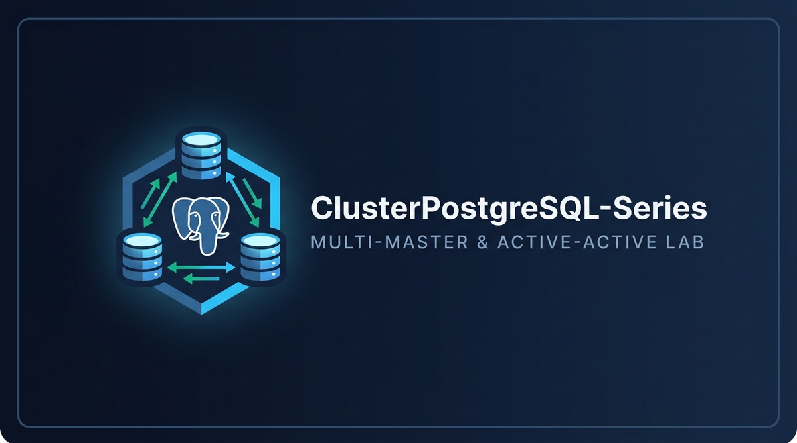
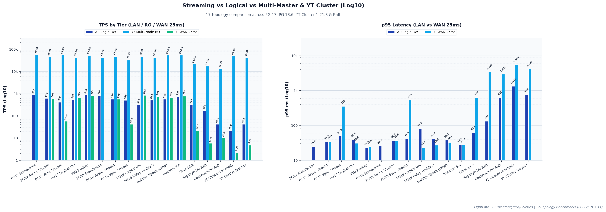

<p align="center">
  
</p>

# ClusterPostgreSQL-Series — PostgreSQL Multi-Master & Active-Active Architectures

**Author:** Jean-Marie Renouard (`jmrenouard`) | **Supported by:** [LightPath](https://www.lightpath.fr) | **License:** [MIT](LICENSE) | **Version française :** [README.fr.md](README.fr.md)

A rigorous engineering study, 36-criterion comparative matrix, reproducible Docker Compose labs (powered by [`jmrenouard/multi-db-docker-env`](https://github.com/jmrenouard/multi-db-docker-env)), 18-test empirical failure-mode catalog (`L1–L8` + `T11–T18`), **187 standardized `pgbench` / `sysbench` / `tc netem` benchmark rows** across **10 live PostgreSQL topologies**, and an offline-capable [**Interactive HTML Benchmark Explorer (`dashboard/index.html`)**](dashboard/index.html).

---

## Executive Summary

PostgreSQL is built on a **single-writer WAL engine** (`LSN`, `XID`, `ProcArray`, local heap pages). Turning PostgreSQL into an "active-active multi-master" system forces an unavoidable trade-off along the **PACELC** spectrum:

- **Asynchronous Logical & Trigger Meshes (`PA/EL`):** Commit locally at sub-15 ms latency even under `50 ms` WAN RTT (`647–824 TPS`), yet lose updates (`-71K` to `-531K` drift in 50-key contention tests) or stall on `SQLSTATE 23505` unless configured with **CRDT Delta-Apply** (`spock.delta_apply` achieved `1,837.64 TPS` with **`0` drift**).
- **Distributed Consensus Raft/Paxos (`PC/EC`):** Guarantee `RPO = 0` and zero lost updates (`0` drift), while paying cross-node RTT penalties (`-76%` to `-97%` TPS drop under simulated `25 ms` one-way WAN delay) and requiring application-level `SQLSTATE 40001` retry loops (`sysbench` failed `685` of `1,587` total attempts on CockroachDB without retries).
- **Single-Primary HA Control (`#15 Patroni + etcd`):** Remains the lowest-TCO, zero-conflict optimal choice for 80%+ of OLTP workloads.

---

## Empirical Benchmark & Limits Headline Matrix (`PG_SCALE = 2`)

Executed sequentially inside isolated Docker bridge networks on a 20-vCPU / 16.4 GiB host (`results/benchmark_summary.csv`, `results/functional_limits_matrix.csv`):

| Topology (Solution #) | Suite A Single RW (TPS) | Suite B2 Overlap RW (TPS) | Suite D Hot Conflict TPS (`Drift`) | Suite E `sysbench` TPS (`Failed`) | Suite F WAN `25ms` TPS | Verified SQLSTATE Limits |
| :--- | :---: | :---: | :---: | :---: | :---: | :--- |
| **`pg17-standalone` (#15)** | `866.82` | `879.01` | `3,128.63` (`0`) | `1,129.51` (`112`) | N/A | `23505` (Single writer) |
| **`pg17-async-streaming` (#15)** | `610.15` | `584.80` | `2,081.26` (`0`) | `962.84` (`107`) | **`599.61`** (`-2%`) | `25006` RO; WAL seq `66\|true` |
| **`pg17-sync-streaming` (#15)** | `409.48` | `465.22` | `1,370.10` (`0`) | `819.36` (`118`) | **`57.00`** (`-86%`) | `23505; 25006`; `25.8` @ `50ms` |
| **`pg17-logical` (#16 Uni)** | `532.38` | `355.57` | `2,386.93` (`0`) | `595.81` (`65`) | **`654.11`** (`0%`) | `55000`; seq trap `23505`; `T12` diverge |
| **`pg-birep` (#1 Native)** | `875.91` | `1,228.60` | `1,231.15` (**`-71,063`**) | `1,105.32` (`96`) | **`824.04`** (`-6%`) | `23505` halt; `55000` keyless |
| **`pgedge` (#2 Spock LWW)** | `556.06` | `818.65` | `2,280.11` (**`-278,698`**) | `888.56` (`114`) | **`646.77`** (`0%`) | `23505` transdiscard; LWW loss |
| **`pgedge-delta-apply` (#2 CRDT)** | — | — | **`1,837.64` (`0` drift)** | — | — | Zero drift on delta columns |
| **`bucardo` (#9 Trigger)** | `735.38` | `1,267.77` | `1,378.79` (**`-531,620`**) | `1,232.84` (`112`) | **`763.23`** (`0%`) | PK req; `23505` sync stall |
| **`citus` (#7 Sharded 2PC)** | `309.04` | `312.98` | `1,691.45` (`0`) | `189.44` (`9`) | **`21.67`** (`-93%`) | `0A000` non-dist `UNIQUE`; `40001` |
| **`yugabyte` (#5 DocDB Raft)** | `173.64` | `170.19` | `832.65` (`0`) | `128.24` (`0`) | **`5.78`** (`-97%`) | `40001` (`RR`); `0A000` `LISTEN`; `2/3` halt |
| **`cockroach` (#6 Pebble Raft)** | `42.08` | `74.17` | `471.61` (`0`) | `44.84` (**`685`**) | **`10.06`** (`-76%`) | `40001`; `XCEXF`; `42601`; `57014` (`2/3`) |

---

## Interactive Benchmark Explorer & Logarithmic Charts (`log10`)

Open [**`dashboard/index.html`**](dashboard/index.html) directly in any browser (zero CDN, offline-ready, EN/FR switcher, multi-solution pills, default `log10` / linear toggle, `L1–L8` + `T11–T18` matrix tab, and CSV export) or browse the full 7-chart gallery in [Chapter 09](docs/en/09_benchmarks_methodology_and_charts.md):




---

## Complete Study Navigation (English & French)

| Chapter | English (`docs/en/`) | Français (`docs/fr/`) |
| :--- | :--- | :--- |
| **01 — Taxonomy** | [01 — Executive Summary & Taxonomy](docs/en/01_executive_summary_and_taxonomy.md) | [01 — Synthèse et taxonomie](docs/fr/01_synthese_et_taxonomie.md) |
| **02 — Theory** | [02 — CAP, PACELC & Conflict Calculus](docs/en/02_theoretical_foundations_cap_pacelc_conflicts.md) | [02 — Fondements théoriques & conflits](docs/fr/02_fondements_theoriques_cap_pacelc_conflits.md) |
| **03a — Native/Ext** | [03a — Native Logical, Extensions & Baselines](docs/en/03a_solutions_native_and_extensions.md) | [03a — Solutions natives & extensions](docs/fr/03a_catalogue_natif_et_extensions.md) |
| **03b — Dist/Cloud** | [03b — Distributed SQL, Triggers & Cloud](docs/en/03b_solutions_distributed_triggers_cloud.md) | [03b — SQL distribué, triggers & cloud](docs/fr/03b_catalogue_distribue_triggers_cloud.md) |
| **04 — Matrices** | [04 — 36-Criterion Feature Comparison](docs/en/04_comprehensive_feature_comparison.md) | [04 — Étude comparative (36 critères)](docs/fr/04_etude_comparative_fonctionnalites.md) |
| **05 — Protocol** | [05 — PoC Architectures & Test Protocol](docs/en/05_poc_architectures_and_test_protocol.md) | [05 — Architectures PoC & protocole](docs/fr/05_architectures_poc_et_protocole_de_test.md) |
| **06 — Benchmarks** | [06 — Empirical Test & Benchmark Results](docs/en/06_empirical_test_and_benchmark_results.md) | [06 — Résultats de tests & benchmarks](docs/fr/06_resultats_tests_et_benchmarks.md) |
| **07 — Guide** | [07 — Decision Framework & Production Guide](docs/en/07_decision_framework_and_production_guide.md) | [07 — Guide de choix & architecture cible](docs/fr/07_guide_de_choix_et_architecture_cible.md) |
| **08 — Limits** | [08 — Limits & Failure Modes Catalog](docs/en/08_limits_and_failure_modes.md) | [08 — Limites & modes de défaillance](docs/fr/08_limites_et_modes_de_defaillance.md) |
| **09 — Charts** | [09 — Benchmarks Methodology & Log10 Charts](docs/en/09_benchmarks_methodology_and_charts.md) | [09 — Méthodologie benchmarks & graphiques](docs/fr/09_methodologie_benchmarks_et_graphiques.md) |
| **10 — 5-Tier** | [10 — Streaming vs Logical vs Multi-Master](docs/en/10_streaming_vs_logical_vs_multimaster.md) | [10 — Streaming vs Logique vs Multi-Maîtres](docs/fr/10_comparatif_streaming_logique_multimaster.md) |

---

## Solutions Catalog & Architecture Sheets (`17` EN + FR Deep Dives)

Every solution evaluated in this study has a dedicated ~1–2 A4 architecture sheet in English (`docs/en/solutions/`) and French (`docs/fr/solutions/`) with Mermaid diagrams, operating principles, implementation modes, strengths/weaknesses, and verified metrics or architectural exclusion baselines.

> **Catalog ID Disambiguation (`#16` vs `#14`):** `pg17-logical` uses **`#16`** (`T3`, native uni-directional logical replication), whereas **`#14`** is reserved for Legacy Trigger Systems (`Slony-I / Londiste / RubyRep`); legacy CSV tables tag `pg17-logical` as `#14 Baseline`.

| Solution & Dedicated Sheet | Product / Docs Link | GitHub Repository | Brief Description |
| :--- | :--- | :--- | :--- |
| **[#1 — PostgreSQL 17 Bidirectional Logical](docs/en/solutions/pg17_bidirectional_logical.md)** | [PG 17 Docs](https://www.postgresql.org/docs/17/logical-replication-subscription.html) | [`postgres/postgres`](https://github.com/postgres/postgres) | Core PG 16/17+ active-active logical mesh using `origin = none` (`PA/EL`) with zero extensions, halting on `23505` PK collisions without autonomous conflict resolution. |
| **[#2 — pgEdge Platform / Spock v5](docs/en/solutions/pgedge_spock.md)** | [pgEdge Docs](https://docs.pgedge.com/) | [`pgEdge/spock`](https://github.com/pgEdge/spock) · [`snowflake`](https://github.com/pgEdge/snowflake) | Open-source logical multi-master extension (`PA/EL`) adding `LWW` resolution, `CRDT` `delta_apply` conflict-free numeric columns, Snowflake IDs, and auto-DDL propagation. |
| **[#3 — pglogical 2](docs/en/solutions/pglogical2.md)** | [pglogical Docs](https://www.enterprisedb.com/docs/pglogical/latest/) | [`2ndQuadrant/pglogical`](https://github.com/2ndQuadrant/pglogical) | Extension-based asynchronous logical replication (`PA/EL`) offering selective replication sets, configurable conflict policies, and `replicate_ddl_command` without CRDTs. |
| **[#4 — EDB Postgres Distributed (PGD/BDR)](docs/en/solutions/edb_pgd.md)** | [EDB PGD Docs](https://www.enterprisedb.com/docs/pgd/latest/) | Proprietary / N/A | Commercial `bdr` multi-master platform pairing async logical replication and CRDTs (`PA/EL`) with embedded Raft consensus (`CAMO`, Eager, Write-Lead `PC/EC`) and `pgd-proxy`. |
| **[#5 — YugabyteDB (YSQL + DocDB)](docs/en/solutions/yugabytedb.md)** | [YugabyteDB Docs](https://docs.yugabyte.com/) | [`yugabyte/yugabyte-db`](https://github.com/yugabyte/yugabyte-db) | Distributed SQL engine (`PC/EC`) pairing a forked PG C `YSQL` query layer with `DocDB` per-tablet Raft consensus (`RF=3`), HLC ordering, and Wait-on-Conflict `READ COMMITTED`. |
| **[#6 — CockroachDB](docs/en/solutions/cockroachdb.md)** | [CockroachDB Docs](https://www.cockroachlabs.com/docs/stable/) | [`cockroachdb/cockroach`](https://github.com/cockroachdb/cockroach) | Clean-room Go distributed SQL engine speaking `pgwire` over `Pebble` Multi-Raft ranges (`RF=3`, `PC/EC`), enforcing strict `SERIALIZABLE` isolation (`40001` retries) by default. |
| **[#7 — Citus](docs/en/solutions/citus.md)** | [Citus Docs](https://docs.citusdata.com/en/stable/) | [`citusdata/citus`](https://github.com/citusdata/citus) | Pure PostgreSQL horizontal sharding extension (`PC/EC`) orchestrating Coordinator + Worker hash shards, 2PC distributed transactions/reference tables, and optional `Citus MX`. |
| **[#8 — OpenTenBase / Postgres-XL / XC](docs/en/solutions/opentenbase_pgxl.md)** | [OpenTenBase Docs](https://docs.opentenbase.org/) | [`OpenTenBase/OpenTenBase`](https://github.com/OpenTenBase/OpenTenBase) | Shared-nothing MPP PostgreSQL fork (`PC/EC`) with stateless Coordinators, sharded Datanodes, and a centralized Global Transaction Manager (`GTM`) for 2PC (XC retired, XL dormant). |
| **[#9 — Bucardo 5](docs/en/solutions/bucardo.md)** | [Bucardo Site](https://bucardo.org/) | [`bucardo/bucardo`](https://github.com/bucardo/bucardo) | External Perl daemon (`PA/EL`) capturing row changes via `PL/Perl` triggers into `bucardo_delta` tables for asynchronous PK-mandatory multi-master batch sync. |
| **[#10 — SymmetricDS](docs/en/solutions/symmetricds.md)** | [SymmetricDS Docs](https://symmetricds.org/docs/overview/) | [`jumpmindinc/symmetric-ds`](https://github.com/jumpmindinc/symmetric-ds) | Java JVM trigger-based asynchronous engine (`PA/EL`) staging changes in `sym_data` for heterogeneous (PG/MySQL/Oracle/SQLite) HTTP/HTTPS edge and mesh batch sync. |
| **[#11 — PgPool-II](docs/en/solutions/pgpool_ii.md)** | [PgPool-II Docs](https://www.pgpool.net/docs/latest/en/html/) | [`pgpool/pgpool2`](https://github.com/pgpool/pgpool2) | C SQL proxy supporting single-primary `streaming_replication` load balancing/Watchdog HA alongside fragile statement-broadcast `replication` and `snapshot_isolation` (`PC/EC`) modes. |
| **[#12 — AWS Aurora Limitless (& MM v1)](docs/en/solutions/aws_aurora_limitless.md)** | [AWS Aurora Limitless Docs](https://docs.aws.amazon.com/AmazonRDS/latest/AuroraUserGuide/limitless.html) | Proprietary / N/A | Managed AWS sharded engine (`PC/EC`) pairing Transaction Routers, Data Access Shards, 4/6 AZ storage quorum, and Time Sync MVCC 2PC (superseding retired Aurora MM v1). |
| **[#13 — GCP Spanner PG & AlloyDB](docs/en/solutions/gcp_spanner_alloydb.md)** | [Spanner PG](https://cloud.google.com/spanner/docs/postgresql-interface) · [AlloyDB](https://cloud.google.com/alloydb/docs) | Proprietary / N/A | Contrasts Spanner PG Interface (`PGAdapter`, Multi-Paxos + TrueTime external consistency `PC/EC`) with AlloyDB's single-primary disaggregated storage and read pools. |
| **[#14 — Legacy Trigger Systems (EOL)](docs/en/solutions/legacy_triggers.md)** | [Slony-I](https://slony.info/) · [Londiste](https://wiki.postgresql.org/wiki/Londiste_Tutorial_%28Skytools_2%29) | [`slony1-engine`](https://github.com/ssinger/slony1-engine) · [`londiste`](https://github.com/pgq/londiste) · [`rubyrep`](https://github.com/rubyrep/rubyrep) | Retired/EOL pre-`pgoutput` trigger/queue replicators (`PA/EL`) — single-origin cascading Slony-I/Londiste+PGQ and abandoned JRuby RubyRep — retained as historical baselines. |
| **[#15a — PostgreSQL 17 Standalone](docs/en/solutions/pg17_standalone.md)** | [PG 17 Docs](https://www.postgresql.org/docs/17/index.html) | [`postgres/postgres`](https://github.com/postgres/postgres) | Single-writer PostgreSQL 17 control baseline using local WAL `fsync` (`CA`) with zero replication overhead to quantify multi-master coordination cost. |
| **[#15b — PG 17 Physical Streaming & Patroni](docs/en/solutions/pg17_physical_streaming_patroni.md)** | [PG 17 HA](https://www.postgresql.org/docs/17/high-availability.html) · [Patroni](https://patroni.readthedocs.io/en/latest/) | [`postgres/postgres`](https://github.com/postgres/postgres) · [`patroni/patroni`](https://github.com/patroni/patroni) | Single-primary physical block-level WAL streaming (`async` `PA/EL` or `sync` `PC/EC` `RPO=0`) orchestrated by Patroni, `etcd` Raft DCS, and HAProxy failover. |
| **[#16 — PG 17 Uni-Directional Logical](docs/en/solutions/pg17_logical_unidirectional.md)** | [PG 17 Logical Docs](https://www.postgresql.org/docs/17/logical-replication.html) | [`postgres/postgres`](https://github.com/postgres/postgres) | Built-in PG 17 `pgoutput` publish/subscribe row replication (`PA/EL`) decoupling storage and major versions (`T3`, zero-downtime upgrades, selective filtering). |

---

## Reproducible Lab Stacks, `multi-db-docker-env` Submodule & `Makefile`

The operational PoC topologies, extended test runners (`T11–T18`), and V2 benchmark harnesses rely exclusively on [`jmrenouard/multi-db-docker-env`](https://github.com/jmrenouard/multi-db-docker-env) mounted as a Git submodule at **`env/multi-db-docker-env`** (see [`stacks/README.md`](stacks/README.md) for the single-source-of-truth mapping and `results/` for raw CSV/JSON datasets):

| Submodule Compose (`env/multi-db-docker-env/`) | Topology | Primary Images |
| :--- | :--- | :--- |
| `docker-compose-pg17-baseline.yml` | PG 17 Standalone & Sync Streaming | `postgres:17` |
| `docker-compose-pg-streaming.yml` / `pg-logical.yml` | PG 17 Async Streaming & Uni-Logical | `postgres:17` |
| `docker-compose-pg-birep.yml` | PG 17 Bidirectional (`origin=none`) + HAProxy | `postgres:17`, `haproxy:2.9-alpine` |
| `docker-compose-pgedge.yml` | 3-Node pgEdge Spock `5.0.14` + Snowflake + HAProxy | `ghcr.io/pgedge/pgedge-postgres:17-spock5-minimal` |
| `docker-compose-bucardo.yml` | 2-Node PG 17 (`plperl`) + Bucardo `5.6.0` Daemon | Custom `postgres:17` + `debian:trixie-slim` |
| `docker-compose-citus.yml` | Citus `14.2.0` (1 Coordinator + 2 Workers) | `citusdata/citus:14.2.0-pg17` |
| `docker-compose-yugabyte.yml` | 3-Node YugabyteDB RF=3 YSQL + DocDB | `yugabytedb/yugabyte:2026.1.3.0-b100` |
| `docker-compose-cockroach.yml` | 3-Node CockroachDB RF=3 Multi-Raft | `cockroachdb/cockroach:v24.3.0` |

### Common Commands

```bash
# Initialize the multi-db-docker-env Git submodule and inspect all Makefile targets
make init-env
make help

# Run unit tests (security, math, chart/dashboard artifacts) and Compose/Bash lint
make test && make lint

# Run topology lifecycle, functional tests, benchmarks, Log10 charts, and HTML dashboard
cp .env.example .env
make up-pgedge && make test-pgedge && make down-pgedge
make bench-all && make charts && make dashboard
```

---

## Governance, Security & Honest Scope

- **Living Registers:** Every engineering decision, bug RCA, dead-end, and simplification is tracked in [`docs/ACTION_LOGBOOK.md`](docs/ACTION_LOGBOOK.md) and [`docs/RCA_REGISTER.md`](docs/RCA_REGISTER.md).
- **Credential Hygiene:** Repository files contain zero real passwords or host paths; lab containers read ephemeral defaults from [`.env.example`](.env.example).
- **Threats to Validity:** Local Docker benchmarks share one 20-vCPU / 16.4 GiB NVMe host; WAN effects were modeled via `tc netem` egress delay (`25 ms`), not independent intercontinental failure domains (see [Chapter 05](docs/en/05_poc_architectures_and_test_protocol.md)).

---

## Support & Attribution

This independent open-source technical series is created by **Jean-Marie Renouard** (`jmrenouard`) under the [MIT License](LICENSE), with engineering and infrastructure support from **LightPath**:

<p align="center">
  <sub>Supported by</sub><br>
  <a href="https://www.lightpath.fr">
    <picture>
      <source media="(prefers-color-scheme: dark)" srcset="assets/lightpath-logo-dark.svg">
      <source media="(prefers-color-scheme: light)" srcset="assets/lightpath-logo-light.svg">
      
    </picture>
  </a>
</p>
