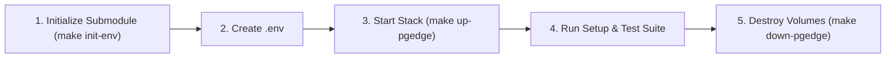

# Tutorial 01: First Docker PoC Lab (pgEdge Spock)

Initialize the Docker lab, boot a two-node pgEdge active-active cluster, run tests, and clean up.



## Prerequisites

- Docker Engine and Docker Compose v2
- `git`, GNU `make`, and free local ports ([Compose Stacks Guide](../../../stacks/README.md))

## Step 1: Initialize Submodule and Environment

```bash
make init-env
cp .env.example .env
make stacks
```

**Expected Output:** `make stacks` prints the `13` available PostgreSQL Compose topologies.

## Step 2: Start and Configure pgEdge

```bash
make up-pgedge
make setup-pgedge
```

**Expected Output:** Both `pgedge` nodes start with `spock` replication active.

## Step 3: Execute Functional Tests

```bash
make test-pgedge
```

**Expected Output:** `env/multi-db-docker-env/tests/test_pgedge.sh` passes all bidirectional insert, update, and conflict checks with exit code `0`.

## Step 4: Clean Up Containers

```bash
make down-pgedge
```

Continue to [Tutorial 02: pgbench & sysbench Lab](02-pgbench-sysbench-lab.md).
