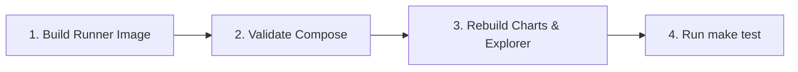

# Tutorial 02: Reproducible pgbench & sysbench Lab

Build the shared benchmark runner image, validate Compose syntax, regenerate charts, and run unit tests.



## Prerequisites

- Complete [Tutorial 01: First Docker PoC Lab](01-first-docker-poc-lab.md)
- Python `3.10+` (`PyYAML`, `matplotlib`)

## Step 1: Build Benchmark Image

Build `multi-db-pgbench-sysbench:latest` from `scripts/Dockerfile.bench`:

```bash
make build-bench-image
```

**Expected Output:** Image builds cleanly with `pgbench`, `sysbench`, and `psycopg`.

## Step 2: Validate Compose Stack

```bash
docker compose -f env/multi-db-docker-env/docker-compose-pg17-baseline.yml config -q
```

**Expected Output:** Command exits with code `0`.

## Step 3: Rebuild Charts, Explorer, and Test Suite

```bash
make charts
make dashboard
make test
```

**Expected Output:** Charts (`assets/charts/chart_01_tps_log_all_suites.png` to `chart_13_*`), `dashboard/index.html`, and all `unittest` checks pass.

Continue to [How-To Guide 01: Run Topology Benchmarks](../02-how-to-guides/01-run-topology-benchmarks.md).
