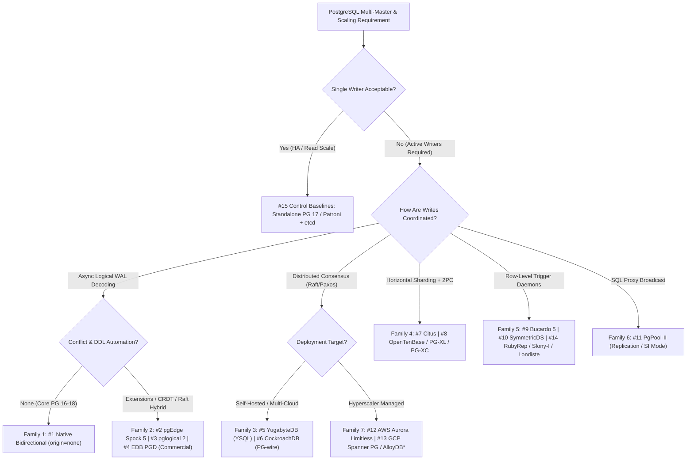

# 01 — Executive Summary and Architectural Taxonomy

**Series:** PostgreSQL Multi-Master & Active-Active Architectures  
**Author:** Jean-Marie Renouard (`jmrenouard`) — [LightPath](https://www.lightpath.fr)  
**License:** MIT License

---

## 1. Executive Summary

PostgreSQL is engineered around a single-writer shared-nothing-by-default storage engine. Every committed modification flows through one sequential Write-Ahead Log (WAL), one cluster-wide transaction identifier (`XID`) allocator, and one local `ProcArray` visibility table. That architecture guarantees ACID integrity and predictable OLTP latency on a single primary node, yet it creates a fundamental tension when organizations require **active-active multi-master writes** across availability zones or continents.

The market offers more than a dozen technologies claiming "PostgreSQL Multi-Master" or "Active-Active" support. In practice, that label conceals four incompatible guarantees:

1. **Asynchronous Eventual Convergence (`AP/EL`)**: Multiple nodes accept local writes independently and ship logical row changes or triggers later. Latency stays local, but concurrent edits to the same key collide and must be resolved via Last-Write-Wins (LWW), CRDTs, or manual intervention.
2. **Distributed Consensus (`CP/EC`)**: Every write passes through a Raft or Paxos quorum before committing. Conflicts are aborted or serialized cleanly, at the cost of cross-node network round-trips (`2 * RTT`) on every commit.
3. **Sharded Shared-Nothing with 2PC (`CP/EC` / `PC/EC`)**: Tables are horizontally partitioned across independent PostgreSQL nodes. Single-shard writes scale linearly, while cross-shard queries and reference tables incur Two-Phase Commit (2PC) overhead.
4. **Statement-Broadcast Middleware**: A proxy intercepts SQL text and replays each statement on every backend node, breaking silently whenever queries invoke non-deterministic functions or concurrent execution orders diverge.

This study evaluates **PostgreSQL 16, 17 (`17.11`), and 18.6** as explicit native clustering targets alongside **16+ architectures across 7 engineering families** (**19 dedicated bilingual solution sheets**), pairing formal distributed-systems theory (CAP, PACELC, conflict calculus) with reproducible Docker Compose proofs-of-concept, empirical breaking-point limits, and **296 standardized `pgbench`/`sysbench`/`tc netem` benchmark rows** (`187` V2 + `87` PostgreSQL 18.6 + `22` YT Cluster 1.21.3).

**PostgreSQL 18.6 Native Leap (`#17`):** Measured live on `PostgreSQL 18.6 (Debian 18.6-1.pgdg13+2)` ([Solution #17](solutions/pg18_native_clustering.md) | [Ch. 12](12_postgresql_18_clustering_and_benchmarks.md)), PG 18.6 introduces native RFC 9562 **`uuidv7()`** active-active primary keys (`50/50` dual-node convergence, `0` `23505` collisions, **`2,066.70 TPS`** = **`3.30x`** BiRep append-only throughput vs PG 17 `627.13 TPS`), asynchronous I/O **`io_method=worker`** (`-18.5%` cold scan latency vs `sync`) with default **`data_checksums=on`**, **7 `confl_*` counters** (`+confl_multiple_unique_conflicts`), and default parallel apply (`substream=p`), while `FOR ALL SEQUENCES` / `REFRESH SEQUENCES` still returns `SQLSTATE 42601` (deferred to PG 19) and automated LWW/CRDT/DDL replication remains outside core.

---

## 2. The Single-Writer Invariant of PostgreSQL Internals

To understand why multi-master PostgreSQL is difficult, examine the invariants enforced inside a standard PostgreSQL 17 instance:

| Subsystem | Single-Primary Invariant | Multi-Master Consequence |
| :--- | :--- | :--- |
| **WAL & `LSN`** | Single monotonically increasing 64-bit byte offset (`pg_lsn`) | Nodes produce disjoint `LSN` timelines; physical byte shipping cannot merge two active writers |
| **Transaction IDs (`XID`)** | Global 32-bit epoch counter protected by `XidGenLock` | Independent nodes assign overlapping `XID`s; snapshot visibility (`xmin`/`xmax`) is strictly node-local |
| **MVCC Heap Tuples** | `t_ctid` chains and `HEAP_XMIN_COMMITTED` hint bits reside in shared buffers | Page-level physical replication fails if two nodes mutate the same 8 KiB heap page simultaneously |
| **System Catalogs** | `pg_class` and `pg_attribute` OIDs allocated locally per cluster | DDL (`ALTER TABLE`) changes physical tuple descriptors; unsynchronized schemas break binary decoding |
| **Sequences** | `nextval()` increments an in-memory/WAL sequence page on one node | Uncoordinated `SERIAL` or `IDENTITY` columns collide immediately (`SQLSTATE 23505`) across active writers |

Physical streaming replication (`walreceiver`) ships raw 8 KiB block images and redo records, forcing every standby into read-only recovery (`pg_is_in_recovery() = true`). Breaking the single-writer barrier therefore requires abandoning physical WAL shipping at the write boundary in favor of **logical WAL decoding (`pgoutput`)**, **row-level triggers**, **statement interception**, or **replacing PostgreSQL's heap/WAL engine with a distributed consensus storage layer**.

---

## 3. Taxonomy of the 7 Architectural Families (15 Solutions)

Every serious PostgreSQL multi-master, sharded, or multi-region contender falls into one of seven architectural families, evaluated alongside single-primary control baselines (`#15`):

| Family | # | Solution | Core Mechanism | Consistency (PACELC) | License / Model |
| :--- | :---: | :--- | :--- | :--- | :--- |
| **1. Native Logical** | #1 | **PostgreSQL 16/17/18 Bidirectional** | `PUBLICATION`/`SUBSCRIPTION`, `origin = none` | `PA/EL` (async, halts on conflict) | Open Source (PostgreSQL) |
| **2. Logical Extensions** | #2 | **pgEdge / Spock v5** | `spock` mesh + `snowflake` + `lolor` + Delta-CRDT | `PA/EL` (LWW + CRDTs) | Open Source (PostgreSQL) |
| **2. Logical Extensions** | #3 | **pglogical 2** | Logical sets + configurable conflict handlers | `PA/EL` (async) | Open Source (PostgreSQL) |
| **2. Logical Extensions** | #4 | **EDB Postgres Distributed (PGD/BDR)** | Logical mesh + Raft consensus (CAMO/Eager/Lead) | Configurable (`PA/EL` to `PC/EC`) | **Commercial / Proprietary** |
| **3. Distributed Consensus** | #5 | **YugabyteDB** | Forked PG C YSQL + DocDB Raft per tablet (RocksDB) | `PC/EC` (HLC + Serializable/RC) | Open Source (Apache 2.0) |
| **3. Distributed Consensus** | #6 | **CockroachDB** | Go PG-wire SQL + Pebble Multi-Raft Leaseholders | `PC/EC` (Strict `SERIALIZABLE`) | Open Source / BSL |
| **4. Sharded MPP / 2PC** | #7 | **Citus** | Coordinator + Workers, Hash Shards + 2PC Ref Tables | `PC/EC` (per shard / 2PC) | Open Source (AGPLv3) |
| **4. Sharded MPP / 2PC** | #8 | **OpenTenBase / PG-XL / PG-XC** | Shared-nothing MPP + Global Transaction Manager | `PC/EC` (GTM-serialized) | Open Source (PG-XL dormant) |
| **5. Trigger Daemons** | #9 | **Bucardo 5** | Perl async daemon + PL/Perl `bucardo_delta` triggers | `PA/EL` (async batch) | Open Source (BSD) |
| **5. Trigger Daemons** | #10 | **SymmetricDS** | Java trigger/capture-table heterogeneous sync | `PA/EL` (async batch) | Open Source (LGPL) / Pro |
| **5. Trigger Daemons** | #14 | **RubyRep / Slony-I / Londiste** | Legacy Ruby/C/Python trigger & PgQ replicators | `PA/EL` (Slony single-origin) | Open Source (Deprecated/EOL) |
| **6. Statement Middleware** | #11 | **PgPool-II** | Statement-broadcast or Snapshot Isolation proxy | `PC/EC` (SI) / fragile broadcast | Open Source (BSD) |
| **7. Cloud & Baselines** | #12 | **AWS Aurora Limitless (& MM v1)** | Routers + Shards + Time Sync 2PC (MM v1 retired) | `PC/EC` (sharded) | Managed Cloud (Proprietary) |
| **7. Cloud & Baselines** | #13 | **GCP Spanner (PG) & AlloyDB** | TrueTime Multi-Paxos (Spanner); Single-Primary (AlloyDB) | `PC/EC` (Spanner) / `PA/EL` (AlloyDB) | Managed Cloud (Proprietary) |
| **7. Cloud & Baselines** | #15 | **Control Baselines (PG 17 & Patroni)** | Standalone PG 17; Patroni + etcd + HAProxy HA | Single-writer (`PC/EC` or `PA/EL`) | Open Source |
| **1. Native Logical & HA** | #17 | **[PostgreSQL 18.6 Native Clustering](solutions/pg18_native_clustering.md)** | AIO `worker`, `data_checksums=on`, `uuidv7()`, 7 `confl_*`, `substream=p` | `PA/EL` (Log/Async) or `PC/EC` (Sync) | Open Source (PostgreSQL) |
| **2. Extensions / 2PC** | #18 | **[YT Cluster / YT Cluster Lite](solutions/yt_cluster_lite.md)** | Unmodified PG 18 + row triggers + Rust `ytserv` Leader XA 2PC (`cc=half`) | `CP`-writes / `EL`-reads (`0` drift) | MIT Core + PolyForm/Commercial `ytserv` |

---

## 4. Visual Taxonomy Flowchart

*\*Note: Google Cloud AlloyDB is included in Family 7 for architectural disambiguation; it uses disaggregated shared storage with a single primary writer and read pools rather than multi-master writes.*

---

## 5. Study Reading Guide & Empirical Integrity

This repository separates **verifiable architectural mechanics** from **live empirical measurements**:

| Chapter | Focus | Status & Scope |
| :--- | :--- | :--- |
| **[01 — Executive Summary & Taxonomy](01_executive_summary_and_taxonomy.md)** | Problem statement, 7 families, 15 solutions, reading map | Complete |
| **[02 — Theoretical Foundations](02_theoretical_foundations_cap_pacelc_conflicts.md)** | CAP/PACELC proofs, conflict anatomy, LaTeX latency & collision models | Complete |
| **[03a — Native & Extension Solutions](03a_solutions_native_and_extensions.md)** | Deep dives on #1 Native, #2 pgEdge/Spock 5, #3 pglogical 2, #4 EDB PGD, #15 Baselines | Complete |
| **[03b — Distributed, Trigger & Cloud Solutions](03b_solutions_distributed_triggers_cloud.md)** | Deep dives on #5–#14 (Yugabyte, Cockroach, Citus, MPP, Triggers, PgPool, Cloud) | Complete |
| **[04 — Comprehensive Feature Comparison](04_comprehensive_feature_comparison.md)** | 36-criterion comparison matrices across all 15 architectures | Complete |
| **[05 — PoC Architectures & Test Protocol](05_poc_architectures_and_test_protocol.md)** | WSL2 Docker topology specs, 10-point functional & 8-point limits tests, Suites A–E | Complete |
| **[06 — Empirical Test & Benchmark Results](06_empirical_test_and_benchmark_results.md)** | Observed `SQLSTATE` failure modes, `pgbench`, `sysbench` & `tc netem` telemetry | Complete |
| **[07 — Decision Framework & Production Guide](07_decision_framework_and_production_guide.md)** | Decision tree, anti-patterns, sizing, cluster PITR, migration playbooks | Complete |
| **[08 — Limits & Failure Modes](08_limits_and_failure_modes.md)** | Catalog of `L1–L8` & `T11–T18` failures, verified `SQLSTATE` exceptions | Complete |
| **[09 — Benchmarks Methodology & Charts](09_benchmarks_methodology_and_charts.md)** | `PG_SCALE=2` harness, `E2–E4`/`H`/WAN sweeps, 7 `log10` charts | Complete |
| **[10 — Streaming vs Logical vs Multi-Master](10_streaming_vs_logical_vs_multimaster.md)** | Five-tier replication spectrum (`T1–T5`), sequence trap `23505`, PG 15->18 | Complete |
| **[11 - Ecosystem Popularity & Vitality](11_ecosystem_popularity_and_vitality.md)** | Live GitHub API telemetry (`21` rows), Git Presence/Accounts, stars, 12m commits | Complete |
| **[12 - PostgreSQL 18.6 Clustering & Benchmarks](12_postgresql_18_clustering_and_benchmarks.md)** | PG 16->17->18.6 evolution, AIO, `uuidv7()`, 7 `confl_*`, 87 rows & [Sheet #17](solutions/pg18_native_clustering.md) | Complete |

**Empirical Honesty Guarantee:** Theoretical chapters state only proven mechanics and explicit analytical formulas. All throughput, latency, and failure-rate metrics published in Chapters 06, 08, 09, 10, and the dedicated `solutions/` sheets were measured directly against isolated Docker topologies (`results/*.csv`).
