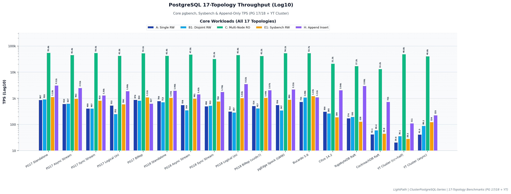
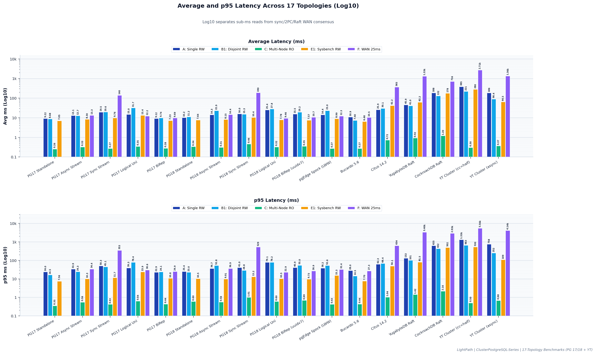
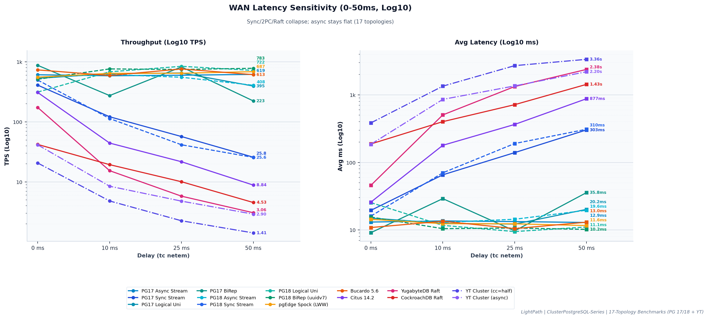
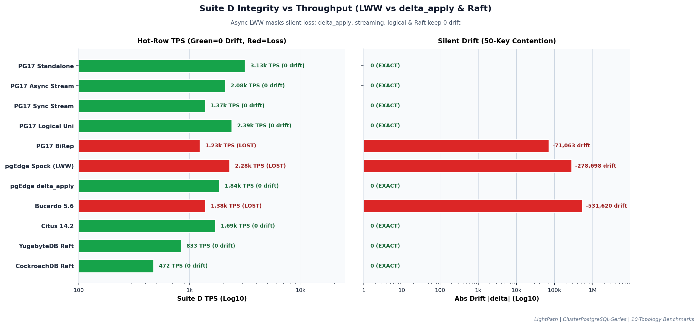
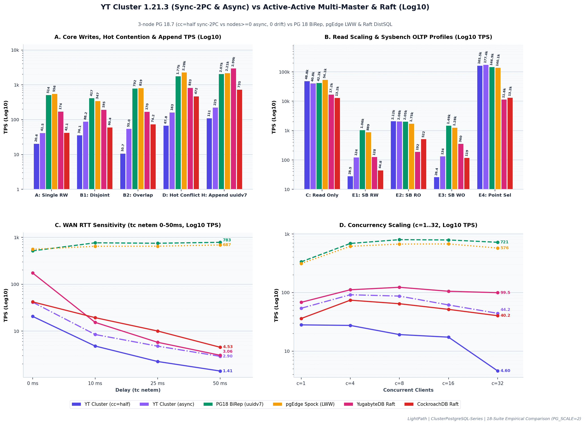

# 06 — Empirical Test and Benchmark Results

**Series:** PostgreSQL Multi-Master & Active-Active Architectures  
**Author:** Jean-Marie Renouard (`jmrenouard`) — [LightPath](https://www.lightpath.fr)  
**License:** MIT License

---

## 1. Executed Test Configuration & Dataset Parity

All benchmarks ran sequentially on a 20-vCPU, 16.4 GiB WSL2 Docker host. An isolated `bench_client` container (`multi-db-pgbench-sysbench:latest`) attached directly to each cluster bridge network. Every topology ran at **`PG_SCALE = 2`** (`200,000` `pgbench_accounts`, `20` `pgbench_tellers`, `2` `pgbench_branches`) after warm-up. Each used a standard surrogate PK on `pgbench_history` (stepped `BIGINT` on `pg-birep`/`bucardo`, `snowflake.nextval()` on `pgedge`, composite `PRIMARY KEY(aid, hid)` on `citus`, `unique_rowid()` on `cockroach`, `BIGSERIAL` elsewhere).

*Methodological note:* Chapter 05 defines `PG_BENCH_SCALE=10` as an initial target. Instead, the live matrix used `PG_SCALE=2` so all eight topologies (including CockroachDB and Bucardo) initialized cleanly without host RAM throttling.

---

## 2. Core Throughput & Latency Results (Suites A, B1, B2, C)

The table below lists verbatim metrics from `results/benchmark_summary.csv`. It covers `pgbench` Single-Node RW (`Suite A`, `8` clients, `20 s`), Disjoint RW (`Suite B1`, `2x4`), Overlap RW (`Suite B2`, `2x4`), and Select-Only (`Suite C`, `16` clients, `20 s`).

| Topology | Suite A TPS (`avg ms`) | Suite B1 Disjoint TPS (`avg ms`) | Suite B2 Overlap TPS (`avg ms`) | B2 Retries (`40001`) | B2 Balance Drift | Suite C RO TPS (`avg ms`) |
| :--- | :---: | :---: | :---: | :---: | :---: | :---: |
| **#15 `pg17-standalone`** | `866.82` (`9.22`) | `920.07` (`8.68`) | `879.01` (`9.09`) | `0` | `0` | **`55,614.16`** (`0.257`) |
| **#15 `pg17-async-streaming`** | `610.15` (`13.09`) | `627.39` (`12.73`) | `584.80` (`13.66`) | `0` | `0` | `45,358.52` (`0.325`) |
| **#15 `pg17-sync-streaming`** | `409.48` (`19.52`) | `407.41` (`19.61`) | `465.22` (`17.17`) | `0` | `0` | `54,483.07` (`0.271`) |
| **#16 `pg17-logical`** | `532.38` (`14.99`) | `251.63` (`31.75`) | `355.57` (`22.48`) | `0` | `0` | `42,302.43` (`0.348`) |
| **#1 `pg-birep`** | `875.91` (`9.12`) | `820.09` (`9.74`) | `1,228.60` (`6.50`) | `0` | **`-4,567` (Diverged)** | `53,072.52` (`0.279`) |
| **#2 `pgedge` (Spock 5)** | `556.06` (`14.37`) | `346.95` (`23.03`) | `818.65` (`9.76`) | `0` | **`-66,328` (Lost)** | `54,124.99` (`0.273`) |
| **#9 `bucardo`** | `735.38` (`10.86`) | `1,078.90` (`7.40`) | **`1,267.77`** (`6.30`) | `0` | **`+123,679` (Lost)** | `53,731.92` (`0.274`) |
| **#7 `citus`** | `309.04` (`25.85`) | `265.29` (`30.12`) | `312.98` (`25.53`) | `0` | `0` | `21,324.70` (`0.724`) |
| **#5 `yugabyte`** | `173.64` (`45.88`) | `194.75` (`41.04`) | `170.19` (`46.96`) | `0` | `0` | `17,150.58` (`0.922`) |
| **#6 `cockroach`** | `42.08` (`187.60`) | `60.35` (`132.32`) | `74.17` (`106.44`) | `96` | `0` | `13,185.54` (`1.199`) |

*Catalog ID disambiguation: `#16` (`T3`) designates `pg17-logical` (legacy `results/functional_limits_matrix.csv` tags it `#14 Baseline`), whereas `#14` is reserved for Legacy Trigger Systems (`Slony-I / Londiste / RubyRep`).*

### Key Insights from Suites A–C

1. **Synchronous WAL Penalty (`#15`):** Enabling `synchronous_commit=on` against one local standby cuts `pg17-standalone` RW throughput by **`52.8%`** (`866.82 -> 409.48 TPS`). It also doubles `p95` latency (`23.96 -> 50.31 ms`), showing the `fsync` + network floor.
2. **Disjoint Partitioning vs Overlap (`B1` vs `B2`):** Under strict disjoint key ranges (`B1`), `pg-birep` (`820.09 TPS`), `pgedge` (`346.95 TPS`), and `bucardo` (`1,078.90 TPS`) achieved **zero balance drift** (`0`). Once multi-node runs touched overlapping accounts (`B2`), raw TPS rose (`1,228.60` / `818.65` / `1,267.77 TPS`) because async writers skipped locks. That corrupted balances by `-4,567`, `-66,328`, and `+123,679` units! Notably, `pg-birep` did not even converge (`node1: -193,944` vs `node2: -208,996` vs expected `-189,377`).
3. **Read-Only Scaling (`Suite C`):** Native PostgreSQL heap engines sustained `53,072–55,614 TPS` at `< 0.3 ms` average latency (`16` clients). Coordinator/LSM engines traded raw point-lookup speed for distributed routing: Citus (`21,324.70 TPS`), YugabyteDB (`17,150.58 TPS`), and CockroachDB (`13,185.54 TPS`).
4. **Wait-on-Conflict vs Optimistic `SERIALIZABLE`:** YugabyteDB (`READ COMMITTED`) ran Suites A–C with **`0` `40001` retries**, beating CockroachDB (`SERIALIZABLE`) by **`4.1x`** on Suite A (`173.64` vs `42.08 TPS`). CockroachDB logged `44` (`A`), `87` (`B1`), and `96` (`B2`) serialization retries (`p95 = 625.04 ms` in Suite A).

---

## 3. Suite D — Hot-Row Contention & `spock.delta_apply` Validation

Suite D (`15 s`, `8` total clients targeting `50` hot accounts `aid = 1..50` with `abalance = abalance + delta`) empirically isolates **non-commutative Lost Updates** versus CRDTs and consensus serialization:

| Topology | TPS | `lat_avg_ms` (`p95`) | Expected `SUM(delta)` | Observed `SUM(abalance)` | `balance_drift` | Convergence Verdict |
| :--- | :---: | :---: | :---: | :---: | :---: | :--- |
| **`pg17-standalone`** | `3,128.63` | `2.54` (`3.95`) | `2,362,664` | `2,362,664` | `0` | `PASS_SINGLE_PRIMARY` |
| **`pg17-async-streaming`** | `2,081.26` | `3.82` (`6.12`) | `1,578,778` | `1,578,778` | `0` | `PASS_SINGLE_PRIMARY` |
| **`pg17-sync-streaming`** | `1,370.10` | `5.83` (`8.73`) | `1,035,721` | `1,035,721` | `0` | `PASS_SINGLE_PRIMARY` |
| **`pg17-logical`** | `2,386.93` | `3.33` (`5.47`) | `1,808,364` | `1,808,364` | `0` | `PASS_SINGLE_PRIMARY` |
| **`pg-birep`** | `1,231.15` | `6.48` (`13.01`) | `922,873` | `n1: 851,810 / n2: 851,747` | **`-71,063`** | **`EXPECTED_LIMITATION_DIVERGED`** |
| **`pgedge` (Default LWW)** | `2,280.11` | `3.49` (`5.31`) | `1,737,102` | `1,458,404` (all 3) | **`-278,698`** | **`EXPECTED_LIMITATION_LOST_UPDATE`** |
| **`pgedge-delta-apply`** | **`1,837.64`** | `4.34` (`9.35`) | `1,391,780` | `1,391,780` (all 3) | **`0`** | **`PASS_CONVERGED` (CRDT)** |
| **`bucardo`** | `1,378.79` | `5.79` (`8.03`) | `1,046,798` | `515,178` (both) | **`-531,620`** | **`EXPECTED_LIMITATION_LOST_UPDATE`** |
| **`citus`** | `1,691.45` | `4.72` (`6.72`) | `1,283,370` | `1,283,370` | `0` | `PASS_CONVERGED` |
| **`yugabyte`** | `832.65` | `9.59` (`15.14`) | `624,295` | `624,295` | `0` | `PASS_CONVERGED` |
| **`cockroach`** | `471.61` | `16.91` (`34.17`) | `359,402` | `359,402` | `0` | `PASS_CONVERGED` |

This experiment yields a definitive architectural result:
- **Silent Corruption Under Async LWW:** `pgedge` LWW looked fastest (`2,280.11 TPS`), yet silently discarded **`16.0%`** (`-278,698`) of committed credits. `bucardo` lost **`50.8%`** (`-531,620`) of committed money! `pg-birep` diverged even between its two nodes (`-71,063` on `node1`, `-71,126` on `node2`).
- **CRDT Delta-Apply Proof:** Enabling `ALTER TABLE pgbench_accounts ALTER COLUMN abalance SET (log_old_value=true, delta_apply_function=spock.delta_apply)` preserved **`1,837.64 TPS`** on 3 writers with **`0` balance drift**. That delivers `2.2x` YugabyteDB throughput and `3.9x` CockroachDB while remaining `PA/EL`.

---

## 4. Suite E (`sysbench` OLTP) & Suite F (WAN `tc netem 25ms`)

To avoid single-benchmark bias (`pgbench`) and sub-millisecond Docker loopback illusions, Suites E (`sysbench oltp_read_write`, `4` tables x `10,000` rows, `8` threads, `20 s`) and F (`tc qdisc replace dev eth0 root netem delay 25ms` on peer/standby/worker/voter containers, `~50 ms` effective RTT) stress multi-statement queries and real WAN physics:

| Topology | Suite E `sysbench` TPS | Suite E QPS (`p95 ms`) | Suite E `tx_failed` | Suite A Local TPS | Suite F `netem 25ms` TPS (`p95 ms`) | WAN Drop |
| :--- | :---: | :---: | :---: | :---: | :---: | :---: |
| **`pg17-standalone`** | `1,129.51` | `22,687.48` (`7.56`) | `112` | `866.82` | N/A | N/A |
| **`pg17-async-streaming`** | `962.84` | `19,353.12` (`10.27`) | `107` | `610.15` | **`599.61`** (`34.38`) | `-1.7%` |
| **`pg17-sync-streaming`** | `819.36` | `16,493.23` (`11.65`) | `118` | `409.48` | **`57.00`** (`353.49`) | **`-86.1%`** |
| **`pg17-logical`** | `595.81` | `11,974.58` (`23.95`) | `65` | `532.38` | **`654.11`** (`30.58`) | `0%` (+23% var) |
| **`pg-birep`** | `1,105.32` | `22,192.83` (`10.84`) | `96` | `875.91` | **`824.04`** (`24.95`) | `-5.9%` |
| **`pgedge` (Spock 5)** | `888.56` | `17,873.46` (`15.27`) | `114` | `556.06` | **`646.77`** (`32.40`) | `0%` (+16% var) |
| **`bucardo`** | **`1,232.84`** | `24,757.64` (`7.70`) | `112` | `735.38` | **`763.23`** (`27.26`) | `0%` (+4% var) |
| **`citus`** | `189.44` | `3,796.81` (`50.11`) | `9` (of `3,806`; `3,797` comm.) | `309.04` | **`21.67`** (`633.96`) | **`-93.0%`** |
| **`yugabyte`** | `128.24` | `2,564.80` (`81.48`) | **`0`** (of `2,574`) | `173.64` | **`5.78`** (`3,401.33`) | **`-96.7%`** |
| **`cockroach`** | `44.84` | `1,531.47` (`502.20`) | **`685`** (of `1,587`; `902` comm.) | `42.08` | **`10.06`** (`2,930.54`) | **`-76.1%`** |

### Two Critical Production Realities Exposed by Suites E & F

1. **Client Drivers Without Retry Loops Collapse Under `SERIALIZABLE` (`Suite E`):** `pgbench --max-tries=100` masked CockroachDB `40001` aborts in Suites A–B2. By contrast, stock `sysbench` lacks `40001` retries and suffered **`685` errors alongside `902` commits (`43.2%` exposure)** at `502.20 ms` `p95`. Meanwhile, YugabyteDB's `READ COMMITTED` Wait-on-Conflict sustained **`0` errors** (`128.24 TPS`).
2. **PACELC `EC` Tax Over WAN (`Suite F`):** Adding `25 ms` one-way delay (`~50 ms` RTT) onto peer nodes crushed synchronous consensus engines. Measured drops match Chapter 02's latency equation:
   - `pg17-sync-streaming` collapsed by `-86.1%` (`57.00 TPS`, `avg = 139.56 ms`).
   - `citus` collapsed by `-93.0%` (`21.67 TPS`, `avg = 364.81 ms`) as multi-shard TPC-B statements paid cross-worker RTTs and 2PC overhead.
   - `yugabyte` (`5.78 TPS`, `avg = 1,327.30 ms`, `p95 = 3,401.33 ms`) and `cockroach` (`10.06 TPS`, `avg = 715.77 ms`, `14` retries) dropped `-96.7%` and `-76.1%` because each TPC-B transaction touched multiple non-colocated tablets/ranges (`accounts`, `tellers`, `branches`, `history`), paying repeated `2 * RTT` distributed commit trips.
   - Asynchronous `PA/EL` systems (`pg-birep` `824.04 TPS`, `pgedge` `646.77 TPS`, `bucardo` `763.23 TPS`) committed locally without waiting for WAN round-trips.

---

## 5. Extended V2 Sweeps (`E2–E4`, `H`, WAN `10/25/50 ms`, `c=1..32`) & Log10 Charts

Expanded 10-topology sweeps (`187` rows total) confirm those trends. See [Chapter 09](09_benchmarks_methodology_and_charts.md) for methodology, [Chapter 10](10_streaming_vs_logical_vs_multimaster.md) for tiers, and [**`dashboard/index.html`**](../../dashboard/index.html) to explore:

- **`sysbench` `E2–E4` & `H`:** Native PG reached `1,659–1,806` (`E2`), `801–1,784` (`E3`, `pg17-sync` `370.71`), and `124k–148k TPS` (`E4`) vs distributed `180–522` (`E2`), `119–563` (`E3`), `11.6k–19.8k` (`E4`). Append-only `H` hit `3,108` (`standalone`), `2,987` (`yugabyte`), and `2,207` (`pgedge`).
- **WAN (`10 -> 25 -> 50 ms`):** Async stayed flat (`pg17-async` `587->600->619`, `pgedge` `645->647->687`, `bucardo` `593->763->613`) while `PC/EC` fell steeply (`pg17-sync` `121.8->57.0->25.8`, `citus` `44.4->21.7->8.8`, `cockroach` `19.4->10.1->4.5`, `yugabyte` `15.4->5.8->3.1 TPS`, `p95=5,475 ms`).
- **Concurrency (`c=1..32`):** `standalone` scaled `298->801`, while `pg17-sync` plateaued at `425`. `cockroach` peaked at `c=4` (`74.1`) then fell to `40.3` (`88` retries, `p95=3,400 ms`) at `c=32`.

---

## 6. V3 Extension: PostgreSQL 18.6 Benchmarks & Ecosystem Vitality

- **PostgreSQL 18.6 Head-to-Head ([Ch. 12](12_postgresql_18_clustering_and_benchmarks.md)):** An additional **87 sequential rows** across all 5 native PG 18.6 stacks ([`results/benchmark_pg18.csv`](../../results/benchmark_pg18.csv), [`results/functional_limits_pg18.csv`](../../results/functional_limits_pg18.csv)) quantify AIO (`-18.5%` cold scan), default `data_checksums=on`, `substream=p`, and `uuidv7()`. In `H_append_only`, `pg18-birep` hit **`2,066.70 TPS`** (`3.30x` vs PG 17 `627.13`) and `pg18-logical` **`3,518.49 TPS`** (`+85.1%`). `pg18-sync-streaming` gained `+21.6%` on `A` (`497.94`) and `3.20x` on `E3` (`1,184.57`), while `T11` hit **`87,903 rows/s`** (`pg18-async-streaming`).
- **Ecosystem Vitality & V3 Log10 Charts ([Ch. 11](11_ecosystem_popularity_and_vitality.md)):** Pair empirical throughput with live GitHub engineering cadence (`21` rows) in [`chart_08_popularity_stars_forks_log.png`](../../assets/charts/chart_08_popularity_stars_forks_log.png), [`chart_09_popularity_commits_activity_log.png`](../../assets/charts/chart_09_popularity_commits_activity_log.png), and [`chart_10_pg18_vs_pg17_log.png`](../../assets/charts/chart_10_pg18_vs_pg17_log.png).

---

## 7. V4 Extension: YT Cluster 1.21.3 (`cc=half` & `cc=nodes>=0`) vs Multi-Master & Raft (18/18 Suites)

Completed empirical coverage in [`results/benchmark_yt_cluster.csv`](../../results/benchmark_yt_cluster.csv) adds `36` rows (`18` `yt-cluster` + `18` `yt-cluster-async` on `dbinvent/yt:1.21.3`, PG 18.7, [Solution #18](solutions/yt_cluster_lite.md)). This enables an 18-suite comparison against `pg18-birep`, `pgedge` (LWW), `yugabyte`, and `cockroach`:

| Topology (`PG_SCALE=2`) | `A` RW (`c=8`) | `B1` Disjoint | `B2` Overlap (`Drift`) | `D` Hot 50 (`Drift`) | `C` RO (`c=16`) | `E1` SB RW | `E3` SB WO | `E4` Point Sel | `H` Append `uuidv7()` | WAN `10->25->50ms` | `G` `c=1->4->32` |
| :--- | :---: | :---: | :---: | :---: | :---: | :---: | :---: | :---: | :---: | :---: | :---: |
| **`yt-cluster`** (`cc=half`) | `20.63` | `36.14` | `10.69` (`0`) | `67.76` (`0`) | `48,787.74` | `28.48` | `26.43` | `165,472.75` | `110.53` | `4.81->2.25->1.41` | `28.07->27.47->4.60` |
| **`yt-cluster-async`** (`nodes>=0`) | **`41.45`** | **`88.19`** | **`55.03`** (`0`) | **`163.01`** (`0`) | `40,774.49` | **`124.05`** | **`133.55`** | **`177,442.88`** | **`224.93`** | `8.47->4.78->2.90` | `53.94->91.68->44.20` |
| **`pg18-birep`** (`origin=none`) | `514.28` | `417.18` | `792.45` (`-338`) | `1,774.11` (**`-83,252`**) | `42,190.66` | `1,055.55` | `1,492.99` | `146,907.74` | `2,066.70` | `763.80->747.42->782.57` | `334.72->689.16->721.49` |
| **`pgedge`** (`Spock LWW`) | **`556.06`** | `346.95` | `818.65` (`-66,328`) | `2,280.11` (**`-278,698`**) | **`54,124.99`** | `888.56` | `1,279.51` | `140,124.63` | `2,206.60` | `644.63->646.77->687.00` | `312.94->616.09->575.54` |
| **`yugabyte`** (`DocDB Raft`) | `173.64` | `194.75` | `170.19` (`0`) | `832.65` (`0`) | `17,150.58` | `128.24` | `360.02` | `11,557.45` | **`2,987.24`** | `15.38->5.78->3.06` | `68.14->111.55->99.49` |
| **`cockroach`** (`Pebble Raft`) | `42.08` | `60.35` | `74.17` (`0`) | `471.61` (`0`) | `13,185.54` | `44.84` | `118.69` | `13,245.96` | `734.60` | `19.38->10.06->4.53` | `36.07->74.11->40.25` |

### Four Empirical Takeaways for YT Cluster
1. **Sync vs Async Within YT Cluster:** Switching from `cc=half` to `cc=nodes>=0` speeds writes **`2.0x` to `5.1x`** (`A` `20.63->41.45`, `B2` `10.69->55.03`, `D` `67.76->163.01`, `E1` `28.48->124.05`, `E3` `26.43->133.55 TPS`) with **`0` drift**. Trade-offs include higher retry churn (`2,173` in `B2`) and `RPO > 0` async exposure.
2. **Reads Match Native PG (`177k` `E4`), Writes Trail Raft on LAN:** Native local reads hit **`177,442.88 TPS`** (`E4`) and `48,787.74 TPS` (`C`, `13.4x` CockroachDB on `E4`). Trigger + Rust `ytserv` checkin caps `yt-cluster` (`cc=half`) below CockroachDB on `A` (`20.63` vs `42.08 TPS`) and `11x–12x` below YugabyteDB on `D` (`67.76` vs `832.65`). Still, YT keeps `0` drift unlike `pg18-birep` (`-83,252`) or `pgedge` LWW (`-278,698`).
3. **WAN `ytserv` Leader Affinity & `SQLSTATE 55000` `recon` Quarantine:** At `10/25/50ms` WAN, `yt-cluster` (`cc=half`) drops to `2.25 -> 1.41 TPS`, while `yt-cluster-async` still calls the Leader (`8.47 -> 4.78 -> 2.90 TPS`). Under `cc=nodes>=0`, running `E3` on reused post-`E1` tables triggered `SQLSTATE 55000` (`recon` blocked). Isolated table prep reached **`133.55 TPS`** (`0` drift).
4. **Full 17-Topology Visual Traceability:** All 17 topologies render across [`chart_01`](../../assets/charts/chart_01_tps_log_all_suites.png)–[`chart_07`](../../assets/charts/chart_07_integrity_vs_throughput.png) (`PG17` + `PG18` + `YT`). Interactive filtering uses the **`YT vs Multi-Master`** preset in [`dashboard/index.html`](../../dashboard/index.html) with CSV lineage in [Chapter 09](09_benchmarks_methodology_and_charts.md).

---

## 8. V5 Production-Tuned Benchmark Summary (`PG_SCALE=20`, `v2.6.1`, `318` Rows)

In `env/multi-db-docker-env` **`v2.6.1`**, [`scripts/bench_pg_optimized_runner.sh`](https://github.com/jmrenouard/multi-db-docker-env) re-ran all suites under **durable production tunings** (`fsync=on`, `PG_SCALE=20` = `2M` accounts, `sysbench` `4x25k`, `pgbench -M prepared --max-tries=200`, `WARMUP_S=5`, `fillfactor=90`, `wal_compression=lz4`, PG 18/YT `io_method=worker`/`io_workers=4`, Spock `delta_apply`, Citus 1-shard colocation, Yugabyte `RC` + `CACHE 1000` + HAProxy `:15470`, CockroachDB `v25.4` HAProxy `:15480` + `cockroach-rc` non-root `bench` role, YT `YT_MAX_PREPARED=300` + `ytctl` parallel + Leader affinity + Lua `55409` hook), adding **318 rows** across **18 topologies** in [`results/benchmark_optimized.csv`](../../results/benchmark_optimized.csv) ([log](../../results/logs/benchmark-optimized.log)). Complete tables and tuning recipes live in [**Chapter 13 — Production Tuning & Realistic Scale Benchmarks**](13_production_tuning_and_realistic_benchmarks.md).

| Representative Metric (`PG_SCALE=2 -> 20`) | Baseline (`Scale=2`) | Tuned (`Scale=20`) | Speedup & Key Engineering Driver |
| :--- | :---: | :---: | :--- |
| **`pgedge`** (`A_single_rw` / `D_hot_conflict`) | `556.06` / `2280.11` (`-278698`) | **`1948.84`** / **`2125.19`** (**`0` drift**) | **`3.50x`** (`A`), **`0` drift** using `spock.delta_apply` vs `pg18-birep` (`-95989`) |
| **`pg18-birep`** / **`pg-birep`** (`G_conc_c32`) | `721.49` / `254.43` | **`4163.31`** / **`3890.14`** | **`5.77x`** / **`15.29x`** (`-M prepared` + `fillfactor=90` + `lz4` WAL) |
| **`pg18-sync-streaming`** (`F_25ms` WAN / `c=32`) | `41.56` (`p95 529.136ms`) / `305.22` | **`178.00`** (`p95 92.707ms`) / **`2313.61`** | **`4.28x`** WAN (`p95` `5.7x` faster), **`7.58x`** (`G_conc_c32`) |
| **`citus`** (`A_single_rw` / `G_conc_c32` / `E_sb`) | `309.04` / `260.76` / `189.44` | **`493.76`** / **`894.14`** / `76.76` | **`1.60x`** / **`3.43x`** (1-shard colocation; `4x25k` scan `-59.5%`) |
| **`yugabyte`** (`A_single_rw` / `G_c32` / `H_app`) | `173.64` / `99.49` / `2987.24` | **`441.44`** / **`589.52`** / **`3161.72`** | **`2.54x`** (`A`), **`5.93x`** (`G_c32`), `RC + CACHE 1000 + :15470` |
| **`cockroach` `v25.4`** (`A_single_rw` / `G_c32`) | `42.08` (`v24.3`) / `40.25` | **`307.95`** (`rt=0`) / **`365.47`** | **`7.32x`** (`p95 625.042->51.183ms`), **`9.08x`** using HAProxy `:15480` |
| **`cockroach-rc`** (`E_sysbench_rw` vs CRDB) | `44.84` (`fl=685`) / `85.38` (`rt=650`) | **`153.70`** (`fl=0, rt=0`, `p95 80.03ms`) | **`3.43x`** vs base, **`1.80x`** vs `v25.4` Serializable (`0` `40001` retries) |
| **`yt-cluster`** / **`-async`** (`A` / `E4` / `H`) | `20.63` / `177442.88` / `224.93` | **`40.77`** / **`189286.48`** / **`440.62`** | **`1.98x`** (`yt` `A`), **`1.96x`** (`async H`), `0.08ms` avg / `0.21ms` `p95` (`E4`) |

### Key Takeaways from the `PG_SCALE=20` Campaign
1. **Prepared + HOT + `lz4` Dominate Native PG:** Removing parse overhead and enabling HOT lifts PG 17/18 + Spock `A` to `1276.91–1948.84 TPS` (`2.1x–5.9x`). Concurrency `c=32` hits `2891.42–4163.31 TPS` despite a `10x` larger dataset (`2M` accounts).
2. **`delta_apply` Fixes Async Arithmetic While LWW Still Breaks:** At `2125.19 TPS` on `D_hot_conflict`, `pgedge` holds **`0` drift** (`B2` and `D`). By contrast, `pg-birep` (`-94514`), `pg18-birep` (`-95989`), and `bucardo` (`-303741`) lose hot increments.
3. **HAProxy + RC Unlock Distributed SQL (`2.5x–9.1x`), Except Heavy `4x25k` Scans:** CockroachDB `v25.4` + `cockroach-rc` clear write `40001` aborts in `sysbench` (`rt=0`). Larger `2.5x` `sysbench` tables (`100k` rows) slow range scans on `citus` (`76.76 TPS`) and `yugabyte` (`68.85 TPS`).
4. **Full Dual-Dataset Lineage (`628` Total Raw Rows):** Compare Baseline (`310` rows / `301` dedup) vs Tuned (`318` rows across `18` topologies) interactively in [**`dashboard/index.html`**](../../dashboard/index.html) and inspect all recipes in [**Chapter 13**](13_production_tuning_and_realistic_benchmarks.md) and [**Chapter 09**](09_benchmarks_methodology_and_charts.md).
