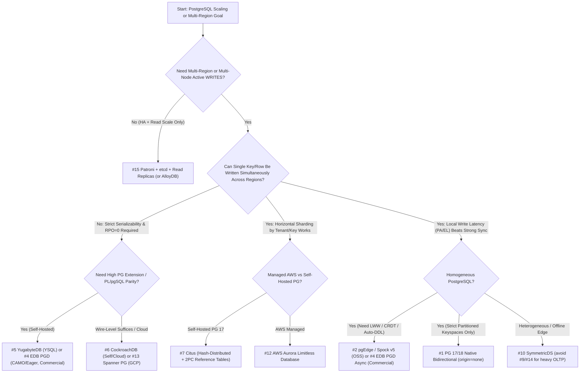

# 07 — Decision Framework and Production Architecture Guide

**Series:** PostgreSQL Multi-Master & Active-Active Architectures  
**Author:** Jean-Marie Renouard (`jmrenouard`) — [LightPath](https://www.lightpath.fr)  
**License:** MIT License

---

## 1. Architectural Selection Decision Tree

Most "multi-master" initiatives stem from three conflated goals: **high availability (`RTO < 30 s`)**, **low-latency global reads**, or **true simultaneous multi-region writes**. Selecting the right topology starts by isolating which requirement is genuinely non-negotiable:

---

## 2. Workload-to-Architecture Mapping Matrix

| Canonical Workload Pattern | Recommended Pick | Runner-Up | Architectural Rationale |
| :--- | :--- | :--- | :--- |
| **Single-Region Mission-Critical OLTP** | **#15 Patroni + etcd** | #4 EDB PGD (Write-Lead) | Zero conflict risk, 100% PG extension parity, deterministic `RPO=0` sync HA |
| **Multi-Tenant SaaS Exceeding 1 Node Writes** | **#7 Citus** | #5 YugabyteDB / #12 Limitless | `tenant_id` sharding routes 95%+ queries to 1 worker without WAN 2PC tax |
| **Global Financial Ledger (Zero Lost Updates)** | **#6 CockroachDB** or **#13 Spanner PG** | #5 YugabyteDB (`SERIALIZABLE`) | Strict `SERIALIZABLE` / External Consistency eliminates async LWW anomalies |
| **Geo-Distributed Edge / User-Local Active-Active** | **#2 pgEdge / Spock v5** | #4 EDB PGD (Async + CRDT) | Sub-millisecond local commits (`PA/EL`) + `snowflake` + `delta_apply` CRDTs |
| **Regional Partitioned Tables (EU writes EU, US writes US)** | **#1 PG 17/18 Native (`origin=none`)** | #2 pgEdge / Spock v5 | Zero third-party extension risk when key ownership never overlaps across regions |
| **Regulated Enterprise Multi-Region PG with SLA** | **#4 EDB PGD (BDR)** | #5 YugabyteDB Enterprise | Raft DDL locks, CAMO, Write-Lead proxy, and commercial vendor support |
| **Disconnected Retail POS / Heterogeneous DB Sync** | **#10 SymmetricDS** | #9 Bucardo 5 (PG-only low vol) | Tolerates multi-hour offline stores and MySQL/Oracle/SQLite heterogeneous peers |
| **Read-Heavy Global Analytics + Local Writes** | **#15 Patroni + Cross-Region Replicas** | #13 AlloyDB / #7 Citus | Logical or physical read replicas scale reads infinitely without multi-writer risk |

---

## 3. Six Critical Multi-Master Anti-Patterns

Avoiding catastrophic production incidents requires recognizing the six recurring failure patterns observed across PostgreSQL multi-master deployments:

1. **The 2-Node Split-Brain / Quorum Trap:** Deploying a 2-node consensus cluster (or 2-node Patroni without a 3rd witness/etcd voter) makes quorum impossible when one link drops: either both halves fence themselves (`0%` availability) or both promote (`100%` split-brain corruption). Always deploy **odd voter counts (`3` or `5`)** or a dedicated lightweight witness node.
2. **Uncoordinated `SERIAL` / `IDENTITY` Sequences:** Leaving standard `1, 2, 3...` sequences active on two bidirectional nodes guarantees `SQLSTATE 23505` collisions within milliseconds of concurrent traffic. Enforce **stepped offsets** (`INCREMENT BY N`), **Snowflake 64-bit IDs**, or **UUIDv7** from day one.
3. **Keyless Tables in Logical Replication:** Legacy audit logs or join tables lacking a `PRIMARY KEY` cannot be updated or deleted under `pgoutput` (`SQLSTATE 55000`), and Bucardo refuses to sync them outright. Mandate surrogate primary keys on every replicated table via CI schema linting.
4. **Hot-Row Contention Under Distributed Consensus:** Putting a global hit counter, sequential batch counter, or single `pgbench_branches` row behind cross-region Raft (`#5 YugabyteDB`, `#6 CockroachDB`, `#4 EDB Eager`) serializes the entire cluster behind `2 * RTT` per transaction and triggers `SQLSTATE 40001` retry storms. Shard counters (`bucket_id`) or offload increments to CRDTs / async streams.
5. **PgPool-II Statement Broadcast on Non-Deterministic SQL:** Using PgPool-II Replication Mode (`#11`) with triggers, `RANDOM()`, `gen_random_uuid()`, or mixed `NOW()` calls silently corrupts state across backends. Restrict PgPool-II strictly to **Streaming Replication (Single-Primary)** read/write splitting.
6. **Clock-Drift Blindness Under LWW (`PA/EL`):** Running LWW conflict resolution (`#2 pgEdge`, `#3 pglogical`, `#9 Bucardo`) without strict `chrony`/NTP monitoring lets a drifted server win every future conflict (`clock + skew > real_time`), silently discarding legitimate updates from healthy peers.

---

## 4. Production Sizing, Quorum & Observability Guardrails

| Operational Layer | Mandatory Production Standard | Rationale |
| :--- | :--- | :--- |
| **Quorum Topology** | 3 or 5 Raft voters across 3 AZs/regions (or 2 Data + 1 Witness) | Prevents minority split-brain while surviving single-AZ failure (`RPO=0`) |
| **WAL Slot Disk Guard** | Set `max_slot_wal_keep_size` explicitly (`pg_replication_slots`) | Prevents one offline subscriber from filling `pg_wal` and crashing the surviving primary |
| **Clock Hygiene** | `chrony` with redundant NTP/PTP sources; alert if drift `> 10 ms` | Protects LWW causality bounds and prevents HLC `max_clock_skew` node eviction |
| **Application Retry Loop** | Exponential backoff + jitter for `SQLSTATE 40001` & `40P01` | Required by CockroachDB, YugabyteDB (`RR`/`SSI`), and multi-shard Citus deadlocks |
| **Secrets & Transport** | TLS 1.3 mutual auth (`sslmode=verify-full`) + external KMS / secrets manager | Eliminates plaintext credential files and secures cross-DC WAL/Raft links |
| **Observability Metrics** | Track `pg_stat_replication`, `pg_stat_subscription_stats`, conflict counters, `40001` rate | Detects silent apply stalls (`23505`) or rising contention before SLA breach |

---

## 5. Cluster-Wide Backup, PITR & Zero-Downtime Migration

### 5.1 Why Independent Node Backups Fail Cluster PITR

Taking asynchronous `pgBackRest` snapshots independently on `Node A` and `Node B` at `12:00:00` does **not** produce a transactionally consistent distributed database backup: transactions committed on `Node A` at `11:59:59.900` may not yet appear in `Node B`'s snapshot, while transactions originating on `Node B` may appear only on `Node B`.

- **Raft / Paxos Distributed Engines (`#5 YugabyteDB`, `#6 CockroachDB`, `#13 Spanner`):** Use built-in distributed snapshot/backup primitives coordinated via HLC/TrueTime read timestamps so every shard reflects an identical global instant.
- **Logical Multi-Master (`#1`, `#2`, `#4`):** For catastrophic recovery, restore **one canonical authoritative node** to PITR, validate data integrity, and re-seed peers via logical snapshot (`copy_data = true` or `Barman` / `PGD` orchestrated restore) rather than mixing stale independent PITR timelines.

### 5.2 Incremental Zero-Downtime Migration Path

Organizations migrating from a single primary should adopt a staged progression rather than jumping blindly into complex active-active meshes:

1. **Stage 1 — Harden Single-Primary HA (`#15`):** Deploy Patroni + etcd + HAProxy, enforce primary keys on 100% of tables, and migrate `SERIAL` keys to UUIDv7 or stepped/Snowflake sequences.
2. **Stage 2 — Partition & Validate Logical Decoding (`#1`):** Enable `wal_level = logical` and `track_commit_timestamp = on`; replicate read-only regional reporting replicas to measure real WAN lag and WAL generation rate.
3. **Stage 3 — Targeted Active-Active Rollout (`#2` / `#4` / `#5` / `#7`):**
   - If tenant-isolated OLTP scaling is the bottleneck -> shard onto **#7 Citus**.
   - If zero-RPO cross-AZ/region active writes are mandatory -> adopt **#5 YugabyteDB**, **#6 CockroachDB**, or **#4 EDB PGD** with automated `40001` retry middleware.
   - If sub-millisecond regional writes on standard PG 17 are mandatory -> cut over cleanly via logical sync to **#2 pgEdge / Spock v5** with `delta_apply` CRDTs on numeric counters and strict `chrony` alerting.

---

## 6. PostgreSQL 16 -> 17 -> 18.6 Production Target Selection

When greenfield or upgrading teams evaluate **[#17 PostgreSQL 18.6 Native Clustering](solutions/pg18_native_clustering.md)** ([Ch. 12 empirical data](12_postgresql_18_clustering_and_benchmarks.md)), apply these concrete boundaries:

| Production Target | Recommended Stack | Why / Verified Empirical Boundary |
| :--- | :--- | :--- |
| **80%+ OLTP HA (`RPO=0` metro, 100% PG parity)** | **#15 Patroni + etcd on PG 18.6 (or PG 17)** | Zero write conflicts; `pg18-sync-streaming` gains `+21.6%` `A_single_rw` (`497.94` vs `409.48 TPS`), `+90.5%` `T11` bulk (`75,629 rows/s`), and default `data_checksums=on` + `io_method=worker` (`-18.5%` cold scans). |
| **Zero-downtime major upgrades & filtered feeds** | **#17 PG 18.6 Native Logical (`pg18-logical`)** | Default `substream=p` and `publish_generated_columns=stored` lift `E_sysbench_oltp_rw` (`1,027.84 TPS`, `+72.5%`) and `H_append_only` (`3,518.49 TPS`, `+85.1%`). Still run manual `setval()` on cutover (`FOR ALL SEQUENCES` raises `SQLSTATE 42601` until PG 19). |
| **Disjoint / append-only active-active (`PA/EL`)** | **#17 PG 18.6 Birep (`origin=none`) + `uuidv7()`** | Native RFC 9562 `uuidv7()` eliminates active-active PK collisions (`50/50` converged, `0` `23505`, `2,066.70 TPS` = `3.30x` PG 17) with 7 `confl_*` counters (`+confl_multiple_unique_conflicts`) for conflict alerting. |
| **Overlapping counters, LWW, Auto-DDL, 3+ mesh** | **#2 pgEdge Spock 5 (`delta_apply`)** or **#4 EDB PGD** | Native PG 18.6 still has no auto-LWW, CRDT, or DDL replication (`pg18-birep` drifted `-338` in `B2` and `-83,252` in `D`). |
| **Global `RPO=0` ACID, global `UNIQUE`, cross-node FK** | **#5 YugabyteDB** or **#6 CockroachDB** | Native PG 18.6 logical apply still halts on `UNIQUE` `23505` and hits `T13` async FK races (`23503x8`); use Raft consensus with `40001` retry loops. |
| **Low-TPS reversible zero-drift PG 18 extension** | **[#18 YT Cluster](solutions/yt_cluster_lite.md)** *(lab / niche)* | Fits unmodified PG 18 needing zero-drift active-active (`0` drift via `55409`/`40001`), high local reads (`48.8K`/`165.5K`), and `DROP EXTENSION` reversibility (`T_REVERT`). **Not** for high-TPS OLTP: `20.63`-`41.45 TPS` 2PC write ceiling (`2.25` @ `25ms` WAN, `86 rows/s` bulk), `SAVEPOINT` rollback `0A000`, `cursor-stability`-only self-run Jepsen, closed `ytserv` (PolyForm/Commercial), and `bus factor = 1`. |

**Upgrade Guardrails (`PG 16/17 -> 18.6`):** Mount Docker volumes at `/var/lib/postgresql` (`PGDATA=/var/lib/postgresql/18/docker`), enable checksums before `pg_upgrade` (`pg_checksums --enable`), benchmark `io_method=sync` vs `worker` on pure hot-RAM micro-OLTP (`-10.3%` IPC trade-off), and whitelist `io_uring` in container seccomp before enabling it.

---

## 7. Interactive PACELC Architecture Selector & GitHub Pages Explorer

Apply the decision tree directly against empirical data in the **PACELC Selector** tab of [`dashboard/index.html`](../../dashboard/index.html) (or on [GitHub Pages](https://jmrenouard.github.io/ClusterPostgreSQL-Series/) once workflow `#506` is active):

- **4 Empirical Inputs:** `RPO` (`0` vs `>0`), `WAN RTT` (`0`/`10`/`25`/`50 ms`), `Write Conflicts` (`Single`, `UUIDv7`, `CRDT`, `High`), and `TCO` (`Low`/`Med`/`High`), synced with `Baseline (S=2)` / `V5 Tuned (S=20)`.
- **Transparent Evidence:** Ranks all 17 topologies + V5/CRDT variants (`0-100`), flags observed LWW drift (`-71K` to `-531K`) as `INCOMPATIBLE` under high contention, surfaces `SQLSTATE` caveats (`23505`, `40001`, `0A000`, `55409`), and provides copyable `make` / `./mdb` commands plus Bench/Matrix/Sheet links.
- **Static Bundle Check:** Run `make dashboard && make pages-build && make pages-check` to build and verify `_site/`.
