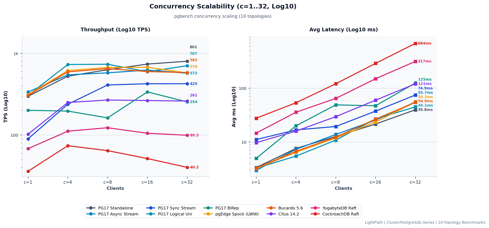
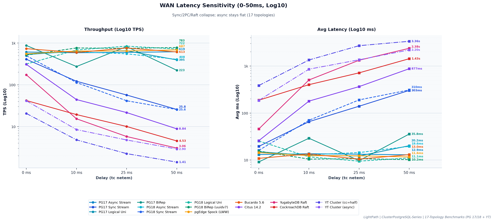
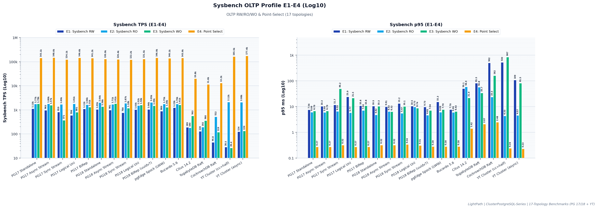
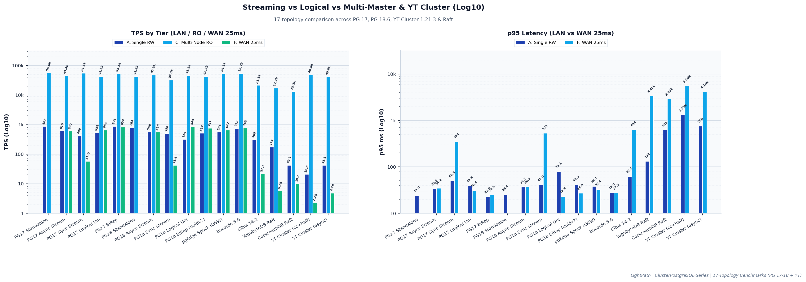
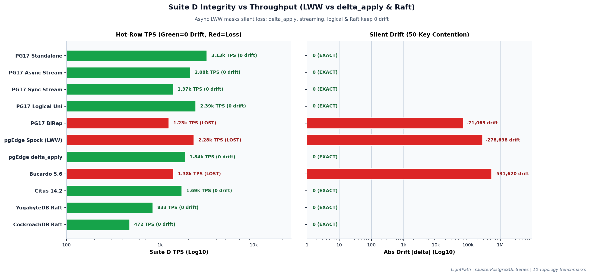
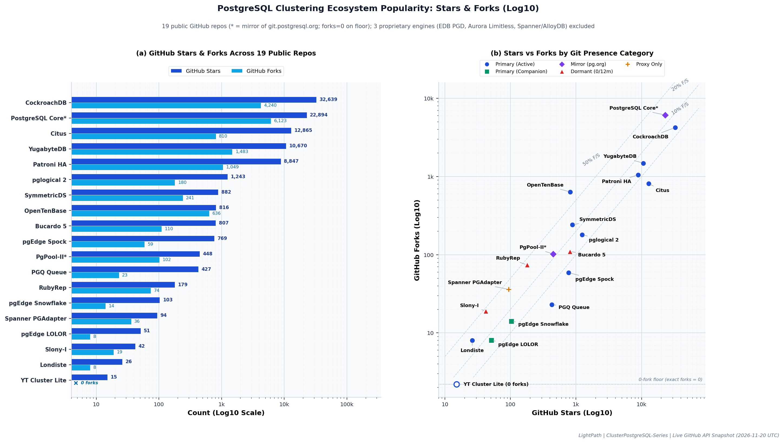

# 09 — Benchmark Methodology, Workloads & Logarithmic Charts

**Series:** PostgreSQL Multi-Master & Active-Active Architectures  
**Author:** Jean-Marie Renouard (`jmrenouard`) — [LightPath](https://www.lightpath.fr)  
**License:** MIT License

---

## 1. Execution Harness & Controlled Isolation

Four runners under `env/multi-db-docker-env` (`v2.4.1` -> **`v2.6.1`**) generate **628 raw benchmark rows** sequentially on a 20-vCPU, 16.4 GiB WSL2 Docker host. They collect **310 baseline rows** at `PG_SCALE=2` (**301 deduplicated** across **17 topologies**) plus **318 V5 tuned rows** at `PG_SCALE=20` across **18 topologies** (incl. `cockroach-rc`):
- `scripts/bench_pg_v2_runner.sh`: **187 rows** across 10 PG 17 & Distributed SQL topologies (`results/benchmark_summary.csv` `70`, `results/benchmark_extended_workloads.csv` `40`, `results/benchmark_wan_sweep.csv` `27`, `results/benchmark_concurrency_sweep.csv` `50`).
- `scripts/bench_pg18_runner.sh`: **87 rows** across 5 PG 18.6 native topologies (`results/benchmark_pg18.csv`).
- `scripts/bench_yt_runner.sh`: **36 rows** (`18` `yt-cluster` `cc=half` + `18` `yt-cluster-async` `cc=nodes>=0`) on 3-node PG 18.7 (`results/benchmark_yt_cluster.csv`).
- `scripts/bench_pg_optimized_runner.sh` (`v2.6.1`): **318 rows** across all **18 topologies** at `PG_SCALE=20`, `sysbench 4x25k`, `pgbench -M prepared --max-tries=200`, `WARMUP_S=5`, `fillfactor=90`, and durable `fsync=on` (`results/benchmark_optimized.csv`, [Ch. 13](13_production_tuning_and_realistic_benchmarks.md)).

- **One-Stack Isolation:** Exactly one cluster runs at a time (`up -> setup -> warm-up -> suites -> down -v`) to eliminate RAM/NVMe noise across RocksDB, Pebble, `ytserv`, and PostgreSQL `shared_buffers`.
- **Zero NAT Skew:** `pgbench` and `sysbench` execute inside an ephemeral `bench_client` container (`multi-db-pgbench-sysbench:latest`) attached directly to each cluster's internal Docker bridge (`--cap-add NET_ADMIN`).
- **Dataset Parity & Reconciliation:** Baseline suites run at `PG_SCALE = 2` (`200,000` `pgbench_accounts`, `20` `pgbench_tellers`, `2` `pgbench_branches`, `sysbench 4x10k`), whereas V5 tuned runs scale 10x to `PG_SCALE = 20` (`2,000,000` accounts, `sysbench 4x25k`). Between write suites, `reset_ds()` zeroes balances and truncates `pgbench_history`. Next, `conv_chk()` verifies `SUM(abalance) - SUM(delta)` on every node (`balance_drift`).
- **Exact Tail Latency (`p95`):** Per-transaction logs (`pgbench -l`) yield exact mean, stddev, and 95th percentile (`lat_p95_ms`).

---

## 2. Schema Standardization Across Engines

Standard `pgbench -i` leaves `pgbench_history` **keyless**, breaking logical replication `UPDATE`/`DELETE` (`SQLSTATE 55000`) and Bucardo sync validation. To evaluate all 17 stacks fairly while testing keyless limits separately in `L2`, the harness injects an engine-idiomatic surrogate Primary Key `hid`:

| Topology Group | `pgbench_history` Surrogate PK & Distribution Adaptation | `sysbench` Adaptation |
| :--- | :--- | :--- |
| **`pg17-*`, `pg18-streaming/logical`, `yugabyte`** | `hid BIGSERIAL PRIMARY KEY` | Standard `sbtest1..4` (replicated on streaming/logical) |
| **`pg-birep` & `bucardo`** | Stepped sequence `INCREMENT BY 2 START WITH {1, 2}` (`BIGINT PK`) | Standard `sbtest1..4` (synced across nodes) |
| **`pg18-birep` & `yt-cluster*`** | Native PG 18 `hid UUID PRIMARY KEY DEFAULT uuidv7()` (`yt_setup()` on `yt*`) | `yt_setup('public.sbtest%')`; isolated `prep_sb()` before `E3` async (avoids `55000` `recon` lock) |
| **`pgedge` (Spock 5)** | `hid BIGINT PRIMARY KEY DEFAULT snowflake.nextval('snowflake.id_seq')` | Standard; `delta_apply` tested on `abalance` |
| **`citus`** | Composite `PRIMARY KEY(aid, hid)` + `create_distributed_table` (`bid`/`tid`/`aid`) | `create_distributed_table('sbtest1..4','id')` |
| **`cockroach`** | `hid INT8 DEFAULT unique_rowid() PRIMARY KEY` | Auto-fallback `--db-ps-mode=disable` if needed |

---

## 3. Complete Workload & Tool Specification

### 3.1 `pgbench` Suites (`A`, `B1`, `B2`, `C`, `D`, `G`, `H`)

All `pgbench` runs use `-n -r --max-tries=100 --failures-detailed -l` to count client-side `SQLSTATE 40001` retries explicitly (`55409`+`40001` in YT Cluster):

| Suite ID | Workload Profile | Clients / Streams | Window | Empirical Span Across 17 Topologies |
| :--- | :--- | :---: | :---: | :--- |
| **`A_single_rw`** | Standard TPC-B RW (`1` endpoint) | `8` (`1x8`, `-j 4`) | `15–20 s` | `20.63` (`yt-cluster`) to `875.91 TPS` (`pg-birep`) |
| **`B1_disjoint_rw`** | Partitioned keys (`1..100k` vs `100k+1..200k`) | `8` (`2x4`, `-j 2`) | `15–20 s` | `36.14` (`yt-cluster`) to `1,078.90 TPS` (`bucardo`) |
| **`B2_overlap_rw`** | Full overlapping keyspace on `2` writers | `8` (`2x4`, `-j 2`) | `15–20 s` | `10.69` (`yt-cluster`, `0` drift) to `1,267.77 TPS` (`bucardo`, `+123,679`) |
| **`C_multinode_ro`** | `pgbench -S` Select-Only lookups | `16` (`2x8`/`1x16`) | `15–20 s` | `13,185.54` (`cockroach`) to `55,614.16 TPS` (`pg17-standalone`) |
| **`D_hot_conflict`** | `50` hot rows (`aid 1..50`, `delta 1..100`) | `8` (`2x4`/`1x8`) | `12–15 s` | `67.76` (`yt-cluster`, `0` drift) to `3,128.63 TPS`; CRDT `1,837.64` (`0` drift) |
| **`G_conc_c1..c32`** | Concurrency sweep ($c \in \{1, 4, 8, 16, 32\}$) | `1..32` | `8 s` | `4.60` (`yt c=32`) to `814.33 TPS` (`pg17-standalone` `801`, `pg18-standalone c=32`) |
| **`H_append_only_insert`** | Pure `INSERT INTO bench_append_events` | `8` (`2x4`/`1x8`) | `12 s` | `110.53` (`yt-cluster`) to `3,518.49 TPS` (`pg18-logical`); `yb=2,987.24` |

### 3.2 `sysbench` OLTP Suites (`E1–E4`, `--db-driver=pgsql`)

Cross-validation runs `sysbench --db-driver=pgsql --tables=4 --table-size=10000` across four Lua workloads: **`E_sysbench_oltp_rw`** (`oltp_read_write`, `8` threads, `15–20 s`), **`E2_sysbench_oltp_ro`** (`oltp_read_only`, `8` threads, `12 s`), **`E3_sysbench_oltp_wo`** (`oltp_write_only`, `8` threads, `12 s`), and **`E4_sysbench_point_select`** (`oltp_point_select`, `16` threads, `12 s`).

- **Critical `40001` & Async `55000` Handling:** Unlike MySQL runs using `--mysql-ignore-errors=all`, stock `sysbench --db-driver=pgsql` lacks `SQLSTATE 40001` retry loops (`685` ignored errors alongside `902` commits on CockroachDB `E`, vs `0` errors on YugabyteDB `READ COMMITTED` `128.24 TPS`). On `yt-cluster-async`, reusing post-`E` `sbtest` tables triggered `SQLSTATE 55000` (`recon` row blocked). Fresh per-suite `prep_sb()` yielded **`133.55 TPS` (`E3`)**. Point-select (`E4`) peaked at **`177,442.88 TPS`** (`0.09 ms` avg) on `yt-cluster-async` and **`148,022.41 TPS`** on `pg17-async-streaming` vs `11,557–19,831 TPS` on distributed engines.

### 3.3 WAN Latency Injection (`F_wan_netem_10ms / 25ms / 50ms`)

Linux `tc qdisc netem` emulates WAN RTT (`~20`, `~50`, and `~100 ms`) inside peer network namespaces. Deterministic cleanup runs `tc qdisc del dev eth0 root`. In YT Cluster `r_wan`, targeting a non-Leader node `wn` prevents Leader-affinity bypass:

```bash
docker run --rm --network container:<peer> --cap-add NET_ADMIN \
  multi-db-pgbench-sysbench:latest tc qdisc replace dev eth0 root netem delay 25ms
```

Under `50 ms` egress delay (`~100 ms` RTT), `PC/EC` and `ytserv` dropped to **`25.79 TPS`** (`pg17-sync-streaming`), **`8.84`** (`citus`), **`4.53`** (`cockroach`), **`3.06`** (`yugabyte`), **`2.90`** (`yt-cluster-async`), and **`1.41 TPS`** (`yt-cluster`). Meanwhile, `PA/EL` async stacks held `612.56–782.57 TPS` (`pg18-birep` `782.57`, `pgedge` `687.00`).

---

## 4. Why Logarithmic (`log10`) Scales Are Mathematically Mandatory

Across all **310 raw benchmark rows**, measurements span **over five orders of magnitude**:
- **Throughput (`TPS`):** `1.41 TPS` (`yt-cluster`, `F_wan_netem_50ms`) to `177,442.88 TPS` (`yt-cluster-async`, `E4_sysbench_point_select`) — dynamic ratio $R_{\text{TPS}} = 177{,}442.88 / 1.41 \approx 125{,}846\times$ ($5.10$ decades, and `pgbench` `2.25` to `55,614.16 TPS` spans $4.39$ decades).
- **Latency (`ms`):** `0.090 ms` (`yt-cluster-async` `E4` avg, `0.110 ms` PG 17 `E4`) to `12,893.483 ms` (`yt-cluster-async`, `F_wan_netem_50ms` `p95`, `5,474.705 ms` on `yugabyte`) — dynamic ratio $R_{\text{lat}} = 12{,}893.483 / 0.090 \approx 143{,}261\times$ ($5.16$ decades).

The decade span $D_{\text{decades}}$ and visual distance $\Delta y_{\log}$ between any two engines $(v_1, v_2)$ obey:

$$
D_{\text{decades}} = \log_{10}\!\left(\frac{v_{\max}}{v_{\min}}\right), \qquad \Delta y_{\log} = \log_{10}(v_2) - \log_{10}(v_1) = \log_{10}\!\left(\frac{v_2}{v_1}\right)
$$

On a linear axis scaled to `55,614` or `177,443 TPS`, a `57.00 TPS` sync WAN bar occupies `< 0.04%` pixel height and `1.41 TPS` disappears completely (`0.0008%`). A `log10` axis maps every `2x` speedup to an identical step ($\log_{10}(2) \approx 0.301$), preserving multiplicative ratios across all decades.

---

## 5. Interactive Dashboard, 13 Logarithmic Charts & Master Traceability Matrix

Explore **18 topologies**, **301 deduplicated baseline rows** (`310` raw, `PG_SCALE=2`), and **318 V5 tuned rows** (`PG_SCALE=20`) in [**Interactive Benchmark Explorer (`dashboard/index.html`)**](../../dashboard/index.html). It adds a Baseline/Optimized toggle, `log10`/linear axes, presets, and EN/FR UI. It also includes limit matrices (`L1–L8`, `T11–T18`, `PG 18.6`, `YT`), Popularity tab, and CSV export.

### 5.1 Master Benchmark-to-Chart Traceability Matrix

| Dataset / Runner | Raw CSV (`results/`) | Workloads / Suites | Topologies Covered | Rows |
| :--- | :--- | :--- | :--- | :---: |
| **`bench_pg_v2_runner.sh`** (`v2.2.0`) | `benchmark_summary.csv` | `A`, `B1`, `B2`, `C`, `D`, `E`, `F_25ms` | `10` PG 17 & DistSQL + `pgedge-delta-apply` (`D`) | `70` |
| **`bench_pg_v2_runner.sh`** (`v2.2.0`) | `benchmark_extended_workloads.csv` | `E2`, `E3`, `E4`, `H` | `10` PG 17 & DistSQL | `40` |
| **`bench_pg_v2_runner.sh`** (`v2.2.0`) | `benchmark_wan_sweep.csv` | `F_wan_netem_10ms/25ms/50ms` | `9` replicated PG 17 & DistSQL | `27` |
| **`bench_pg_v2_runner.sh`** (`v2.2.0`) | `benchmark_concurrency_sweep.csv` | `G_conc_c1/c4/c8/c16/c32` | `10` PG 17 & DistSQL | `50` |
| **`bench_pg18_runner.sh`** (`v2.3.0`) | `benchmark_pg18.csv` | All `18` (`15` on `pg18-standalone`, no WAN) | `5` PG 18.6 native (`worker` AIO, `uuidv7()`) | `87` |
| **`bench_yt_runner.sh`** (`v2.4.1`) | `benchmark_yt_cluster.csv` | All `18` (`A`–`H`, `F_wan*`, `G_conc*`) | `yt-cluster` (`cc=half`) & `yt-cluster-async` (`nodes>=0`) | `36` |
| **`bench_pg_optimized_runner.sh`** (`v2.6.1`) | `benchmark_optimized.csv` | All `18` @ `PG_SCALE=20`, `-M prepared`, `5s` warm | All `18` topologies (incl. `cockroach-rc` non-root `bench`) | `318` |
| **`collect_popularity.py`** + Tests | `project_popularity.csv` + `functional_limits_*.csv` | GitHub API metrics; `L1–L8` / `T11–T18` probes | `22` solutions (`19` GitHub repos); `16` matrix rows | `22` / `26` |

| Artifact (`assets/charts/` & `dashboard/`) | Input CSV(s) | Suites Visualized | Generator Script | Chapter Link |
| :--- | :--- | :--- | :--- | :--- |
| **`chart_01_tps_log_all_suites.png`** | All `6` benchmark CSVs (`17` topos) | `A`, `B1`, `C`, `E1`, `H` | `scripts/generate_charts.py` | [Ch. 06](06_empirical_test_and_benchmark_results.md) |
| **`chart_02_latency_log_all_suites.png`** | All `6` benchmark CSVs (`17` topos) | `A`, `B1`, `C`, `E1`, `F_25ms` (`avg`/`p95`) | `scripts/generate_charts.py` | [Ch. 06](06_empirical_test_and_benchmark_results.md) |
| **`chart_03_concurrency_sweep_log.png`** | `summary`+`conc`+`pg18`+`yt_cluster` | `G_conc_c1`, `c4`, `c8`, `c16`, `c32` | `scripts/generate_charts.py` | [Ch. 09 §5](#chart-03--concurrency-scalability-sweep-g_conc_c1c32-log10) |
| **`chart_04_wan_netem_sweep_log.png`** | `summary`+`wan`+`pg18`+`yt_cluster` | `0ms` (`A`), `10ms`, `25ms`, `50ms` | `scripts/generate_charts.py` | [Ch. 06](06_empirical_test_and_benchmark_results.md) |
| **`chart_05_sysbench_profile_log.png`** | `summary`+`ext`+`pg18`+`yt_cluster` | `E_rw`, `E2_ro`, `E3_wo`, `E4_pt` | `scripts/generate_charts.py` | [Ch. 09 §5](#chart-05--sysbench-workload-profile-e1e4-log10) |
| **`chart_06_streaming_vs_logical_vs_mm.png`** | All `6` benchmark CSVs (`17` topos) | `A`, `C`, `F_wan_netem_25ms` | `scripts/generate_charts.py` | [Ch. 10](10_streaming_vs_logical_vs_multimaster.md) |
| **`chart_07_integrity_vs_throughput.png`** | `summary`+`pg18`+`yt_cluster` (`18` bars) | `D_hot_conflict` TPS vs drift | `scripts/generate_charts.py` | [Ch. 06](06_empirical_test_and_benchmark_results.md) |
| **`chart_08_popularity_stars_forks_log.png`** | `project_popularity.csv` (`19` repos) | Stars, forks, commits vs role | `scripts/generate_charts_v3.py` | [Ch. 11](11_ecosystem_popularity_and_vitality.md) |
| **`chart_09_popularity_commits_activity_log.png`** | `project_popularity.csv` (`19` repos) | 12m commits vs days idle | `scripts/generate_charts_v3.py` | [Ch. 11](11_ecosystem_popularity_and_vitality.md) |
| **`chart_10_pg18_vs_pg17_log.png`** | `summary`+`ext`+`wan` vs `benchmark_pg18.csv` | `A`, `C`, `E`, `E3`, `H`, `F_25ms` | `scripts/generate_charts_v3.py` | [Ch. 12](12_postgresql_18_clustering_and_benchmarks.md) |
| **`chart_11_yt_cluster_vs_multimaster_log.png`** | `yt_cluster`+`pg18`+`summary/ext/wan/conc` | `18/18` (`yt-*` vs `pg18-birep`/`pgedge`/`yb`/`crdb`) | `scripts/generate_charts_v4.py` | [Ch. 06 §7](06_empirical_test_and_benchmark_results.md) · [#18](solutions/yt_cluster_lite.md) |
| **`chart_12_baseline_vs_optimized_log.png`** | `benchmark_optimized.csv` vs `6` baseline CSVs | `A`, `B2`, `D`, `E`, `H`, `F_25ms` (`PG_SCALE=2` vs `20`) | `scripts/generate_charts_v5.py` | [Ch. 13](13_production_tuning_and_realistic_benchmarks.md) · [Ch. 06 §8](06_empirical_test_and_benchmark_results.md) |
| **`chart_13_optimized_all_topologies_log.png`** | `benchmark_optimized.csv` (`318` rows) | `A`, `B1`, `C`, `E1`, `H`, `G_c1..32`, `F_0..50ms` (`18` topos) | `scripts/generate_charts_v5.py` | [Ch. 13](13_production_tuning_and_realistic_benchmarks.md) · [Ch. 06 §8](06_empirical_test_and_benchmark_results.md) |
| **`dashboard/index.html`** (`dashboard/*.js`) | `6` baseline + `benchmark_optimized.csv` + `4` limit + `popularity` | Dual-dataset `301` + `318` rows / `18` topos + presets | `scripts/build_dashboard.py` | [Ch. 06](06_empirical_test_and_benchmark_results.md) · [Ch. 13](13_production_tuning_and_realistic_benchmarks.md) |

### Chart 01 — Multi-Suite Throughput (`log10` TPS)

*Compares `A_single_rw`, `B1_disjoint_rw`, `C_multinode_ro`, `E_sysbench_oltp_rw`, and `H_append_only_insert` across all 17 topologies (`20.63` on `yt-cluster` to `55,614.16 TPS` on `pg17-standalone`).*

### Chart 02 — Average & Tail `p95` Latency (`log10` ms)

*Reveals the `4+`-decade latency spread from `0.257 ms` (`pg17-standalone` `-S`) and `0.305 ms` (`yt-cluster` `C`) up to `5,557.31 ms` (`yt-cluster` `25 ms` WAN `p95`) and `4,136.14 ms` (`yt-cluster-async`).*

### Chart 03 — Concurrency Scalability Sweep (`G_conc_c1..c32`, `log10`)

*Real 5-point curves (`c = 1..32`) across 17 topologies: `pg17-standalone` (`801.27`) and `pg18-standalone` (`814.33`) scale up. `cockroach` peaks at `c = 4` (`74.11`), and `yt-cluster-async` peaks at `c = 4` (`91.68 -> 44.20`), outpacing `yt-cluster` (`28.07 -> 4.60 TPS`).*

### Chart 04 — WAN RTT Sensitivity Sweep (`tc netem 0/10/25/50 ms`, `log10`)

*Captures the PACELC split across `0/10/25/50 ms`: async PG stacks (`587–783 TPS`) stay flat while `pg17-sync` (`25.79`), `pg18-sync` (`25.60`), `citus` (`8.84`), `cockroach` (`4.53`), `yugabyte` (`3.06`), `yt-cluster-async` (`2.90`), and `yt-cluster` (`1.41 TPS`) decay cleanly.*

### Chart 05 — `sysbench` Workload Profile (`E1–E4`, `log10`)

*Contrasts all 17 topologies on `E1–E4`: native PG (`1,659–2,053` `E2`, `122k–148k` `E4`) vs distributed SQL vs `yt-cluster*` (`26.43`/`133.55` `E3` and `165.5k`/`177.4k TPS` `E4`).*

### Chart 06 — Streaming vs Native Logical vs Multi-Master (`log10`)

*Contrasts 17 topologies across Chapter 10 tiers from PG 17 and PG 18.6 (`pg18-logical` `844.10`, `pg18-birep` `747.42`) to YT 1.21.3 and Raft.*

### Chart 07 — Data Integrity vs Throughput (Suite D Hot-Row Contention)

*Exposes Lost Update drift (`-531,620` `bucardo`, `-278,698` `pgedge` LWW, `-71,063` `pg-birep`, `-83,252` `pg18-birep`). Shows **`0` drift** on `pgedge-delta-apply` (`1,837.64`), YT (`67.76`/`163.01`), streaming, logical, Citus, YugabyteDB, and CockroachDB.*

---

## 6. V3, V4 & V5 Extensions: Ecosystem (`chart_08`–`09`), PG 18.6 (`chart_10`), YT (`chart_11`) & Production Tuning (`chart_12`–`13`)




- **Ecosystem Vitality (`chart_08`–`09`, [Ch. 11](11_ecosystem_popularity_and_vitality.md)):** Live GitHub telemetry (`21` entries / `19` public repos spanning `3+` decades) separates core `Tier A` platforms (`postgres`, `cockroachdb`, `yugabytedb`, `citus`, `patroni`) from young `Tier C` extensions like `DBinvent/yt-cluster-lite` (`15` stars, `0` forks, `21` commits, `2` contributors).
- **PG 18.6 Generational Shift (`chart_10`, [Ch. 12](12_postgresql_18_clustering_and_benchmarks.md)):** `87` sequential PG 18.6 rows quantify AIO `worker`, `data_checksums=on`, `substream=p`, and `uuidv7()` (`pg18-birep` `H=2,066.70`, `pg18-logical` `H=3,518.49`, `pg18-sync` `E3=1,184.57 TPS`).
- **YT Cluster Sync/Async vs Multi-Master (`chart_11`, [Ch. 06 §7](06_empirical_test_and_benchmark_results.md)):** `36` sequential rows (`18` `cc=half` + `18` `nodes>=0`) show YT's `2.0x–5.1x` async speedup (`A` `20.63->41.45`, `B2` `10.69->55.03`, `D` `67.76->163.01`, `E3` `26.43->133.55`, `H` `110.53->224.93 TPS`) with `0` drift. Native `E4` hits `177,442.88 TPS` while `ytserv` WAN RTT drops to `1.41–8.47 TPS`.
- **V5 Production-Tuned Realistic Scale (`chart_12`–`13`, [Ch. 13](13_production_tuning_and_realistic_benchmarks.md)):** `318` sequential rows (`v2.6.1`, `PG_SCALE=20`, `sysbench 4x25k`, `-M prepared`, `5s` warm-up, `fsync=on`) compare all `18` topologies. `pg18-birep` hits `4,163.31 TPS` (`G_c32`), `pgedge` `2,125.19` (`D`, `0` drift), `cockroach` `307.95` (`A`), `cockroach-rc` `153.70` (`E`), and `yt-cluster-async` `189,286.48 TPS` (`E4`).
