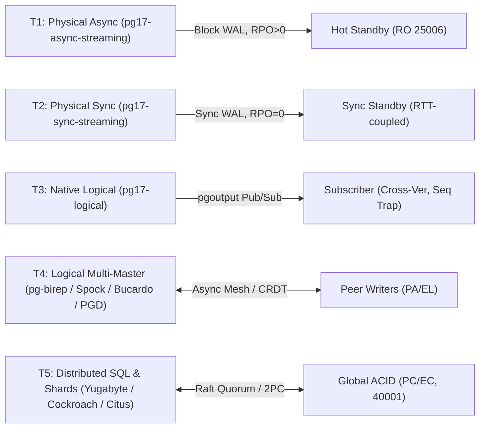

# 10 — Physical Streaming vs Native Logical vs Multi-Master & Distributed SQL

**Series:** PostgreSQL Multi-Master & Active-Active Architectures  
**Author:** Jean-Marie Renouard (`jmrenouard`) — [LightPath](https://www.lightpath.fr)  
**License:** MIT License

---

## 1. The Five-Tier PostgreSQL Replication Spectrum

Teams often jump straight to active-active multi-master without evaluating the two native single-writer replication tiers built into core PostgreSQL: **Physical Streaming Replication** (async or sync) and **Native Uni-Directional Logical Replication**. Moving rightward across the five tiers trades engine simplicity for selective filtering, multi-writer agility, or global consensus.



Commit latency separates asynchronous local writes (`T1`, `T3`, `T4` async) from synchronous standby WAL acknowledgment (`T2`) and multi-round quorum consensus (`T5`):

$$
L_{\text{T1/T3/T4-async}} \approx L_{\text{disk}}, \qquad L_{\text{T2-sync}} \approx L_{\text{disk}} + \text{RTT}_{\text{standby}}, \qquad L_{\text{T5-Raft}} \approx L_{\text{disk}} + 2 \cdot \text{RTT}_{\text{quorum}} + L_{\text{coord}}
$$

---

## 2. Architectural Analysis of the Five Tiers

### Tier 1 — Physical Streaming Replication: Async (`pg17-async-streaming`)

- **Mechanism:** `walsender` ships raw 8 KiB WAL page images byte-for-byte to `walreceiver` via a physical slot (`pg_basebackup`). Standby replays identical heap/index blocks in continuous recovery.
- **Strengths:** Zero schema caveats—keyless tables, DDL, `SERIAL`/`IDENTITY` sequences, `pg_largeobject`, `TRUNCATE`, and all C extensions (`PostGIS`, `pgvector`) replicate identically at local primary commit speed with zero write conflicts.
- **Hard Limits:** Standby is strictly **read-only** (`SQLSTATE 25006` on writes). Requires identical major PG version, CPU arch, and `glibc` collation lineage. Crash failover risks $\text{RPO} > 0$ (unshipped WAL bytes).

### Tier 2 — Physical Streaming Replication: Sync (`pg17-sync-streaming`)

- **Mechanism:** Physical WAL streaming plus `synchronous_standby_names` and `synchronous_commit = on` (standby disk flush) or `remote_apply` (visible on standby before primary `COMMIT` returns).
- **Strengths:** Strict **`RPO = 0`**, 100% PostgreSQL parity, zero conflicts. Paired with **Patroni + etcd** (`#15`), it delivers fenced automated failover (`RTO ~ 10–30 s`).
- **Hard Limits:** Commit latency tracks standby RTT: locally (`results/benchmark_summary.csv`), Suite A drops **`52.8%`** (`866.82 -> 409.48 TPS`); at `25 ms` WAN delay (`Suite F`), throughput collapses **`-86.1%`** (`57.00 TPS`, `p95 = 353.49 ms`). Without a `FIRST 1 (s1, s2)` quorum standby list, losing the sole sync standby **stalls all primary writes**.

### Tier 3 — Native Uni-Directional Logical Replication (`pg17-logical`)

- **Mechanism:** `wal_level = logical` decodes WAL via `pgoutput` into row-level `INSERT`/`UPDATE`/`DELETE` streams filtered by `CREATE PUBLICATION` and applied via `CREATE SUBSCRIPTION`.
- **Strengths:** Table-level granularity, `WHERE` row filters, column lists, writable subscriber for local reporting tables, cross-OS portability, and **zero-downtime cross-major-version upgrades** (PG 15 -> 17 -> 18).
- **Three Operational Traps:**
  1. **Keyless Tables (`SQLSTATE 55000`):** `UPDATE`/`DELETE` fails on publisher tables without a `PRIMARY KEY` or `REPLICA IDENTITY FULL`.
  2. **No Auto-DDL:** `ALTER TABLE ADD COLUMN` does not propagate; apply DDL subscriber-first or apply workers halt.
  3. **Sequence Non-Synchronization Trap (`SQLSTATE 23505`):** Core PG 15–17 logical replication **never syncs sequence `last_value`**. After `50` publisher inserts (`id = 1..50`), the subscriber sequence stays at `1`; promoting without manual `setval()` immediately triggers **`23505`** collisions.

### Tier 4 — Native Bidirectional (`pg-birep`) vs Multi-Master Extensions (`pgEdge`, `Bucardo`, `EDB PGD`)

- **Native Bidirectional (`#1 pg-birep`, `origin = none`):** Breaks `A -> B -> A` loops natively in PG 16–18 (`875.91 TPS` Suite A; `824.04 TPS` under `25 ms` WAN), but offers **no conflict resolution**: PK/`UNIQUE(email)` collisions halt apply (`23505`) and overlapping increments diverge (`-71,063` drift in Suite D). Safe only on disjoint keyspaces.
- **Extensions (`#2 pgEdge Spock 5`, `#9 Bucardo 5`, `#4 EDB PGD`):** Add LWW, global IDs (`snowflake`/`timeshard`), and auto-DDL (`Spock`, `PGD`). Only **CRDT Delta-Apply** (`spock.delta_apply`: `1,837.64 TPS`, **`0` drift** in Suite D) or **EDB PGD CAMO/Eager Raft** avoid Lost Updates (`-278,698` Spock LWW; `-531,620` Bucardo).

### Tier 5 — Distributed SQL Consensus (`YugabyteDB`, `CockroachDB`) & Sharding (`Citus`)

- **Consensus (`#5 YugabyteDB`, `#6 CockroachDB`):** Per-tablet/range Raft (`RF = 3`) guarantees global `UNIQUE`, `RPO = 0`, and 1-of-3 survival, at the cost of `40001` retry loops (`685` failed `sysbench` tx on CockroachDB), 2-of-3 quorum halt (`57014`), and severe WAN drop (`5.78` / `10.06 TPS` at `25 ms`).
- **Sharding (`#7 Citus`):** Scales tenant-keyed PG 17 writes (`0` drift), but blocks non-shard `UNIQUE` (`0A000`), requires Coordinator HA, and drops `-93.0%` (`21.67 TPS`) under `25 ms` WAN 2PC.

---

## 3. 25-Point Feature Matrix: Streaming vs Logical vs Multi-Master

| # | Criterion | T1: Phys Async | T2: Phys Sync | T3: Logical Uni | T4: Logical MM | T5: Dist SQL / Citus |
| :-: | :--- | :--- | :--- | :--- | :--- | :--- |
| 1 | **Repl. Unit** | 8 KiB WAL | 8 KiB WAL | Row tuples | Tuples / triggers | Raft ranges / shards |
| 2 | **Active Writers** | `1` Primary | `1` Primary | `1` Pub (+ Sub) | `N` Peers | `N` Nodes / Coord |
| 3 | **CAP / PACELC** | `PA/EL` | `PC/EC` | `PA/EL` | `PA/EL` (PGD: hyb) | `PC/EC` |
| 4 | **`RPO` (1-Loss)** | `> 0` | **`0`** | `> 0` | `> 0` (CAMO: `0`) | **`0`** (`RF>=3`) |
| 5 | **Commit Latency** | Local `fsync` | `+ 1*RTT` | Local `fsync` | Local (Eager: Raft) | `2*RTT` Raft / 2PC |
| 6 | **Standby Writes** | No (`25006`) | No (`25006`) | Yes (drift risk) | Active-Active | Active-Active |
| 7 | **Major Upgrade** | **No** | **No** | **Yes** (15->17->18) | Yes (`Spock`) | Rolling upgrade |
| 8 | **Cross-OS/ABI** | **No** | **No** | **Yes** | **Yes** | **Yes** |
| 9 | **Row/Col Filter** | No | No | **Yes** (`WHERE`) | Partial (`repset`) | Placement zones |
| 10 | **Auto-DDL** | **100%** WAL | **100%** WAL | **No** (manual) | No `#1/#9`; Yes `#2/#4` | **Yes** (global) |
| 11 | **Keyless DML** | **100%** Native | **100%** Native | **`55000`** (`RI`) | `55000`/drop/reject | Hidden `rowid`/`0A000` |
| 12 | **Sequence Sync** | **100%** WAL | **100%** WAL | **None (`23505`)** | Step / `snowflake` | Global / `unique_rowid` |
| 13 | **Write Conflicts** | None | None | Sub -> `23505` | Halt / LWW / CRDT | `40001` retry |
| 14 | **Lost Update Safe** | Yes | Yes | If Sub RO | `delta_apply`/Eager | **Yes** |
| 15 | **Sec. `UNIQUE`** | Yes | Yes | Pub only | `23505` halt/drop | Global (`0A000` Citus) |
| 16 | **Large Objects** | **100%** WAL | **100%** WAL | **No** | No (`lolor`: Yes) | **No** (Citus Coord) |
| 17 | **`TRUNCATE`** | **100%** WAL | **100%** WAL | Yes (pub opt) | Yes (`#1/#2/#9`) | Yes |
| 18 | **Locks/`LISTEN`** | Primary-local | Primary-local | Pub-local | Node-local | Global/`0A000`/`42601` |
| 19 | **PG Extensions** | **100%** | **100%** | **100%** | **100%** | High `YB` / No `CRDB` |
| 20 | **Slot/Log Bloat** | Physical slot | Physical slot | Logical slot | WAL / `delta` tbl | Raft GC |
| 21 | **Peer Outage** | Primary OK | **Primary stalls** | Primary OK | Peers OK | 1/3 OK; **2/3 halt** |
| 22 | **Promotion** | `pg_promote` | `pg_promote` | Manual cutover | LB reroute | Auto Raft election |
| 23 | **Post-Fail Seq** | Auto-safe | Auto-safe | **Manual `setval`** | Step / `snowflake` | Auto-safe |
| 24 | **WAN `25ms`** | Low (async) | **-86.1%** | Low (async) | Low (`0..-6%`) | **-76% to -97%** |
| 25 | **Ops / TCO** | **Lowest** | **Low** (Patroni) | Low-Med | Med-High | High (Raft/retries) |

---

## 4. Empirical Benchmarks & Extended Limits Alignment (`T11–T18`)

Verified cross-tier results from `results/benchmark_summary.csv`, `results/benchmark_wan_sweep.csv`, and `results/extended_functional_matrix.csv` (all 10 topologies):

| Topology | Tier | Suite A TPS | WAN `10 / 25 / 50 ms` TPS | Suite D Drift | `T15` RAW `p50 / p95` | `T18` Peer Sequence State |
| :--- | :-: | :-: | :-: | :-: | :-: | :--- |
| **`pg17-async-streaming`** | T1 | `610.15` | `587.2 / 599.6 / 619.4` | `0` | `9.65 / 25.13 ms` | Safe: WAL `66\|true` (`next=67`) |
| **`pg17-sync-streaming`** | T2 | `409.48` | `121.8 / 57.0 / 25.8` | `0` | `1.88 / 2.74 ms` | Safe: WAL `66\|true` (`next=67`) |
| **`pg17-logical`** | T3 | `532.38` | `636.6 / 654.1 / 395.5` | `0` | `1.68 / 2.14 ms` | **TRAP:** `1\|false` -> **`23505`** |
| **`pg-birep`** | T4 | `875.91` | `274.5 / 824.0 / 223.3` | `-71,063` | `1.47 / 2.28 ms` | Std seq `1\|false` -> `23505` (step `+2`) |
| **`pgedge` (Spock 5)** | T4 | `556.06` | `644.6 / 646.8 / 687.0` | `-278,698` (`0` CRDT) | `1.16 / 1.63 ms` | Std seq `1\|false` -> `23505` (`snowflake`) |
| **`bucardo`** | T4 | `735.38` | `593.0 / 763.2 / 612.6` | `-531,620` | `548.7 / 1,275 ms` | Std seq `1\|false` -> `23505` |
| **`citus`** | T5 | `309.04` | `44.4 / 21.7 / 8.8` | `0` | `1.71 / 13.89 ms` | Safe: single coord (`next=51`) |
| **`yugabyte` / `cockroach`** | T5 | `173.6 / 42.1` | `15.4/5.8/3.1` vs `19.4/10.1/4.5` | `0` / `0` | `2.0/2.8` vs `4.1/5.0 ms` | Safe: Raft (`next=101` / `51`) |

Empirical proof (`T12`, `T18`, `L7`): physical streaming retained `3,088 B` WAL offline, replicated keyless DML + DDL, blocked standby writes (`25006`), and preserved `66|true` across `pg_promote()`. Conversely, `pg17-logical` **diverged** on `T12` (`pub=upd_n1` vs `sub=DELETED`), rejected keyless updates (`55000`), retained `27,320 B` WAL, and hit **`23505`** on failover until `setval()` restored `id=51`.

---

## 5. Failure, Promotion & Zero-Downtime Upgrade Playbooks

### 5.1 Physical Streaming Promotion (`T1` / `T2`)

1. Fence the failed primary (Patroni watchdog / STONITH) to prevent split-brain writes.
2. Promote standby (`SELECT pg_promote(wait => true);` or Patroni DCS election) and confirm `pg_is_in_recovery() = f`.
3. Zero sequence resync or DDL replay is needed; switch HAProxy/PgBouncer immediately.

### 5.2 Logical Cutover & Zero-Downtime Major Upgrade (`PG 15 -> 17 -> 18`)

1. **Pre-flight:** Verify PKs on 100% of tables, load `pg_dump --schema-only` on PG 18, create `PUBLICATION` + `SUBSCRIPTION` (`copy_data = true`).
2. **Freeze & Drain:** Set source read-only (`SET default_transaction_read_only = on`) and wait until `replay_lsn = sent_lsn`.
3. **Mandatory Sequence Sync (Prevents `23505`):** Advance every sequence on target before opening writes:

```sql
SELECT format('SELECT setval(%L, %s, true);', schemaname || '.' || sequencename, COALESCE(last_value, start_value) + 1000)
FROM pg_sequences WHERE schemaname = 'public';
```

4. **Cutover:** `DROP SUBSCRIPTION`, repoint pooler to PG 18, and retain old primary read-only for fallback.

### 5.3 Migration & Selection Guidance

- **Stay on Tier 1/2 (Physical Streaming + Patroni)** for **80%+ of OLTP workloads**: zero PK/DDL/sequence traps, full extension parity, deterministic `RPO = 0` inside metro AZs.
- **Choose Tier 3 (Native Logical)** for **cross-major-version upgrades**, **OS/glibc transitions**, or **filtered data feeds**—never as an automated HA standby without scripted DDL and sequence sync.
- **Choose Tier 4 (`pgEdge Spock 5` / `EDB PGD`)** only when **multi-region local write latency (`PA/EL`)** is mandatory and counters use CRDTs (`spock.delta_apply`).
- **Choose Tier 5 (`YugabyteDB`, `CockroachDB`, `Citus`)** only when **global `RPO = 0` ACID** or **horizontal multi-terabyte write sharding** justifies WAN latency and `40001` retry engineering.
