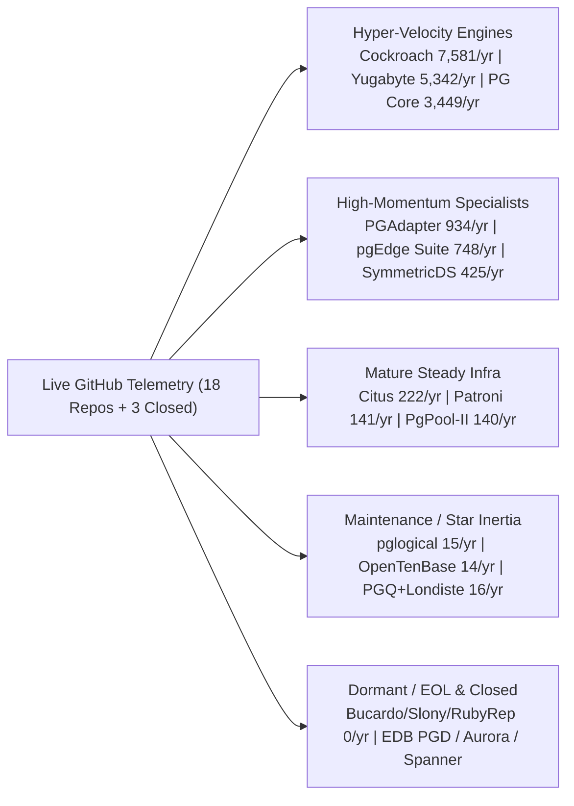

# 11 — Ecosystem Popularity, Git Presence & Engineering Vitality

**Series:** PostgreSQL Multi-Master & Active-Active Architectures  
**Author:** Jean-Marie Renouard (`jmrenouard`) — [LightPath](https://www.lightpath.fr)  
**License:** MIT License

---

## 1. Live Telemetry Methodology (`2026-11-20T13:34:55Z`)

Architecture choices fail when teams mistake legacy brand awareness or cumulative GitHub stars for active engineering cadence. On **`2026-11-20T13:34:55Z`**, [`scripts/collect_popularity.py`](../../scripts/collect_popularity.py) queried live GitHub REST and GraphQL APIs across **21 catalog rows** (**18 public GitHub repos** plus **3 proprietary/managed engines**) into [`results/project_popularity.csv`](../../results/project_popularity.csv):

- **Exact Pagination (`total_commits`, `commits_12m`, `contributors`):** Calls `per_page=1` on each repo's `default_branch` (`since=2025-11-20T13:34:55Z` for 12m commits) and parses HTTP `Link: rel="last"` without cloning repositories.
- **True Watchers & Canonical Targets:** Uses `subscribers_count` (true watchers, avoiding `watchers_count` which duplicates stars), follows canonical redirects (`JumpMind/symmetric-ds` -> `jumpmindinc/symmetric-ds`), and queries `GoogleCloudPlatform/pgadapter` directly for the Spanner proxy.
- **Chronological Tags:** Reads `/releases/latest` with GraphQL `TAG_COMMIT_DATE DESC` fallback so tag-only repos (`postgres/postgres`, `pgEdge/spock`, `cockroachdb/cockroach`, `pgpool/pgpool2`) report current releases.

To contrast cumulative reach ($S$ stars) with active cadence ($C_{12\text{m}}$ commits in 12 months out of $C_{\text{total}}$), we track **12-Month Momentum ($M_{12\text{m}}$)**, **Velocity per Star ($R_{\text{vel/star}}$)**, and **Log-Decade Span ($D_{\text{decades}}$)**:

$$
M_{12\text{m}} = \frac{C_{12\text{m}}}{C_{\text{total}}} \times 100\%, \qquad R_{\text{vel/star}} = \frac{C_{12\text{m}}}{\max(S, 1)}, \qquad D_{\text{decades}} = \log_{10}\!\left(\frac{v_{\max}}{v_{\min}^{+}}\right)
$$

Live telemetry spans **three orders of magnitude**: Stars run from `26` (`pgq/londiste`) to `32,638` (`cockroachdb/cockroach`, $1{,}255\times$, $D = 3.10$), Total Commits `89` to `118,999` ($1{,}337\times$, $D = 3.13$), positive 12m Commits `8` to `7,581` ($948\times$, $D = 2.98$), and Contributors `2` to `1,217` ($609\times$, $D = 2.78$). Per [Chapter 09](09_benchmarks_methodology_and_charts.md), `log10` axes are mandatory.

---

## 2. Complete Ecosystem Telemetry Matrix (`21` Rows)

| Solution (`#`) | Git Role | Repo & Account (`Type`/`Repos`) | Stars / Forks | Commits (`Tot`/`12m`) | Contrib | Lang / SPDX | Tag (`Last Push`) |
| :--- | :--- | :--- | :---: | :---: | :---: | :--- | :--- |
| **PostgreSQL Core (`#1/#15/#16`)** | Mirror* | `postgres/postgres` (Org/6) | 22,893 / 6,122 | 66,089 / **3,449** | 58* | C / NOASSERTION | `REL_19_0` (2026-11-20) |
| **Patroni HA (`#15b`)** | Primary | `patroni/patroni` (Org/1) | 8,845 / 1,048 | 2,712 / 141 | 246 | Py / MIT | `v4.1.5` (2026-11-20) |
| **pgEdge Spock (`#2`)** | Primary | `pgEdge/spock` (Org/51) | 769 / 59 | 1,616 / **621** | 32 | C / NOASSERTION | `v6.0.0-beta.2` (2026-11-20) |
| **pgEdge Snowflake (`#2b`)** | Companion | `pgEdge/snowflake` (Org/51) | 103 / 14 | 239 / 48 | 20 | PLpgSQL / PostgreSQL | `v2.6.1` (2026-11-18) |
| **pgEdge LOLOR (`#2c`)** | Companion | `pgEdge/lolor` (Org/51) | 51 / 8 | 159 / 79 | 16 | C / PostgreSQL | `v1.2.3` (2026-11-20) |
| **pglogical 2 (`#3`)** | Primary | `2ndQuadrant/pglogical` (Org/46) | 1,243 / 179 | 876 / **15** | 52 | C / NOASSERTION | `REL2_4_8` (2026-07-28) |
| **YugabyteDB (`#5`)** | Primary | `yugabyte/yugabyte-db` (Org/314) | 10,670 / 1,481 | 41,469 / **5,342** | **1,217** | C / NOASSERTION | `v2026.1.3.0` (2026-11-20) |
| **CockroachDB (`#6`)** | Primary | `cockroachdb/cockroach` (Org/227) | **32,638** / 4,239 | **118,999** / **7,581** | 1,123 | Go / NOASSERTION | `v25.2.29` (2026-11-18) |
| **Citus (`#7`)** | Primary | `citusdata/citus` (Org/67) | 12,865 / 810 | 7,400 / 222 | 152 | C / AGPL-3.0 | `v14.3.0` (2026-11-20) |
| **OpenTenBase (`#8`)** | Primary | `OpenTenBase/OpenTenBase` (Org/14) | 797 / 633 | 817 / **14** | 64 | C / NOASSERTION | `v5.0` (2026-11-09) |
| **Bucardo 5 (`#9`)** | Primary | `bucardo/bucardo` (Org/15) | 807 / 110 | 2,535 / **0** | 30 | Perl / NOASSERTION | `5.6.0` (2025-05-31) |
| **SymmetricDS (`#10`)** | Primary | `jumpmindinc/symmetric-ds` (Org/8) | 882 / 241 | 14,926 / **425** | 96 | Java / N/A | `3.18.4` (2026-11-19) |
| **PgPool-II (`#11`)** | Mirror* | `pgpool/pgpool2` (Org/8) | 448 / 102 | 4,627 / 140 | 35* | C / NOASSERTION | `V4_7_3` (2026-11-18) |
| **Slony-I (`#14a`)** | Maintainer | `ssinger/slony1-engine` (User/36) | 42 / 19 | 2,569 / **0** | 23 | C / NOASSERTION | `REL_2_2_11` (2024-03-11) |
| **PGQ Queue (`#14b`)** | Primary | `pgq/pgq` (Org/13) | 427 / 23 | 89 / 8 | 7 | PLpgSQL / ISC | `v3.5.2` (2026-07-09) |
| **Londiste (`#14c`)** | Primary | `pgq/londiste` (Org/13) | 26 / 8 | 195 / 8 | 5 | Py / ISC | `v3.12` (2026-07-22) |
| **RubyRep (`#14d`)** | Dormant | `rubyrep/rubyrep` (User/2) | 179 / 74 | 556 / **0** | **2** | Ruby / MIT | `v2.0.0` (2023-07-10) |
| **Spanner PGAdapter (`#13a`)** | Proxy Only | `GoogleCloudPlatform/pgadapter` (Org/1,545) | 94 / 36 | 4,040 / **934** | 22 | Java / Apache-2.0 | `v0.56.4` (2026-11-20) |
| **EDB PGD / BDR (`#4`)** | Proprietary | N/A (`git_present = No (Proprietary)`) | N/A | N/A | N/A | N/A / Proprietary | N/A |
| **AWS Aurora Limitless (`#12`)** | Managed | N/A (`git_present = No (Managed Cloud)`) | N/A | N/A | N/A | N/A / Proprietary | N/A |
| **GCP Spanner & AlloyDB (`#13`)** | Partial | N/A (`PGAdapter only; engine proprietary`) | N/A | N/A | N/A | N/A / Proprietary | N/A |

*\*Notes: `postgres/postgres` (58) and `pgpool/pgpool2` (35) are official read-only mirrors of `git.postgresql.org`; contributor counts reflect trusted committers pushing mailing-list patches, not total authors. `NOASSERTION` indicates custom/dual licenses (PostgreSQL License on Core/Spock/pglogical; BSL/CSL on CockroachDB; Apache-2.0 + Polyform on YugabyteDB; BSD-like on PgPool/Bucardo/Slony). `cockroachdb` tags `v25.2.29` (LTS backport) beside `v26.2.12`; `pgEdge/spock` pairs `v6.0.0-beta.2` with stable `v5.0.14`.*

---

## 3. Logarithmic Charts & Interactive Explorer

Filter all 21 entries, toggle `log10` vs. linear axes, and cross-reference ecosystem vitality with empirical TPS/latency in the offline [**Interactive Benchmark Explorer (`dashboard/index.html`)**](../../dashboard/index.html).

### Chart 08 — Community Reach: Stars & Forks (`log10`)

*Contrasts cumulative reach (`26` to `32,638` stars; `8` to `6,122` forks) across 18 GitHub repos beside proprietary/managed engines.*

### Chart 09 — Engineering Vitality: Commits, 12m Velocity & Contributors (`log10`)

*Reveals the split between star inertia and active code investment: `pgEdge/spock` (`621`/12m) and `pgadapter` (`934`/12m) leap past dormant legacy tools.*

---

## 4. Popularity vs. Engineering Vitality: Five Structural Findings

1. **GitHub Mirror Distortion (`postgres/postgres`, `pgpool/pgpool2`):** `postgres/postgres` shows `0` GitHub issues and only `58` GitHub contributors, which would falsely imply a tiny team if read literally. Both `postgres/postgres` (`66,089` commits, `3,449`/12m, `6,122` forks, `REL_19_0`) and `pgpool/pgpool2` (`4,627` commits, `140`/12m, `V4_7_3`) are **official mirrors of `git.postgresql.org`** fed by mailing lists and Commitfest.
2. **Hyperscale Consensus vs. License Risk (`CockroachDB`, `YugabyteDB`):** `cockroachdb/cockroach` leads stars (`32,638`), total commits (`118,999`), and 12m velocity (`7,581` = `20.8`/day), while `yugabyte/yugabyte-db` leads contributors (`1,217`), org breadth (`314` repos), and momentum ($M_{12\text{m}} = 12.9\%$, `5,342`/12m). Both carry `8,029-9,772` open issues and non-standard licenses (`NOASSERTION`) requiring legal audit.
3. **The Star-Inertia Trap (`pgEdge/spock` vs. `pglogical` & `Bucardo`):** `2ndQuadrant/pglogical` (`1,243` stars) and `bucardo/bucardo` (`807` stars) both outrank `pgEdge/spock` (`769` stars), yet **`pgEdge/spock` shipped `621` commits/12m** ($M_{12\text{m}} = 38.4\%$, $R_{\text{vel/star}} = 0.81$)—**`41.4x` faster than `pglogical`** (`15`/12m, `191` open issues)—while `bucardo` posted **`0` commits** since `2025-05-31`. With `snowflake` (`48`/12m) and `lolor` (`79`/12m, $M_{12\text{m}} = 49.7\%$), pgEdge totals **`748` commits/12m**.
4. **Mature Stability vs. Silent Workhorses (`Patroni`, `Citus`, `SymmetricDS`, `PGAdapter`):** `patroni/patroni` (`8,845` stars, `246` contributors, `1` repo, `MIT`) proves mature HA needs only `141` focused commits/12m (`v4.1.5`). `citusdata/citus` (`12,865` stars, `AGPL-3.0`) sustains PG 17/18 cadence (`222`/12m, `v14.3.0`). `jumpmindinc/symmetric-ds` (`882` stars, `14,926` commits, `425`/12m) runs quietly at industrial scale, while `GoogleCloudPlatform/pgadapter` logs **`934` commits/12m** on `94` stars ($R_{\text{vel/star}} = 9.94$) to maintain wire compatibility for a proprietary engine.
5. **High-Fork Stagnation & Personal-Account EOL (`OpenTenBase`, `PGQ`, `Slony-I`, `RubyRep`):** `OpenTenBase` shows a `0.79` fork-to-star ratio (`633/797`) yet only `14` `master` commits/12m (`421` issues). `pgq`/`londiste` stay on minimal life-support (`8`/12m each, `5-7` contributors), while `ssinger/slony1-engine` (`User`, `0`/12m) and `rubyrep/rubyrep` (`User`, `2` contributors, `0`/12m) are strictly EOL.

---

## 5. Bus-Factor & Production Sustainability Tiers

| Tier | Projects (`#`) | 12m Velocity | Bus Factor & Governance | Production Verdict |
| :---: | :--- | :---: | :--- | :--- |
| **S — Core** | `PostgreSQL Core` (`#1/#15/#16`), `Patroni` (`#15b`) | 141-3,449 | Multi-vendor community; PostgreSQL / MIT licenses | **Lowest risk.** Default for 80%+ of OLTP clusters. |
| **A — Active OSS** | `CockroachDB` (`#6`), `YugabyteDB` (`#5`), `Citus` (`#7`), `pgEdge` (`#2`) | 222-7,581 | Funded teams (32-1,217 contribs); watch BSL/AGPL | **Production-viable.** Audit license and WAN limits. |
| **B — Niche** | `SymmetricDS` (`#10`), `PgPool-II` (`#11`) | 140-425 | Dedicated maintainers (35-96 contribs) | **Targeted use.** Heterogeneous sync (`#10`) or pooling (`#11`). |
| **C — Fragile** | `pglogical 2` (`#3`), `OpenTenBase` (`#8`), `PGQ`/`Londiste` (`#14b/c`) | 8-15 | Minimal cadence; small core (5-64 contribs) | **Avoid greenfield.** Migrate to PG 17/18 logical or Spock. |
| **D — EOL** | `Bucardo 5` (`#9`), `Slony-I` (`#14a`), `RubyRep` (`#14d`) | **0** | Zero 12m commits; `User` repos (`#14a/d`), bus factor 1-2 | **Do not deploy.** Decommission legacy estates. |
| **Closed / Cloud** | `EDB PGD` (`#4`), `Aurora Limitless` (`#12`), `Spanner`/`AlloyDB` (`#13`) | Opaque (934 proxy) | Zero engine Git telemetry; commercial SLA & lock-in | **Contract audit.** Assess exit cost, `PGAdapter`, TCO. |

---

**Navigation:** [Index](../../README.md) · [Ch. 09 — Benchmarks & Log10 Charts](09_benchmarks_methodology_and_charts.md) · [Ch. 10 — Streaming vs Logical vs Multi-Master](10_streaming_vs_logical_vs_multimaster.md) · [Version française](../fr/11_popularite_et_vitalite_ecosysteme.md)
