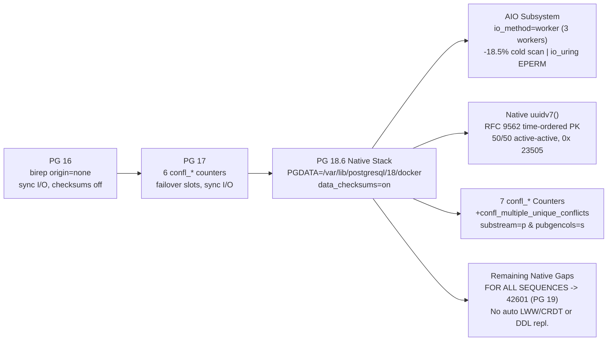

# 12 - PostgreSQL 18 Clustering Evolution & Empirical Benchmarks

**Series:** PostgreSQL Multi-Master & Active-Active Architectures  
**Author:** Jean-Marie Renouard (`jmrenouard`) - [LightPath](https://www.lightpath.fr)  
**Copyright:** Copyright (c) 2026 Jean-Marie Renouard  
**License:** MIT License  
**Links:** [Version francaise](../fr/12_clustering_postgresql_18_et_benchmarks.md) | [Ch. 10 - Streaming vs Logical vs Multi-Master](10_streaming_vs_logical_vs_multimaster.md) | [Ch. 11 - Ecosystem Popularity & Vitality](11_ecosystem_popularity_and_vitality.md)

---

## 1. PostgreSQL 16 -> 17 -> 18 Clustering Evolution

We deployed **`PostgreSQL 18.6 (Debian 18.6-1.pgdg13+2)`** across all five native clustering tiers (`pg18-standalone`, `pg18-async-streaming`, `pg18-sync-streaming`, `pg18-logical`, `pg18-birep`), collecting **87 sequential benchmark rows** ([`results/benchmark_pg18.csv`](../../results/benchmark_pg18.csv)) and **5 x 26 functional probes** ([`results/functional_limits_pg18.csv`](../../results/functional_limits_pg18.csv); log [`results/logs/pg18-benchmark.log`](../../results/logs/pg18-benchmark.log)).

### PostgreSQL 16 vs PostgreSQL 17 vs PostgreSQL 18 Clustering Matrix

| Capability / Default | PostgreSQL 16 | PostgreSQL 17 (`17.11`) | PostgreSQL 18 (`18.6`) |
| :--- | :--- | :--- | :--- |
| **Docker `PGDATA` / `VOLUME`** | `/var/lib/postgresql/data` | `/var/lib/postgresql/data` | **`/var/lib/postgresql/18/docker`**, `VOLUME /var/lib/postgresql` |
| **Default `data_checksums`** | `off` | `off` | **`on`** at `initdb` (silent corruption protection) |
| **AIO (`io_method`)** | `sync` only | `sync` only | **`worker` (`io_workers=3`)** default; `sync`; `io_uring` (`EPERM` default Docker seccomp) |
| **Active-Active PK Gen** | Stepped `SERIAL` / ext | Stepped / `snowflake` | **Native `uuidv7()`** (RFC 9562 time-ordered UUID) |
| **Conflict Telemetry** | Apply error count | 6 `confl_*` counters | **7 `confl_*` counters** (+`confl_multiple_unique_conflicts`) |
| **Logical Apply & Gen Cols** | `streaming=on` opt-in | `streaming=parallel` opt-in | **`substream=p` default**; `publish_generated_columns=stored` (`s`); virtual default |
| **Logical Sequence Sync** | None (`23505` trap) | None (`23505` trap) | **Still absent (`SQLSTATE 42601` on `FOR ALL SEQUENCES` / `REFRESH SEQUENCES`; PG 19)** |
| **Birep LWW / CRDT / DDL** | Manual (`origin=none`) | Manual (`origin=none`) | **Still manual**: no auto LWW/CRDT, no DDL repl. (`TRUNCATE` only) |

---

## 2. Empirical PG 18.6 Functional, AIO & Conflict Findings

We quantify AIO latency shift $\Delta_{\text{AIO}}$ and generational speedup $S_{18/17}$ as:

$$
\Delta_{\text{AIO}} = \frac{t_{\text{worker}} - t_{\text{sync}}}{t_{\text{sync}}} \times 100\%, \qquad S_{18/17} = \frac{\text{TPS}_{\text{PG18}}}{\text{TPS}_{\text{PG17}}}
$$

### 2.1 Controlled AIO `io_method` A/B Probe (`pg18-standalone`)

- **Cold post-checkpoint scan:** `worker` (`829.4 ms`) beat `sync` (`1,018.3 ms`) by **$\Delta_{\text{AIO}} = -18.5\%$** (parallel read-ahead on uncached pages).
- **Warm OS-cached avg:** `385.0 ms` (`worker`) vs `352.5 ms` (`sync`) (`+9.2%` worker-IPC overhead on hot RAM cache).
- **Small `fsync` `pgbench` RW:** `290.75` (`worker`) vs `323.98 TPS` (`sync`) (`-10.3%`, combining IPC + default `data_checksums=on`).
- **`io_method=io_uring`:** Startup fails (`EPERM`) under Docker's default seccomp profile.

### 2.2 Native `uuidv7()` Active-Active Proof (`pg18-birep`)

- **50/50 Dual-Node Convergence:** `id UUID PRIMARY KEY DEFAULT uuidv7()` converged **50/50 concurrent dual-node inserts** (`0` `23505`, `0` B-tree ordering inversions) vs naive `SERIAL` (`23505`, `confl_insert_exists=1`).
- **`H_append_only_insert`:** Two `pg18-birep` writers hit **`2,066.70 TPS`** (`p95 = 5.42 ms`, `PASS_CONVERGED`, `24,767/24,767`) vs PG 17 `627.13 TPS` (`p95 = 32.79 ms`) = **`3.30x`** ($S_{18/17} = 3.30$).

### 2.3 Live `pg_stat_subscription_stats` Verification & `L1-L8` / `T11-T18` Highlights

| Counter (`pg_stat_subscription_stats`) | `pg18-logical` | `pg18-birep` | Live Trigger & Observed Outcome |
| :--- | :---: | :---: | :--- |
| `confl_insert_exists` | **2** | **2** | Naive `SERIAL` + `UNIQUE(email)` collision (`SQLSTATE 23505`; apply halted) |
| `confl_update_origin_differs` | **1** | **1/2** | Concurrent `+100/-30` Lost Update (`n1=970.00` vs `n2=1100.00`; diverged) |
| `confl_update_missing` | **1** | **1** | `T12` `UPDATE` vs `DELETE` (`logical` diverged `upd_n1`/`DELETED`; `birep` `DELETED`) |
| `confl_delete_missing` | **1** | 0 | Remote `DELETE` targeting already-deleted subscriber tuple |
| `confl_delete_origin_differs` | 0 | **1** | `T12` `DELETE` racing against remote-origin `UPDATE` on `pg18-birep` |
| `confl_multiple_unique_conflicts` *(PG 18)* | 0 | **1** | Single `INSERT` colliding simultaneously on PK + `UNIQUE(email)` |

Key `L1-L8` / `T11-T18` results (`results/functional_limits_pg18.csv`):
- **`T11` Bulk 10k:** `pg18-async-streaming` led at **`87,903 rows/s`** (`114 ms`, catch-up `88.4 ms` vs PG 17 `28,693`); `pg18-standalone` `80,108` (`+52.6%`); `pg18-sync-streaming` `75,629` (`+90.5%`, `99.8 ms`); `pg18-birep` `70,470` (`321.2 ms`); `pg18-logical` `69,827` (`316.0 ms`).
- **`T13` Cross-Node FK Race:** `pg18-birep` exposed async FK race (**`2/10 ok; 23503x8`**); streaming rejected standby writes (`25006x10`); `standalone` & `logical` passed `10/10`.
- **`T14` / `T15` / `T16` / `T17`:** 5/5 bit-identical (`md5=00493e3a`, `65,536 B` `BYTEA`, `JSONB`, UTF-8); `T15` RAW `p50/p95` dropped on every replicated stack (`pg18-async` `4.41/5.80` vs PG 17 `9.65/25.13 ms`, `pg18-sync` `1.47/2.07`, `pg18-logical` `1.46/1.68`, `pg18-birep` `1.25/1.75 ms`); 5/5 passed `T16` `SIGKILL` (`20/20`, `RPO=0`, `21/21`) and `T17` (`NO_DIRTY_READ`, `82-114 ms`).
- **`T18` Sequence Sync & `L7` WAL:** Physical streaming kept `66|true` (`next_id=67`, `3,008 B` WAL; sync stalled primary on `wait_event=SyncRep`). `pg18-logical` (`19,448 B`) and `pg18-birep` (`352,664 B`) raised **`SQLSTATE 42601`** on `FOR ALL SEQUENCES` / `REFRESH SEQUENCES` and stayed at `1|false` -> **`SQLSTATE 23505`**.

---

## 3. Head-to-Head Benchmarks: PostgreSQL 18.6 vs PostgreSQL 17.11

All 87 PG 18.6 rows ran sequentially at `PG_SCALE=2` in the identical `bench_client` harness (`results/benchmark_pg18.csv` vs `benchmark_summary.csv`, `benchmark_extended_workloads.csv`, `benchmark_wan_sweep.csv`, `benchmark_concurrency_sweep.csv`).

### 3.1 Core `pgbench` & `H_append_only` (TPS: PG 18.6 / PG 17.11)

| Topology Pair | `A_single_rw` | `B1_disjoint` | `B2_overlap` (Drift) | `C_ro` (16c) | `D_hot_conflict` (Drift) | `H_append_only` (Ratio) |
| :--- | :---: | :---: | :---: | :---: | :---: | :---: |
| **`standalone`** | 784.43 / 866.82 | 712.70 / 920.07 | 506.21 / 879.01 (0) | 42,373.67 / 55,614.16 | 2,117.66 / 3,128.63 (0) | 1,956.76 / 3,108.22 (0.63x) |
| **`async-streaming`** | 558.34 / 610.15 | 349.25 / 627.39 | 353.30 / 584.80 (0) | **47,548.05** / 45,358.52 | **2,277.43** / 2,081.26 (0) | 1,423.07 / 2,511.15 (0.57x) |
| **`sync-streaming`** | **497.94** / 409.48 | **523.12** / 407.41 | **472.20** / 465.22 (0) | 32,258.16 / 54,483.07 | 1,223.75 / 1,370.10 (0) | **1,760.26** / 1,301.45 (**1.35x**) |
| **`logical`** | 314.26 / 532.38 | **287.13** / 251.63 | **475.08** / 355.57 (0) | **45,862.68** / 42,302.43 | **2,998.37** / 2,386.93 (0) | **3,518.49** / 1,901.20 (**+85.1%**) |
| **`birep`** | 514.28 / 875.91 | 417.18 / 820.09 | 792.45 / 1,228.60 (-338 / -4,567) | 42,190.66 / 53,072.52 | **1,774.11** / 1,231.15 (-83,252 / -71,063) | **2,066.70** / 627.13 (**3.30x**) |

### 3.2 `sysbench` (`E`, `E2`, `E3`, `E4`) & `T11` Bulk 10k (PG 18.6 / PG 17.11)

| Topology Pair | `E_oltp_rw` TPS | `E2_oltp_ro` TPS | `E3_oltp_wo` TPS | `E4_point_select` QPS | `T11` Bulk 10k (`rows/s`) |
| :--- | :---: | :---: | :---: | :---: | :---: |
| **`standalone`** | 1,046.67 / 1,129.51 | **2,000.88** / 1,774.04 (+12.8%) | 1,382.15 / 1,784.36 | 130,850.73 / 143,147.96 | **80,108** / 52,496 (+52.6%) |
| **`async-streaming`** | **980.72** / 962.84 | 1,706.90 / 1,804.13 | **1,809.82** / 1,569.06 (+15.3%) | 126,416.90 / 148,022.41 | **87,903** / 28,693 (**3.06x**) |
| **`sync-streaming`** | 767.63 / 819.36 | **1,869.54** / 1,693.64 (+10.4%) | **1,184.57** / 370.71 (**3.20x**) | 122,246.91 / 124,105.25 | **75,629** / 39,697 (+90.5%) |
| **`logical`** | **1,027.84** / 595.81 (+72.5%) | 1,517.26 / 1,806.08 | **1,582.39** / 801.11 (**+97.5%**) | 131,542.35 / 146,564.77 | **69,827** / 52,816 (+32.2%) |
| **`birep`** | 1,055.55 / 1,105.32 | **2,053.07** / 1,658.72 (+23.8%) | **1,492.99** / 1,308.81 (+14.1%) | **146,907.74** / 141,203.99 | **70,470** / 65,881 (+7.0%) |

### 3.3 WAN RTT (`10 / 25 / 50 ms`) & Concurrency Sweep (`c = 1, 4, 8, 16, 32`)

| Topology Pair | WAN `10/25/50ms` PG 18 | WAN `10/25/50ms` PG 17 | Conc `c=1/4/8/16/32` PG 18 | Conc `c=1/4/8/16/32` PG 17 |
| :--- | :---: | :---: | :---: | :---: |
| **`standalone`** | N/A | N/A | 308.6 / 753.5 / 832.5 / 692.8 / 813.9 | 298.4 / 525.0 / 630.2 / 739.6 / 801.3 |
| **`async-streaming`** | 617.0 / 554.9 / 408.0 | 587.2 / 599.6 / 619.4 | 399.7 / 586.1 / 651.5 / 634.1 / 624.9 | 336.8 / 545.9 / 577.7 / 624.8 / 571.6 |
| **`sync-streaming`** | 113.7 / 41.6 / 25.6 | 121.8 / 57.0 / 25.8 | 286.8 / 315.1 / 307.0 / 425.2 / 305.2 | 89.9 / 238.2 / 410.8 / 424.7 / 425.0 |
| **`logical`** | **683.3 / 844.1 / 721.6** | 636.6 / 654.1 / 395.5 | 407.6 / 788.6 / 718.2 / 736.4 / 627.7 | 306.1 / 731.1 / 736.3 / 596.1 / 706.7 |
| **`birep`** | **763.8 / 747.4 / 782.6** | 274.5 / 824.0 / 223.3 | **334.7 / 689.2 / 799.8 / 790.5 / 721.5** | 201.0 / 196.6 / 162.4 / 337.6 / 254.4 |

### Performance Takeaways

1. **Decisive PG 18.6 Wins:** `substream=p`, `uuidv7()`, and I/O batching accelerated `H_append_only` (`pg18-birep` **3.30x**, `pg18-logical` **+85.1%**, `pg18-sync` **+35.3%**), write-heavy `sysbench` (`pg18-sync` `E3` **3.20x**, `pg18-logical` `E` **+72.5%** / `E3` **+97.5%**), `pg18-birep` concurrency (`c=8` **4.92x**) and WAN `50 ms` (**3.50x**), and `T11` bulk load (+7% to **3.06x**).
2. **Honest Small-TX Overhead:** On tiny cached `pgbench` commits (`A`/`B1`/`B2`) and hot `C` scans, default `data_checksums=on` + `io_method=worker` IPC trimmed peaks by `-8.5%` to `-41%` vs PG 17 (`checksums=off`, `sync`), matching the AIO A/B probe (`290.75` vs `323.98 TPS`).
3. **Unchanged Physics:** `pg18-sync-streaming` still dropped `-94.9%` at `50 ms` WAN (`25.60 TPS`, `p95 = 766.21 ms`); `pg18-birep` still diverged on overlapping writes (`B2` `-338`; `D` `-83,252`).

---

## 4. Production Upgrade & Architecture Guidance (PG 16 -> 17 -> 18)

### 4.1 Upgrade Checklist (`PG 16/17 -> PG 18.6`)

1. **Docker Storage Layout:** Mount `/var/lib/postgresql` and resolve `$PGDATA` dynamically (`/var/lib/postgresql/18/docker`) in `pg_basebackup` and Patroni manifests.
2. **Checksums & AIO:** Enable checksums before `pg_upgrade` (`pg_checksums --enable`). Keep `io_method=worker` for scans/mixed I/O; test `sync` on pure hot-RAM micro-OLTP; whitelist `io_uring` in seccomp before switching.
3. **Sequence Sync Still Required:** Until PG 19 adds logical sequence sync, run scripted `setval()` (Ch. 10, Section 5.2) during every logical cutover to prevent `SQLSTATE 23505`.

### 4.2 Honest Decision Boundary: Native PG 18 vs Extensions & Distributed SQL

| Target Requirement | Native PG 18 Enough? | Recommended Architecture |
| :--- | :---: | :--- |
| Single-primary HA (`RPO=0` metro, 100% PG parity) | **Yes** | **PG 18 Streaming + Patroni** (`pg18-sync` +21.6% `A`, +90.5% `T11`) |
| Zero-downtime major upgrade / filtered feeds | **Yes (with `setval`)** | **PG 18 Logical** (`substream=p`, `pubgencols=s`, +72.5% `E`, +85.1% `H`) |
| Append-only / disjoint active-active multi-region | **Yes (`uuidv7()`)** | **PG 18 Birep (`origin=none`) + `uuidv7()` + `confl_*`** (2,066.70 TPS, 0 PK clash) |
| Overlapping counters, LWW, Auto-DDL, 3+ mesh | **No** | **pgEdge Spock 5 (`delta_apply` CRDT)** or **EDB PGD** (native PG 18 drifts -83,252 in D) |
| Global `RPO=0` ACID, global `UNIQUE`, cross-node FK | **No** | **YugabyteDB** or **CockroachDB** (`pg18-birep` still hits `23505` stalls & `T13` `23503x8`) |

---

**Navigation:** [Index](../../README.md) | [Ch. 09 - Benchmarks & Log10 Charts](09_benchmarks_methodology_and_charts.md) | [Ch. 10 - Streaming vs Logical vs Multi-Master](10_streaming_vs_logical_vs_multimaster.md) | [Ch. 11 - Ecosystem Popularity & Vitality](11_ecosystem_popularity_and_vitality.md) | [Version francaise](../fr/12_clustering_postgresql_18_et_benchmarks.md)
