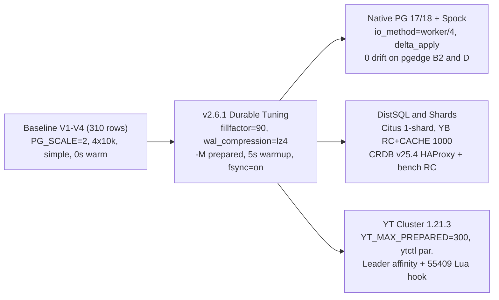

# 13 - Production Tuning & Realistic Scale Benchmarks (`PG_SCALE=20`)

**Series:** PostgreSQL Multi-Master & Active-Active | **Author:** Jean-Marie Renouard (`jmrenouard`) - [LightPath](https://www.lightpath.fr) (MIT)  
**Links:** [Version francaise](../fr/13_optimisation_production_et_benchmarks_realistes.md) | [Ch. 06](06_empirical_test_and_benchmark_results.md) | [Ch. 09](09_benchmarks_methodology_and_charts.md) | [Ch. 12](12_postgresql_18_clustering_and_benchmarks.md) | [Dashboard](../../dashboard/index.html)

---

## 1. From `PG_SCALE=2` Defaults to Durable Production Tuning (`v2.6.1`)

Baseline V1-V4 campaigns ([Ch. 06](06_empirical_test_and_benchmark_results.md), [Ch. 09](09_benchmarks_methodology_and_charts.md)) tested defaults at `PG_SCALE=2` (`200k` rows), `sysbench` `4x10k`, simple protocol, and `0s` warm-up. In `env/multi-db-docker-env` **`v2.6.1`** (`scripts/bench_pg_optimized_runner.sh`), all 13 PG Compose stacks apply **durable tunings** (`fsync=on`, `full_page_writes=on`, `RPO=0` on sync/Raft/XA), collecting **318 rows** across **18 topologies** (`2` standalone x `15` + `16` replicated x `18`) in [`results/benchmark_optimized.csv`](../../results/benchmark_optimized.csv) ([log](../../results/logs/benchmark-optimized.log)):

- **10x Dataset & 2.5x Sysbench:** `PG_SCALE=20` (`2M` `pgbench_accounts`, `20` branches, `200` tellers) + `sysbench` `4x25k` (`100k` rows) under `15 GiB` RAM caps (`2048m` x3 Citus, `3072m` x3 Yugabyte/Cockroach).
- **Prepared + Warm-Up + HOT:** `pgbench -M prepared --max-tries=200` after `WARMUP_S=5` (`A`-`D`, `F`, `G_conc_c1`), plus `WITH (fillfactor=90)` on `pgbench_{accounts,branches,tellers}` (omitted on Yugabyte DocDB LSM).
- **Retries & HAProxy:** `sysbench` via `/tmp/sb_wrap.lua` (`sql_error_ignorable` for `55409`/`40001`/`40P01` + `ROLLBACK`); YugabyteDB (`:15470`) & CockroachDB v25.4 (`:15480`) use HAProxy TCP, adding `cockroach-rc` (`READ COMMITTED`).

We quantify throughput multiplier $G_{\text{opt}}$ and `p95` speedup $R_{p95}$ per suite as:

$$
G_{\text{opt}} = \frac{\text{TPS}_{\text{opt}}(\text{scale}=20)}{\text{TPS}_{\text{base}}(\text{scale}=2)}, \qquad R_{p95} = \frac{p95_{\text{base}}}{p95_{\text{opt}}}
$$

---

## 2. Per-Solution Durable Tuning Playbook (All `18` Topologies)

|Group (`#`)|Verified Compose, DDL & Runtime Tunings (`v2.6.1`)|Critical Caveat Verified|
|:---|:---|:---|
|**PG 17** (`pg17-*`, `pg-birep`) (`#15`, `#16`, `#1`)|`shared_buffers=512MB`, `effective_cache_size=2GB`, `work_mem=16MB`, `maintenance_work_mem=128MB`, `max_connections=200`, `wal_compression=lz4`, `wal_buffers=16MB`, `max_wal_size=2GB`, `min_wal_size=512MB`, `checkpoint_completion_target=0.9`, `random_page_cost=1.1`, `effective_io_concurrency=16`, `jit=off`, `fillfactor=90`; logical/birep add `logical_decoding_work_mem=256MB`, `max_parallel_apply_workers_per_subscription=4`, `max_logical_replication_workers=8`, `max_worker_processes=16`.|`io_method`/`io_workers` fail on PG 17 (`17.11`); keep on PG 18/YT only. `pg-birep` keeps `INCREMENT BY 2` `hid`.|
|**PG 18.6** (`pg18-*`) (`#17`)|PG 17 GUCs + `io_method=worker`, `io_workers=4`, `data_checksums=on`, native `uuidv7()` `hid` on `pg18-birep`.|`io_uring` fails (`EPERM`) in Docker seccomp; `pg18-birep` still diverges in `D` (`-95989`).|
|**pgEdge Spock 5** (`pgedge`, `17.12`) (`#2`)|`wal_compression=lz4`, `logical_decoding_work_mem=256MB`, `spock.batch_inserts=on`, `spock.use_spi=off`, `spock.synchronous_commit=off`, `spock.feedback_frequency=200`, `spock.save_resolutions=on`, `snowflake.node=1..3`; `SET (log_old_value=true, delta_apply_function=spock.delta_apply)` on `abalance`/`bbalance`/`tbalance`.|Drain peer `pgbench_history` before resetting `hs[0]` so `-old` delta applies cleanly (`0` drift across 18 suites).|
|**Bucardo 5.6** (`bucardo`, `17.12`) (`#9`)|PG 17 GUCs + `autovacuum_naptime=5s`, `autovacuum_vacuum_scale_factor=0.05`, `autovacuum_analyze_scale_factor=0.05`, `autovacuum_vacuum_cost_limit=2000`, `autovacuum_max_workers=4`; `bucardo set quick_delta_check=1 ctl_sleep=0.1 kid_sleep=0.1`; `autokick=1 stayalive=1 kidsalive=1`.|`sync_pgbench` skips `sbtest*` (`_sb_prepare` waits on `hs[0]` only). LWW loses updates (`15339` `B2`, `-303741` `D`).|
|**Citus 14.2** (`citus`, `17.10`) (`#7`)|`2048m`/node, `shared_buffers=512MB`, `effective_cache_size=1536MB`, `wal_compression=lz4`, `jit=off`, `citus.shard_count=32`, `citus.max_adaptive_executor_pool_size=16`, `citus.multi_shard_modify_mode=parallel`, `citus.local_shared_pool_size=50`; **1-shard-per-stmt**: `branches(bid)`, `tellers(tid)`, `accounts(aid)`, `history(aid, colocate_with=>'pgbench_accounts')`.|`bid`-colocated DDL forced 32-shard scatter on `WHERE aid=:aid` (`40.56 TPS`, `197.2ms` avg). Autocommit `DROP TABLE` avoids deadlocks.|
|**YugabyteDB `2026.1.3`** (`yugabyte`) (`#5`)|`3072m` (`master` `512MiB`, `tserver` `1.5GiB`), `yb_enable_read_committed_isolation=true`, `enable_wait_queues=true`, `ysql_enable_packed_row=true`, `yb_num_shards_per_tserver=1`, `ysql_num_shards_per_tserver=1`, `ysql_max_connections=300`, `ysql_pg_conf_csv={yb_enable_cbo=on,jit=off}`, `CACHE 1000`, HAProxy `:15470`.|`COPY` risks OOM at `PG_SCALE=20`; chunked `50k` `INSERT`s load safely. `sysbench` `4x25k` pays HAProxy + scan cost.|
|**CockroachDB `v25.4.21`** (`cockroach`, `cockroach-rc`) (`#6`)|Upgraded `v24.3.0->latest-v25.4` (`3072m`), `--cache=1GiB --max-sql-memory=1GiB`, HAProxy `:15480` (`/health?ready=1`), `/tmp/sb_wrap.lua` `40001`. `cockroach-rc`: `SET CLUSTER SETTING sql.txn.read_committed_isolation.enabled=true;` + admin `bench` (`ALTER ROLE bench SET default_transaction_isolation='read committed'`).|`sql.defaults.default_transaction_isolation` invalid (`42P02`); `ALTER ROLE ALL` skips `root` (`42501`); `bench` enforces RC.|
|**YT Cluster `1.21.3`** (`yt-cluster*`, PG `18.7`) (`#18`)|`YT_MAX_PREPARED=300` + PG 18 GUCs (`shared_buffers=512MB`, `wal_compression=lz4`, `io_method=worker`, `io_workers=4`, `jit=off`); `ytctl` tokens `CgPIAQE=` (`cc=half`, `parallel_apply_conns=4`) and `CgcSAhACyAEB` (`cc=nodes>=0` + parallel); Leader affinity (`yt_info('o')`); `/tmp/sb_wrap.lua` (`55409`).|Never pass `-c shared_preload_libraries=...` on CLI (clobbers `conf.d/yt.conf`). `pgbench` aborts on `55409` (`RC=2`), needing `YT_RETRY_PY`.|

---

## 3. Before (`PG_SCALE=2`) vs. After (`PG_SCALE=20`) Across All `18` Topologies

Verbatim `results/benchmark_optimized.csv` (`318` rows, `PG_SCALE=20`, exact `p95` tail latencies only) vs `PG_SCALE=2` baselines (`cockroach-rc` vs `cockroach` `v24.3.0` Serializable):

|Topology (`Scale=20`)|`A` RW (`Base->Opt`)|`B2` (`Drift`)|`D` Hot 50 (`Drift`)|`E` SB (`Fl/Rt`)|`H` Append|`F` `25ms`|`G` `c=32`|
|:---|:---:|:---:|:---:|:---:|:---:|:---:|:---:|
|`pg17-standalone`|866.82->1833.98 (2.12x)|879.01->1574.23 (0)|3128.63->2999.19 (0)|1129.51(112)->975.67(0/32)|3108.22->2430.82|N/A|801.27->3026.06 (3.78x)|
|`pg17-async-streaming`|610.15->1276.91 (2.09x)|584.80->1230.92 (0)|2081.26->2045.29 (0)|962.84(107)->878.29(0/25)|2511.15->2425.19|599.61->1163.62|571.58->2891.42 (5.06x)|
|`pg17-sync-streaming`|409.48->947.80 (2.31x)|465.22->985.62 (0)|1370.10->1103.53 (0)|819.36(118)->721.28(0/25)|1301.45->1584.88|57.00->115.73 (2.03x)|424.98->1957.79 (4.61x)|
|`pg17-logical`|532.38->1857.44 (3.49x)|355.57->1709.59 (0)|2386.93->2871.31 (0)|595.81(65)->1028.84(0/37)|1901.20->3258.16|654.11->1947.79|706.65->3432.39 (4.86x)|
|`pg-birep`|875.91->1836.27 (2.10x)|1228.60(-4567)->1641.89(0)|1231.15(-71063)->2115.99(-94514)|1105.32(96)->1036.93(0/29)|627.13->2401.93 (3.83x)|824.04->1588.44|254.43->3890.14 (15.29x)|
|`pg18-standalone`|784.43->1883.93 (2.40x)|506.21->1891.18 (0)|2117.66->3322.45 (0)|1046.67(74)->1078.99(0/33)|1956.76->2626.99|N/A|813.91->4160.50 (5.11x)|
|`pg18-async-streaming`|558.34->1373.98 (2.46x)|353.30->1440.53 (0)|2277.43->2138.07 (0)|980.72(75)->995.00(0/27)|1423.07->2728.58|554.93->1144.28|624.85->3578.90 (5.73x)|
|`pg18-sync-streaming`|497.94->1153.85 (2.32x)|472.20->938.53 (0)|1223.75->1133.32 (0)|767.63(76)->726.17(0/25)|1760.26->1753.60|41.56->178.00 (4.28x)|305.22->2313.61 (7.58x)|
|`pg18-logical`|314.26->1846.00 (5.87x)|475.08->1687.34 (0)|2998.37->2890.98 (0)|1027.84(79)->1016.40(0/37)|3518.49->3012.75|844.10->1769.69|627.69->4146.78 (6.61x)|
|`pg18-birep`|514.28->1758.84 (3.42x)|792.45(-338)->1358.03(0)|1774.11(-83252)->2087.99(-95989)|1055.55(76)->998.04(0/22)|2066.70->2176.42|747.42->1846.09|721.49->4163.31 (5.77x)|
|`pgedge`|556.06->1948.84 (3.50x)|818.65(-66328)->1336.14(0)|2280.11(-278698)->2125.19(0)|888.56(114)->1018.74(0/28)|2206.60->2552.75|646.77->1606.27|575.54->3155.35 (5.48x)|
|`bucardo`|735.38->641.72|1267.77(123679)->1125.12(15339)|1378.79(-531620)->1015.75(-303741)|1232.84(112)->1058.84(0/31)|1105.99->1043.14|763.23->712.79|582.00->567.95|
|`citus`|309.04->493.76 (1.60x)|312.98->514.14 (0)|1691.45->1267.12 (0)|189.44(9)->76.76(0/1)|2040.36->2544.52|21.67->33.20|260.76->894.14 (3.43x)|
|`yugabyte`|173.64->441.44 (2.54x)|170.19->379.44 (0)|832.65->703.15 (0)|128.24(0)->68.85(0/0)|2987.24->3161.72|5.78->20.80 (3.60x)|99.49->589.52 (5.93x)|
|`cockroach`|42.08->307.95 (7.32x)|74.17->355.81 (0)|471.61->603.44 (0)|44.84(685)->85.38(0/650)|734.60->1305.70|10.06->27.10 (2.69x)|40.25->365.47 (9.08x)|
|`cockroach-rc`|42.08->287.18 (6.82x)|74.17->276.54 (0)|471.61->502.00 (0)|44.84(685)->153.70(0/0)|734.60->1159.66|10.06->28.86 (2.87x)|40.25->337.03 (8.37x)|
|`yt-cluster`|20.63->40.77 (1.98x)|10.69->61.03 (0)|67.76->106.65 (0)|28.48(12)->31.79(0/13)|110.53->104.99|2.25->3.44|4.60->37.34 (8.12x)|
|`yt-cluster-async`|41.45->118.03 (2.85x)|55.03->117.93 (0)|163.01->202.01 (0)|124.05(34)->123.42(0/23)|224.93->440.62|4.78->8.84|44.20->113.98|

---

## 4. Five Architectural Insights Under Tuned `PG_SCALE=20` Load

1. **Prepared + LZ4 + `fillfactor=90` Multiply Native Scaling (`2.1x-15.3x`):** Cutting parse CPU and keeping 10% HOT headroom drove `pg17-logical` `A` **`3.49x`** (`1857.44`), `pg18-logical` `A` **`5.87x`** (`1846.00`), `pg-birep` `G_conc_c32` **`15.29x`** (`3890.14`), and `pg18-birep` `G_conc_c32` **`5.77x`** (`4163.31`), while `pg18-sync` `25ms` WAN jumped **`4.28x`** (`178.00 TPS`, `p95` `529.136->92.707ms`).
2. **pgEdge Spock 5 `delta_apply` Holds `0` Drift at `2125.19 TPS`:** `spock.delta_apply` on `abalance`/`bbalance`/`tbalance` hit **`1336.14 TPS`** (`B2`) and **`2125.19 TPS`** (`D`) with **`0` drift** on 3 nodes, vs `pg-birep` (`-94514`), `pg18-birep` (`-95989`), and `bucardo` (`15339` `B2`, `-303741` `D`). Though `PG_SCALE=20` diluted `B2` collisions on `birep`, `D` proves async LWW still corrupts hot rows.
3. **Distributed SQL Resurgence (HAProxy, `v25.4`, RC, 1-Shard Citus):** CockroachDB `v25.4` + HAProxy `:15480` surged **`7.32x`** on `A` (`307.95 TPS`, `0` retries, `p95` `625.042->51.183ms`) and **`9.08x`** on `G_conc_c32` (`365.47`); `cockroach-rc` (`bench`) erased all `650` `sysbench` `40001` retries (`85.38->153.70 TPS`, `rt=0`, `p95` `253.35->80.03ms`). YugabyteDB (`:15470`, `CACHE 1000`) hit `441.44` (`A`), `589.52` (`G_conc_c32`), `20.80` (`F_25ms`), and **`3161.72`** (`H`); Citus 1-shard hit `493.76` (`A`) and `894.14` (`G_conc_c32`).
4. **Honest `10x`/`2.5x` Scale & Scan Regressions:** `sysbench` `4x25k` cut scan TPS on 32-shard `citus` (`189.44->76.76`, `E2` `180.33->83.16`) and `yugabyte` (`128.24->68.85`, `1.5GiB` tserver + HAProxy). `B1_disjoint_rw` (`bid=1..2` in `s_d1`/`s_d2`) dipped on `pg17-standalone` (`920.07->620.74`) and `pg17-async` (`627.39->359.45`) under 10x heap/index size and denser prepared branch locks.
5. **YT Cluster Gains Within XA Bounds:** `YT_MAX_PREPARED=300`, `ytctl` parallel tokens, Leader routing, and `/tmp/sb_wrap.lua` pushed `yt-cluster` (`A` `1.98x`, `B2` `5.71x`, `G_conc_c32` `8.12x`) and `yt-cluster-async` (`A` `2.85x`, `H` `1.96x`, `E4` **`189286.48 TPS`** at `0.08ms` avg / `0.21ms` `p95`, **`0` drift** across `36` rows, `1` `tx_failed` in `async D`), yet XA triggers trail CockroachDB `7.5x` on `A` (`40.77` vs `307.95`) and fall to `1.82 TPS` (`p95=6095.341ms`) at `50ms` WAN.

---

**Navigation:** [Index](../../README.md) | [Ch. 06](06_empirical_test_and_benchmark_results.md) | [Ch. 09](09_benchmarks_methodology_and_charts.md) | [Ch. 12](12_postgresql_18_clustering_and_benchmarks.md) | [Dashboard](../../dashboard/index.html) | [Version francaise](../fr/13_optimisation_production_et_benchmarks_realistes.md)
