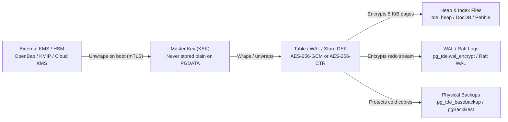

# 14 - Transparent Data Encryption (TDE) and Encryption at Rest

**Series:** PostgreSQL Multi-Master & Active-Active Architectures  
**Author:** Jean-Marie Renouard (`jmrenouard`) - [LightPath](https://www.lightpath.fr)  
**License:** MIT License  
**Links:** [Ch. 04 - Feature Matrix](04_comprehensive_feature_comparison.md) | [Ch. 07 - Decision Guide](07_decision_framework_and_production_guide.md) | [Ch. 10 - 5-Tier Spectrum](10_streaming_vs_logical_vs_multimaster.md) | [Ch. 12 - PG 18.6 Clustering](12_postgresql_18_clustering_and_benchmarks.md) | [Docs Portal](../index.md)

---

## 1. Encryption Layers and Threat Model

Compliance frameworks (PCI-DSS, HIPAA, GDPR, DORA) require strong encryption for stored database files and backups. Community PostgreSQL (`15` through `18.6`) ships without native storage TDE. Teams therefore combine four security layers:

1. **Transport Encryption (`TLS 1.3`):** `hostssl` and `sslmode=verify-full` protect SQL clients, physical WAL shipping, and logical `pgoutput` streams on the wire.
2. **OS and Block Encryption:** `dm-crypt`/LUKS, ZFS dataset encryption, or cloud volume KMS (EBS/PD) encrypts raw disks at rest. Once mounted, the kernel serves plaintext blocks to any host root user.
3. **Storage-Engine TDE (`KEK / DEK`):** The database engine encrypts heap pages, indexes, and WAL inside database memory before writing to disk. Raw storage snapshots, `pg_wal`, and cold copies stay unreadable without the KMS key.
4. **Application-Layer Encryption:** Client libraries or `pgcrypto` encrypt sensitive columns before `INSERT`. This protects data even against privileged SQL superusers (`postgres`) reading memory or `pg_dump` exports.

| Threat Vector | TLS 1.3 Only | OS / LUKS / Cloud Disk | Engine TDE (`KMS`) | Client Column Encryption |
| :--- | :---: | :---: | :---: | :---: |
| **Network Packet Sniffing** | Protected | Exposed | Exposed | Protected |
| **Stolen Physical Disk or Raw Block Snapshot** | Exposed | Protected | Protected | Protected |
| **Unencrypted File Copy on Mounted OS (`root` / DBA)** | Exposed | **Exposed** | **Protected** *(needs KMS)* | Protected |
| **Logical Dump (`pg_dump`) or `SELECT` by Superuser** | Exposed | Exposed | Exposed | **Protected** |

> [!IMPORTANT]
> **Lab Boundary Note:** The `env/multi-db-docker-env` Compose PoCs run without external KMS or TDE enabled by default. Production clusters must attach an external KMS (`OpenBao`, `KMIP`, `AWS KMS`, `GCP Cloud KMS`, `Azure KMS`, or `OCI KMS`).

---

## 2. TDE Key Hierarchy (`KEK` / `DEK`)

Modern database TDE separates long-lived master keys from high-volume page encryption keys. Envelope encryption lets teams rotate master keys without rewriting terabytes of heap files:

Under envelope encryption, total write overhead $O_{\text{TDE}}$ depends on hardware AES-NI acceleration and key-cache hits:

$$
O_{\text{TDE}} \approx L_{\text{AES-NI}}(b) + P_{\text{miss}} \cdot \text{RTT}_{\text{KMS}}, \qquad T_{\text{effective}} = \frac{T_{\text{plain}}}{1 + \delta_{\text{CPU}}}
$$

With AES-NI or ARMv8 Crypto extensions enabled, $\delta_{\text{CPU}}$ stays near `2%` to `8%` on OLTP workloads. Cold KMS fetches ($P_{\text{miss}}$) occur only on startup, key rotation, or new table creation.

---

## 3. PostgreSQL 17/18 vs. Enterprise Forks vs. Distributed SQL

### 3.1 Community PostgreSQL (`15`, `16`, `17`, `18.6`)

Upstream community PostgreSQL (`#1`, `#15`, `#16`, `#17`) does **not** include built-in TDE in core. PostgreSQL 18.6 adds default `data_checksums=on` and asynchronous I/O (`io_method=worker`). Those features detect media corruption and speed scans, yet stored heap and WAL files remain unencrypted on disk.

### 3.2 Open-Source `pg_tde` 2.1 (Percona Server for PostgreSQL)

**Percona `pg_tde` 2.1** provides open-source (Apache 2.0 / PostgreSQL License) TDE for **Percona Server for PostgreSQL 17** and **18.1+** (with native PostgreSQL 18 AIO support):

- **Table & WAL Encryption:** Uses the `tde_heap` table access method (`AES-128` or `AES-256-GCM`) plus **GA WAL encryption** (`pg_tde.wal_encrypt = on`). Internal tables not using `tde_heap` (such as temporary relations or `pg_stat_*` files) require OS encryption for total coverage.
- **External KMS Integration:** Supports **KMIP** (`mTLS`) and **OpenBao** namespaces for cluster-wide and per-database KEKs (`file` provider suits lab tests only).
- **Dedicated Binaries:** Standard upstream `pg_basebackup`, `pg_waldump`, `pg_rewind`, and `pg_upgrade` cannot decrypt `pg_tde` files. Operators must run `pg_tde_basebackup`, `pg_tde_waldump`, `pg_tde_rewind`, `pg_tde_resetwal`, `pg_tde_checksums`, and `pg_tde_upgrade`.

### 3.3 Commercial PostgreSQL Forks (EDB & Cybertec PGEE)

- **EDB Postgres (`EPAS` / `PGE`, powering `#4 EDB PGD`):** Enables cluster-wide `AES-128`/`AES-256` TDE at initialization (`initdb --data-encryption`). Wraps the cluster DEK with `--key-wrap-command` and `--key-unwrap-command` against KMIP, OpenBao, or cloud KMS, covering heap, WAL, and temporary files.
- **Cybertec PGEE:** Delivers commercial cluster-wide `AES-256` encryption covering heap pages, WAL segments, temporary files, and `pgBackRest` integration.

### 3.4 Distributed SQL and Cloud Managed Engines

- **#5 YugabyteDB (`DocDB`):** Includes open-source native encryption at rest (`AES-128`/`256`) using a Universe Key (`KEK`) and per-tablet/file DEKs. Encrypts RocksDB SSTables, Raft WAL logs, and distributed backups using KMIP, OpenBao, AWS KMS, GCP Cloud KMS, or Azure KMS.
- **#6 CockroachDB:** Supports node-level AES-CTR encryption of Pebble SSTables, Raft logs, and backups with `--enterprise-encryption`. Free BSL core builds omit this flag unless licensed for Enterprise or hosted on CockroachDB Cloud (`CMEK`).
- **#12 AWS Aurora Limitless & #13 GCP Spanner / AlloyDB:** Encrypt disaggregated cloud storage (`Aurora` 6-way volumes, `Spanner` Colossus splits, `AlloyDB` LPS) with `AWS KMS` CMKs or `GCP Cloud KMS` CMEKs (`Cloud HSM` / `EKM`). Self-hosted `AlloyDB Omni` relies on host LUKS or Kubernetes CSI KMS drivers.

---

## 4. TDE Comparison Across All 18 Catalog Architectures

The matrix below summarizes encryption-at-rest support across `#1` through `#18` ([Ch. 04 Matrix F](04_comprehensive_feature_comparison.md)):

| # | Architecture | Engine TDE Support | Key Scope & KMS Options | Replication & Backup Impact | Recommended Production Baseline |
| :---: | :--- | :--- | :--- | :--- | :--- |
| **#1** | PG 16-18 Native Birep | None in core PG | OS/LUKS or Percona `pg_tde` (`KMIP`/`OpenBao`) | `pgoutput` ships plain rows over TLS; independent KEKs OK | LUKS + `hostssl` + `pgBackRest` AES (`pg_tde` if OSS TDE) |
| **#2** | pgEdge / Spock v5 | None in stock `spock` | OS/LUKS or EBS/PD KMS (`hostssl` mesh) | `spock_output` sends logical rows/deltas over TLS | LUKS/Cloud KMS + `sslmode=verify-full` + encrypted repo |
| **#3** | pglogical 2 | None in core PG | OS/LUKS or Cloud KMS | Logical replication stream requires TLS (`hostssl`) | LUKS/Cloud KMS + `pgBackRest` encrypted repo |
| **#4** | EDB PGD (BDR) | **Built-in (`EPAS`/`PGE`)** | `initdb --data-encryption` + `key_wrap_command` (`KMIP`/KMS) | Raft/logical over TLS; `Barman` inherits TDE + key wrap | EPAS/PGE cluster TDE + external KMIP/KMS + TLS 1.3 |
| **#5** | YugabyteDB (`YSQL`) | **Built-in OSS (`DocDB`)** | Universe Key + tablet DEKs (`KMIP`, `OpenBao`, Cloud KMS) | Raft WAL + SSTables + `yb_backup` encrypted end-to-end | Enable DocDB encryption at rest + node-to-node TLS |
| **#6** | CockroachDB | **Enterprise / Cloud only** | `--enterprise-encryption` Store Keys + Cloud KMS / KMIP | Encrypts Pebble, Raft WAL, and `BACKUP`; absent in BSL free | Enterprise `--enterprise-encryption` (or Cloud CMEK) |
| **#7** | Citus | None in OSS (`pg_tde` opt.) | OS/LUKS/Cloud KMS (Azure SSE/CMK managed) | Coordinator-worker 2PC links need TLS; `pgBackRest` per node | LUKS/Cloud KMS + TLS on `citus_add_node` + `pgBackRest` |
| **#8** | OpenTenBase / PG-XL | None in OSS PG 10-11 fork | OS/LUKS across CN, DN, and GTM disks | GTM/DN network traffic must use TLS; check legacy ciphers | OS LUKS/dm-crypt across all CN/DN/GTM nodes |
| **#9** | Bucardo 5 | None in core PG | OS/LUKS on PG nodes + `bucardo` control DB | **`bucardo.delta_*` shadow PKs** sit unencrypted without disk/TDE | LUKS on both data + control DBs + TLS + `pgBackRest` |
| **#10** | SymmetricDS | None on PG (`Pro` batch) | OS/LUKS on PG + JVM staging disk | Offline `sym_data` queues persist on disk; enforce HTTPS TLS | LUKS on edge DB + disk + mutual TLS HTTPS sync |
| **#11** | PgPool-II | **N/A (Proxy only)** | `pool_passwd` AES-256 + TLS; backends need LUKS/`pg_tde` | Terminates client TLS; re-encrypts proxy-to-PG sessions | Enforce TLS on both proxy hops + LUKS/TDE on backends |
| **#12** | AWS Aurora Limitless | **Managed Storage (`KMS`)** | `AWS KMS` CMK (AES-256, fixed at cluster creation) | Encrypts 6-way AZ storage, shards, and continuous snapshots | Create shard group with dedicated customer-managed KMS CMK |
| **#13** | GCP Spanner & AlloyDB | **Managed (`CMEK`)** | Google default AES-256 + `GCP Cloud KMS` / `EKM` | Encrypts Colossus/LPS storage + backups (`Omni`: host KMS) | Enable CMEK with Cloud KMS; LUKS/CSI KMS for AlloyDB Omni |
| **#14** | Legacy Triggers (EOL) | None in core PG | OS/LUKS on legacy hosts | Shadow queues (`_slony`, `pgq`) expose deltas if unencrypted | Migrate off EOL; enforce LUKS + TLS during transition |
| **#15** | PG 17 Standalone/Patroni | None in core (OSS `pg_tde`) | OS/LUKS, `pg_tde` 2.1 (`KMIP`/`OpenBao`), or Cybertec PGEE | Physical WAL ships encrypted blocks; standbys share KEK | Patroni + `pg_tde` 2.1 (or LUKS) + `pgBackRest` AES-256 |
| **#16** | PG 17 Uni-Logical | None in core (OSS `pg_tde`) | Independent KEK/KMS per Publisher and Subscriber | **Key separation:** logical migration bridges unencrypted->TDE | Enable `pg_tde` or LUKS on target + `hostssl` slot auth |
| **#17** | PG 18.6 Native | None in core (`pg_tde` 2.1) | Percona PG 18 + `pg_tde` 2.1 (AIO + GA WAL) or LUKS | Physical needs shared KEK + `pg_tde_basebackup`; birep splits | Percona PG 18.1+ `pg_tde` 2.1 (KMIP/OpenBao) + AIO `worker` |
| **#18** | YT Cluster 1.21 | None in PG 18.7 core | OS/LUKS on `PGDATA` + `ytserv` state directory | `yt_synchronize` streams row deltas over local Unix socket gRPC | LUKS on PG + `ytserv` disks + mTLS between `ytserv` peers |

---

## 5. Replication, Backup, and Compliance Guardrails

1. **Physical Streaming vs. Logical Replication Keys:** Physical WAL streaming (`#15`, `#17`) replicates raw 8 KiB blocks byte-for-byte. Primary and standby nodes must access the same KEK/keyring (`pg_tde` or EDB TDE). Logical replication (`#1`, `#2`, `#16`) decodes decrypted rows and sends tuples over TLS. That allows different KMS keys or live migrations from unencrypted PG 15/16 to encrypted PG 18 targets.
2. **Never Leak Plaintext Backups or Dumps:** A TDE database backed up with plain `pg_dump` or unencrypted storage snapshots loses confidentiality. Pair `pg_tde_basebackup` or `pgBackRest` (`repo1-cipher-type=aes-256-cbc`) with an isolated `repo1-cipher-pass` stored outside `PGDATA`.
3. **Separate Key Storage from Data Storage:** Never store local keyring files or KEK passphrases on the same volume as `PGDATA`. Configure mutual TLS (`mTLS`) to an external **KMIP** appliance, **OpenBao** cluster, or cloud KMS.
4. **Harden Logs, `pg_stat_statements`, and Temp Files:** Engines encrypting only `tde_heap` tables leave query literals in logs or `pg_stat_statements`. Scrub logs, use parameterized queries, and add OS LUKS on temporary tablespaces and `/var/log`.
