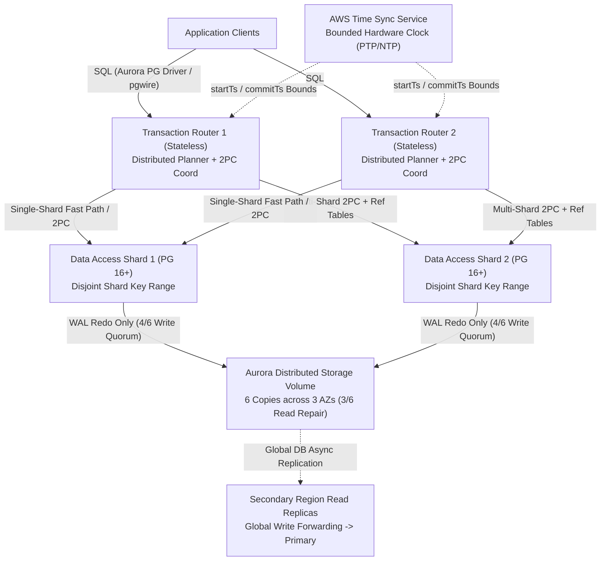

# 12 — AWS Aurora PostgreSQL Limitless (& Multi-Master v1 — Architectural Reference)

**Series:** PostgreSQL Multi-Master & Active-Active Architectures  
**Author:** Jean-Marie Renouard (`jmrenouard`) — [LightPath](https://www.lightpath.fr)  
**License:** MIT License

---

| Attribute | Value |
| :--- | :--- |
| **Catalog ID** | `#12` (`AWS Aurora Limitless (& MM v1)` in `Ch. 01`, `Ch. 03b`, `Ch. 04`, `Ch. 07`) |
| **Benchmark Status** | **Not live-benchmarked (`APP-005` Managed Cloud Exclusion)** |
| **Family / Tier** | `T5 / Cloud` — Managed Sharded Distributed PG & Disaggregated Storage (`Niveau 5 / Cloud`) |
| **Versions** | `Aurora PostgreSQL 16.4+ Limitless Database` (GA 2024); `Aurora Global DB`; `Multi-Master v1` (retired 2024) |
| **CAP / PACELC Profile** | `PC/EC` (Limitless 2PC + Time Sync MVCC; base Aurora 4/6 AZ quorum; Global DB async `PA/EL`) |
| **License / Deployment** | Proprietary AWS Managed Service / DB Shard Group (`Transaction Routers` + `Data Access Shards`) |

---

## 1. Technology Description & What It Does

**Amazon Aurora PostgreSQL** breaks PostgreSQL's coupled local-disk bottleneck using a **log-is-the-database** disaggregated storage architecture: compute instances stream redo/WAL records rather than 8 KiB dirty pages to a shared storage volume replicated **6 ways across 3 Availability Zones** (2 copies per AZ), committing on a **4/6 write quorum** (and recovering with a **3/6 read quorum**). Standard Aurora, however, remains strictly **single-writer**.

To scale PostgreSQL write throughput horizontally across multiple nodes, AWS introduced **Aurora PostgreSQL Limitless Database** (GA 2024) using **DB Shard Groups** composed of stateless **Transaction Routers** and sharded PostgreSQL **Data Access Shards** coordinated via **AWS Time Sync Service** hardware clocks and Two-Phase Commit (2PC). This architecture replaces the earlier **Aurora Multi-Master v1** (Aurora MySQL 5.6 only, never GA on PostgreSQL, retired in 2024), which suffered severe shared-page invalidation abort storms across competing writers.

---

## 2. Architecture & Data Flow

An Aurora Limitless DB Shard Group routes SQL through stateless **Transaction Routers**, evaluates time-based MVCC snapshots via **AWS Time Sync Service**, and commits single-shard or 2PC multi-shard writes into Aurora's 6-way disaggregated storage layer:

For cross-region topologies, **Aurora Global Database Write Forwarding** does not create active-active multi-master writers; instead, secondary read replicas forward DML over the AWS private backbone to the single primary writer under configurable session consistency (`eventual`, `session`, or `global`).

---

## 3. Operating Principles & Implementation Modes

1. **6-Way Disaggregated Storage Quorum:** Every 10 GiB protection group spans 6 storage nodes across 3 AZs. A commit waits for **4/6 write acknowledgments** (`RPO = 0` across 1 AZ + 1 node loss); crash recovery reads **3/6** segments to reconstruct latest LSN state without full-page replay.
2. **Time-Based MVCC & Commit Latency Model:** Limitless replaces cluster-wide `XID` coordination with physical timestamps bounded by **AWS Time Sync Service** ($\varepsilon_{\text{TimeSync}}$):

$$
L_{\text{Aurora-Limitless}} \approx L_{\text{quorum-4/6}} + \text{RTT}_{\text{TR-Shard}} + k_{\text{2PC}} \cdot \text{RTT}_{\text{2PC}} + \varepsilon_{\text{TimeSync}}
$$

where $k_{\text{2PC}} = 0$ on single-shard writes and $k_{\text{2PC}} = 1$ on multi-shard 2PC writes.
3. **Table Placement & Routing:** Tables are declared as `sharded` (`rds_aurora.limitless_create_sharded_table` on a shard key), `reference` (replicated across shards for local joins), or `standard` (single-shard).

| Mode / Variant | Scope & Mechanism | Commit & Sync Path | Conflict / Failover | Trade-Off |
| :--- | :--- | :--- | :--- | :--- |
| **Standard Aurora PG** *(Single-Writer)* | 1 RW primary + up to 15 RO replicas | WAL redo to 4/6 storage quorum | Auto failover `< 30 s`, `RPO = 0` | Single-node write ceiling |
| **Limitless — Single-Shard** | `sharded` table keyed on shard key | TR -> 1 Shard -> 4/6 storage (no 2PC) | Shard failover managed in ACUs | Scales writes horizontally (`SQL` subset) |
| **Limitless — Multi-Shard 2PC** | Cross-shard DML & `reference` tables | TR-coordinated 2PC + Time Sync `commitTs` | Distributed lock / `40001`-class aborts | Cross-shard 2PC adds RTT overhead |
| **Global DB Write Forwarding** | Cross-region DR + RO replicas | Async storage sync (`~1 s`); writes forwarded | Primary writer still single-region | Added cross-region RTT on forwarded DML |
| **Aurora Multi-Master v1** *(Retired)* | MySQL 5.6 multi-writer (never PG) | Shared storage page invalidation | Severe abort storms under contention | **Retired by AWS in 2024** |

---

## 4. Strengths & Weaknesses

| Strengths | Weaknesses & Operational Traps |
| :--- | :--- |
| **Cloud-Native Horizontal PG Write Scaling:** DB Shard Groups scale writes past single-instance vCPU limits while keeping disaggregated 4/6 storage durability (`RPO = 0`). | **Proprietary AWS Lock-In & ACU Cost (`APP-005`):** Router + Shard ACU capacity pricing and closed AWS storage fabric cannot run on-premises or multi-cloud. |
| **No Cluster-Wide `XID` Bottleneck:** Time Sync MVCC avoids centralized GTM serialization (`#8 OpenTenBase`) on single-shard and read-only queries. | **SQL, Extension & DDL Constraints:** Uses an allowlisted extension subset; shard keys are immutable and cross-shard features trail stock PostgreSQL 17. |
| **Zero-I/O Backup & Fast Crash Recovery:** Log-is-the-database storage removes checkpoint storms and rebuilds state via 3/6 storage quorums in seconds. | **Multi-Shard 2PC & Cross-Region Limits:** Cross-shard transactions pay 2PC latency; Limitless targets intra-region AZs rather than multi-region active-active writes. |
| **Transparent Global Read Scaling:** Aurora Global Database pairs low-lag cross-region replicas with optional Write Forwarding for read-heavy global apps. | **Write Forwarding Latency & Stale Reads:** Forwarded writes pay cross-region RTT to the single primary; `global` consistency stalls replica reads until caught up. |

---

## 5. Architectural Exclusion (`APP-005`), Mode Comparison & Reference Baseline

**Why `#12 AWS Aurora Limitless` Was Not Live-Benchmarked (`APP-005`):** Per `docs/RCA_REGISTER.md` (`APP-005`), Aurora PostgreSQL Limitless relies on AWS-proprietary storage, hypervisor Time Sync hardware, and managed cloud APIs that cannot be packaged in `env/multi-db-docker-env/`. Zero synthetic TPS or latency figures are invented here.

Instead, Limitless maps directly onto our live-benchmarked `T5` (`PC/EC` sharded/consensus) and single-node control baselines in `results/benchmark_summary.csv` and `results/functional_limits_matrix.csv` (99th-percentile latency is not recorded in `results/`):

| Capability / Baseline | `#12 Aurora Limitless` *(Arch. Ref., `APP-005`)* | `#7 Citus` *(PoC, PG `17.10`)* | `#5 YugabyteDB` *(PoC, `RF=3`)* | `#6 CockroachDB` *(PoC, `RF=3`)* | `#15a pg17-standalone` *(Control)* |
| :--- | :--- | :--- | :--- | :--- | :--- |
| **Consensus / Storage** | 4/6 AZ Storage + Time Sync 2PC | Coord 2PC (no worker Raft) | Per-tablet Raft (`RF=3`) + HLC | Per-range Raft (`RF=3`) + HLC | Single primary (`CA`) |
| **PG Parity / Extensions** | Aurora PG 16+ (allowlist subset) | **Core `PG 17`** (high parity) | Fork `PG 15` C (`YSQL`, `vector`) | Go `pgwire` (zero C ext.) | **Core `PG 17.11` (`100%`)** |
| **Sharding & Key Rule** | `sharded` / `reference` / `standard` | **`0A000` w/o dist key (`L2`/`L4`)** | Auto hash/range (`23505` global) | Auto range (`23505` global) | None (local `23505`) |
| **Reference Anchor (`A_single_rw`)** | Not benchmarked (`APP-005`) | `309.04 TPS` (`0` drift) | `173.64 TPS` (`0` retries) | `42.08 TPS` (`44` retries) | `866.82 TPS` (`23.958 ms` `p95`) |
| **Reference Anchor (`F_wan_netem_25ms`)** | Not benchmarked (regional AZ) | `21.67 TPS` (`-93.0%` WAN 2PC) | `5.78 TPS` (`-96.7%` WAN Raft) | `10.06 TPS` (`-76.1%` WAN Raft) | N/A |

## 6. GitHub Popularity, Git Presence & Maintenance Vitality (`results/project_popularity.csv`)

Live GitHub telemetry (`2026-11-20T17:26:02Z`, `archived = false` unless `N/A`):

| Project | Git Presence / Role | Repo (`Account / Repos`) | Stars / Forks / Watch | Commits (`Tot / 12m`) | Contrib / Issues | Lang / SPDX | Release / Last Push |
| :--- | :--- | :--- | :---: | :---: | :---: | :--- | :--- |
| **AWS Aurora Limitless (#12)** | `No (Managed Cloud)` -- `Proprietary (Managed Cloud)` | N/A (Proprietary) | N/A / N/A / N/A | N/A / N/A | N/A / N/A | N/A / Proprietary | N/A / N/A |

- **Maintenance Level:** **Closed / Managed Cloud** -- AWS-managed proprietary service (`APP-005`) with no public GitHub source repository (`N/A`).
- **Currency / Freshness:** **Opaque (Vendor-Managed)** -- Last push `N/A`, `N/A` commits/12m, latest release `N/A`.
- **Operational Manageability:** **Vendor Lock-In** -- Requires AWS Aurora Limitless DB Shard Groups, proprietary Time Sync/storage fabric, and ACU-billed cloud operations.

---

**Navigation:** [Index](../../../README.md) · [Ch. 03b — Distributed, Triggers & Cloud](../03b_solutions_distributed_triggers_cloud.md) · [Ch. 10 — Streaming vs Logical vs Multi-Master](../10_streaming_vs_logical_vs_multimaster.md) · [Version française](../../fr/solutions/aws_aurora_limitless.md)
