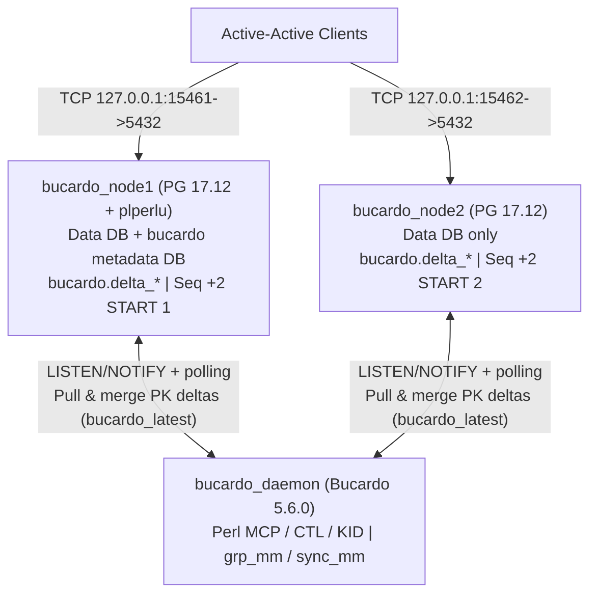

# 9 — Bucardo 5 (Trigger-Based Asynchronous Multi-Master)

**Series:** PostgreSQL Multi-Master & Active-Active Architectures  
**Author:** Jean-Marie Renouard (`jmrenouard`) — [LightPath](https://www.lightpath.fr)  
**License:** MIT License

---

| Attribute | Value |
| :--- | :--- |
| **Catalog ID** | `#9` (`Bucardo 5 (#9)` in `results/functional_limits_matrix.csv`) |
| **Benchmark Topology ID** | `bucardo` (`results/*.csv`) |
| **Family / Tier** | `T4` — Trigger-Based Multi-Master (`Niveau 4`) |
| **Versions** | `PostgreSQL 17.12` (`postgres:17` + `postgresql-plperl-17`), `Bucardo 5.6.0` (`debian:trixie-slim`) |
| **CAP / PACELC Profile** | `AP / PA-EL` — asynchronous trigger-captured multi-master |
| **License / Deployment** | BSD License / PostgreSQL License / 3 containers (`docker-compose-bucardo.yml`) |

---

## 1. Technology Description & What It Does

**Bucardo 5** is an external asynchronous Perl replication daemon (`Bucardo 5.6.0`) that orchestrates multi-master and primary-replica PostgreSQL synchronization without custom C WAL output plugins. Instead of decoding WAL streams, Bucardo installs `PL/pgSQL` `bucardo_delta*` triggers that record modified primary keys into shadow `bucardo.delta_*` tables inside each participating database.

When a `LISTEN/NOTIFY` kick or polling timer fires, `bucardo_daemon` (MCP/CTL/KID workers) pulls delta keys from peers in a `dbgroup` (`db1:source db2:source`), resolves conflicts via `bucardo_latest`, and merges rows asynchronously. In the PoC, `bucardo_node1` hosts both user data and the `bucardo` metadata database (`plperlu`), creating a structural metadata coupling on node 1.

---

## 2. Architecture & Data Flow

In `env/multi-db-docker-env/docker-compose-bucardo.yml`, `bucardo_daemon` connects over `bucardo_net` to `bucardo_node1` (`15461`) and `bucardo_node2` (`15462`), each configured with `INCREMENT BY 2` stepped sequences:

Keyless tables are rejected upfront by `bucardo add sync` (`validate_sync`), enforcing primary keys on every replicated table.

---

## 3. Operating Principles & Implementation Modes

1. **Trigger Capture & Daemon Loop:** Local writes fire `bucardo_delta*` triggers (`5/5` verified in `F1`), inserting changed PKs into `bucardo.delta_public_*` tables. `bucardo_daemon` wakes on `NOTIFY` (`Autokick = Yes`) or polling (`T15` `p50=548.74 ms`, `p95=1,275.25 ms`, max `1,282.96 ms`).
2. **Commit Latency Model:**

$$
L_{\text{T4-bucardo}} \approx L_{\text{disk}} + L_{\text{trigger}} \quad (\text{local trigger write; daemon poll and merge are async})
$$

3. **`dbgroup` Unified Multi-Source & `plperlu`:** Bucardo 5 replaces legacy Bucardo 4 `swap`/`pushdelta` sync types with unified `dbgroup` roles (`source:source` vs `source:target`), requiring `postgresql-plperl-17` (`plperlu`) for `db_getconn()`.

| Mode / Handler | Scope | Mechanics & Key Strategy | Conflict / Failover Impact | Trade-Off |
| :--- | :--- | :--- | :--- | :--- |
| **`source:source` (`grp_mm`, `bucardo_latest`)** *(PoC)* | `db1:source db2:source` | `sync_mm` compares timestamp/row state; stepped seqs (`INCREMENT BY 2`) | Peers stay writable (`L1`); lost updates (`B2`, `D`, `L3`) | High local TPS; severe hot-row drift |
| **`source:target` (`pushdelta`)** *(Arch. — Not in PoC)* | `db1:source db2:target` | Uni-directional async trigger push to read/reporting target | Zero multi-writer conflicts | No active-active writes on target |
| **`bucardo_source` / `bucardo_target`** *(Arch. — Not in PoC)* | `conflict_strategy` | Deterministic priority winner (fixed source or target node wins) | Predictable overwrite without clock skew | Discards losing node's concurrent edits |
| **`bucardo_abort` / `bucardo_skip` / `bucardo_random` / Perl** *(Arch.)* | `conflict_strategy` | Halts sync, skips row, picks randomly, or runs custom Perl hook | `abort` protects data like `pg-birep`; Perl enables custom merge | Custom Perl adds latency & ops code |
| **Stepped Sequences (`+2`)** *(PoC)* vs **Keyless** *(Rejected)* | DDL (`START 1` / `2`) | Odd/even PKs (`setup_bucardo.sh`); `validate_sync` blocks keyless (`L2`) | Avoids `23505` on inserts; keyless refused at `add sync` | Fixed node stride; PK mandatory |

---

## 4. Strengths & Weaknesses

| Strengths | Weaknesses & Operational Traps |
| :--- | :--- |
| **Fast Disjoint & `sysbench` Local Writes:** `1,078.9 TPS` (`B1`), `1,232.84 TPS` (`E`), `1,607.89 TPS` (`E3`), `53,731.92 TPS` (`C`), and `0` drift on `B1`/`E`/`H`. | **Extreme Hot-Row Drift (`D`/`B2`/`L3`):** `D_hot_conflict` loses `-531,620` (`50.8%` of `1,046,798`); `B2` drifts `+123,679`; `L3` loses `+100` (`970.00`). |
| **Trigger Portability Across PG Versions:** Works via `PL/pgSQL` + `plperlu` without WAL decoding slots or core `pgoutput` (`wal_level` independent). | **Polling Lag (`T15`) & FK Race Failure (`T13`):** `p50=548.74 ms` / `p95=1,275.25 ms` (300x–500x slower than WAL) causes `0/10` (`23503x10`) in `T13`. |
| **WAN-Resilient Commits & Bulk Speed:** Holds `763.23 TPS` at `25 ms` WAN (`612.56` at `50 ms`), `42,536 rows/s` bulk (`T11`, `139.1 ms`), and `5/5` outage catch-up (`L7`). | **Metadata SPOF (`T16`) & Sync Stall (`L4`):** `bucardo` DB lives on `node1` (`SIGKILL` ends `post_restart=20/21`); `L4` `23505` stalls `sync_mm` to `Bad (Error=7)`. |
| **Strict Pre-Sync PK Guard (`L2`):** `validate_sync` refuses keyless tables immediately instead of silently skipping `UPDATE`/`DELETE` like Spock. | **No Auto-DDL (`L5`), Write Amp & `E` Noise:** `ALTER TABLE` does not propagate; delta tables inflate `VACUUM`; `sysbench` `112` (`E`) / `193` (`E3`) = Lua collision noise. |

---

## 5. Empirical Benchmark Results, Functional Limits & PoC Spec

Ran at `pg_scale = 2` (`retries_40001 = 0`). Only `Avg`, `Stddev` (`0` for `sysbench`), and `p95` are measured (p99 latency is unmeasured).

### Table A — Core & Extended Workloads (`benchmark_summary.csv`, `benchmark_extended_workloads.csv`)

| Suite | Cl / Dur | TPS | QPS | Avg / Stddev / p95 (ms) | Committed (Fail) | Drift | Status |
| :--- | :---: | :---: | :---: | :---: | :---: | :---: | :--- |
| `A_single_rw` | 8 / 20s | 735.38 | N/A | 10.864 / 9.234 / 28.017 | 14705 (0) | 0 | `PASS_CONVERGED` |
| `B1_disjoint_rw` | 8 / 20s | 1078.9 | N/A | 7.402 / 3.739 / 14.458 | 21570 (0) | 0 | `PASS_CONVERGED` |
| `B2_overlap_rw` | 8 / 20s | 1267.77 | N/A | 6.297 / 2.914 / 11.503 | 25346 (0) | 123679 | `EXPECTED_LIMITATION_LOST_UPDATE` |
| `C_multinode_ro` | 16 / 20s | 53731.92 | N/A | 0.274 / 0.098 / 0.439 | 1073565 (0) | 0 | `PASS` |
| `D_hot_conflict` | 8 / 15s | 1378.79 | N/A | 5.794 / 1.232 / 8.033 | 20671 (0) | -531620 | `EXPECTED_LIMITATION_LOST_UPDATE` |
| `E_sysbench_oltp_rw` | 8 / 20s | 1232.84 | 24757.64 | 6.48 / 0 / 7.7 | 24667 (112) | 0 | `PASS` |
| `E2_sysbench_oltp_ro` | 8 / 12s | 1757.72 | 28123.53 | 4.55 / 0 / 5.99 | 21108 (0) | 0 | `PASS` |
| `E3_sysbench_oltp_wo` | 8 / 12s | 1607.89 | 9707.55 | 4.97 / 0 / 6.43 | 20529 (193) | 0 | `PASS` |
| `E4_sysbench_point_select` | 16 / 12s | 143920.93 | 143920.93 | 0.11 / 0 / 0.28 | 1728510 (0) | 0 | `PASS` |
| `H_append_only_insert` | 8 / 12s | 1105.99 | N/A | 7.222 / 1.98 / 10.472 | 13255 (0) | 0 | `PASS_CONVERGED` |
| `F_wan_netem_25ms` | 8 / 15s | 763.23 | N/A | 10.466 / 8.486 / 27.255 | 11444 (0) | 0 | `PASS_NETEM_25MS` |

*(Divergence details: `B2` `exp=662527`, `n1/n2=786206`; `D` `exp=1046798`, `n1/n2=515178`.)*

### Table B — Concurrency & WAN Latency Sweeps (`benchmark_concurrency_sweep.csv`, `benchmark_wan_sweep.csv`)

| Sweep Suite | Param | TPS | Avg / Stddev / p95 (ms) | Committed | Status |
| :--- | :---: | :---: | :---: | :---: | :--- |
| `G_conc_c1` (8s) | 1 cl | 306.29 | 3.253 / 0.958 / 5.143 | 2448 | `PASS` |
| `G_conc_c4` (8s) | 4 cl | 594.05 | 6.713 / 3.394 / 12.678 | 4750 | `PASS` |
| `G_conc_c8` (8s) | 8 cl | 649.72 | 12.288 / 9.173 / 30.693 | 5187 | `PASS` |
| `G_conc_c16` (8s) | 16 cl | 598.61 | 26.658 / 26.474 / 80.308 | 4781 | `PASS` |
| `G_conc_c32` (8s) | 32 cl | 582.0 | 54.769 / 64.546 / 183.552 | 4640 | `PASS` |
| `F_wan_netem_10ms` (12s) | 10 ms | 593.03 | 13.469 / 10.124 / 33.581 | 7100 | `PASS_NETEM_10MS` |
| `F_wan_netem_25ms` (15s) | 25 ms | 763.23 | 10.466 / 8.486 / 27.255 | 11444 | `PASS_NETEM_25MS` |
| `F_wan_netem_50ms` (12s) | 50 ms | 612.56 | 13.038 / 9.506 / 32.517 | 7337 | `PASS_NETEM_50MS` |

### Table C — Functional Limits (`F1`, `L1–L8`) & Extended Probes (`T11–T18`)

| Probe | Observed Empirical Result |
| :--- | :--- |
| `F1` Health | `PASS: sync_mm Good/Active; plperlu=1; delta_triggers=5/5` |
| `L1` Serial PK | `EXPECTED_LIMITATION: bucardo_latest overwrite (Conflicts=1 winner=from_n2)` |
| `L2` Keyless Table | `EXPECTED_LIMITATION: validate_sync rejected keyless table; PK unlocked sync` |
| `L3` Lost Update | `EXPECTED_LIMITATION: +100/-30 converged to 970.00 (lost +100)` |
| `L4` Unique Conf. | `EXPECTED_LIMITATION: stalled sync_mm (Current state=Bad DB db2 state=23505 Error=7)` |
| `L5` DDL & Savept | `EXPECTED_LIMITATION: ALTER TABLE ADD COLUMN not propagated; TRUNCATE propagated` |
| `L6` PG Features | `EXPECTED_LIMITATION: advisory_lock & LISTEN/NOTIFY node-local; TEMP session-local` |
| `L7` Node Outage | `PASS: 8 delta rows queued in bucardo.delta_public_accounts; caught up 5/5` |
| `L8` Quorum Loss | `N/A: AP async continues without quorum` |
| `T11` Bulk 10k | `PASS: 42536 rows/s (235ms); peer_catchup=139.1ms` |
| `T12` Upd vs Del | `EXPECTED_LIMITATION: bucardo_latest race n1=DELETED n2=DELETED` |
| `T13` FK Race | `EXPECTED_LIMITATION: 0/10 ok; failures=23503x10 (polling lag outraces child insert)` |
| `T14` Rich MD5 | `PASS: 2/2 identical md5=00493e3a (BYTEA=65536B JSONB/NULL/TS/UTF8)` |
| `T15` Vis. Lag | `p50=548.74ms p95=1275.25ms max=1282.96ms (n=30)` |
| `T16` SIGKILL RPO | `PASS: peer_surv=20/20 RPO=0 peer_write_OK; post_restart=20/21 (node1 metadata SPOF)` |
| `T17` Long Open TX | `PASS: NO_DIRTY_READ; side_tx_unblocked(112ms); post_commit_vis=110ms` |
| `T18` Seq Sync (50) | `EXPECTED_LIMITATION: std seq 1\|false -> SQLSTATE 23505 (use stepped +2)` |
| **Verified SQLSTATEs** | `L1–L8: 23505` \| `T11–T18: 23503;23505` |

### Table D — PoC Docker Specification (`env/multi-db-docker-env/`)

| Parameter | PoC Setting / Observation |
| :--- | :--- |
| **Compose & Scripts** | `docker-compose-bucardo.yml` + `scripts/bucardo/Dockerfile` + `scripts/bucardo/Dockerfile.pg` + `scripts/bucardo/setup_bucardo.sh` + `tests/test_bucardo.sh` |
| **DB Nodes** | `bucardo_node1` (`127.0.0.1:15461:5432`, hosts data + `bucardo` DB), `bucardo_node2` (`127.0.0.1:15462:5432`), `postgres:17` (`17.12`) + `postgresql-plperl-17` |
| **Daemon Container** | `bucardo_daemon` (`debian:trixie-slim` + `bucardo` `5.6.0`), MCP/CTL/KID processes, `/var/run/bucardo/`, `/var/log/bucardo/log.bucardo` |
| **Key Setup & Sync** | `dbgroup grp_mm db1:source db2:source`, `sync_mm` (`conflict_strategy=bucardo_latest`, `Autokick=Yes`, `Stayalive=Yes`), `INCREMENT BY 2 START WITH 1/2`. |

## 6. GitHub Popularity, Git Presence & Maintenance Vitality (`results/project_popularity.csv`)

Live GitHub telemetry (`2026-11-20T17:26:02Z`, `archived = false` unless `N/A`):

| Project | Git Presence / Role | Repo (`Account / Repos`) | Stars / Forks / Watch | Commits (`Tot / 12m`) | Contrib / Issues | Lang / SPDX | Release / Last Push |
| :--- | :--- | :--- | :---: | :---: | :---: | :--- | :--- |
| **Bucardo 5 (#9)** | `Yes` -- `Primary` | [`bucardo/bucardo`](https://github.com/bucardo/bucardo) (`Org / 15`) | 807 / 110 / 33 | 2535 / 0 | 30 / 53 | Perl / `NOASSERTION` | `5.6.0` / `2025-05-31T18:51:42Z` |

- **Maintenance Level:** **Tier D (EOL / Dormant)** -- `bucardo/bucardo` records `0` commits/12m (`2,535` total, `30` contributors, `807` stars, `53` open issues).
- **Currency / Freshness:** **Stale / Dormant** -- Last push `2025-05-31T18:51:42Z`, `0` commits/12m, latest release `5.6.0`.
- **Operational Manageability:** **Do Not Deploy** -- Legacy trigger-based Perl daemon (`5.6.0`) is dormant with `node1` metadata SPOF, `T13` FK races, and high lag.

---

**Navigation:** [Index](../../../README.md) · [Ch. 03b — Distributed, Triggers & Cloud](../03b_solutions_distributed_triggers_cloud.md) · [Ch. 10 — Streaming vs Logical vs Multi-Master](../10_streaming_vs_logical_vs_multimaster.md) · [Version française](../../fr/solutions/bucardo.md)
