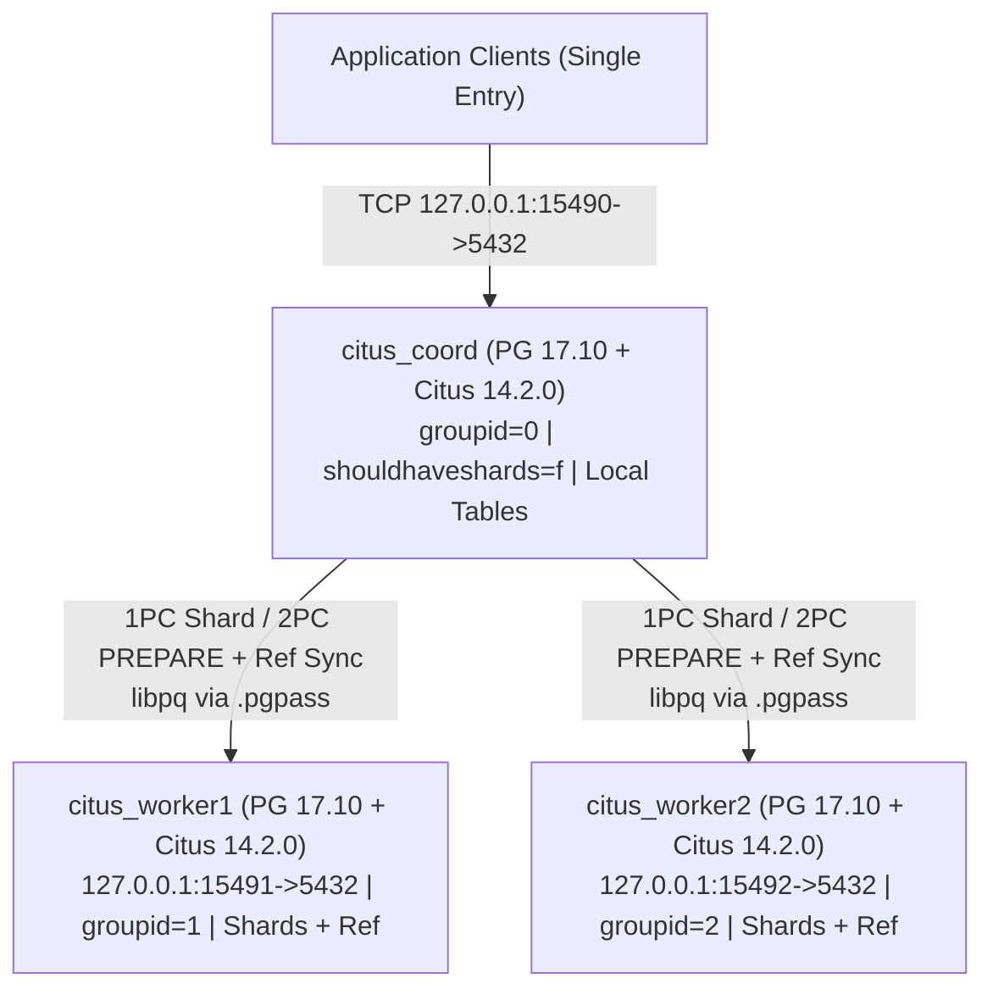

# 7 — Citus (Distributed Sharded PostgreSQL Extension — Coordinator + Workers + 2PC)

**Series:** PostgreSQL Multi-Master & Active-Active Architectures  
**Author:** Jean-Marie Renouard (`jmrenouard`) — [LightPath](https://www.lightpath.fr)  
**License:** MIT License

---

| Attribute | Value |
| :--- | :--- |
| **Catalog ID** | `#7` (`Citus 14.2.0 Distributed PG 17 (#7)` in `results/functional_limits_matrix.csv`) |
| **Benchmark Topology ID** | `citus` (`results/*.csv`) |
| **Family / Tier** | `T5` — Sharded MPP / Distributed 2PC (`Niveau 5`) |
| **Versions** | `PostgreSQL 17.10` (`citusdata/citus:14.2.0-pg17`), `Citus 14.2.0` (`citus_version()`) |
| **CAP / PACELC Profile** | `CP / PC-EC` (`CP (Coord SPOF / 2PC)` — single coordinator + 2PC; MX optional) |
| **License / Deployment** | AGPLv3 (Open Source) / 3 containers (`docker-compose-citus.yml`) |

---

## 1. Technology Description & What It Does

**Citus** is a PostgreSQL C extension (AGPLv3) turning standard instances into a sharded **Coordinator + Workers** cluster (`citus_add_node`). Without altering heap storage or adding Raft, it intercepts planner/executor hooks to route queries to logical shards with `max_prepared_transactions > 0`.

Tables span three classes: **Hash-Distributed** (`create_distributed_table`) sharded by key, **Reference** (`create_reference_table`) 2PC-replicated to all workers, and **Coordinator-Local**. Unlike `#5 YugabyteDB` or `#6 CockroachDB`, Citus keeps 100% PG 17 shard semantics without default inter-worker Raft.

---

## 2. Architecture & Data Flow

In `env/multi-db-docker-env/docker-compose-citus.yml`, clients connect only to `citus_coord` (`groupid=0`, `shouldhaveshards=f`). It routes 1PC shard queries and 2PC transactions to `citus_worker1` (`groupid=1`) and `citus_worker2` (`groupid=2`) over `citus_net` (`citus.shard_count=8`):

In the PoC, **Citus MX** (`start_metadata_sync_to_node`) stays disabled, so `B1`–`D` and `H` run through `citus_coord` only. Then `tc netem` adds WAN egress delay onto `citus_worker1` and `citus_worker2`.

---

## 3. Operating Principles & Implementation Modes

1. **1PC vs. 2PC Routing:** Queries filtered on the distribution key (`D_hot_conflict` colocated on `aid`, `H_append_only_insert`) push down in 1PC. Multi-key TPC-B (`A`, `B1`, `B2`, `F`) spans `accounts(aid)`, `tellers(tid)`, and `branches(bid)`, forcing **2PC (`PREPARE TRANSACTION` / `COMMIT PREPARED`)**.
2. **Commit Latency Model:**

$$
L_{\text{T5-citus-1PC}} \approx L_{\text{disk}} + \text{RTT}_{\text{coord-worker}}, \qquad L_{\text{T5-citus-2PC}} \approx L_{\text{disk}} + 3 \cdot \text{RTT}_{\text{coord-worker}}
$$

3. **Schema Rules (`0A000`), Colocation & MX:** `PRIMARY KEY`/`UNIQUE` on distributed tables must include the shard key (`0A000` otherwise, `L2`/`L4`). Colocated tables support distributed FKs (`T13`: `10/10`). Optional **Citus MX** syncs metadata to workers.

| Mode / Table Type | Scope | Mechanics & Key Strategy | Conflict / Failover Impact | Trade-Off |
| :--- | :--- | :--- | :--- | :--- |
| **Hash-Distributed (1PC)** *(PoC `D`/`H`)* | `create_distributed_table(..., col)` | Single-shard pushdown (`citus.shard_count=8`); colocated FKs (`T13`) | Native PG row locks; `0` drift; zero 2PC lock overhead | Requires shard key in `WHERE`, `PK`, and `UNIQUE` |
| **Hash-Distributed (2PC)** *(PoC `A`/`B1`/`B2`)* | Multi-shard DML | Coordinator runs `PREPARE TRANSACTION` / `COMMIT PREPARED` across workers | Atomic `0` drift (`PASS_CONVERGED`); `RR` raises `40001` (`L3`) | `-64.3%` LAN TPC-B (`309.04` vs `866.82` standalone) & `-93.0%` WAN |
| **Reference Tables** *(PoC `L7`)* | `create_reference_table(...)` | Full table replicated synchronously to all workers using 2PC | Survives worker outage for reads (`L7`: `worker2` down, ref OK) | Writes stall if any worker is unreachable |
| **Coordinator-Local Tables** *(PoC)* | Unsharded tables on `citus_coord` | Stored solely on coordinator (`groupid=0`, `shouldhaveshards=f`) | Coordinator sequence (`L1` `1.62 ms`, `T18` `next_id=51`) | Cannot shard horizontally; coordinator SPOF |
| **Citus MX Multi-Coord** *(Arch. — Not in PoC)* | `start_metadata_sync_to_node` | Syncs shard metadata so workers act as SQL entry points (`shouldhaveshards=t`) | Removes single-coordinator SQL routing bottleneck | Still requires external HA per node; metadata sync overhead |
| **Worker/Coord Patroni HA** *(Arch. — Not in PoC)* | Per-node streaming standby | Pairs coordinator and each worker with Patroni + `etcd` | Eliminates `08006` shard outage (`T16`) & coord SPOF (`L8`, `RTO 10–30 s`) | Doubles/triples container footprint |

---

## 4. Strengths & Weaknesses

| Strengths | Weaknesses & Operational Traps |
| :--- | :--- |
| **Fast Colocated & Append Scaling:** Reaches `1,691.45 TPS` (`D`, `0` drift), `2,040.36 TPS` (`H`), `21,324.7 TPS` (`C`), `19,831.34 TPS` (`E4`), and `35,308 rows/s` bulk (`T11`). | **Cross-Shard 2PC & Concurrency Ceiling:** Multi-key TPC-B drops `-64.3%` vs standalone (`309.04` vs `866.82 TPS`); `G_conc` plateaus at `268.71` (`c=8`) -> `260.76 TPS` (`c=32`, `p95=343.094 ms`). |
| **100% Core PG 17 Isolation & `0` Drift:** `0` `40001` retries in `A`–`H`, `L3` `READ COMMITTED` serializes (`1100`), `L5` auto-propagates `ALTER TABLE` + `SAVEPOINT`, `T13` FK `10/10`. | **Severe 2PC WAN Collapse (`Suite F`):** Drops `-93.0%` at `25 ms` WAN (`21.67 TPS`, `p95=633.963 ms`) and to `8.84 TPS` at `50 ms` (`p95=1,486.044 ms`). |
| **Rich PG Compatibility & Single Sequence:** `pg_trgm`, `uuid-ossp`, `TEMP TABLE`, `LISTEN/NOTIFY` & `pg_try_advisory_lock(42)` on coord pass (`L6`); `L1` `1.62 ms`, `T18` `next_id=51`. | **Strict `0A000` Schema Traps (`L2`/`L4`/`L6`):** Post-distribution `ADD PRIMARY KEY`/`serial` and non-dist `UNIQUE` fail `0A000`; `vector` returns `ERR(0A000)` in stock `citus:14.2.0-pg17`. |
| **Deterministic 2PC & Reference Reads (`L7`):** Guarantees `0` balance drift (`A`/`B1`/`B2`/`D`) and keeps reference + `worker1` reads online when `worker2` stops (`L7`). | **No Built-In Worker/Coord HA (`L8`/`T16`):** Coordinator outage halts queries (`L8`); `SIGKILL` `worker2` raises `08006` (`T16`, `21/21` post-restart); `E`/`E3` `9`/`68` vs `112`/`192` noise. |

---

## 5. Empirical Benchmark Results, Functional Limits & PoC Spec

Ran at `pg_scale = 2` (`retries_40001 = 0`). Only `Avg`, `Stddev` (`0` for `sysbench`), and `p95` are measured (99th-percentile latency is not recorded in `results/`).

### Table A — Core & Extended Workloads (`benchmark_summary.csv`, `benchmark_extended_workloads.csv`)

| Suite | Cl / Dur | TPS | QPS | Avg / Stddev / p95 (ms) | Committed (Fail) | Drift | Status |
| :--- | :---: | :---: | :---: | :---: | :---: | :---: | :--- |
| `A_single_rw` | 8 / 20s | 309.04 | N/A | 25.853 / 21.845 / 62.289 | 6183 (0) | 0 | `PASS_CONVERGED` |
| `B1_disjoint_rw` | 8 / 20s | 265.29 | N/A | 30.123 / 23.832 / 68.37 | 5308 (0) | 0 | `PASS_CONVERGED` |
| `B2_overlap_rw` | 8 / 20s | 312.98 | N/A | 25.533 / 23.759 / 59.067 | 6263 (0) | 0 | `PASS_CONVERGED` |
| `C_multinode_ro` | 16 / 20s | 21324.7 | N/A | 0.724 / 0.242 / 1.04 | 425845 (0) | 0 | `PASS` |
| `D_hot_conflict` | 8 / 15s | 1691.45 | N/A | 4.716 / 1.265 / 6.722 | 25354 (0) | 0 | `PASS_CONVERGED` |
| `E_sysbench_oltp_rw` | 8 / 20s | 189.44 | 3796.81 | 42.17 / 0 / 50.11 | 3797 (9) | 0 | `PASS` |
| `E2_sysbench_oltp_ro` | 8 / 12s | 180.33 | 2885.34 | 44.26 / 0 / 58.92 | 2173 (0) | 0 | `PASS` |
| `E3_sysbench_oltp_wo` | 8 / 12s | 563.34 | 3402.62 | 14.17 / 0 / 21.89 | 6777 (68) | 0 | `PASS` |
| `E4_sysbench_point_select` | 16 / 12s | 19831.34 | 19831.34 | 0.8 / 0 / 1.42 | 238537 (0) | 0 | `PASS` |
| `H_append_only_insert` | 8 / 12s | 2040.36 | N/A | 3.905 / 2.015 / 6.134 | 24446 (0) | 0 | `PASS_CONVERGED` |
| `F_wan_netem_25ms` | 8 / 15s | 21.67 | N/A | 364.812 / 138.872 / 633.963 | 332 (0) | 0 | `PASS_NETEM_25MS` |

### Table B — Concurrency & WAN Latency Sweeps (`benchmark_concurrency_sweep.csv`, `benchmark_wan_sweep.csv`)

| Sweep Suite | Param | TPS | Avg / Stddev / p95 (ms) | Committed | Status |
| :--- | :---: | :---: | :---: | :---: | :--- |
| `G_conc_c1` (8s) | 1 cl | 102.5 | 9.74 / 6.602 / 14.998 | 820 | `PASS` |
| `G_conc_c4` (8s) | 4 cl | 250.29 | 15.939 / 7.291 / 28.207 | 2000 | `PASS` |
| `G_conc_c8` (8s) | 8 cl | 268.71 | 29.66 / 20.253 / 71.539 | 2154 | `PASS` |
| `G_conc_c16` (8s) | 16 cl | 264.65 | 60.028 / 54.883 / 170.4 | 2131 | `PASS` |
| `G_conc_c32` (8s) | 32 cl | 260.76 | 121.122 / 117.985 / 343.094 | 2104 | `PASS` |
| `F_wan_netem_10ms` (12s) | 10 ms | 44.37 | 179.145 / 76.089 / 355.182 | 537 | `PASS_NETEM_10MS` |
| `F_wan_netem_25ms` (15s) | 25 ms | 21.67 | 364.812 / 138.872 / 633.963 | 332 | `PASS_NETEM_25MS` |
| `F_wan_netem_50ms` (12s) | 50 ms | 8.84 | 876.664 / 408.462 / 1486.044 | 113 | `PASS_NETEM_50MS` |

### Table C — Functional Limits (`F1`, `L1–L8`) & Extended Probes (`T11–T18`)

| Probe | Observed Empirical Result |
| :--- | :--- |
| `F1` Health | `PASS: Citus=14.2.0 active_workers=2` |
| `L1` Serial PK | `PASS: single coordinator sequence (avg 1.62ms)` |
| `L2` Keyless Table | `EXPECTED_LIMITATION: 0A000 ADD PRIMARY KEY/serial blocked post-distribution; upfront PK(aid hid) works` |
| `L3` Lost Update | `PASS: RC_bal=1100; RR raises SQLSTATE 40001 on concurrent update` |
| `L4` Unique Conf. | `EXPECTED_LIMITATION: 0A000 UNIQUE without dist key unsupported; composite (dist_key email) OK` |
| `L5` DDL & Savept | `PASS: ALTER TABLE propagated to worker shards; tx DDL and SAVEPOINT OK` |
| `L6` PG Features | `PASS: adv_lock LISTEN/NOTIFY TEMP pg_trgm uuid-ossp OK; vector=ERR(0A000)` *(advisory lock probed on coord only)* |
| `L7` Node Outage | `PARTIAL: ref reads & worker1 OK; worker2 shards error until restart` |
| `L8` Quorum Loss | `EXPECTED_LIMITATION: single coordinator outage halts distributed queries` |
| `T11` Bulk 10k | `PASS: 35308 rows/s (283ms); catchup=0ms (single-view)` |
| `T12` Upd vs Del | `PASS: consensus (upd=OK del=OK) nodes=DELETED` |
| `T13` FK Race | `PASS: 10/10 immediate cross-node child inserts consistent (0 FK errors)` |
| `T14` Rich MD5 | `PASS: 1/1 identical md5=00493e3a (BYTEA=65536B JSONB/NULL/TS/UTF8)` |
| `T15` Vis. Lag | `p50=1.71ms p95=13.89ms max=19.29ms (n=30)` |
| `T16` SIGKILL RPO | `EXPECTED_LIMITATION: worker2 SIGKILL failed query (rc=1 08006); recovered 21/21` |
| `T17` Long Open TX | `PASS: NO_DIRTY_READ; side_tx_unblocked(138ms); post_commit_vis=315ms (ok=True)` |
| `T18` Seq Sync (50) | `PASS: single sequence safe (next_id=51)` |
| **Verified SQLSTATEs** | `L1–L8: 0A000;40001` \| `T11–T18: 08006` |

### Table D — PoC Docker Specification (`env/multi-db-docker-env/`)

| Parameter | PoC Setting / Observation |
| :--- | :--- |
| **Compose & Scripts** | `docker-compose-citus.yml` + `scripts/citus/setup_citus.sh` + `tests/test_citus.sh` |
| **Nodes & Ports** | `citus_coord` (`127.0.0.1:15490:5432`), `citus_worker1` (`127.0.0.1:15491:5432`), `citus_worker2` (`127.0.0.1:15492:5432`) |
| **Image & Resources** | `citusdata/citus:14.2.0-pg17` (`PG 17.10`), `mem_limit: 512m` per node, bridge `citus_net` |
| **Key GUCs & Setup** | `shared_preload_libraries=citus`, `shared_buffers=128MB`, `max_connections=100`, `citus.shard_count=8`, `citus_set_coordinator_host('citus_coord', 5432)`, `citus_add_node('citus_worker1|2', 5432)`, `PRIMARY KEY(aid, hid)` on `pgbench_history`. |

## 6. GitHub Popularity, Git Presence & Maintenance Vitality (`results/project_popularity.csv`)

Live GitHub telemetry (`2026-11-20T17:26:02Z`, `archived = false` unless `N/A`):

| Project | Git Presence / Role | Repo (`Account / Repos`) | Stars / Forks / Watch | Commits (`Tot / 12m`) | Contrib / Issues | Lang / SPDX | Release / Last Push |
| :--- | :--- | :--- | :---: | :---: | :---: | :--- | :--- |
| **Citus (#7)** | `Yes` -- `Primary` | [`citusdata/citus`](https://github.com/citusdata/citus) (`Org / 67`) | 12865 / 810 / 212 | 7400 / 222 | 152 / 475 | C / `AGPL-3.0` | `v14.3.0` / `2026-11-20T12:28:36Z` |

- **Maintenance Level:** **Tier A (Active OSS)** -- `citusdata/citus` logs `222` commits/12m (`7,400` total, `152` contributors, `12,865` stars, `475` open issues).
- **Currency / Freshness:** **Current -- Active** -- Last push `2026-11-20T12:28:36Z`, `222` commits/12m, latest release `v14.3.0`.
- **Operational Manageability:** **Moderate** -- Standard PG C extension (`AGPL-3.0`). It requires distribution-key schema discipline (`0A000`) and external HA (`08006`).

---

**Navigation:** [Index](../../../README.md) · [Ch. 03b — Distributed, Triggers & Cloud](../03b_solutions_distributed_triggers_cloud.md) · [Ch. 10 — Streaming vs Logical vs Multi-Master](../10_streaming_vs_logical_vs_multimaster.md) · [Version française](../../fr/solutions/citus.md)
