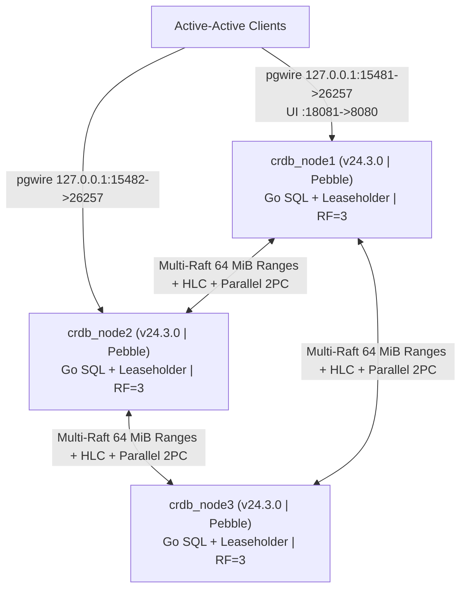

# 6 — CockroachDB (Distributed SQL: Go PG-Wire + Pebble Multi-Raft Serializable)

**Series:** PostgreSQL Multi-Master & Active-Active Architectures  
**Author:** Jean-Marie Renouard (`jmrenouard`) — [LightPath](https://www.lightpath.fr)  
**License:** MIT License

---

| Attribute | Value |
| :--- | :--- |
| **Catalog ID** | `#6` (`CockroachDB v24.3.0 Pebble Raft (#6)` in `results/functional_limits_matrix.csv`) |
| **Benchmark Topology ID** | `cockroach` (`results/*.csv`) |
| **Family / Tier** | `T5` — Distributed Consensus SQL (`Niveau 5`) |
| **Versions** | `CockroachDB v24.3.0`, PG-wire `13.0.0` (Clean-room Go SQL engine + Pebble LSM) |
| **CAP / PACELC Profile** | `CP / PC-EC` (`3 (RF=3 SQL)` — Multi-Raft per `64 MiB` Range `RF=3`, HLC bounded) |
| **License / Deployment** | BSL 1.1 / Enterprise (licensed features) / 3 containers (`docker-compose-cockroach.yml`) |

---

## 1. Technology Description & What It Does

**CockroachDB** is a distributed SQL database written in Go that implements the PostgreSQL v3 wire protocol (`pgwire` `13.0.0`) over **Pebble** (an ordered LSM key-value engine) and **Multi-Raft** consensus per `64 MiB` Range (`RF = 3`). Each range elects a **Leaseholder** that coordinates strongly consistent reads locally without Raft disk rounds while writes replicate across the range's Raft quorum.

Unlike `#5 YugabyteDB` (forked PG 15 C engine defaulting to pessimistic `READ COMMITTED`), CockroachDB is **not** a PostgreSQL kernel fork: it defaults globally to strict **`SERIALIZABLE`** optimistic MVCC, supports zero PostgreSQL C extensions, and requires client-side `SQLSTATE 40001` retry loops under write contention.

---

## 2. Architecture & Data Flow

In `env/multi-db-docker-env/docker-compose-cockroach.yml`, three `--insecure` nodes (`crdb_node1..3`) form a symmetric `RF=3` Multi-Raft mesh on `crdb_net` (`--cache=256MiB`, `--max-sql-memory=256MiB`):

Multi-writer runs (`B1`–`D`, `H`) drive `crdb_node1` and `crdb_node2` (`user=root`) while `crdb_node3` joins Raft quorum (`conv_chk` verifies all 3 nodes; `tc netem` delays `crdb_node2` and `crdb_node3`).

---

## 3. Operating Principles & Implementation Modes

1. **Multi-Raft Ranges, Leaseholders & Parallel Commits:** Contiguous `64 MiB` ranges replicate via Raft (`RF = 3`) with HLC timestamps. Writes stage provisional MVCC intents in parallel with Raft quorum replication, saving one RTT compared to sequential 2PC.
2. **Commit Latency Model:**

$$
L_{\text{T5-crdb-1range}} \approx L_{\text{disk-leaseholder}} + \text{RTT}_{\text{Raft-quorum}}, \qquad L_{\text{T5-crdb-2PC}} \approx L_{\text{disk}} + 2 \cdot \text{RTT}_{\text{Raft-quorum}} + T_{\text{intent-wait}}
$$

3. **`SERIALIZABLE` Retries vs. `READ COMMITTED` & `unique_rowid()`:** Optimistic `SERIALIZABLE` raises `40001` (`WriteTooOldError`) on conflicting updates (`44`/`87`/`96` retries in `A`/`B1`/`B2`; `685` aborted tx in retry-less `E_sysbench_oltp_rw`). Default `SERIAL` maps to unordered `unique_rowid()` (`17.72 ms` `L1`, `L2` hidden `rowid`).

| Mode / Feature | Scope | Mechanics & Key Strategy | Conflict / Failover Impact | Trade-Off |
| :--- | :--- | :--- | :--- | :--- |
| **`SERIALIZABLE` + `40001` Retry** *(PoC Default)* | Global MVCC + intents | Optimistic concurrency (`T17` `2.1 s` intent wait); client retries `40001` | `44`/`87`/`96` retries (`A`/`B1`/`B2`); `685` failed in retry-less `E` | Zero anomalies; collapses if client omits retry |
| **Opt-in `READ COMMITTED`** *(Arch. v24.x — Not in PoC)* | `sql.defaults.default_transaction_isolation` | Pessimistic lock waiting in v23.2+/v24.x (disabled in PoC) | Sharply cuts `40001` aborts under hot-row contention | Relaxes serializability to read committed |
| **Follower Reads** *(Arch. — Not in PoC)* | `AS OF SYSTEM TIME follower_read_timestamp()` | Serves historical reads from closest non-leaseholder Raft replica | Offloads cross-region read RTT to local DC | Bounded staleness (~`4.8 s` behind current HLC) |
| **Multi-Region Survival & Localities** *(Arch.)* | `SURVIVE ZONE \| REGION`, `REGIONAL BY ROW`, `GLOBAL` | Pins range leaseholders/voters or replicates read-mostly `GLOBAL` tables | Automates geo-placement and regional failover | Higher write RTT for `SURVIVE REGION` quorum |
| **`unique_rowid()` vs. `SEQUENCE CACHE 1`** *(PoC `L1`/`T18`)* | `INT8 DEFAULT unique_rowid()` (`17.72 ms`) | 64-bit timestamp+node ID avoids hot index tail (`L2` hidden `rowid`) | Zero `23505`; `SEQUENCE CACHE 1` takes `46.07 ms` (`T18` `next=51`) | `unique_rowid()` is non-monotonic; `CACHE 1` slow |

---

## 4. Strengths & Weaknesses

| Strengths | Weaknesses & Operational Traps |
| :--- | :--- |
| **Strict `SERIALIZABLE` & `0` Drift:** Guarantees full serializability (`0` drift across `A`/`B1`/`B2`/`D`/`H`) and `471.61 TPS` in `D_hot_conflict` (`0` retries). | **Mandatory `40001` Retries & `E` Aborts:** `pgbench` needed `44`/`87`/`96` retries (`A`/`B1`/`B2`) and `0..88` (`G`, peaking `c=4` `74.11` -> `40.25 TPS` `c=32`); `E` failed `685` of `902`. |
| **`RPO = 0` Multi-Raft & Read Speed:** Survives `1/3` stop (`L7` `bal=500`) and `SIGKILL` (`T16` `20/20` RPO=0, `21/21` post-restart), `13,185.54 TPS` (`C`), `13,245.96 TPS` (`E4`), `22,079 rows/s` (`T11`, `264.5 ms`). | **Zero PG C Extensions & `XCEXF`/`42601` (`L6`):** No `pgBackRest` or C extensions (`pg_trgm`/`uuid-ossp`/`vector` are Go emulations); `TEMP TABLE` fails `XCEXF` unless experimental flag set; `LISTEN` fails `42601`. |
| **Graceful WAN Curve vs. YugabyteDB:** Parallel commits retain `10.06 TPS` (`25 ms`) and `4.53 TPS` (`50 ms`), beating YugabyteDB (`5.78` / `3.06 TPS`) on WAN despite slower LAN. | **Slow Single-Row Latency & `CACHE 1` Cost:** LAN `A` hits `42.08 TPS` (`187.6 ms` avg); `SEQUENCE CACHE 1` takes `46.07 ms` (`L1`), while `unique_rowid()` is unordered. |
| **Auto Keyless `rowid` & `T18` Safety:** `L2` injects hidden `rowid`; `L4` enforces global `23505`; `L5` DDL + `SAVEPOINT` and `T13` FK `10/10` pass; `T18` yields `next_id=51`. | **Majority Quorum Halt (`L8`) & BSL Licensing:** Losing `2/3` nodes halts SQL (`57014` timeout); `cockroach.log` emits BSL enterprise throttling `NOTICE` past grace window. |

---

## 5. Empirical Benchmark Results, Functional Limits & PoC Spec

Ran at `pg_scale = 2`. Only `Avg`, `Stddev` (`0` for `sysbench`), and `p95` are measured (99th-percentile latency is not recorded in `results/`).

### Table A — Core & Extended Workloads (`benchmark_summary.csv`, `benchmark_extended_workloads.csv`)

| Suite | Cl / Dur | TPS | QPS | Avg / Stddev / p95 (ms) | Committed (Fail) | Drift | Status |
| :--- | :---: | :---: | :---: | :---: | :---: | :---: | :--- |
| `A_single_rw` | 8 / 20s | 42.08 | N/A | 187.6 / 304.051 / 625.042 | 849 (0) | 0 | `PASS_CONVERGED` |
| `B1_disjoint_rw` | 8 / 20s | 60.35 | N/A | 132.318 / 209.453 / 431.931 | 1212 (0) | 0 | `PASS_CONVERGED` |
| `B2_overlap_rw` | 8 / 20s | 74.17 | N/A | 106.436 / 213.013 / 385.921 | 1490 (0) | 0 | `PASS_CONVERGED` |
| `C_multinode_ro` | 16 / 20s | 13185.54 | N/A | 1.199 / 0.586 / 2.161 | 263668 (0) | 0 | `PASS` |
| `D_hot_conflict` | 8 / 15s | 471.61 | N/A | 16.913 / 8.303 / 34.165 | 7091 (0) | 0 | `PASS_CONVERGED` |
| `E_sysbench_oltp_rw` | 8 / 20s | 44.84 | 1531.47 | 177.91 / 0 / 502.2 | 902 (685) | 0 | `PASS` |
| `E2_sysbench_oltp_ro` | 8 / 12s | 522.05 | 8352.78 | 15.31 / 0 / 23.52 | 6271 (0) | 0 | `PASS` |
| `E3_sysbench_oltp_wo` | 8 / 12s | 118.69 | 715.64 | 67.29 / 0 / 161.51 | 1430 (13) | 0 | `PASS` |
| `E4_sysbench_point_select` | 16 / 12s | 13245.96 | 13245.96 | 1.21 / 0 / 2.48 | 159016 (0) | 0 | `PASS` |
| `H_append_only_insert` | 8 / 12s | 734.6 | N/A | 10.861 / 4.993 / 17.335 | 8813 (0) | 0 | `PASS_CONVERGED` |
| `F_wan_netem_25ms` | 8 / 15s | 10.06 | N/A | 715.768 / 1072.655 / 2930.542 | 167 (0) | 0 | `PASS_NETEM_25MS` |

*(Recorded `retries_40001`: `A=44`, `B1=87`, `B2=96`, `F_wan_netem_25ms=14`, `0` elsewhere; `E` logged `685` failed tx without client retry.)*

### Table B — Concurrency & WAN Latency Sweeps (`benchmark_concurrency_sweep.csv`, `benchmark_wan_sweep.csv`)

| Sweep Suite | Param | TPS | Avg / Stddev / p95 (ms) | Committed | Status |
| :--- | :---: | :---: | :---: | :---: | :--- |
| `G_conc_c1` (8s) | 1 cl | 36.07 | 27.7 / 10.1 / 49.442 | 289 | `PASS` |
| `G_conc_c4` (8s) | 4 cl | 74.11 | 53.722 / 33.733 / 113.615 | 598 | `PASS` |
| `G_conc_c8` (8s) | 8 cl | 64.46 | 121.346 / 168.766 / 440.652 | 525 | `PASS` |
| `G_conc_c16` (8s) | 16 cl | 51.64 | 290.743 / 584.597 / 1289.289 | 436 | `PASS` |
| `G_conc_c32` (8s) | 32 cl | 40.25 | 683.976 / 1173.039 / 3400.035 | 341 | `PASS` |
| `F_wan_netem_10ms` (12s) | 10 ms | 19.38 | 401.196 / 544.766 / 1489.622 | 240 | `PASS_NETEM_10MS` |
| `F_wan_netem_25ms` (15s) | 25 ms | 10.06 | 715.768 / 1072.655 / 2930.542 | 167 | `PASS_NETEM_25MS` |
| `F_wan_netem_50ms` (12s) | 50 ms | 4.53 | 1430.517 / 1325.619 / 4453.735 | 65 | `PASS_NETEM_50MS` |

*(Recorded `retries_40001`: `G_conc_c1..c32 = 0/5/26/64/88`; `F_wan_netem_10ms/25ms/50ms = 16/14/5`.)*

### Table C — Functional Limits (`F1`, `L1–L8`) & Extended Probes (`T11–T18`)

| Probe | Observed Empirical Result |
| :--- | :--- |
| `F1` Health | `PASS: CockroachDB v24.3.0 live=3 rf3=True ui=200` |
| `L1` Serial PK | `PASS: unique_rowid 17.72ms; seq cache=1 46.07ms` |
| `L2` Keyless Table | `PASS: auto-injected hidden rowid PK; upfront unique_rowid() PK works` |
| `L3` Lost Update | `PASS with retry: Serializable raw hit 9x 40001 (WriteTooOldError); retry bal=1100 (27 retries)` |
| `L4` Unique Conf. | `PASS: global SQLSTATE 23505 enforced across nodes` |
| `L5` DDL & Savept | `PASS: ALTER TABLE ADD COLUMN visible on node3; tx DDL and SAVEPOINT OK` |
| `L6` PG Features | `PARTIAL: temp_default=ERR(XCEXF); temp_exp_on adv_lock pg_trgm uuid-ossp vector=OK; LISTEN=ERR(42601)` *(advisory lock probed on node1 only)* |
| `L7` Node Outage | `PASS: 1/3 node down survives (RPO=0 bal=500)` |
| `L8` Quorum Loss | `EXPECTED_LIMITATION: 2/3 down lost Raft quorum -> HALTED (57014 timeout); recovers` |
| `T11` Bulk 10k | `PASS: 22079 rows/s (453ms); peer_catchup=264.5ms` |
| `T12` Upd vs Del | `PASS: consensus (upd=OK del=OK) nodes=DELETED/DELETED/DELETED` |
| `T13` FK Race | `PASS: 10/10 immediate cross-node child inserts consistent (0 FK errors)` |
| `T14` Rich MD5 | `PASS: 3/3 identical md5=00493e3a (BYTEA=65536B JSONB/NULL/TS/UTF8)` |
| `T15` Vis. Lag | `p50=4.09ms p95=4.98ms max=22.77ms (n=30)` |
| `T16` SIGKILL RPO | `PASS: peer_surv=20/20 RPO=0 peer_write_OK; post_restart=21/21` |
| `T17` Long Open TX | `PASS: NO_DIRTY_READ(serializable_intent_wait=2.1s); side_tx_unblocked(165ms); post_commit_vis=115ms (ok=True)` |
| `T18` Seq Sync (50) | `PASS: global sequence safe on node2 (next_id=51; zero 23505)` |
| **Verified SQLSTATEs** | `L1–L8: 40001;23505;XCEXF;42601;57014` \| `T11–T18: NONE` |

### Table D — PoC Docker Specification (`env/multi-db-docker-env/`)

| Parameter | PoC Setting / Observation |
| :--- | :--- |
| **Compose & Scripts** | `docker-compose-cockroach.yml` + `scripts/cockroach/setup_cockroach.sh` + `tests/test_cockroach.sh` |
| **Nodes & Ports** | `crdb_node1` (`127.0.0.1:15481:26257`, UI `18081:8080`), `crdb_node2` (`15482:26257`), `crdb_node3` (`15483:26257`) |
| **Image & Resources** | `cockroachdb/cockroach:v24.3.0`, `mem_limit: 1280m`, `--cache=256MiB`, `--max-sql-memory=256MiB`, bridge `crdb_net` |
| **Key Flags & Setup** | `start --insecure --join=crdb_node1..3:26257`, `cockroach init`, `SHOW ZONE CONFIGURATION` (`num_replicas=3`), `hid INT8 DEFAULT unique_rowid() PRIMARY KEY` on `pgbench_history`. |

---

**Navigation:** [Index](../../../README.md) · [Ch. 03b — Distributed, Triggers & Cloud](../03b_solutions_distributed_triggers_cloud.md) · [Ch. 10 — Streaming vs Logical vs Multi-Master](../10_streaming_vs_logical_vs_multimaster.md) · [Version française](../../fr/solutions/cockroachdb.md)
