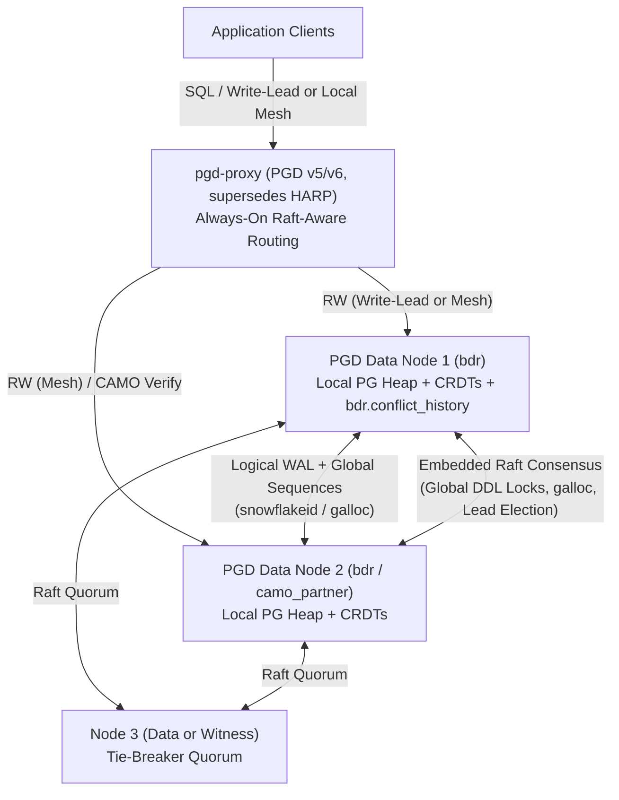

# 4 — EDB Postgres Distributed / BDR (Hybrid Raft Multi-Master — Architectural Reference)

**Series:** PostgreSQL Multi-Master & Active-Active Architectures  
**Author:** Jean-Marie Renouard (`jmrenouard`) — [LightPath](https://www.lightpath.fr)  
**License:** MIT License

---

| Attribute | Value |
| :--- | :--- |
| **Catalog ID** | `#4` (`EDB Postgres Distributed / PGD / BDR` in `Ch. 01`, `Ch. 03a`, `Ch. 04`, `Ch. 07`) |
| **Benchmark Status** | **Not live-benchmarked (`APP-005` Commercial Exclusion)** |
| **Family / Tier** | `T4 / Hybrid` — Logical Extension + Embedded Raft (`Niveau 4 / Hybride`) |
| **Versions** | `EDB PGD v5 / v6` (`bdr` extension, `pgd-proxy` superseding HARP) |
| **CAP / PACELC Profile** | `Hybrid` (`PA/EL` in Async / CRDT vs `PC/EC` in CAMO / Eager / Write-Lead Raft) |
| **License / Deployment** | Proprietary Commercial Subscription (EnterpriseDB) / min `3` nodes (`2 data + 1 witness` or `3 data`) |

---

## 1. Technology Description & What It Does

**EDB Postgres Distributed (PGD)** — evolved from 2ndQuadrant's Bi-Directional Replication (**BDR**) — is a commercial distributed PostgreSQL multi-master platform built on PostgreSQL / EDB Postgres Extended. Unlike pure asynchronous logical extensions, PGD v5/v6 embeds a **native Raft consensus plane** inside the `bdr` extension across data and optional witness nodes, paired with **`pgd-proxy`** (which superseded the older external `etcd`/`Consul`-based **HARP** daemon from BDR v3/v4).

Within a single cluster, PGD spans the PACELC trade-off spectrum: workloads can run in local-speed asynchronous mesh mode using `bdr.conflict_history` LWW or conflict-free CRDT column types (`bdr.crdt_gcounter`, `bdr.crdt_pncounter`, `bdr.crdt_delta_counter`, `bdr.crdt_delta_sum`), or tighten to Raft-coordinated `RPO = 0` via **CAMO**, **Eager All-Node Replication**, or **Write-Lead** routing.

---

## 2. Architecture & Data Flow

A canonical PGD v5/v6 deployment combines at least three Raft members (`2 data + 1 witness` or `3 data` nodes) behind `pgd-proxy` for Write-Lead or multi-region routing:

By embedding Raft directly inside `bdr`, PGD serializes global DDL locks (`ALTER TABLE`) and `Write-Lead` failovers (`RTO ~ 1–5 s`) without relying on external consensus stores.

---

## 3. Operating Principles & Implementation Modes

1. **Embedded Raft & `pgd-proxy`:** Raft arbitrates Lead-Master election (`Write-Lead`), global DDL locks, and `galloc` sequence block allocation across `>= 3` voters (`2 data + 1 witness` minimum).
2. **Dual Commit Latency Model:**

$$
L_{\text{PGD-Async/CRDT}} \approx L_{\text{disk}}, \qquad L_{\text{PGD-CAMO/Eager}} \approx L_{\text{disk}} + 2 \cdot \text{RTT}_{\text{Raft/Partner}}
$$

3. **Exact CRDTs, Conflict Audit & Global Sequences:** Numeric CRDT columns use `bdr.crdt_gcounter`, `bdr.crdt_pncounter`, `bdr.crdt_delta_counter`, or `bdr.crdt_delta_sum` with `REPLICA IDENTITY FULL`; row-level conflicts and LWW outcomes (`column_modify_timestamp`) are recorded in `bdr.conflict_history`. Global IDs use `bdr.global_sequences` (`snowflakeid` recommended 64-bit `bigint`, `galloc` Raft chunks for 32-bit PKs, or legacy `timeshard`).

| Mode / Feature | Scope | Mechanics & Key Strategy | Conflict / Failover / RPO Impact | Trade-Off |
| :--- | :--- | :--- | :--- | :--- |
| **Async Group Replication + LWW** | `PA/EL` Default | `track_commit_timestamp` LWW + `bdr.conflict_history` audit | Local commit speed; `RPO > 0`; silent LWW lost updates | Vulnerable to concurrent hot-row drift |
| **CRDT Columns** (`bdr.crdt_*`) | Column (`REPLICA IDENTITY FULL`) | `bdr.crdt_gcounter`, `bdr.crdt_pncounter`, `bdr.crdt_delta_counter`, `bdr.crdt_delta_sum` | Commutative counter/sum convergence without global locks | Requires schema migration to CRDT types |
| **CAMO** *(Commit-At-Most-Once)* | `PC/EC` Paired (`camo_partner`) | Client queries partner node to verify in-flight TX outcome on failover | **`RPO = 0`** + idempotent client retries | Requires CAMO-aware client drivers & RTT wait |
| **Eager All-Node Replication** | `PC/EC` Global Raft | Coordinates global commit/conflict checks across cluster | Zero write conflicts; strict consistency | Pays `2 * RTT` WAN latency per commit |
| **Write-Lead + `pgd-proxy`** | Hybrid Lead Master | `pgd-proxy` routes writes to one Raft-elected Lead Master | Eliminates multi-writer conflicts (`RTO ~ 1–5 s`) | Single-region write bottleneck like `#15 Patroni` |
| **Global Sequences** (`bdr.global_sequences`) | `snowflakeid` / `galloc` / `timeshard` | `snowflakeid` (64-bit, `4,096` IDs/ms/node); `galloc` (Raft chunks); `timeshard` (legacy) | Prevents `23505` PK collisions in multi-master | `timeshard` lacks wraparound guard (deprecated) |
| **Raft Global DDL Locks** | Cluster DDL | Acquires Raft lock before propagating `ALTER TABLE` | Prevents split-brain schema drift | Blocks writes across WAN if quorum degrades |

---

## 4. Strengths & Weaknesses

| Strengths | Weaknesses & Operational Traps |
| :--- | :--- |
| **Unified `PA/EL` to `PC/EC` Spectrum:** Combines local-speed Async/CRDTs, `RPO = 0` CAMO/Eager, and single-writer Write-Lead in one PostgreSQL architecture. | **Proprietary Commercial TCO & Lock-In (`APP-005`):** Per-core/vCPU EnterpriseDB subscription and gated binary repos exclude community self-hosting. |
| **Raft-Serialized Global DDL & CRDTs:** Unlike `#2 Spock` (event-trigger DDL without global lock), Raft DDL locks serialize concurrent schema changes alongside native `bdr.crdt_*` types. | **WAN Physics on Eager / DDL Locks:** Eager commits and Raft global DDL locks suffer `2 * RTT` WAN degradation and stall if Raft quorum is lost. |
| **Built-In `pgd-proxy` & Orchestrated Backup:** Embedded Raft + `pgd-proxy` (replacing HARP) delivers `1–5 s` failover, paired with `Barman`/`pgBackRest` backup orchestration. | **Minimum 3-Node Quorum Footprint:** Requires at least `2 data + 1 witness` nodes even for 2-datacenter deployments; CAMO requires client driver integration. |
| **Full PostgreSQL Extension Ecosystem:** Preserves PostgreSQL heap storage and C extensions (`PostGIS`, `pgvector`) per full-copy node. | **Full-Dataset-Per-Node Ceiling:** Unlike `#7 Citus`, `#5 YugabyteDB`, or `#6 CockroachDB`, PGD does not horizontally shard tables beyond single-node disk capacity. |

---

## 5. Architectural Exclusion (`APP-005`), Mode Comparison & Reference Baseline

**Why EDB PGD Was Not Live-Benchmarked (`APP-005`):** Per `docs/RCA_REGISTER.md` (`APP-005`), EDB Postgres Distributed requires a commercial EnterpriseDB subscription and gated package/container registries. Including trial-gated proprietary binaries in `env/multi-db-docker-env/` would break the open, MIT-reproducible `make bench-all` contract.

Instead, each PGD mode maps apples-to-apples onto live-benchmarked baselines in `results/*.csv` (no synthetic TPS or latency values are invented for EDB PGD):
- **PGD Async + CRDT** shares the `wal_level = logical` local-commit + delta-merge physics of **`#2 pgedge` / `pgedge-delta-apply`** (`1,837.64 TPS` with `0` drift in `D_hot_conflict`; `646.77 TPS` at `25 ms` WAN).
- **PGD Eager / CAMO** enters the `PC/EC` Raft-consensus regime bounded by WAN `2 * RTT` physics (`#5 YugabyteDB`: `5.78 TPS` at `25 ms` WAN; `#6 CockroachDB`: `10.06 TPS` at `25 ms` WAN).
- **PGD Write-Lead** behaves operationally like **`#15b Patroni HA`** in single-region OLTP while preserving hot cross-region peers.

| Capability / Baseline | `#4 EDB PGD` *(Arch. Ref., `APP-005`)* | `#2 pgEdge / Spock 5` *(PoC)* | `#1 pg-birep` *(PoC)* | `#5 YugabyteDB` / `#6 CockroachDB` *(PoC)* |
| :--- | :--- | :--- | :--- | :--- |
| **Consensus / Quorum** | Embedded Raft (`>=3` nodes/witness) | None (`PA/EL` async) | None (`PA/EL` async) | Per-tablet / Per-range Raft (`RF=3`) |
| **CRDT / Conflict Fix** | `bdr.crdt_*` + `bdr.conflict_history` + Eager | `spock.delta_apply` (`0` drift `D`) | Halt (`23505`, `-71,063` drift `D`) | Native ACID Raft (`0` drift `D`) |
| **DDL Serialization** | **Raft Global DDL Lock** | Event trigger (no global lock) | Manual per node (`L5` fails) | Distributed transactional DDL |
| **Horizontal Sharding** | No (full copy per node) | No (full copy per node) | No (full copy per node) | **Yes (automatic tablet/range sharding)** |
| **Reference Empirical Anchor** | Not benchmarked (`APP-005`) | `1,837.64 TPS` CRDT (`D`), `646.77 TPS` (`25 ms`) | `875.91 TPS` (`A`), `824.04 TPS` (`25 ms`) | `5.78` / `10.06 TPS` at `25 ms` WAN (`PC/EC`) |

---

**Navigation:** [Index](../../../README.md) · [Ch. 03a — Native & Extensions](../03a_solutions_native_and_extensions.md) · [Ch. 10 — Streaming vs Logical vs Multi-Master](../10_streaming_vs_logical_vs_multimaster.md) · [Version française](../../fr/solutions/edb_pgd.md)
