# 13 — Google Cloud Spanner (PG Interface) & AlloyDB (Architectural Reference)

**Series:** PostgreSQL Multi-Master & Active-Active Architectures  
**Author:** Jean-Marie Renouard (`jmrenouard`) — [LightPath](https://www.lightpath.fr)  
**License:** MIT License

---

| Attribute | Value |
| :--- | :--- |
| **Catalog ID** | `#13` (`GCP Spanner PG & AlloyDB` in `Ch. 01`, `Ch. 03b`, `Ch. 04`, `Ch. 07`) |
| **Benchmark Status** | **Not live-benchmarked (`APP-005` Managed Cloud Exclusion)** |
| **Family / Tier** | `T5 / Cloud` (Spanner Active-Active) vs `T1–T2 / Cloud` (AlloyDB Single-Primary Disaggregated) |
| **Versions** | `Cloud Spanner PostgreSQL Interface` (`PGAdapter`); `AlloyDB for PostgreSQL` (`PG 14–16+`) & `AlloyDB Omni` |
| **CAP / PACELC Profile** | `PC/EC` (Spanner TrueTime + Multi-Paxos) / `PC/EC` or `PA/EL` (AlloyDB Single-Primary + Read Pools) |
| **License / Deployment** | Proprietary GCP Managed Services (`Spanner`, `AlloyDB`) & Containerized Commercial (`AlloyDB Omni`) |

---

## 1. Technology Description & What It Does

Catalog `#13` groups two fundamentally distinct Google Cloud architectures to eliminate a recurring market confusion (`Ch. 01`, `Ch. 03b`):
- **Google Cloud Spanner (PostgreSQL Interface)** is a globally distributed, horizontally sharded active-active `PC/EC` relational engine. Using **Multi-Paxos** per data split and **TrueTime** hardware clocks (GPS + atomic clocks bounding clock uncertainty $\varepsilon < 7\text{ ms}$), Spanner delivers **External Consistency (Strict Serializability)** across continents. Applications connect via standard PostgreSQL drivers through the **`PGAdapter`** gRPC sidecar proxy using Spanner's PostgreSQL SQL dialect.
- **Google Cloud AlloyDB for PostgreSQL (and AlloyDB Omni)** is **NOT active-active multi-master**. It is a high-performance **single-primary** PostgreSQL engine built over a disaggregated **Log Processing Service (LPS)** storage layer, elastic **Read Pools**, and an adaptive in-memory **Columnar Engine** (`AlloyDB Omni` brings this stack to self-managed containers/Kubernetes).

---

## 2. Architecture & Data Flow

Spanner coordinates distributed multi-region writes via **PGAdapter**, **Multi-Paxos** split leaders, **2PC**, and **TrueTime**, whereas AlloyDB funnels all writes through one primary instance to disaggregated **LPS** storage shared with **Read Pools**:

```mermaid
flowchart TB
    subgraph SPAN["Cloud Spanner (PG Interface — Active-Active PC/EC)"]
        CS["PG Client / ORM"] -->|"pgwire"| PGA["PGAdapter Sidecar<br/>pgwire -> Spanner gRPC"]
        TT["TrueTime API<br/>GPS + Atomic Clocks (eps < 7ms)"] -.->|"Commit-Wait 2*eps"| SP1["Split Leader A<br/>Multi-Paxos + Wound-Wait"]
        PGA -->|"gRPC SQL Dialect"| SP1
        PGA -->|"gRPC SQL Dialect"| SP2["Split Leader B<br/>Multi-Paxos + 2PC"]
        SP1 <-->|"Cross-Split 2PC"| SP2
        SP1 -->|"Paxos Replicas"| COL1["Colossus Storage"]
        SP2 -->|"Paxos Replicas"| COL1
    end
    subgraph ALLOY["AlloyDB / AlloyDB Omni (Single-Primary Disaggregated)"]
        CA["PG Client"] -->|"RW SQL"| AP["Single Primary Compute<br/>Row Heap + Columnar Cache"]
        CA -->|"RO SQL"| ARP["Elastic Read Pools<br/>Columnar Engine + SSD Cache"]
        AP -->|"WAL Stream Only"| LPS["Log Processing Service (LPS)<br/>Async Page Materialization"]
        LPS --> COL2["Shared Colossus / Omni Storage"]
        COL2 -->|"Shared Pages"| ARP
    end
```

Notice the structural boundary: Spanner scales writes globally with strict serializability via Paxos + TrueTime, while AlloyDB keeps PostgreSQL single-writer semantics (`100%` extension/trigger parity) and scales reads plus HTAP analytics.

---

## 3. Operating Principles & Implementation Modes

1. **TrueTime & Commit-Wait (`2\varepsilon`):** Google datacenters expose TrueTime intervals $[t_{\text{earliest}}, t_{\text{latest}}]$ bounded by $\varepsilon < 7\text{ ms}$. Before releasing write locks, Spanner executes a **commit-wait** of $2\varepsilon$ so any causally subsequent transaction receives a strictly larger timestamp, enabling **lock-free consistent reads** globally:

$$
L_{\text{Spanner-Write}} \approx L_{\text{Paxos-quorum}} + 2 \cdot \varepsilon_{\text{TrueTime}} + k_{\text{2PC}} \cdot \text{RTT}_{\text{2PC}}, \qquad \varepsilon_{\text{TrueTime}} < 7\text{ ms}
$$

2. **Spanner PG Dialect Constraints vs. AlloyDB LPS:** Spanner uses **Wound-Wait** concurrency control, **Interleaved Tables**, **bit-reversed sequences**, and **Change Streams** (`~65%` PG compatibility: zero C extensions, no triggers, mandatory PKs). Conversely, AlloyDB offloads dirty-page writes to **LPS** and accelerates OLAP scans in Read Pools via its **Columnar Engine**.

| Mode / Variant | Scope & Mechanism | Commit & Sync Path | Conflict / Failover | Trade-Off |
| :--- | :--- | :--- | :--- | :--- |
| **Spanner PG — Regional** | Multi-zone `Multi-Paxos` splits | Paxos quorum + `2*eps` commit-wait | Wound-Wait / `40001` aborts; `< 5 s` RTO | Zero C extensions; PG dialect subset |
| **Spanner PG — Multi-Region** | Continental Paxos voting + witnesses | Leader/witness quorum + 2PC + TrueTime | Zero split-brain (`RPO = 0`) | WAN Paxos RTT + `2*eps` write floor |
| **Spanner PG — Stale Reads** | Bounded / exact-staleness `RO` | Local read-only replica at past `ts` | Lock-free; zero Paxos write round | Reads bounded historical snapshot |
| **AlloyDB for PostgreSQL** | Single primary + Read Pools + LPS | Primary streams WAL only to LPS | Managed single-writer HA (`RPO = 0`) | **Not multi-master**; GCP lock-in |
| **AlloyDB Omni** *(Portable)* | Containerized / K8s PG + Columnar | Single primary + local/shared storage | Patroni/K8s operator single-writer HA | Portable self-hosted; still single-writer |

---

## 4. Strengths & Weaknesses

| Strengths | Weaknesses & Operational Traps |
| :--- | :--- |
| **True External Consistency (Spanner):** TrueTime + Multi-Paxos eliminates clock-drift lost updates (`LWW`) and stale reads across continents with `RPO = 0`. | **Limited PG Dialect Parity (Spanner ~65%):** Requires `PGAdapter` sidecar; zero C extensions (`PostGIS`, `pgvector` C), no triggers, limited PL/pgSQL, and mandatory PKs. |
| **Lock-Free Global Reads (Spanner):** Read-only transactions and stale reads execute without acquiring locks or stalling multi-region writers. | **Very High Cloud TCO (`APP-005`):** Dedicated Spanner compute nodes, inter-region network egress, and enterprise AlloyDB licensing carry steep production bills. |
| **Disaggregated LPS + HTAP Columnar (AlloyDB):** Eliminates checkpoint I/O storms on primary and accelerates mixed OLTP/OLAP scans in Read Pools. | **AlloyDB Is Single-Primary Only:** Cannot accept concurrent active-active writes across nodes or regions; cross-region replicas remain asynchronous read-only. |
| **Portable Hybrid Option (`AlloyDB Omni`):** Brings AlloyDB's columnar engine and query optimizations into Docker/Kubernetes outside GCP. | **Vendor Ecosystem Divergence (Spanner):** `LISTEN/NOTIFY` and physical `pgBackRest` workflows are replaced by Spanner Change Streams and managed PITR. |

---

## 5. Architectural Exclusion (`APP-005`), Mode Comparison & Reference Baseline

**Why `#13 GCP Spanner & AlloyDB` Were Not Live-Benchmarked (`APP-005`):** Per `docs/RCA_REGISTER.md` (`APP-005`), Cloud Spanner depends on proprietary TrueTime GPS/atomic-clock hardware and Colossus/Borg infrastructure, while AlloyDB is a proprietary GCP managed service (`AlloyDB Omni` is commercially licensed). Zero synthetic TPS or latency figures are invented here.

In our empirical baseline (`results/benchmark_summary.csv`, `results/functional_limits_matrix.csv`), Spanner maps onto `T5` (`PC/EC` Multi-Raft) while AlloyDB maps onto `T1/T2` single-primary HA (99th-percentile latency is not recorded in `results/`):

| Capability / Baseline | `#13 Spanner PG` *(Arch. Ref., `APP-005`)* | `#13 AlloyDB` *(Single-Primary Ref.)* | `#6 CockroachDB` *(PoC, `RF=3`)* | `#5 YugabyteDB` *(PoC, `RF=3`)* | `#15b pg17-sync-streaming` *(Control)* |
| :--- | :--- | :--- | :--- | :--- | :--- |
| **Consensus / Writers** | Multi-Paxos + TrueTime (Active-Active) | Single Primary + LPS + Read Pools | Per-range Raft (`RF=3`) + HLC | Per-tablet Raft (`RF=3`) + HLC | 1 Primary + Sync Standby (`25006`) |
| **PG Parity / Extensions** | ~65% (`PGAdapter`, zero C ext.) | High PG parity + Columnar | ~75% Go `pgwire` (zero C ext.) | ~98% Fork `PG 15` (`vector`) | **Core `PG 17.11` (`100%`)** |
| **Keyless / `LISTEN`** | PK Required / Change Streams | Full PG / Node-local | Hidden `rowid` / `42601` | Hidden `rowid` / `0A000` | Full PG / Primary-local |
| **Reference Anchor (`A_single_rw`)** | Not benchmarked (`APP-005`) | Not benchmarked (`APP-005`) | `42.08 TPS` (`44` `40001` retries) | `173.64 TPS` (`0` retries) | `409.48 TPS` (`50.307 ms` `p95`) |
| **Reference Anchor (`F_wan_netem_25ms`)** | Not benchmarked (2*eps + Paxos RTT) | Not benchmarked (1 primary) | `10.06 TPS` (`-76.1%` WAN Raft) | `5.78 TPS` (`-96.7%` WAN Raft) | `57.00 TPS` (`-86.1%` WAN WAL) |

## 6. GitHub Popularity, Git Presence & Maintenance Vitality (`results/project_popularity.csv`)

Live GitHub telemetry (`2026-11-20T17:26:02Z`, `archived = false` unless `N/A`):

| Project | Git Presence / Role | Repo (`Account / Repos`) | Stars / Forks / Watch | Commits (`Tot / 12m`) | Contrib / Issues | Lang / SPDX | Release / Last Push |
| :--- | :--- | :--- | :---: | :---: | :---: | :--- | :--- |
| **Google Cloud Spanner & AlloyDB (#13)** | `Partial (PGAdapter only; engine proprietary)` -- `Proprietary (Managed Cloud)` | N/A (Proprietary) | N/A / N/A / N/A | N/A / N/A | N/A / N/A | N/A / Proprietary | N/A / N/A |
| **Cloud Spanner PGAdapter (#13a)** | `Partial (Proxy only)` -- `Primary (Client Proxy; Engine Proprietary)` | [`GoogleCloudPlatform/pgadapter`](https://github.com/GoogleCloudPlatform/pgadapter) (`Org / 1545`) | 94 / 36 / 26 | 4040 / 934 | 22 / 74 | Java / `Apache-2.0` | `v0.56.4` / `2026-11-20T11:30:29Z` |

- **Maintenance Level:** **Closed / Managed Cloud (+ OSS Proxy)** -- Core Spanner and AlloyDB engines are closed GCP services (`N/A`); open-source `GoogleCloudPlatform/pgadapter` logs `934` commits/12m (`4,040` total, `22` contributors, `94` stars, `74` open issues).
- **Currency / Freshness:** **Opaque Engine + Active Proxy** -- Engine push `N/A`; PGAdapter last push `2026-11-20T11:30:29Z`, `934` commits/12m, latest release `v0.56.4`.
- **Operational Manageability:** **Vendor Lock-In** -- Requires managed GCP Spanner/AlloyDB services (or commercial `AlloyDB Omni`), `PGAdapter` sidecar ops, and Spanner dialect constraints.

---

**Navigation:** [Index](../../../README.md) · [Ch. 03b — Distributed, Triggers & Cloud](../03b_solutions_distributed_triggers_cloud.md) · [Ch. 10 — Streaming vs Logical vs Multi-Master](../10_streaming_vs_logical_vs_multimaster.md) · [Version française](../../fr/solutions/gcp_spanner_alloydb.md)
