# 14 — Legacy Trigger & Queue Replication: Slony-I, Londiste/PGQ & RubyRep (Architectural Reference — EOL)

**Series:** PostgreSQL Multi-Master & Active-Active Architectures  
**Author:** Jean-Marie Renouard (`jmrenouard`) — [LightPath](https://www.lightpath.fr)  
**License:** MIT License

---

| Attribute | Value |
| :--- | :--- |
| **Catalog ID** | `#14` (`RubyRep / Slony-I / Londiste` in `Ch. 01`, `Ch. 03b`, `Ch. 04`) |
| **Benchmark Status** | **Not live-benchmarked (Architectural Reference — Historical / EOL)** |
| **Family / Tier** | `T4 / Historical` — Trigger & Queue-Based Async Replication (`Niveau 4 / Historique`) |
| **Versions** | `Slony-I 2.2.x` (C/PLpgSQL); `Skytools 3 / Londiste + PGQ` (Python/C, EOL); `RubyRep 1.2.x` (JRuby, abandoned) |
| **CAP / PACELC Profile** | `PA/EL` — asynchronous trigger/queue capture (`Slony`/`Londiste` single-origin; `RubyRep` fragile bi-dir) |
| **License / Deployment** | Open Source (BSD / ISC / MIT) / In-DB row triggers + shadow queue tables + external `slon`/`londiste`/`rubyrep` daemon |

---

## 1. Technology Description & What It Does

Before PostgreSQL 9.0 introduced physical streaming replication and PostgreSQL 9.4/10 introduced logical WAL decoding (`pgoutput`), selective and cross-version PostgreSQL replication relied on **in-database triggers** writing row changes into staging tables polled by external daemons:
- **Slony-I:** C/PLpgSQL trigger engine (`_slony.logTrigger`) with a `slon` daemon per node supporting **cascading single-origin** master-to-slaves trees (`NOT` active-active multi-master) and zero-downtime upgrades via explicit `EXECUTE SCRIPT` DDL locks.
- **Londiste (Skytools) + PGQ:** Skype's queue-based system capturing changes via `pgq.logutriga` triggers into rotating **PGQ** tables cut into snapshot-consistent **batches** by a **`pgq.ticker`** daemon and applied by Python `londiste` consumer workers.
- **RubyRep:** Ruby/JRuby bidirectional table-diff and trigger sync (`rr_pending_changes` + periodic full-table checksums); abandoned around 2012 and unsafe for modern OLTP.

---

## 2. Architecture & Data Flow

All three legacy engines intercept DML inside user transactions via SQL/C triggers rather than reading WAL asynchronously, incurring double write I/O before external daemons replay batches on target nodes:

```mermaid
flowchart TB
    subgraph SLONY["Slony-I (Single-Origin Cascading Tree)"]
        SM["Origin Primary"] -->|"C _slony.logTrigger -> sl_log_1/2"| SD["slon C Daemons<br/>(EXECUTE SCRIPT DDL Lock)"]
        SD -->|"Async Replay"| SS1["Cascading Replica 1"]
        SD -->|"Cascade"| SS2["Cascading Replica 2"]
    end
    subgraph LOND["Londiste / Skytools + PGQ (Queue Batches)"]
        LM["Source Node"] -->|"pgq.logutriga -> pgq.event_*"| TICK["pgq.ticker Daemon<br/>Batch Tick Cut + Vacuum"]
        TICK -->|"Discrete Batches"| LC["Python londiste Worker"]
        LC -->|"Async Apply"| LS["Subscriber Node"]
    end
    subgraph RUBY["RubyRep (Bidirectional Diff + Triggers — Abandoned)"]
        RA["Node A (rr_pending_changes)"] <-->|"JRuby Polling + Checksum Diff"| RB["Node B (rr_pending_changes)"]
    end
```

Unlike `pgoutput` logical decoding (which reads WAL out-of-band after commit), trigger capture executes **inside** the foreground write transaction, doubling heap/index/WAL pressure and queue `VACUUM` overhead.

---

## 3. Operating Principles & Implementation Modes

1. **Synchronous Trigger Capture vs. Asynchronous Batch Replay:** Every `INSERT`/`UPDATE`/`DELETE` writes both the target table and a queue/log table (`sl_log_1`, `pgq.event_*`, or `rr_pending_changes`), followed by daemon tick polling:

$$
\text{Write}_{\text{trigger}} \approx W_{\text{heap}} + W_{\text{queue}} + 2 \cdot W_{\text{WAL}} + V_{\text{vacuum-queue}}, \qquad L_{\text{batch}} \ge \Delta t_{\text{tick}} + \frac{Q_{\text{batch}}}{\mu_{\text{worker}}}
$$

2. **Schema & Primary Key Discipline:** Every replicated table requires a `PRIMARY KEY` (or unique candidate key); DDL never propagates automatically (`Slony-I` requires blocking `EXECUTE SCRIPT` via `slonik`, while `Londiste` and `RubyRep` require manual out-of-band DDL coordination).

| Tool / Mode | Scope & Mechanism | Commit & Sync Path | Conflict / Failover | Trade-Off |
| :--- | :--- | :--- | :--- | :--- |
| **Slony-I** *(Cascading Single-Origin)* | `_slony` schema + `logTrigger` + `slon` | Foreground trigger -> async `slon` replay | Single writer per set (zero write conflicts) | High admin complexity; superseded by streaming/`pg17-logical` |
| **Slony-I `EXECUTE SCRIPT`** | Coordinated schema change via `slonik` | Acquires cluster-wide locks per set | Prevents DDL tuple mismatch | Causes brief cluster-wide write stalls |
| **Londiste + PGQ** *(Queue Batching)* | `pgq.logutriga` + `pgq.ticker` + Python | Trigger -> PGQ event table -> tick batch | Single-origin per table (star/fan-out OK) | Clean batch rotation in its era; Python/PGQ EOL debt |
| **RubyRep** *(Bidirectional Diff)* | `rr_pending_changes` + table checksums | Trigger + JRuby polling & diff sync | LWW / custom Ruby hooks (clock/lock risk) | Abandoned ~2012; severe CPU and scan lock overhead |

---

## 4. Strengths & Weaknesses

| Strengths | Weaknesses & Operational Traps |
| :--- | :--- |
| **Historical Zero-Downtime Upgrades:** Slony-I and Londiste enabled live `PG 8.x -> 9.x -> 10` migrations years before native logical decoding existed. | **Severe Trigger Write Amplification & Bloat:** Every write generates extra queue rows, index updates, double WAL, and chronic `VACUUM` / XID wraparound risk on `sl_log` / `pgq`. |
| **Selective Table & Cascading Fan-Out:** Londiste/PGQ and Slony-I replicated chosen table subsets across heterogeneous OS/PG versions (`PA/EL`). | **No Multi-Master in Slony-I / Abandoned RubyRep:** Slony-I is strictly single-origin per replication set, while RubyRep is unmaintained and unsafe under concurrent OLTP. |
| **Reusable Event Queue (`PGQ`):** Skytools decoupled event capture (`pgq.logutriga`) from consumers, allowing multiple independent workers per queue. | **High Batch Lag & Zero Auto-DDL:** Tick-based polling yields hundreds of milliseconds of lag (mirroring `#9 Bucardo`), and raw `ALTER TABLE` breaks replication without manual wrappers. |
| **Simple Table Diffs (`RubyRep`):** Built-in row checksums helped reconcile small drifted tables during legacy migrations. | **Superseded by Core PG 17 & Modern Tools:** Native `pgoutput`, `#2 pgEdge Spock 5`, and `#10 SymmetricDS` replace every legacy trigger role cleanly. |

---

## 5. Architectural Exclusion, Mode Comparison & Reference Baseline

**Why `#14 Legacy Trigger Systems` Were Not Live-Benchmarked:** Slony-I, Londiste/PGQ, and RubyRep are historical/EOL pre-PG-9.4 architectures rather than viable PostgreSQL 17 production stacks (`env/multi-db-docker-env/` excludes EOL daemons). Zero synthetic TPS or latency figures are invented here.

**Catalog Disambiguation:** Catalog `#14` is strictly reserved for these legacy trigger systems (Slony-I, Londiste/PGQ, RubyRep), whereas native PostgreSQL 17 uni-directional logical replication (`pg17-logical`) is cataloged as `#16` (`T3`).

Instead, these legacy trigger architectures map cleanly onto the live-benchmarked trigger and logical baselines in `results/benchmark_summary.csv`, `results/functional_limits_matrix.csv`, and `results/extended_functional_matrix.csv` (99th-percentile latency is not recorded in `results/`):

| Capability / Baseline | **Legacy Triggers** *(Arch. Ref., EOL)* | `#9 Bucardo 5` *(PoC Trigger Baseline)* | `pg17-logical` *(PoC `T3` Replacement)* | `#1 pg-birep` *(PoC `T4` Native)* | `#15a pg17-standalone` *(Control)* |
| :--- | :--- | :--- | :--- | :--- | :--- |
| **Capture Mechanism** | In-DB SQL/C triggers + queue tables | PL/Perl triggers (`bucardo_delta`) | WAL `pgoutput` decoding (no triggers) | WAL `pgoutput` (`origin=none`) | Single primary (`CA`) |
| **Multi-Master Support** | No (`Slony`/`Londiste`); fragile (`RubyRep`) | Yes (`bucardo_latest` `-531,620` drift) | No (Uni-directional `Pub -> Sub`) | Yes (halts `23505`, `-71,063` drift) | Single writer (`0` drift) |
| **Keyless / FK / DDL** | PK req / FK race / Manual DDL | PK req / **`23503` `0/10`** / Manual DDL | `55000` keyless / `10/10` FK / Manual | `55000` keyless / `10/10` FK / Manual | Full native PG 17 |
| **Reference Anchor (`A` / `T15` Lag)** | Not benchmarked (EOL reference) | `735.38 TPS` (`A`) / `548.74 ms` `p50` | `532.38 TPS` (`A`) / `1.68 ms` `p50` | `875.91 TPS` (`A`) / `1.47 ms` `p50` | `866.82 TPS` (`A`, `23.958 ms` `p95`) |
| **Migration Target Today** | Replace with `T1–T4` / `#10 SymmetricDS` | Low-vol Perl hooks only | **Native `PG 17` upgrades & subsets** | Disjoint active-active (`T4`) | Default `80%+` OLTP (`#15`) |

---

**Navigation:** [Index](../../../README.md) · [Ch. 03b — Distributed, Triggers & Cloud](../03b_solutions_distributed_triggers_cloud.md) · [Ch. 10 — Streaming vs Logical vs Multi-Master](../10_streaming_vs_logical_vs_multimaster.md) · [Version française](../../fr/solutions/legacy_triggers.md)
