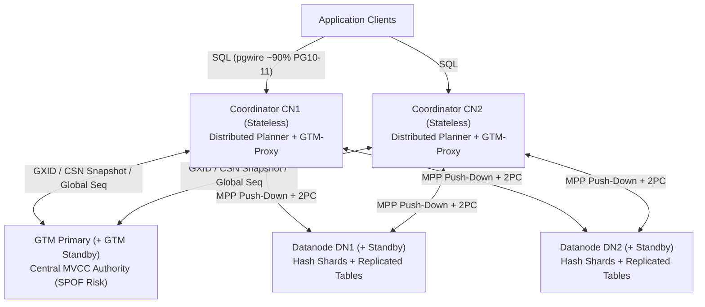

# 8 — OpenTenBase / Postgres-XL / Postgres-XC (Shared-Nothing MPP 2PC — Architectural Reference)

**Series:** PostgreSQL Multi-Master & Active-Active Architectures  
**Author:** Jean-Marie Renouard (`jmrenouard`) — [LightPath](https://www.lightpath.fr)  
**License:** MIT License

---

| Attribute | Value |
| :--- | :--- |
| **Catalog ID** | `#8` (`OpenTenBase / Postgres-XL / Postgres-XC` in `Ch. 01`, `Ch. 03b`, `Ch. 04`) |
| **Benchmark Status** | **Not live-benchmarked (Architectural Reference)** |
| **Family / Tier** | `T5` — Shared-Nothing MPP / GTM + Distributed 2PC (`Niveau 5`) |
| **Versions** | `Postgres-XC` (retired), `Postgres-XL 10` (dormant ~2018), `OpenTenBase` (active PG 10–11 fork + backports) |
| **CAP / PACELC Profile** | `CP / PC-EC` — centralized GTM (`GXID` + global MVCC snapshots) + CN/DN 2PC |
| **License / Deployment** | Open Source (PostgreSQL / Tencent Apache-style) / `GTM` (+ Standby/Proxy) + Coordinators + Datanodes |

---

## 1. Technology Description & What It Does

**OpenTenBase**, **Postgres-XL**, and their retired ancestor **Postgres-XC** (originally developed by NTT) form a **shared-nothing Massively Parallel Processing (MPP)** PostgreSQL lineage. Unlike `#7 Citus` (a pure C extension layered onto unmodified PostgreSQL 17), this family forks the PostgreSQL server kernel to split query processing into three dedicated node roles: stateless **Coordinators (CN)**, hash-sharded **Datanodes (DN)**, and a centralized **Global Transaction Manager (GTM)**.

The GTM issues cluster-wide `GXID` IDs, global `CSN` snapshots, and global sequences. This gives cross-shard snapshot isolation and parallel analytical push-down joins (`HTAP`/`OLAP`). Today, **Postgres-XC** is retired, **Postgres-XL** is frozen at `PG 10` (~2018), and **OpenTenBase** (Tencent's fork of TBase under the OpenAtom Foundation) is the sole actively maintained open-source descendant.

---

## 2. Architecture & Data Flow

An OpenTenBase or Postgres-XL cluster routes SQL through stateless **Coordinators**. Coordinators fetch `GXID`/snapshots from the **GTM** (or **GTM-Proxy**) and commit across **Datanodes** with 2PC:

Because every distributed `BEGIN`, snapshot read, and 2PC `COMMIT` hits the GTM, WAN links raise latency sharply. Single-shard Citus and decentralized Raft engines (`#5`, `#6`) avoid this bottleneck.

---

## 3. Operating Principles & Implementation Modes

1. **Centralized GTM (`GXID` / `CSN`) & `GTM-Proxy`:** The GTM assigns strictly ordered `GXID` values and global snapshots across all Coordinators and Datanodes. `GTM-Proxy` processes co-located on CN/DN hosts batch multiple concurrent requests over fewer GTM sockets to ease thread/network saturation.
2. **Commit Latency Model:**

$$
L_{\text{T5-MPP-GTM}} \approx L_{\text{disk-DN}} + \text{RTT}_{\text{CN-GTM}} + 2 \cdot \text{RTT}_{\text{CN-DN}}
$$

3. **Distribution & Lineage Modes:** Use `DISTRIBUTE BY HASH(col)` or `MODULO(col)` for horizontal sharding, and `DISTRIBUTE BY REPLICATION` for 2PC reference tables. Distributed `PK`/`UNIQUE` keys must include the distribution column (`Ch. 04`).

| Lineage / Mode | Status & Kernel | Mechanics & Key Strategy | Conflict / Failover Impact | Trade-Off |
| :--- | :--- | :--- | :--- | :--- |
| **Postgres-XC** *(NTT)* | Retired (EOL) | Original GTM + CN + DN 2PC split on PG 9.x | GTM SPOF without modern CSN batching | Superseded by XL and OpenTenBase |
| **Postgres-XL** *(Community)* | Dormant (~2018, `PG 10`) | Added MPP distributed query planner + `GTM-Proxy` | Unpatched PG 10 kernel; manual HA | Frozen ecosystem; unsuitable for new prod |
| **OpenTenBase** *(Tencent / OpenAtom)* | Active (`PG 10–11` fork + backports) | TBase descendant with CSN, GTM Standby, HTAP/columnar | GTM + DN streaming standbys (`RPO = 0`, `RTO 15–60 s`) | High ops cost; kernel lags stock PG 17 |
| **`DISTRIBUTE BY HASH` vs. `REPLICATION`** | Sharded vs. Replicated DDL | Hash splits data across DNs; Replication copies full lookup table | Requires shard key in `PK`/`UNIQUE`; cross-DN FKs restricted | Replicated writes lock all DNs with 2PC |
| **`GTM-Proxy` Batching** | CN/DN local proxy | Groups `GXID` and snapshot RPCs toward GTM | Reduces GTM socket contention in LAN HTAP | Does not remove WAN `RTT` penalty |

---

## 4. Strengths & Weaknesses

| Strengths | Weaknesses & Operational Traps |
| :--- | :--- |
| **True Global MVCC Snapshots (`GXID`/`CSN`):** GTM coordinates consistent cluster-wide read snapshots without clock-skew waits (`HLC`) across multi-shard joins. | **Centralized GTM OLTP & WAN Bottleneck:** Every short OLTP `BEGIN`/`COMMIT` pays GTM + CN-DN 2PC round-trips; WAN RTT collapses throughput worse than `#7 Citus`. |
| **MPP Analytical Push-Down (`HTAP`/`OLAP`):** OpenTenBase scales parallel hash joins and columnar/HTAP scans across many Datanodes and stateless Coordinators. | **Dormant Predecessors & PG Fork Lag:** Postgres-XC is retired, Postgres-XL is frozen at `PG 10`, and OpenTenBase forks `PG 10–11` rather than running stock `PG 17` extensions. |
| **Zero-RPO Standby Topologies (`DN` + `GTM` HA):** Pairing Datanodes and GTM with streaming standbys achieves `RPO = 0` (`RTO 15–60 s`) plus `pg_rman` barrier PITR. | **Very High Operational Complexity:** Operating 4 distinct roles (`GTM`, `GTM-Proxy`, `CN`, `DN` + standbys) and barrier-coordinated backups imposes heavy SRE overhead. |
| **High SQL & MPP Planner Richness:** Retains `~90%` PostgreSQL wire compatibility, partitioned tables, and `GTM Sequence` global IDs. | **Schema & Ecosystem Limits:** Shard key mandatory in `PK`/`UNIQUE`, restricted cross-node FKs, and partial trigger/extension support vs. `#7 Citus` on PG 17. |

---

## 5. Architectural Exclusion, Mode Comparison & Reference Baseline

**Why `#8 OpenTenBase / Postgres-XL / Postgres-XC` Was Not Live-Benchmarked:** The Docker PoC (`env/multi-db-docker-env/`, `Makefile` `PG_STACKS`) evaluates 9 live stacks anchored on **PostgreSQL 17** and modern distributed SQL engines. Postgres-XC is retired, and Postgres-XL is frozen on EOL `PG 10`. OpenTenBase targets intra-DC MPP/HTAP on a forked `PG 10–11` kernel rather than stock `PG 17` OLTP. Zero synthetic TPS or latency figures are invented here.

Instead, `#8` maps cleanly onto the live-benchmarked `T5` (`CP / PC-EC`) and single-node control baselines in `results/benchmark_summary.csv` and `results/functional_limits_matrix.csv` (99th-percentile latency is not recorded in `results/`):

| Capability / Baseline | `#8 OpenTenBase / PG-XL` *(Arch. Ref.)* | `#7 Citus` *(PoC, PG `17.10`)* | `#5 YugabyteDB` *(PoC, `RF=3`)* | `#6 CockroachDB` *(PoC, `RF=3`)* | `#15a pg17-standalone` *(Control)* |
| :--- | :--- | :--- | :--- | :--- | :--- |
| **Consensus / Authority** | Central **GTM** + 2PC | Coord 2PC (no worker Raft) | Per-tablet Raft (`RF=3`) + HLC | Per-range Raft (`RF=3`) + HLC | Single primary (`CA`) |
| **PG Kernel & Extensions** | Fork `PG 10–11` (~90% wire) | **Core `PG 17`** (high parity) | Fork `PG 15` C (`YSQL`, `vector`) | Go `pgwire` (zero C ext.) | **Core `PG 17.11` (`100%`)** |
| **Key Schema Constraint** | Shard key in `PK`/`UNIQUE` | **`0A000` w/o dist key (`L2`/`L4`)** | Global `23505`; `LISTEN` `0A000` | `TEMP` `XCEXF`; `LISTEN` `42601` | None (local `23505`) |
| **Reference Anchor (`A_single_rw`)** | Not benchmarked | `309.04 TPS` (`0` drift) | `173.64 TPS` (`0` retries) | `42.08 TPS` (`44` retries) | `866.82 TPS` (`23.958 ms` `p95`) |
| **Reference Anchor (`D` / `25 ms` WAN)** | Not benchmarked (GTM + 2PC WAN penalty) | `1,691.45` (`D`) / `21.67 TPS` (`-93.0%`) | `832.65` (`D`) / `5.78 TPS` (`-96.7%`) | `471.61` (`D`) / `10.06 TPS` (`-76.1%`) | `3,128.63 TPS` (`D`) / N/A |

## 6. GitHub Popularity, Git Presence & Maintenance Vitality (`results/project_popularity.csv`)

Live GitHub telemetry (`2026-11-20T17:26:02Z`, `archived = false` unless `N/A`):

| Project | Git Presence / Role | Repo (`Account / Repos`) | Stars / Forks / Watch | Commits (`Tot / 12m`) | Contrib / Issues | Lang / SPDX | Release / Last Push |
| :--- | :--- | :--- | :---: | :---: | :---: | :--- | :--- |
| **OpenTenBase (#8)** | `Yes` -- `Primary (PG-XL/XC Successor)` | [`OpenTenBase/OpenTenBase`](https://github.com/OpenTenBase/OpenTenBase) (`Org / 14`) | 816 / 636 / 112 | 817 / 14 | 64 / 421 | C / `NOASSERTION` | `v5.0` / `2026-11-09T13:23:30Z` |

- **Maintenance Level:** **Tier C (Fragile / Maintenance)** -- `OpenTenBase/OpenTenBase` records `14` commits/12m (`817` total, `64` contributors, `816` stars, `421` open issues). Postgres-XC is retired and Postgres-XL is frozen on PG 10.
- **Currency / Freshness:** **Low Cadence** -- Last push `2026-11-09T13:23:30Z`, `14` commits/12m, latest release `v5.0`.
- **Operational Manageability:** **High Risk** -- Forked `PG 10-11` kernel (`MulanPSL-2.0` / `NOASSERTION` SPDX) and 4-role GTM/CN/DN stack impose heavy SRE burden vs. `#7 Citus`.

---

**Navigation:** [Index](../../../README.md) · [Ch. 03b — Distributed, Triggers & Cloud](../03b_solutions_distributed_triggers_cloud.md) · [Ch. 10 — Streaming vs Logical vs Multi-Master](../10_streaming_vs_logical_vs_multimaster.md) · [Version française](../../fr/solutions/opentenbase_pgxl.md)
