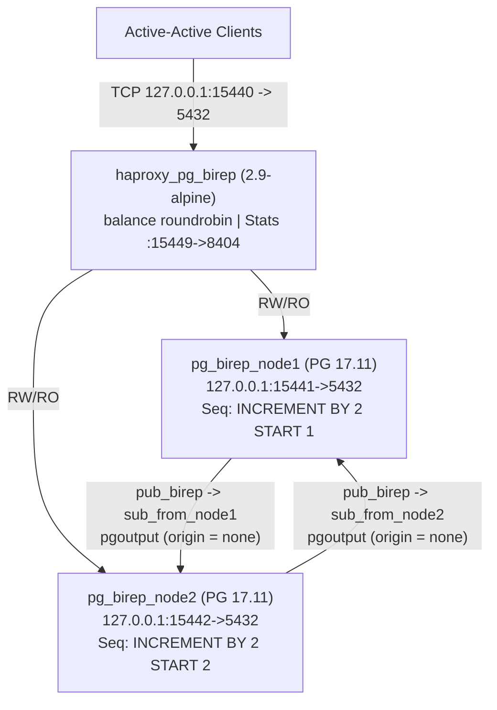

# 1 — PostgreSQL 17 Native Bidirectional Logical Replication (`pg-birep`)

**Series:** PostgreSQL Multi-Master & Active-Active Architectures  
**Author:** Jean-Marie Renouard (`jmrenouard`) — [LightPath](https://www.lightpath.fr)  
**License:** MIT License

---

| Attribute | Value |
| :--- | :--- |
| **Catalog ID** | `#1` (`PostgreSQL 17 Native Bidirectional (#1)` in `results/functional_limits_matrix.csv`) |
| **Benchmark Topology ID** | `pg-birep` (`results/*.csv`) |
| **Family / Tier** | `T4` — Native Logical Multi-Master (`Niveau 4`) |
| **Versions** | `PostgreSQL 17.11` (`postgres:17`), `HAProxy 2.9` (`haproxy:2.9-alpine`) |
| **CAP / PACELC Profile** | `AP / PA-EL` — asynchronous active-active mesh |
| **License / Deployment** | PostgreSQL License / GPL-2.0 (HAProxy) / 3 containers (`docker-compose-pg-birep.yml`) |

---

## 1. Technology Description & What It Does

**PostgreSQL Native Bidirectional Logical Replication** (`pg-birep`) links writable PostgreSQL 16/17/18 primaries in an active-active mesh. It uses core `pgoutput` publications and subscriptions with `WITH (origin = none)`.

Introduced in PostgreSQL 16, `origin = none` filters out changes that carry a remote `pg_replication_origin`, breaking infinite `Node 1 -> Node 2 -> Node 1` replication loops without third-party extensions. Behind **HAProxy TCP round-robin**, both nodes accept local writes at disk speed. Because core PostgreSQL offers **zero auto-conflict resolution**, `pg-birep` fits **strictly disjoint keyspaces** only.

---

## 2. Architecture & Data Flow

In `env/multi-db-docker-env/docker-compose-pg-birep.yml`, HAProxy distributes TCP connections round-robin across `pg_birep_node1` and `pg_birep_node2` on `pg_birep_net`:

---

## 3. Operating Principles & Implementation Modes

1. **Loop Prevention (`origin = none`):** Local commits keep `origin = NULL` and replicate to peers. Apply workers tag incoming rows with `pg_replication_origin`, so `origin = none` skips them outbound.
2. **Commit Latency Model:**

$$
L_{\text{T4-birep}} \approx L_{\text{disk}} \quad (\text{local WAL fsync; peer apply is asynchronous})
$$

3. **No Conflict Resolution (`23505` / `55000` Halt):** `track_commit_timestamp = on` records timestamps for diagnostics, but PK/`UNIQUE` collisions halt apply (`apply_error_count`). Recover with row cleanup or `ALTER SUBSCRIPTION ... SKIP (lsn = '...')`.

| Mode / Option | Scope | Mechanics & Sequence Strategy | Conflict / Failover Impact | Trade-Off |
| :--- | :--- | :--- | :--- | :--- |
| **`origin = none`** *(PoC Mandatory)* | `CREATE SUBSCRIPTION` | Replicates only locally originated rows (`origin = NULL`) | Prevents `A -> B -> A` infinite loops | Required on every peer link in mesh |
| **`copy_data = true` vs `false`** | Subscription / `REFRESH` | `true` on empty bootstrap (`scripts/pg_birep/setup_birep.sh`); `false` on pre-seeded peers | `true` on populated peers hits double-copy `23505` | Bootstrap empty schema first, or use `false` |
| **Stepped Sequences (`INCREMENT BY 2`)** *(PoC)* | DDL (`START WITH 1` / `2`) | Partitions odd/even IDs across 2 peers (`scripts/pg_birep/setup_birep.sh`) | Prevents `23505` PK collisions on inserts | Fixed node-count stride; manual rebalance |
| **`UUIDv7` / Global IDs** | PK Strategy *(Arch.)* | Time-ordered 128-bit UUID (`uuidv7()` in PG 18; SQL func in PG 17) | Zero coordination across `N` active nodes | Larger 16-byte PK index than `BIGINT` |
| **Uncoordinated `SERIAL`** *(Anti-Pattern)* | Default DDL | Both peers start at `1` (`T18` `1\|false`) | Immediately triggers `23505` & apply worker halt (`L1`) | Unsafe without stepped stride or UUIDv7 |
| **Halt + `SKIP (lsn=...)`** *(PG 16–18)* | Error Recovery | Apply halts (`apply_error_count`); `SKIP` discards conflicting peer tx | Preserves integrity vs silent LWW; requires operator runbook | PG 18 adds `pg_stat_subscription_stats` conflict counters |
| **`REPLICA IDENTITY` (`DEFAULT` vs `FULL`)** | Table | `DEFAULT` sends PK; `FULL` logs full pre-image | Keyless `UPDATE`/`DELETE` fails `55000` (`L2`) | `FULL` needed if table lacks PK |

---

## 4. Strengths & Weaknesses

| Strengths | Weaknesses & Operational Traps |
| :--- | :--- |
| **Zero-Extension Native Active-Active:** Uses core `postgres:17` `pgoutput` (`origin = none`), maintaining full extension and OS portability (`L6`). | **Guaranteed Divergence on Shared Keys (`L3`, `B2`, `D`):** `+100/-30` diverged (`n1=970.00` vs `n2=1100.00`, exp `1070.00`); `D_hot_conflict` drifted `-71,063` (`851810` vs `851747`); `B2` drifted `-4,567`. |
| **WAN-Resilient Local Throughput:** `875.91 TPS` (`A`), `824.04 TPS` at `25ms` WAN (`-5.9%`), `53,072.52 TPS` (`C`), `65,881 rows/s` (`T11`), `1.47 ms` p50 lag (`T15`). | **Silent Apply Halt (`23505`):** Concurrent `UNIQUE(email)` or `SERIAL` inserts increment `apply_error_count` (`0->1->2`) and freeze replication until `SKIP (lsn=...)` (`L1`, `L4`). |
| **Disjoint Workload Convergence:** `0` drift on `B1_disjoint_rw` (`820.09 TPS`), `E` (`1,105.32 TPS`), and `H_append_only_insert` (`627.13 TPS`). | **Keyless DML (`55000`), No Auto-DDL (`L2`/`L5`) & Seq Trap (`T18`):** `ALTER TABLE` does not replicate; `T12` `DELETE` won silently (`DELETED/DELETED`); `T18` seq `1\|false` -> `23505`. |
| **Clean Peer Outage Catchup (`L7`/`T16`):** `node1` remained writable during `node2` outage (`54,432 B` WAL retained; `5/5` catchup; `20/20` SIGKILL RPO=0). | **No Quorum / Slot Bloat (`L7`/`L8`):** Long outages risk unbounded WAL retention without `max_slot_wal_keep_size` and `idle_in_transaction` timeouts. |

---

## 5. Empirical Benchmark Results, Functional Limits & PoC Spec

Ran at `pg_scale = 2` (`retries_40001 = 0`). Only `Avg`, `Stddev` (`0` for `sysbench`), and `p95` exist (p99 latency is unmeasured).

### Table A — Core & Extended Workloads (`benchmark_summary.csv`, `benchmark_extended_workloads.csv`)

| Suite | Cl / Dur | TPS | QPS | Avg / Stddev / p95 (ms) | Committed (Fail) | Drift | Status |
| :--- | :---: | :---: | :---: | :---: | :---: | :---: | :--- |
| `A_single_rw` | 8 / 20s | 875.91 | N/A | 9.121 / 6.78 / 22.938 | 17512 (0) | 0 | `PASS_CONVERGED` |
| `B1_disjoint_rw` | 8 / 20s | 820.09 | N/A | 9.738 / 7.935 / 24.124 | 16395 (0) | 0 | `PASS_CONVERGED` |
| `B2_overlap_rw` | 8 / 20s | 1228.6 | N/A | 6.499 / 5.993 / 12.532 | 24563 (0) | -4567 | `EXPECTED_LIMITATION_DIVERGED` |
| `C_multinode_ro` | 16 / 20s | 53072.52 | N/A | 0.279 / 0.11 / 0.441 | 1060571 (0) | 0 | `PASS` |
| `D_hot_conflict` | 8 / 15s | 1231.15 | N/A | 6.476 / 5.517 / 13.007 | 18469 (0) | -71063 | `EXPECTED_LIMITATION_DIVERGED` |
| `E_sysbench_oltp_rw` | 8 / 20s | 1105.32 | 22192.83 | 7.23 / 0 / 10.84 | 22115 (96) | 0 | `PASS` |
| `E2_sysbench_oltp_ro` | 8 / 12s | 1658.72 | 26539.51 | 4.82 / 0 / 7.04 | 19914 (0) | 0 | `PASS` |
| `E3_sysbench_oltp_wo` | 8 / 12s | 1308.81 | 7907.06 | 6.11 / 0 / 10.84 | 15716 (163) | 0 | `PASS` |
| `E4_sysbench_point_select` | 16 / 12s | 141203.99 | 141203.99 | 0.11 / 0 / 0.27 | 1695873 (0) | 0 | `PASS` |
| `H_append_only_insert` | 8 / 12s | 627.13 | N/A | 12.717 / 11.294 / 32.793 | 7522 (0) | 0 | `PASS_CONVERGED` |
| `F_wan_netem_25ms` | 8 / 15s | 824.04 | N/A | 9.694 / 10.444 / 24.949 | 12354 (0) | 0 | `PASS_NETEM_25MS` |

*(Divergence details: `B2` `exp=-189377`, `n1=-193944` vs `n2=-208996`. `D` `exp=922873`, `n1=851810` vs `n2=851747`.)*

### Table B — Concurrency & WAN Latency Sweeps (`benchmark_concurrency_sweep.csv`, `benchmark_wan_sweep.csv`)

| Sweep Suite | Param | TPS | Avg / Stddev / p95 (ms) | Committed | Status |
| :--- | :---: | :---: | :---: | :---: | :--- |
| `G_conc_c1` (8s) | 1 cl | 201.0 | 4.96 / 3.081 / 10.119 | 1607 | `PASS` |
| `G_conc_c4` (8s) | 4 cl | 196.63 | 20.011 / 35.612 / 54.679 | 1627 | `PASS` |
| `G_conc_c8` (8s) | 8 cl | 162.43 | 49.087 / 78.957 / 169.136 | 1303 | `PASS` |
| `G_conc_c16` (8s) | 16 cl | 337.61 | 47.265 / 157.109 / 112.233 | 2692 | `PASS` |
| `G_conc_c32` (8s) | 32 cl | 254.43 | 125.201 / 178.846 / 445.723 | 2037 | `PASS` |
| `F_wan_netem_10ms` (12s) | 10 ms | 274.53 | 29.098 / 29.698 / 84.045 | 3293 | `PASS_NETEM_10MS` |
| `F_wan_netem_25ms` (15s) | 25 ms | 824.04 | 9.694 / 10.444 / 24.949 | 12354 | `PASS_NETEM_25MS` |
| `F_wan_netem_50ms` (12s) | 50 ms | 223.32 | 35.751 / 30.676 / 92.48 | 2678 | `PASS_NETEM_50MS` |

### Table C — Functional Limits (`F1`, `L1–L8`) & Extended Probes (`T11–T18`)

| Probe | Observed Empirical Result |
| :--- | :--- |
| `F1` Health | `PASS: wal_level=logical track_commit_timestamp=on workers=1/1` |
| `L1` Serial PK | `EXPECTED_LIMITATION: apply halted (apply_error_count=1) SQLSTATE 23505` |
| `L2` Keyless Table | `EXPECTED_LIMITATION: UPDATE/DELETE rejected SQLSTATE 55000; surrogate PK fixed` |
| `L3` Lost Update | `EXPECTED_LIMITATION: +100/-30 diverged n1=970.00 n2=1100.00 (expected 1070.00)` |
| `L4` Unique Conf. | `EXPECTED_LIMITATION: apply stalled (errors 1->2) SQLSTATE 23505` |
| `L5` DDL & Savept | `EXPECTED_LIMITATION: ALTER TABLE ADD COLUMN not propagated; TRUNCATE propagated` |
| `L6` PG Features | `EXPECTED_LIMITATION: advisory_lock & LISTEN/NOTIFY node-local; TEMP session-local` |
| `L7` Node Outage | `PASS: node1 writable; slot active=false WAL retained=54432B; caught up 5/5` |
| `L8` Quorum Loss | `N/A: AP async continues without quorum` |
| `T11` Bulk 10k | `PASS: 65881 rows/s (152ms); peer_catchup=336.3ms` |
| `T12` Upd vs Del | `EXPECTED_LIMITATION: DELETE won silently n1=DELETED n2=DELETED` |
| `T13` FK Race | `PASS: 10/10 immediate cross-node child inserts consistent (0 FK errors)` |
| `T14` Rich MD5 | `PASS: 2/2 identical md5=00493e3a (BYTEA=65536B JSONB/NULL/TS/UTF8)` |
| `T15` Vis. Lag | `p50=1.47ms p95=2.28ms max=2.31ms (n=30)` |
| `T16` SIGKILL RPO | `PASS: peer_surv=20/20 RPO=0 peer_write_OK; post_restart=21/21` |
| `T17` Long Open TX | `PASS: NO_DIRTY_READ; side_tx_unblocked(122ms); post_commit_vis=201ms (ok=True)` |
| `T18` Seq Sync (50) | `EXPECTED_LIMITATION: peer seq stuck at 1\|false -> insert hit SQLSTATE 23505` |
| **Verified SQLSTATEs** | `L1–L8: 23505;55000` \| `T11–T18: 23505` |

### Table D — PoC Docker & HAProxy Specification (`env/multi-db-docker-env/`)

| Parameter | PoC Setting / Observation |
| :--- | :--- |
| **Compose & Scripts** | `docker-compose-pg-birep.yml` + `scripts/pg_birep/setup_birep.sh` + `scripts/pg_birep/haproxy.cfg` |
| **Nodes & Images** | `pg_birep_node1` (`127.0.0.1:15441:5432`), `pg_birep_node2` (`127.0.0.1:15442:5432`), `postgres:17` (`17.11`) |
| **HAProxy LB** | `haproxy_pg_birep` (`haproxy:2.9-alpine`), `127.0.0.1:15440:5432` (TCP RR `inter 2s fall 2 rise 2`), `127.0.0.1:15449:8404` (`/stats`) |
| **Key GUCs & Mesh** | `wal_level=logical`, `track_commit_timestamp=on`, `max_logical_replication_workers=8`, `wal_keep_size=128MB`; `pub_birep FOR ALL TABLES` + `sub_from_node1`/`sub_from_node2` (`origin=none`, `copy_data=true`, `INCREMENT BY 2 START WITH 1/2`). |

## 6. GitHub Popularity, Git Presence & Maintenance Vitality (`results/project_popularity.csv`)

Live GitHub telemetry (`2026-11-20T17:26:02Z`, `archived = false` unless `N/A`):

| Project | Git Presence / Role | Repo (`Account / Repos`) | Stars / Forks / Watch | Commits (`Tot / 12m`) | Contrib / Issues | Lang / SPDX | Release / Last Push |
| :--- | :--- | :--- | :---: | :---: | :---: | :--- | :--- |
| **PostgreSQL Core (#1/#15/#16)** | `Yes (Mirror)` -- `Mirror (canonical: git.postgresql.org)` | [`postgres/postgres`](https://github.com/postgres/postgres) (`Org / 6`) | 22894 / 6123 / 589 | 66091 / 3446 | 58 / 0 | C / `NOASSERTION` | `REL_19_0` / `2026-11-20T16:52:40Z` |

- **Maintenance Level:** **Tier S (Core)** -- `postgres/postgres` logs `3,446` commits/12m (`66,091` total, `58` mirror committers, `22,894` stars) under multi-vendor governance.
- **Currency / Freshness:** **Current -- Daily Active** -- Last push `2026-11-20T16:52:40Z`, `3,446` commits/12m, latest release `REL_19_0`.
- **Operational Manageability:** **High Risk** -- Core engine is Tier S (`PostgreSQL License`), yet native bi-directional logical replication has zero auto-conflict resolution and halts on `23505`.

---

**Navigation:** [Index](../../../README.md) · [Ch. 03a — Native & Extensions](../03a_solutions_native_and_extensions.md) · [Ch. 10 — Streaming vs Logical vs Multi-Master](../10_streaming_vs_logical_vs_multimaster.md) · [Version française](../../fr/solutions/pg17_bidirectional_logical.md)
