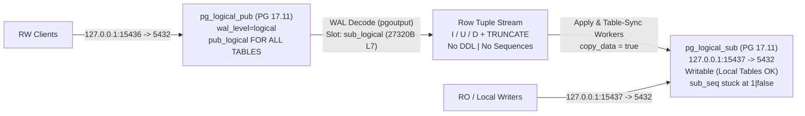

# 16 — PostgreSQL 17 Native Uni-Directional Logical Replication (Pub/Sub)

**Series:** PostgreSQL Multi-Master & Active-Active Architectures  
**Author:** Jean-Marie Renouard (`jmrenouard`) — [LightPath](https://www.lightpath.fr)  
**License:** MIT License

---

| Attribute | Value |
| :--- | :--- |
| **Catalog ID** | `#16` (`CSV ref: #14 Baseline` — see disambiguation note below) |
| **Benchmark Topology ID** | `pg17-logical` (`results/*.csv`) |
| **Family / Tier** | `T3` — Native Uni-Directional Logical Replication (`Niveau 3`) |
| **Version** | `PostgreSQL 17.11` (`postgres:17`, Debian `17.11-1.pgdg13+2`) |
| **CAP / PACELC Profile** | `AP / PA-EL (uni-directional logical)` |
| **License / Deployment** | PostgreSQL License / 2 containers (`docker-compose-pg-logical.yml`) |

> **Catalog ID Disambiguation (`#16` vs `#14`):** `docs/en/10_streaming_vs_logical_vs_multimaster.md` assigns **`#16`** (`T3`) to `pg17-logical` and reserves `#14` for Legacy Trigger Systems (`Slony-I / Londiste / RubyRep`). Some legacy CSV/chapter tables (`results/functional_limits_matrix.csv`, `06`) still tag `pg17-logical` as `#14 Baseline`.

---

## 1. Technology Description & What It Does

**PostgreSQL Native Uni-Directional Logical Replication** (`pg17-logical`) decodes committed WAL records (`wal_level = logical`) into row-level `INSERT` / `UPDATE` / `DELETE` tuples via the built-in `pgoutput` plugin, streaming them asynchronously from a **Publisher** (`CREATE PUBLICATION`) to a **Subscriber** (`CREATE SUBSCRIPTION`).

Unlike block-level physical streaming (`#15b`), logical replication decouples physical storage, OS/CPU architecture, and major PostgreSQL versions (`PG 15 -> 17 -> 18`), enabling **zero-downtime major upgrades**, **selective table/row/column replication**, and **writable subscribers** for local reporting tables.

---

## 2. Architecture & Data Flow

In `env/multi-db-docker-env/docker-compose-pg-logical.yml`, clients write to `pg_logical_pub` (`127.0.0.1:15436:5432`) while `pg_logical_sub` (`127.0.0.1:15437:5432`) applies row changes over `pg_logical_net` via logical slot `sub_logical`:

---

## 3. Operating Principles & Implementation Modes

1. **Logical Decoding (`pgoutput`):** The `walsender` reorder-buffer assembles committed transactions (`BEGIN`..`COMMIT`, omitting rolled-back transactions) and streams row changes using `REPLICA IDENTITY` keys.
2. **Commit Latency Model:**

$$
L_{\text{T3-logical}} \approx L_{\text{disk}} \quad (\text{local publisher WAL fsync; apply is asynchronous})
$$

3. **Three Mandatory Operational Traps:** (a) keyless tables reject `UPDATE`/`DELETE` (`SQLSTATE 55000`); (b) DDL (`ALTER TABLE ADD COLUMN`) is not replicated; (c) **Sequence Non-Sync (`T18` / `L1`):** PostgreSQL 15–17 logical replication never advances subscriber sequences (`pub=50|true` vs `sub=1|false`), triggering `23505` on failover unless `setval()` is run first.

| Mode / Option | Scope | Behavior & Filter Mechanics | Failover / Sequence Impact | Trade-Off |
| :--- | :--- | :--- | :--- | :--- |
| **`FOR ALL TABLES` + `copy_data=true`** *(PoC)* | Publication / Sub | Snapshots existing rows (`srsubstate='r'`) then streams all tables | Subscriber sequences stay `1\|false` (`23505` until `setval()`) | Simplest setup; requires identical PKs on both sides |
| **Table / `WHERE` / Column Filters** | Publication *(Arch.)* | `FOR TABLE t WHERE (region='EU')` or column lists `(id, name)` | Filtered rows stay absent on subscriber | Enables regional subsets and PII redaction |
| **`copy_data = false`** | `REFRESH PUBLICATION` | Skips initial table copy (used for pre-seeded / schema-added tables) | Avoids duplicate PK `23505` on pre-loaded targets | Operator must guarantee pre-existing parity |
| **`pgoutput` vs `wal2json` / `test_decoding`** | Output Plugin | Built-in binary `pgoutput` (PG-to-PG) vs JSON CDC plugins | `pgoutput` needs zero extensions | JSON plugins suit Kafka/CDC, not native PG `SUBSCRIPTION` |
| **PG 17 `failover=true` + `synchronized_standby_slots`** | PG 17 HA *(Arch.)* | Syncs logical slot state from publisher primary to its physical standby (`sync_replication_slots=on`) | Preserves subscriber continuity after publisher physical failover | Requires physical standby on publisher (not in 2-node PoC) |
| **`pg_createsubscriber`** *(PG 17)* | Migration Tool *(Arch.)* | Converts a physical standby into a logical subscriber in-place | Avoids multi-TB initial `copy_data` snapshot | Useful for blue/green PG 17+ upgrades |
| **`REPLICA IDENTITY` (`DEFAULT` vs `FULL`)** | Table | `DEFAULT` sends PK; `FULL` logs entire old row in WAL | Unblocks `UPDATE`/`DELETE` on keyless tables (`55000`) | `FULL` inflates WAL volume and sequential-scan apply cost |

---

## 4. Strengths & Weaknesses

| Strengths | Weaknesses & Operational Traps |
| :--- | :--- |
| **Cross-Version & Cross-OS Upgrades:** Bridges `PG 15 -> 17 -> 18` and differing CPU/OS/`glibc` with near-zero cutover downtime. | **Sequence Non-Sync Trap (`L1`/`T18`):** `sub_seq` stays `1\|false` after `50` publisher inserts (`pub=50\|true`), immediately hitting `SQLSTATE 23505` on promotion without `setval()`. |
| **Granular Filtering & Writable Target:** Supports `WHERE` row filters, column projections, and writable local analytics/reporting tables on subscriber. | **Keyless DML (`55000`) & No Auto-DDL (`L2`/`L5`):** `UPDATE`/`DELETE` fails (`55000`) without PK/`REPLICA IDENTITY FULL`; `ALTER TABLE ADD COLUMN` halts apply if missing on subscriber. |
| **WAN-Resilient Async Commits:** `654.11 TPS` at `25ms` WAN (`+22.9%` vs `A_single_rw` `532.38`); `42,302.43 TPS` on `C_multinode_ro` and `146,564.77 TPS` on `E4`. | **Silent Divergence & Apply Halt (`L3`/`L4`/`T12`):** Local subscriber writes diverge silently or halt the apply worker (`errors 0->2`, `23505`); missing-row `UPDATE` diverges (`T12`). |
| **No `pg_largeobject` / Extension Lock:** Preserves all publisher extensions (`L6`); `TRUNCATE` propagates cleanly (`L5`). | **Logical Slot WAL Retention (`L7`):** Offline subscriber retained `27,320 B` in `sub_logical` (unbounded in prod without `max_slot_wal_keep_size`). |

---

## 5. Empirical Benchmark Results, Functional Limits & PoC Spec

All tests ran at `pg_scale = 2` (`retries_40001 = 0`, `balance_drift = 0`). Only `Avg`, `Stddev` (`0` for `sysbench`), and `p95` are measured (p99 latency is unmeasured).

### Table A — Core & Extended Workloads (`benchmark_summary.csv`, `benchmark_extended_workloads.csv`)

| Suite | Cl / Dur | TPS | QPS | Avg / Stddev / p95 (ms) | Committed (Fail) | Drift | Status |
| :--- | :---: | :---: | :---: | :---: | :---: | :---: | :--- |
| `A_single_rw` | 8 / 20s | 532.38 | N/A | 14.994 / 14.472 / 39.319 | 10658 (0) | 0 | `PASS_SINGLE_PRIMARY` |
| `B1_disjoint_rw` | 8 / 20s | 251.63 | N/A | 31.747 / 28.543 / 78.407 | 5038 (0) | 0 | `PASS_SINGLE_PRIMARY` |
| `B2_overlap_rw` | 8 / 20s | 355.57 | N/A | 22.475 / 29.148 / 77.992 | 7109 (0) | 0 | `PASS_SINGLE_PRIMARY` |
| `C_multinode_ro` | 16 / 20s | 42302.43 | N/A | 0.348 / 0.213 / 0.637 | 845078 (0) | 0 | `PASS` |
| `D_hot_conflict` | 8 / 15s | 2386.93 | N/A | 3.327 / 1.17 / 5.468 | 35747 (0) | 0 | `PASS_SINGLE_PRIMARY` |
| `E_sysbench_oltp_rw` | 8 / 20s | 595.81 | 11974.58 | 13.42 / 0 / 23.95 | 11926 (65) | 0 | `PASS` |
| `E2_sysbench_oltp_ro` | 8 / 12s | 1806.08 | 28897.23 | 4.42 / 0 / 5.77 | 21690 (0) | 0 | `PASS` |
| `E3_sysbench_oltp_wo` | 8 / 12s | 801.11 | 4830.94 | 9.97 / 0 / 21.5 | 9627 (73) | 0 | `PASS` |
| `E4_sysbench_point_select` | 16 / 12s | 146564.77 | 146564.77 | 0.11 / 0 / 0.27 | 1760391 (0) | 0 | `PASS` |
| `H_append_only_insert` | 8 / 12s | 1901.2 | N/A | 4.181 / 3.298 / 8.348 | 22778 (0) | 0 | `PASS_SINGLE_PRIMARY` |
| `F_wan_netem_25ms` | 8 / 15s | 654.11 | N/A | 12.207 / 9.064 / 30.581 | 9806 (0) | 0 | `PASS_NETEM_25MS` |

### Table B — Concurrency & WAN Latency Sweeps (`benchmark_concurrency_sweep.csv`, `benchmark_wan_sweep.csv`)

| Sweep Suite | Param | TPS | Avg / Stddev / p95 (ms) | Committed | Status |
| :--- | :---: | :---: | :---: | :---: | :--- |
| `G_conc_c1` (8s) | 1 cl | 306.11 | 3.255 / 1.127 / 5.323 | 2445 | `PASS` |
| `G_conc_c4` (8s) | 4 cl | 731.06 | 5.453 / 2.37 / 10.059 | 5841 | `PASS` |
| `G_conc_c8` (8s) | 8 cl | 736.27 | 10.843 / 8.357 / 27.946 | 5877 | `PASS` |
| `G_conc_c16` (8s) | 16 cl | 596.09 | 26.779 / 31.243 / 82.425 | 4760 | `PASS` |
| `G_conc_c32` (8s) | 32 cl | 706.65 | 45.111 / 53.971 / 145.974 | 5637 | `PASS` |
| `F_wan_netem_10ms` (12s) | 10 ms | 636.58 | 12.542 / 10.198 / 32.043 | 7634 | `PASS_NETEM_10MS` |
| `F_wan_netem_25ms` (15s) | 25 ms | 654.11 | 12.207 / 9.064 / 30.581 | 9806 | `PASS_NETEM_25MS` |
| `F_wan_netem_50ms` (12s) | 50 ms | 395.49 | 20.183 / 19.449 / 58.448 | 4749 | `PASS_NETEM_50MS` |

### Table C — Functional Limits (`F1`, `L1–L8`) & Extended Probes (`T11–T18`)

| Probe | Observed Empirical Result |
| :--- | :--- |
| `F1` Health | `PASS: wal_level=logical active_workers=1 uni-directional pub->sub` |
| `L1` Serial PK | `EXPECTED_LIMITATION: sequence non-sync trap (pub=50\|true sub=1\|false -> SQLSTATE 23505 on failover; setval fixed)` |
| `L2` Keyless Table | `EXPECTED_LIMITATION: UPDATE/DELETE rejected SQLSTATE 55000; surrogate PK fixed` |
| `L3` Lost Update | `PASS on single publisher (0 drift); local subscriber writes diverge silently` |
| `L4` Unique Conf. | `EXPECTED_LIMITATION: local subscriber write collision halted apply worker (errors 0->2 SQLSTATE 23505)` |
| `L5` DDL & Savept | `EXPECTED_LIMITATION: ALTER TABLE ADD COLUMN not propagated; TRUNCATE propagated` |
| `L6` PG Features | `EXPECTED_LIMITATION: advisory_lock & LISTEN/NOTIFY node-local; TEMP TABLE session-local` |
| `L7` Node Outage | `PASS: publisher writable; logical slot active=false WAL retained=27320B; caught up 5/5` |
| `L8` Quorum Loss | `N/A: AP async publisher continues without subscriber (RPO > 0 risk)` |
| `T11` Bulk 10k | `PASS: 52816 rows/s (189ms); peer_catchup=332.9ms` |
| `T12` Upd vs Del | `EXPECTED_LIMITATION: DIVERGED pub=upd_n1 sub=DELETED (missing-row UPDATE ignored)` |
| `T13` FK Race | `PASS: 10/10 immediate cross-node child inserts consistent (0 FK errors)` |
| `T14` Rich MD5 | `PASS: 2/2 identical md5=00493e3a (BYTEA=65536B JSONB/NULL/TS/UTF8)` |
| `T15` Vis. Lag | `p50=1.68ms p95=2.14ms max=2.16ms (n=30)` |
| `T16` SIGKILL RPO | `PASS: peer_surv=20/20 RPO=0 sub_writable_local; post_restart=21/21` |
| `T17` Long Open TX | `PASS: NO_DIRTY_READ; side_tx_unblocked(107ms); post_commit_vis=120ms (ok=True)` |
| `T18` Seq Sync (50) | `EXPECTED_LIMITATION: peer seq stuck at 1\|false -> insert hit SQLSTATE 23505` |
| **Verified SQLSTATEs** | `L1–L8: 23505;55000` \| `T11–T18: 23505` |

### Table D — PoC Docker Specification (`env/multi-db-docker-env/`)

| Parameter | PoC Setting / Observation |
| :--- | :--- |
| **Compose & Setup** | `docker-compose-pg-logical.yml` + `scripts/pg_logical/setup_pg_logical.sh` |
| **Containers & Ports** | `pg_logical_pub` (`127.0.0.1:15436:5432`), `pg_logical_sub` (`127.0.0.1:15437:5432`), bridge `pg_logical_net` |
| **Image & Volumes** | `postgres:17` (`PG 17.11`); volumes `pg_logical_pub_data`, `pg_logical_sub_data` |
| **Key GUCs & Setup** | `wal_level=logical`, `max_wal_senders=10`, `max_replication_slots=10`, `max_logical_replication_workers=8`, `max_worker_processes=12`, `wal_keep_size=128MB`, `shared_buffers=128MB`; `pub_logical FOR ALL TABLES` + `sub_logical` (`pgoutput`, `copy_data=true`). |

---

**Navigation:** [Index](../../../README.md) · [Ch. 03a — Native & Extensions](../03a_solutions_native_and_extensions.md) · [Ch. 10 — Streaming vs Logical vs Multi-Master](../10_streaming_vs_logical_vs_multimaster.md) · [Version française](../../fr/solutions/pg17_logical_unidirectional.md)
