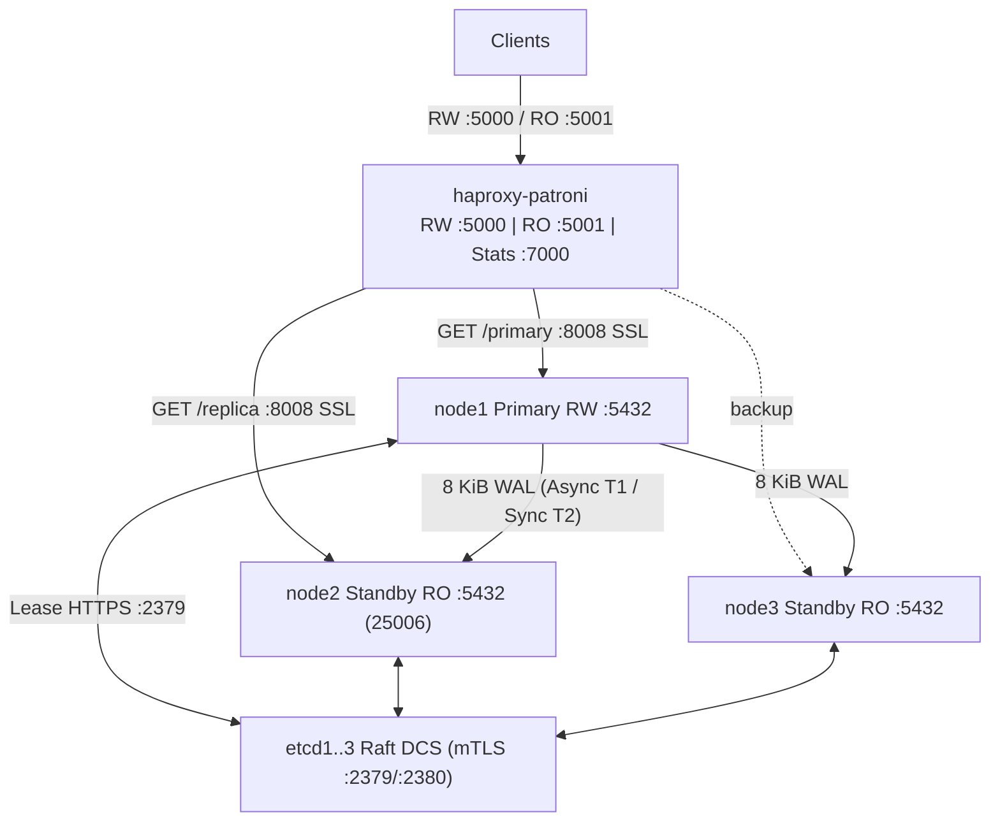

# 15b — PostgreSQL 17 Physical Streaming Replication & Patroni HA

**Series:** PostgreSQL Multi-Master & Active-Active Architectures  
**Author:** Jean-Marie Renouard (`jmrenouard`) — [LightPath](https://www.lightpath.fr)  
**License:** MIT License

---

| Attribute | Value |
| :--- | :--- |
| **Catalog ID** | `#15b` (`#15 Baseline` in `results/functional_limits_matrix.csv`) |
| **Benchmark Topologies** | `pg17-async-streaming`, `pg17-sync-streaming` (`results/*.csv`); HA: `docker-compose-patroni.yml` |
| **Family / Tier** | `T1` (`pg17-async-streaming`, `Niveau 1`) & `T2` (`pg17-sync-streaming`, `Niveau 2`) |
| **Versions** | `PostgreSQL 17.11` (`postgres:17`), `Patroni + etcd v3 + HAProxy` (`patroni-rhel8-*`) |
| **CAP / PACELC** | Async: `AP / PA-EL (async standby)` \| Sync: `CP / PC-EC (sync standby)` (`RPO = 0`) |
| **License / Stack** | PostgreSQL License / MIT (Patroni) / Apache-2.0 (etcd) / GPL-2.0 (HAProxy) |

---

## 1. Description & Role

**Physical Streaming Replication** ships raw 8 KiB WAL records from one primary (`walsender`) to hot standbys (`walreceiver`), replaying heap, index, sequence, and DDL blocks (`hot_standby = on`).

Runs in **Async (`T1`)** or **Sync (`T2`)** mode, paired with **Patroni + etcd + HAProxy** (`docker-compose-patroni.yml`) for Raft election, watchdog fencing (`RTO ~ 10–30 s`), and `/primary`/`/replica` routing.

---

## 2. Architecture & Data Flow

The PoC separates raw streaming (`15434/15435`, `15432/15433`) from 7-container Patroni HA (`patroni_net`, mTLS `etcd`, REST `:8008`):

Standbys reject writes (`SQLSTATE 25006`), preventing multi-writer conflicts.

---

## 3. Operating Principles & Modes

1. **Slot & `pg_basebackup`:** `pg_basebackup -Fp -Xs -P -R -S slot_stream_standby` retains WAL on outages (`3088B` in `L7`).
2. **Commit Latency Model:**

$$
L_{\text{T1-async}} \approx L_{\text{disk}}, \qquad L_{\text{T2-sync}} \approx L_{\text{disk}} + \text{RTT}_{\text{standby}}
$$

3. **Patroni Lease:** `node1..3` run `patroni /etc/patroni.yml` (`supervisord`), renewing `etcd` lease (`ttl=30`, `loop_wait=10`, `retry_timeout=10`) with fencing.

| Mode / Parameter | Scope | Commit Path | RPO / Stall Behavior | Trade-Off |
| :--- | :--- | :--- | :--- | :--- |
| **`pg17-async-streaming`** (`T1`, PoC) | `synchronous_standby_names=''` | Local WAL flush; ships async | `RPO > 0`; zero primary stall | `610.15 TPS` (`A`); immune to `25ms` WAN (`599.61`) |
| **`pg17-sync-streaming`** (`T2`, PoC) | `synchronous_commit=on` | Primary + standby disk flush | **`RPO = 0`**; sole standby loss **stalls primary** | `409.48 TPS` (`-52.8%` vs standalone); `57.0 TPS` at `25ms` WAN |
| **`remote_write`** | Session / global *(Arch.)* | Standby OS `write()` (no `fsync`) | Survives PG crash; `RPO > 0` on power loss | Lower latency than `on` |
| **`remote_apply`** | Session / global *(Arch.)* | Standby replays WAL before `COMMIT` | **`RPO = 0`** + strict RO read-after-write | Highest sync latency |
| **`off` / `local`** | Session *(Arch.)* | `off`: async local; `local`: local flush only | Relaxes remote sync per tx | Non-critical write fast-path |
| **`FIRST 1` vs `ANY k`** | `synchronous_standby_names` | Priority vs `k`-of-`N` quorum | Prevents 1-standby stall when `N >= 2` | Needs >=2 standbys for HA |
| **Patroni + etcd + HAProxy** | HA Control Plane | Raft lease, `/primary` & `/replica` (`3s/fall 3/rise 2`) | Auto failover (`RTO ~ 10–30 s`) | Replaces manual `pg_promote()` |

---

## 4. Strengths & Weaknesses

| Strengths | Weaknesses & Operational Traps |
| :--- | :--- |
| **100% PG Parity:** Keyless DML (`L2`), DDL/`SAVEPOINT` (`L5`), seqs (`T18`: `66\|true`, `next_id=67`), `pg_largeobject`, exts (`L6`). | **Sync WAN & Stall (`T2`):** `25ms` WAN -> `57.0 TPS` (`-86.1%` vs LAN), `50ms` -> `25.79`; sole sync loss stalls (`L7`/`L8`). |
| **Zero Drift (`0`):** No `A`–`D` conflicts; zero `40001`; `RPO = 0` on `SIGKILL` (`T16`: `20/20`). | **Single-Writer:** Standby writes fail (`25006`, `T12`, `T13`); write scale needs sharding (`#7`) or MM. |
| **High Read Scale:** `45358.52` (async) / `54483.07 TPS` (sync) on `C`; `148022.41` / `124105.25 TPS` on `E4`. | **Binary Lockstep:** Requires identical major PG version, CPU arch, and `glibc` (cannot cross PG 15 -> 17). |
| **Fenced HA (Patroni):** `etcd` Raft election + HAProxy drop without app logic. | **Slot WAL Bloat (`L7`):** Offline slots keep WAL (`3088B` in test) without `max_slot_wal_keep_size`. |

---

## 5. Empirical Benchmark Results, Functional Limits & PoC Spec

Ran at `pg_scale = 2` (`retries_40001 = 0`, `balance_drift = 0`). Only `Avg`, `Stddev` (`0` for `sysbench`), and `p95` exist (p99 latency is unmeasured).

### Table A — Workloads (`benchmark_summary.csv`, `benchmark_extended_workloads.csv`)

| Suite (Cl/Dur) | Async TPS | Async Avg/Std/p95 (ms) | Async Comm(Fail) | Sync TPS | Sync Avg/Std/p95 (ms) | Sync Comm(Fail) | Status (Both) |
| :--- | :---: | :---: | :---: | :---: | :---: | :---: | :--- |
| `A_single_rw` (8/20s) | 610.15 | 13.094/10.073/33.928 | 12199(0) | 409.48 | 19.516/15.543/50.307 | 8192(0) | `PASS_SINGLE_PRIMARY` |
| `B1_disjoint_rw` (8/20s) | 627.39 | 12.731/6.053/24.346 | 12540(0) | 407.41 | 19.612/16.57/45.134 | 8152(0) | `PASS_SINGLE_PRIMARY` |
| `B2_overlap_rw` (8/20s) | 584.8 | 13.663/10.657/34.406 | 11686(0) | 465.22 | 17.171/18.922/46.194 | 9315(0) | `PASS_SINGLE_PRIMARY` |
| `C_multinode_ro` (16/20s) | 45358.52 | 0.325/0.147/0.557 | 906086(0) | 54483.07 | 0.271/0.091/0.427 | 1088619(0) | `PASS` |
| `D_hot_conflict` (8/15s) | 2081.26 | 3.82/1.843/6.117 | 31189(0) | 1370.1 | 5.827/1.424/8.725 | 20541(0) | `PASS_SINGLE_PRIMARY` |
| `E_sysbench_rw` (8/20s) | 962.84 | 8.3/0/10.27 | 19268(107) | 819.36 | 9.76/0/11.65 | 16397(118) | `PASS` (QPS `19353.12`/`16493.23`) |
| `E2_sysbench_ro` (8/12s) | 1804.13 | 4.43/0/5.99 | 21662(0) | 1693.64 | 4.72/0/6.55 | 20340(0) | `PASS` (QPS `28866.02`/`27098.18`) |
| `E3_sysbench_wo` (8/12s) | 1569.06 | 5.09/0/6.79 | 18844(179) | 370.71 | 21.56/0/49.21 | 4453(51) | `PASS` (QPS `9473.7`/`2241.22`) |
| `E4_point_sel` (16/12s) | 148022.41 | 0.11/0/0.27 | 1777606(0) | 124105.25 | 0.13/0/0.32 | 1490530(0) | `PASS` (`QPS = TPS`) |
| `H_append_only` (8/12s) | 2511.15 | 3.172/0.788/4.306 | 30095(0) | 1301.45 | 6.126/5.016/8.61 | 15573(0) | `PASS_SINGLE_PRIMARY` |
| `F_wan_netem_25ms` (8/15s) | 599.61 | 13.317/10.473/34.381 | 8991(0) | 57.0 | 139.564/98.831/353.493 | 866(0) | `PASS_NETEM_25MS` |

### Table B — Concurrency & WAN Sweeps (`benchmark_concurrency_sweep.csv`, `benchmark_wan_sweep.csv`)

| Suite | Param | Async TPS | Async Avg/Std/p95 (ms) | Async Comm | Sync TPS | Sync Avg/Std/p95 (ms) | Sync Comm | Status (Both) |
| :--- | :---: | :---: | :---: | :---: | :---: | :---: | :---: | :--- |
| `G_conc_c1` (8s) | 1 cl | 336.82 | 2.959/0.99/4.256 | 2692 | 89.89 | 11.106/23.784/22.605 | 719 | `PASS` |
| `G_conc_c4` (8s) | 4 cl | 545.91 | 7.309/3.136/12.943 | 4357 | 238.15 | 16.768/22.183/49.238 | 1901 | `PASS` |
| `G_conc_c8` (8s) | 8 cl | 577.65 | 13.824/10.732/35.125 | 4599 | 410.8 | 19.428/15.823/51.894 | 3290 | `PASS` |
| `G_conc_c16` (8s) | 16 cl | 624.75 | 25.54/24.679/77.071 | 4993 | 424.67 | 37.536/35.542/106.896 | 3387 | `PASS` |
| `G_conc_c32` (8s) | 32 cl | 571.58 | 55.682/55.256/167.031 | 4573 | 424.98 | 74.902/89.331/227.512 | 3390 | `PASS` |
| `F_wan_netem_10ms` (12s) | 10 ms | 587.16 | 13.603/10.678/35.753 | 7044 | 121.75 | 65.492/47.958/162.898 | 1466 | `PASS_NETEM_10MS` |
| `F_wan_netem_25ms` (15s) | 25 ms | 599.61 | 13.317/10.473/34.381 | 8991 | 57.0 | 139.564/98.831/353.493 | 866 | `PASS_NETEM_25MS` |
| `F_wan_netem_50ms` (12s) | 50 ms | 619.37 | 12.897/9.903/33.368 | 7421 | 25.79 | 302.966/255.796/779.848 | 323 | `PASS_NETEM_50MS` |

### Table C — Limits (`F1`, `L1–L8`) & Probes (`T11–T18`)

| Probe | Async (`pg17-async-streaming`) | Sync (`pg17-sync-streaming`) |
| :--- | :--- | :--- |
| `F1` Health | `PASS`: `wal_level=replica sync_state=async slot_active=t rec=f/t` | `PASS`: `sync_state=sync synchronous_commit=on` |
| `L1` Serial PK | `PASS`: WAL preserves seq across `pg_promote` (`pri_lv=50 stb_lv=66 next_id=67`; 0 `23505`) | `N/A`: single primary sequence |
| `L2` Keyless | `PASS`: physical WAL replicates keyless `UPDATE`/`DELETE` atomically | `PASS`: physical WAL replicates all heap changes |
| `L3` Lost Upd | `PASS`: primary row locks (0 drift); standby rejects writes (`25006`) | `PASS`: row locks on primary (0 drift) |
| `L4` Unique | `PASS`: `23505` enforced on primary; standby RO (`25006`) | `PASS`: `23505` enforced on primary |
| `L5` DDL/Svp | `PASS`: replicates `ALTER TABLE ADD COLUMN` & `SAVEPOINT` atomically | `PASS`: replicates DDL & `SAVEPOINT` |
| `L6` PG Feat | `EXPECTED_LIMITATION`: `adv_lock`/`LISTEN` local; standby rejects `TEMP` (`25006`) | `PASS`: `adv_lock`/`LISTEN` local; standby RO |
| `L7` Outage | `PASS`: primary writable; slot `active=false`, WAL `3088B`; catchup `10/10` | `EXPECTED_LIMITATION`: primary commits block if sync standby offline (`RPO=0`) |
| `L8` Quorum | `N/A`: `AP` async continues (`RPO > 0` risk on primary crash) | `EXPECTED_LIMITATION`: `1/2` sync standby loss stalls writes unless relaxed |
| `T11` Bulk10k | `PASS`: `28693 rows/s` (`349ms`); `peer_catchup=105.2ms` | `PASS`: `39697 rows/s` (`252ms`); `peer_catchup=114.6ms` |
| `T12` Upd/Del | `PASS`: standby `DELETE` rejected (`25006`); primary serialized (`DELETED`) | `PASS`: standby `DELETE` rejected (`25006`); primary serialized (`DELETED`) |
| `T13` FK Race | `EXPECTED_LIMITATION`: `0/10` ok; `failures=25006x10` | `EXPECTED_LIMITATION`: `0/10` ok; `failures=25006x10` |
| `T14` MD5 | `PASS`: `2/2` `md5=00493e3a` (`BYTEA=65536B` JSONB/NULL/TS/UTF8) | `PASS`: `2/2` `md5=00493e3a` (`BYTEA=65536B` JSONB/NULL/TS/UTF8) |
| `T15` Vis Lag | `p50=9.65ms p95=25.13ms max=57.44ms (n=30)` | `p50=1.88ms p95=2.74ms max=2.96ms (n=30)` |
| `T16` SIGKILL | `PASS`: `peer_surv=20/20 RPO=0 RO_standby`; `post_restart=21/21` | `PASS`: `peer_surv=20/20 RPO=0 RO_standby`; `post_restart=21/21` |
| `T17` Long TX | `PASS`: `NO_DIRTY_READ`; `side_tx(98ms)`; `post_commit_vis=277ms (ok=True)` | `PASS`: `NO_DIRTY_READ`; `side_tx(99ms)`; `post_commit_vis=112ms (ok=True)` |
| `T18` Seq (50) | `PASS`: WAL synced seq (`last_value=66\|true`; safe on `pg_promote`) | `PASS`: WAL synced seq (`last_value=66\|true`; safe on `pg_promote`) |
| **SQLSTATEs** | `L1–L8: 25006` \| `T11–T18: 25006` | `L1–L8: 23505;25006` \| `T11–T18: 25006` |

### Table D — PoC Docker Stacks (`env/multi-db-docker-env/`)

| Stack | Compose & Setup | Containers, Ports & Images | Key GUCs / Config Notes |
| :--- | :--- | :--- | :--- |
| **Streaming** | `docker-compose-pg-streaming.yml` + `scripts/pg_streaming/setup_pg_streaming.sh` | `pg_stream_primary` (`15434:5432`), `pg_stream_standby` (`15435:5432`), `postgres:17` | `wal_level=replica`, `wal_keep_size=64MB`, slot `slot_stream_standby`, `hot_standby=on` |
| **Sync Pair** | `docker-compose-pg17-baseline.yml` + `scripts/bench_pg_v2_runner.sh` (`ALTER SYSTEM`; parent-repo `scripts/setup_pg17_baseline.sh`) | `pg17_sync_primary` (`15432:5432`), `pg17_sync_standby` (`15433:5432`), `postgres:17` | `synchronous_standby_names='pg17_sync_standby'`, `synchronous_commit='on'` |
| **Patroni HA** | `docker-compose-patroni.yml` + `conf/haproxy-patroni.cfg` | `etcd1..3` (`2379:2379`), `node1..3` (`5432`/`8008`), `haproxy-patroni` (`5000/5001/7000`), `patroni-rhel8-*` | mTLS `etcd`, `hostssl`/`verify-ca`; `/etc/patroni.yml` (`ttl=30/loop_wait=10/retry_timeout=10`). PgBouncer `:6432` absent in compose. |

## 6. GitHub Popularity, Git Presence & Maintenance Vitality (`results/project_popularity.csv`)

Live GitHub telemetry (`2026-11-20T17:26:02Z`, `archived = false` unless `N/A`):

| Project | Git Presence / Role | Repo (`Account / Repos`) | Stars / Forks / Watch | Commits (`Tot / 12m`) | Contrib / Issues | Lang / SPDX | Release / Last Push |
| :--- | :--- | :--- | :---: | :---: | :---: | :--- | :--- |
| **PostgreSQL Core** | `Yes (Mirror)` -- Mirror (canonical: git.postgresql.org) | [`postgres/postgres`](https://github.com/postgres/postgres) (`Org / 6`) | 22894 / 6123 / 589 | 66091 / 3446 | 58 / 0 | C / `NOASSERTION` | `REL_19_0` / `2026-11-20T16:52:40Z` |
| **Patroni HA** | `Yes` -- Primary | [`patroni/patroni`](https://github.com/patroni/patroni) (`Org / 1`) | 8847 / 1049 / 124 | 2713 / 142 | 246 / 68 | Python / `MIT` | `v4.1.5` / `2026-11-20T17:03:56Z` |

- **Maintenance Level:** **Tier S (Core)** -- `postgres/postgres` (`3446` commits/12m) & `patroni/patroni` (**Tier A (Active OSS)**, `142` commits/12m, `246` contributors).
- **Currency / Freshness:** **Current -- Daily Active** -- Last push `2026-11-20T16:52:40Z` / `2026-11-20T17:03:56Z`, `3446` / `142` commits/12m, latest release `REL_19_0` / `v4.1.5`.
- **Operational Manageability:** **Low Risk** -- Multi-vendor core and MIT HA plane, requiring teams to manage `max_slot_wal_keep_size` and `etcd` quorum.

---

**Navigation:** [Index](../../../README.md) · [Ch. 03a — Native & Extensions](../03a_solutions_native_and_extensions.md) · [Ch. 10 — Streaming vs Logical vs Multi-Master](../10_streaming_vs_logical_vs_multimaster.md) · [Version française](../../fr/solutions/pg17_physical_streaming_patroni.md)
