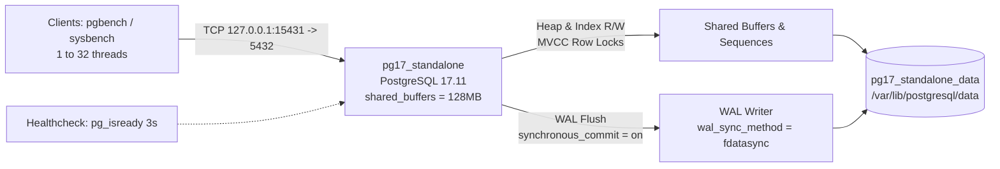

# 15a — PostgreSQL 17 Standalone (Single-Writer Control Baseline)

**Series:** PostgreSQL Multi-Master & Active-Active Architectures  
**Author:** Jean-Marie Renouard (`jmrenouard`) — [LightPath](https://www.lightpath.fr)  
**License:** MIT License

---

| Attribute | Value |
| :--- | :--- |
| **Catalog ID** | `#15a` (`#15 Baseline` in `results/functional_limits_matrix.csv`) |
| **Benchmark Topology ID** | `pg17-standalone` (`results/*.csv`) |
| **Family / Tier** | `T0` — Single-Writer Control Baseline (`Niveau 0`) |
| **Version** | `PostgreSQL 17.11` (`postgres:17`, Debian `17.11-1.pgdg13+2`) |
| **CAP / PACELC Profile** | `Single-Node (CA)` — local ACID, zero partition tolerance |
| **License / Deployment** | PostgreSQL License / Single container (`docker-compose-pg17-baseline.yml`) |

---

## 1. Technology Description & What It Does

**PostgreSQL 17 Standalone** (`pg17-standalone`) is a single-instance relational server with no physical standbys, logical subscribers, coordinators, or quorum consensus. In this study, it acts as the **zero-replication control baseline** for all multi-node benchmarks.

By removing network round-trips, WAL shipping, logical decoding, and distributed lock coordination, `pg17-standalone` isolates the **hardware and engine ceiling**: local WAL `fsync` latency ($L_{\text{disk}}$) and MVCC row-lock throughput. Suite A replication overhead percentages (e.g., `-52.8%` for sync streaming on LAN at `409.48 TPS`, or `-93.4%` for sync `25 ms` WAN at `57.0 TPS` vs standalone `866.82 TPS` — i.e., `-86.1%` relative to sync LAN `409.48 TPS`) are measured from this baseline.

---

## 2. Architecture & Data Flow

In `env/multi-db-docker-env/docker-compose-pg17-baseline.yml`, workloads connect directly to `127.0.0.1:15431` mapped to container `pg17_standalone:5432` on `pg17_baseline_net`:

A single authoritative memory image yields immediate linearizability (`catchup = 0 ms`), with total unavailability if the node stops.

---

## 3. Operating Principles & Implementation Modes

PostgreSQL 17 enforces local ACID via **Write-Ahead Logging (WAL)** and **MVCC**:

1. **Sequential WAL Commit:** Redo records are appended to WAL buffers and flushed (`fdatasync`) before `COMMIT` returns.
2. **Row-Level Serialization:** Concurrent updates on hot keys (`D_hot_conflict`, `B2_overlap_rw`) serialize via local tuple locks (`xmax`) with zero write divergence or `40001` retries.
3. **Commit Latency Model:**

$$
L_{\text{T0-standalone}} \approx L_{\text{disk}} + L_{\text{CPU/MVCC}}
$$

Durability depends on `synchronous_commit` and `wal_sync_method` (Linux PG 17 defaults: `synchronous_commit = on`, `wal_sync_method = fdatasync`, neither overridden in the PoC compose file):

| Mode / Parameter | Scope | Commit Durability Path | Data Loss (`RPO`) | Latency / Throughput Trade-Off |
| :--- | :--- | :--- | :--- | :--- |
| **`synchronous_commit = on`** *(PoC)* | Session / global | Flushes WAL via `wal_sync_method` before `COMMIT` | **`RPO = 0`** (`20/20` on `SIGKILL`, `T16`) | Baseline (`866.82 TPS` Suite A; `p95 = 23.958 ms`) |
| **`synchronous_commit = local`** | Session / global | Identical to `on` when no standby exists | **`RPO = 0`** | Same as `on` on standalone |
| **`synchronous_commit = off`** | Session / global *(Arch.)* | Returns from WAL buffer; `walwriter` flushes every `wal_writer_delay` (`200 ms`) | **`RPO > 0`** (~`600 ms` max; zero corruption) | Higher fsync-bound TPS; drops flush stall |
| **`wal_sync_method`** (`fdatasync`, `open_datasync`, `fsync`) | Server | Selects Linux WAL flush syscall (`fdatasync` skips inode metadata) | **`RPO = 0`** with `on` | `fdatasync` / `open_datasync` faster than `fsync` |
| **`fsync = off`** *(Unsafe)* | Server | Disables all `fsync()` calls | **Corruption risk** on power loss | Forbidden in production; not benchmarked |

---

## 4. Strengths & Weaknesses

| Strengths | Weaknesses & Operational Traps |
| :--- | :--- |
| **Peak Single-Node Baseline:** `55,614.16 TPS` (`C_multinode_ro`), `143,147.96 TPS` (`E4`), `52,496 rows/s` bulk (`T11`). | **Single Point of Failure (`SPOF`):** Host/container outage stops all reads and writes (`L7`/`L8`). |
| **100% PostgreSQL Parity:** Keyless DML (`L2`), transactional DDL/`SAVEPOINT` (`L5`), `LISTEN/NOTIFY`, advisory locks, `TEMP TABLE`, extensions (`L6`). | **No Horizontal Read/Write Scale:** All clients contend on one node's CPU, RAM, and IOPS. |
| **Zero Drift (`0`):** Row locks prevent Lost Updates (`B2`, `D`), dirty reads (`T17`), and FK races (`T13`: `10/10`). | **No HA or Cross-Region DR:** Enforces local `23505` (`L4`), but maintenance/upgrades require downtime. |
| **Zero Replication Overhead:** No slot WAL bloat, no sequence drift (`T18` `next_id = 51`), clean crash recovery (`T16`). | **Vertical Ceiling:** Requires `#15b` (streaming) or `#16` (logical) for HA or zero-downtime upgrades. |

---

## 5. Empirical Benchmark Results, Functional Limits & PoC Spec

All tests ran at `pg_scale = 2` (`retries_40001 = 0`). Only `Avg`, `Stddev` (`0` for `sysbench`), and `p95` latencies are measured (p99 latency is unmeasured). `F_wan_netem_*` is `N/A` (no remote peer).

### Table A — Core & Extended Workloads (`results/benchmark_summary.csv`, `benchmark_extended_workloads.csv`)

| Suite | Cl / Dur | TPS | QPS | Avg / Stddev / p95 (ms) | Committed (Fail) | Drift | Status |
| :--- | :---: | :---: | :---: | :---: | :---: | :---: | :--- |
| `A_single_rw` | 8 / 20s | 866.82 | N/A | 9.216 / 9.408 / 23.958 | 17328 (0) | 0 | `PASS_SINGLE_PRIMARY` |
| `B1_disjoint_rw` | 8 / 20s | 920.07 | N/A | 8.679 / 4.625 / 16.543 | 18397 (0) | 0 | `PASS_SINGLE_PRIMARY` |
| `B2_overlap_rw` | 8 / 20s | 879.01 | N/A | 9.088 / 7.091 / 23.395 | 17577 (0) | 0 | `PASS_SINGLE_PRIMARY` |
| `C_multinode_ro` | 16 / 20s | 55614.16 | N/A | 0.257 / 0.068 / 0.355 | 1110839 (0) | 0 | `PASS` |
| `D_hot_conflict` | 8 / 15s | 3128.63 | N/A | 2.541 / 0.965 / 3.946 | 46888 (0) | 0 | `PASS_SINGLE_PRIMARY` |
| `E_sysbench_oltp_rw` | 8 / 20s | 1129.51 | 22687.48 | 7.05 / 0 / 7.56 | 23387 (112) | 0 | `PASS` |
| `E2_sysbench_oltp_ro` | 8 / 12s | 1774.04 | 28384.66 | 4.5 / 0 / 6.09 | 21300 (0) | 0 | `PASS` |
| `E3_sysbench_oltp_wo` | 8 / 12s | 1784.36 | 10770.03 | 4.48 / 0 / 6.79 | 21424 (192) | 0 | `PASS` |
| `E4_sysbench_point_select` | 16 / 12s | 143147.96 | 143147.96 | 0.11 / 0 / 0.27 | 1718999 (0) | 0 | `PASS` |
| `H_append_only_insert` | 8 / 12s | 3108.22 | N/A | 2.556 / 0.768 / 3.481 | 37246 (0) | 0 | `PASS_SINGLE_PRIMARY` |

*(Sysbench `tx_failed` = `112` in `E`, `192` in `E3` are `ignored errors`. Zero `SQLSTATE` aborts occurred in `pgbench`.)*

### Table B — Concurrency Sweep (`results/benchmark_concurrency_sweep.csv`, `8s` RW)

| Suite | Clients | TPS | Avg / Stddev / p95 (ms) | Committed | Status |
| :--- | :---: | :---: | :---: | :---: | :--- |
| `G_conc_c1` | 1 | 298.4 | 3.342 / 1.861 / 5.134 | 2386 | `PASS` |
| `G_conc_c4` | 4 | 524.95 | 7.597 / 7.82 / 16.649 | 4174 | `PASS` |
| `G_conc_c8` | 8 | 630.17 | 12.674 / 14.94 / 34.489 | 5032 | `PASS` |
| `G_conc_c16` | 16 | 739.61 | 21.588 / 23.539 / 64.954 | 5903 | `PASS` |
| `G_conc_c32` | 32 | 801.27 | 39.775 / 42.674 / 122.2 | 6392 | `PASS` |

### Table C — Functional Limits (`F1`, `L1–L8`) & Extended Probes (`T11–T18`)

| Probe | Observed Empirical Result |
| :--- | :--- |
| `F1` Health | `PASS: PG 17.11 single writer ready` |
| `L1` Serial PK | `N/A: single sequence` |
| `L2` Keyless Table | `PASS: native UPDATE/DELETE works without PK` |
| `L3` Lost Update | `PASS: serialized via row locks (0 drift)` |
| `L4` Unique Conflict | `PASS: local 23505 unique constraint` |
| `L5` DDL / Savepoint | `PASS: transactional DDL and SAVEPOINT atomic` |
| `L6` PG Features | `PASS: advisory_lock LISTEN/NOTIFY TEMP TABLE extensions OK` |
| `L7` Node Outage | `N/A: single node full outage on stop` |
| `L8` Quorum Loss | `N/A: no replication quorum` |
| `T11` Bulk 10k | `PASS: 52496 rows/s (190ms); catchup=0ms (single-view)` |
| `T12` Upd vs Del | `PASS: primary row-lock serialized (final=DELETED)` |
| `T13` FK Race | `PASS: 10/10 immediate cross-node child inserts consistent (0 FK errors)` |
| `T14` Rich MD5 | `PASS: 1/1 identical md5=00493e3a (BYTEA=65536B JSONB/NULL/TS/UTF8)` |
| `T15` Visibility Lag | `p50=1.15ms p95=1.55ms max=1.56ms (n=30)` |
| `T16` SIGKILL RPO | `PASS: WAL crash recovery 20/20 (RPO=0); restart+write OK (21/21)` |
| `T17` Long Open TX | `PASS: NO_DIRTY_READ; side_tx_unblocked(115ms); post_commit_vis=144ms (ok=True)` |
| `T18` Seq Sync (50) | `PASS: single sequence safe (next_id=51)` |
| **Verified SQLSTATEs** | `L1–L8: 23505` \| `T11–T18: NONE` |

### Table D — PoC Docker Specification (`env/multi-db-docker-env/`)

| Parameter | PoC Setting / Observation |
| :--- | :--- |
| **Compose & Service** | `docker-compose-pg17-baseline.yml` -> service `pg17_standalone` |
| **Image & Version** | `postgres:17` (`PostgreSQL 17.11 (Debian 17.11-1.pgdg13+2)`) |
| **Port & Network** | `127.0.0.1:15431:5432`, bridge network `pg17_baseline_net` |
| **Volume & Health** | `pg17_standalone_data:/var/lib/postgresql/data`; `pg_isready` (`3s` / `15` retries) |
| **GUCs & Setup** | Flags: `shared_buffers=128MB`, `max_connections=100`, `log_error_verbosity=verbose`; defaults: `synchronous_commit=on`, `wal_sync_method=fdatasync`. No setup script for `pg17_standalone` (sync pair uses submodule `scripts/bench_pg_v2_runner.sh` / `scripts/bench_pg_multimaster.sh` `ALTER SYSTEM`, or parent-repo `scripts/setup_pg17_baseline.sh`). |

## 6. GitHub Popularity, Git Presence & Maintenance Vitality (`results/project_popularity.csv`)

Live GitHub telemetry (`2026-11-20T17:26:02Z`, `archived = false` unless `N/A`):

| Project | Git Presence / Role | Repo (`Account / Repos`) | Stars / Forks / Watch | Commits (`Tot / 12m`) | Contrib / Issues | Lang / SPDX | Release / Last Push |
| :--- | :--- | :--- | :---: | :---: | :---: | :--- | :--- |
| **PostgreSQL Core** | `Yes (Mirror)` -- Mirror (canonical: git.postgresql.org) | [`postgres/postgres`](https://github.com/postgres/postgres) (`Org / 6`) | 22894 / 6123 / 589 | 66091 / 3446 | 58 / 0 | C / `NOASSERTION` | `REL_19_0` / `2026-11-20T16:52:40Z` |

- **Maintenance Level:** **Tier S (Core)** -- `postgres/postgres` (`3446` commits/12m, `22894` stars, `6123` forks, `58` mirror committers).
- **Currency / Freshness:** **Current -- Daily Active** -- Last push `2026-11-20T16:52:40Z`, `3446` commits/12m, latest release `REL_19_0`.
- **Operational Manageability:** **Low Risk** -- Multi-vendor core governance, where single-node `SPOF` remains an architectural boundary.

---

**Navigation:** [Index](../../../README.md) · [Ch. 03a — Native & Extensions](../03a_solutions_native_and_extensions.md) · [Ch. 10 — Streaming vs Logical vs Multi-Master](../10_streaming_vs_logical_vs_multimaster.md) · [Version française](../../fr/solutions/pg17_standalone.md)
