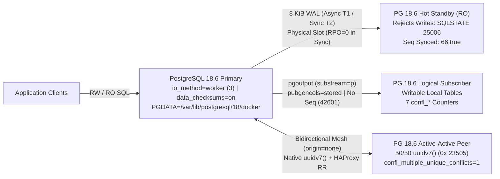

# #17 - PostgreSQL 18.6 Native Clustering (AIO, uuidv7, Streaming & Logical)

**Series:** PostgreSQL Multi-Master & Active-Active Architectures  
**Author:** Jean-Marie Renouard (`jmrenouard`) - [LightPath](https://www.lightpath.fr)  
**License:** MIT License  
**Language:** [Version française](../../fr/solutions/pg18_native_clustering.md)

---

| Attribute | Value |
| :--- | :--- |
| **Catalog ID** | `#17` (`PostgreSQL 18.6 Native Clustering` across all 5 native tiers) |
| **Benchmark Topologies** | `pg18-standalone`, `pg18-async-streaming`, `pg18-sync-streaming`, `pg18-logical`, `pg18-birep` (`results/benchmark_pg18.csv`, 87 rows) |
| **Engine Version** | `PostgreSQL 18.6 (Debian 18.6-1.pgdg13+2)` (`postgres:18`) |
| **CAP / PACELC Profile** | `Single-Node (CA)` \| `AP / PA-EL` (async, logical, birep) \| `CP / PC-EC` (sync streaming, `RPO = 0`) |
| **Storage & AIO Defaults** | `PGDATA=/var/lib/postgresql/18/docker` (`VOLUME /var/lib/postgresql`), `io_method=worker` (`io_workers=3`), `data_checksums=on` |
| **Logical & Conflict Engine** | Native `uuidv7()`, `substream=p`, `publish_generated_columns=stored` (`s`), 7 `confl_*` counters in `pg_stat_subscription_stats` |
| **License / Docker Stacks** | PostgreSQL License / `docker-compose-pg18-streaming.yml`, `docker-compose-pg18-logical.yml`, `docker-compose-pg18-birep.yml` |

---

## 1. Overview & Operating Principles (PG 16 vs PG 17 vs PG 18)

**PostgreSQL 18.6** modernizes core database storage, I/O scheduling, and logical replication without altering fundamental replication physics. It introduces an **Asynchronous I/O (AIO) subsystem** (`io_method=worker`, `io_workers=3`), enables **`data_checksums=on`** by default at `initdb`, moves Docker's data layout to `PGDATA=/var/lib/postgresql/18/docker`, ships native RFC 9562 **`uuidv7()`** for coordination-free active-active primary keys, defaults logical apply to **`substream=p`** (parallel streaming), supports **`publish_generated_columns=stored`** (`s`), and expands **`pg_stat_subscription_stats`** to **7 `confl_*` counters** including `confl_multiple_unique_conflicts`.

In controlled `pg18-standalone` A/B probes, we measure the AIO latency shift $\Delta_{\text{AIO}}$ and PG 18 vs PG 17 throughput speedup $S_{18/17}$ as:

$$
\Delta_{\text{AIO}} = \frac{t_{\text{worker}} - t_{\text{sync}}}{t_{\text{sync}}} \times 100\%, \qquad S_{18/17} = \frac{\text{TPS}_{\text{PG18}}}{\text{TPS}_{\text{PG17}}}
$$

- **AIO A/B Reality:** `io_method=worker` cut cold post-checkpoint scans by **$-18.5\%$** (`829.4 ms` vs `1,018.3 ms` `sync`), while warm OS-cached reads (`385.0 ms` vs `352.5 ms`) and small `fsync` `pgbench` commits (`290.75` vs `323.98 TPS`) reflect modest worker-IPC and `data_checksums=on` overhead. `io_method=io_uring` fails with `EPERM` under default Docker seccomp.
- **Active-Active `uuidv7()` & Honest Native Boundaries:** `uuidv7()` achieved **50/50 dual-node active-active convergence** (`0` `SQLSTATE 23505`, `0` B-tree inversions), outperforming naive `SERIAL`. However, **logical sequence replication is still absent in PostgreSQL 18.6**: `FOR ALL SEQUENCES` and `REFRESH SEQUENCES` raise **`SQLSTATE 42601`** (deferred to PostgreSQL 19), leaving subscriber sequences at `1|false` -> `SQLSTATE 23505` until manual `setval()`. Automatic LWW/CRDT and DDL replication remain absent.

| Capability / Default | PostgreSQL 16 | PostgreSQL 17 (`17.11`) | PostgreSQL 18 (`18.6`) |
| :--- | :--- | :--- | :--- |
| **Docker `PGDATA` & Checksums** | `/var/lib/postgresql/data`, `off` | `/var/lib/postgresql/data`, `off` | **`/var/lib/postgresql/18/docker`**, **`data_checksums=on`** |
| **Asynchronous I/O (`io_method`)** | `sync` only | `sync` only | **`worker` (`io_workers=3`)** (`-18.5%` cold scan); `io_uring` `EPERM` in default Docker |
| **Active-Active PK Generation** | Stepped `SERIAL` / ext | Stepped / `snowflake` | **Native `uuidv7()`** (`50/50` dual-node convergence, `0` `23505`) |
| **Conflict Telemetry (`pg_stat_subscription_stats`)** | Apply error count only | 6 `confl_*` counters | **7 `confl_*` counters** (+`confl_multiple_unique_conflicts=1` live) |
| **Logical Apply & Generated Cols** | `streaming=on` opt-in | `streaming=parallel` opt-in | **`substream=p` default**; `publish_generated_columns=stored` (`s`) |
| **Logical Sequence Sync (`T18`)** | Absent (`23505` trap) | Absent (`23505` trap) | **Still absent (`SQLSTATE 42601`; deferred to PG 19)** |
| **Birep LWW / CRDT / DDL** | Manual (`origin=none`) | Manual (`origin=none`) | **Manual**: no auto LWW/CRDT, no DDL repl. (`TRUNCATE` only) |

---

## 2. Architecture & Data Flow

PostgreSQL 18.6 unifies all five native deployment modes atop the same AIO worker pool and checksum-protected storage engine:

---

## 3. Implementation Modes & Topologies

| Mode | CAP / PACELC | Commit / RPO / Conflicts | PG 18.6 Docker Stack |
| :--- | :--- | :--- | :--- |
| **`pg18-standalone`** | `Single-Node (CA)` | Local WAL `fsync`, `RPO = 0` on local crash (`T16` `20/20`); zero replication conflicts | `docker-compose-pg18-streaming.yml` (single primary baseline) |
| **`pg18-async-streaming`** | `AP / PA-EL` | Local WAL flush, async physical standby; `RPO > 0` risk; standby RO (`25006`), zero conflicts | `docker-compose-pg18-streaming.yml` (`wal_level=replica`, `sync_state=async`) |
| **`pg18-sync-streaming`** | `CP / PC-EC` | Sync WAL flush (`synchronous_commit=on`), **`RPO = 0`**; sole standby loss stalls (`wait_event=SyncRep`) | `docker-compose-pg18-streaming.yml` (`sync_state=sync`, slot `slot_pg18_standby`) |
| **`pg18-logical`** | `AP / PA-EL` | Async `pgoutput` (`substream=p`, `pubgencols=stored`); 7 `confl_*` counters; seq `42601`/`23505` | `docker-compose-pg18-logical.yml` (1 Publisher + 1 Subscriber) |
| **`pg18-birep`** | `AP / PA-EL` | Active-active `origin=none` + `uuidv7()` (`0` PK clash); shared keys diverge (no auto LWW/CRDT) | `docker-compose-pg18-birep.yml` (2 PG 18.6 peers + HAProxy TCP RR) |

---

## 4. Empirical Benchmarks & Verified Limits (`results/benchmark_pg18.csv` & `results/functional_limits_pg18.csv`)

All 87 rows ran sequentially at `pg_scale = 2` (`retries_40001 = 0`). Only `Avg`, `Stddev` (`0` for `sysbench`), and `p95` are recorded (`p99` latency is unmeasured).

| Topology | `A_single_rw` TPS (`p95`) | `C_multinode_ro` TPS | `E_sysbench_oltp_rw` TPS | `E3_wo` TPS | `H_append_only_insert` TPS | `F_wan_netem_25ms` TPS | `T11` 10k Bulk (`rows/s`) |
| :--- | :---: | :---: | :---: | :---: | :---: | :---: | :---: |
| **`pg18-standalone`** | 784.43 (`25.372 ms`) | 42,373.67 | 1,046.67 | 1,382.15 | 1,956.76 | N/A | 80,108 (`125ms`) |
| **`pg18-async-streaming`** | 558.34 (`36.662 ms`) | 47,548.05 | 980.72 | 1,809.82 | 1,423.07 | 554.93 | 87,903 (`114ms`, `88.4ms`) |
| **`pg18-sync-streaming`** | 497.94 (`40.98 ms`) | 32,258.16 | 767.63 | 1,184.57 | 1,760.26 | 41.56 (`p95 529.136 ms`) | 75,629 (`132ms`, `99.8ms`) |
| **`pg18-logical`** | 314.26 (`79.055 ms`) | 45,862.68 | 1,027.84 | 1,582.39 | **3,518.49** (`+85.1%`) | 844.10 | 69,827 (`143ms`, `316.0ms`) |
| **`pg18-birep`** | 514.28 (`40.902 ms`) | 42,190.66 | 1,055.55 | 1,492.99 | **2,066.70** (`3.30x`, `uuidv7()`) | 747.42 | 70,470 (`142ms`, `321.2ms`) |

| Verified Probe / Limit | Empirical PG 18.6 Result (`results/functional_limits_pg18.csv`) |
| :--- | :--- |
| **AIO & Storage (`pg18-standalone`)** | `io_method=worker` (`workers=3`), `data_checksums=on`; cold scan `829.4 ms` vs `1,018.3 ms` `sync` (`-18.5%`); `io_uring=EPERM` |
| **`uuidv7()` & Sequences (`L1`/`T18`)** | `pg18-birep` `50/50` `uuidv7()` converged (`0x 23505`); physical WAL synced seq (`66|true`, `next_id=67`); logical `FOR ALL SEQUENCES` / `REFRESH SEQUENCES` raised **`SQLSTATE 42601`** (`1|false` -> **`23505`**) |
| **7 `confl_*` Counters** | Verified `confl_insert_exists=2`, `confl_update_origin_differs=1/2`, `confl_update_missing=1`, `confl_delete_missing=1`, `confl_delete_origin_differs=1`, **`confl_multiple_unique_conflicts=1`** (`pg18-birep`) |
| **Shared-Key Drift (`B2`/`D`/`L3`/`T12`)** | `pg18-birep` diverged `-338` (`B2`), `-83,252` (`D`), `+100/-30` (`n1=970.00` vs `n2=1100.00`), `T12` `DELETE` won (`DELETED/DELETED`); `pg18-logical` `T12` diverged `upd_n1`/`DELETED` |
| **Keyless (`L2`), DDL (`L5`) & FK (`T13`)** | Logical/birep reject keyless `UPDATE`/`DELETE` (**`55000`**), do not replicate `ALTER TABLE ADD COLUMN` (`TRUNCATE` OK); `pg18-birep` `T13` async FK race `2/10 ok` (**`23503x8`**); streaming standby RO (**`25006`**) |
| **Outage (`L7`), Lag (`T15`), Crash (`T16`)** | `L7` WAL retained `3,008 B` (`async`), `SyncRep` stall (`sync`), `19,448 B` (`logical`), `352,664 B` (`birep`); `T15` p50/p95 `4.41/5.80` (`async`), `1.47/2.07` (`sync`), `1.46/1.68` (`logical`), `1.25/1.75 ms` (`birep`); 5/5 `md5=00493e3a` & `20/20` `RPO=0` |
| **Verified SQLSTATEs** | `23505` (PK/`UNIQUE`), `25006` (RO standby), `42601` (sequence DDL unsupported), `55000` (keyless logical DML), `23503` (`pg18-birep` FK race) |

---

## 5. Strengths & Weaknesses

| Strengths | Weaknesses & Operational Traps |
| :--- | :--- |
| **Native `uuidv7()` + 3.30x Append-Only Leap:** Solves active-active PK generation natively (`50/50`, `0` `23505`, `2,066.70 TPS` on `pg18-birep`, `3,518.49 TPS` on `pg18-logical`). | **Logical Sequence Sync Deferred to PG 19 (`42601`):** `FOR ALL SEQUENCES` / `REFRESH SEQUENCES` fail with `SQLSTATE 42601`; scripted `setval()` remains mandatory on cutover. |
| **AIO Cold Scans & Default Checksums:** `io_method=worker` cuts uncached scan latency `-18.5%` (`829.4` vs `1,018.3 ms`), while `data_checksums=on` guards against silent page corruption by default. | **No Auto Conflict Resolution or DDL Replication:** `pg18-birep` still diverges on shared rows (`B2` `-338`, `D` `-83,252`, `T13` `23503x8`) and halts apply on `23505` without Spock/PGD/CRDTs. |
| **Complete 7-Counter Conflict Diagnostics:** `pg_stat_subscription_stats` exposes `confl_multiple_unique_conflicts` plus all 6 PG 17 counters for clean alerting and `SKIP (lsn=...)` runbooks. | **Docker Layout & Small-TX Checksum/IPC Tax:** `PGDATA=/var/lib/postgresql/18/docker` breaks PG 17 mounts; `io_uring` hits `EPERM`; tiny cached `pgbench` commits pay `-8.5%` to `-10.3%` overhead. |
| **Zero-Extension Ecosystem & Fast Bulk Load:** 100% core PostgreSQL License, `T11` bulk load jumps to `69,827-87,903 rows/s`, and `T15` visibility lag drops to `1.25-4.41 ms` p50. | **Sync WAN Physics Unchanged:** `pg18-sync-streaming` still drops to `41.56 TPS` at `25ms` WAN (`p95 529.136 ms`) and stalls primary writes (`wait_event=SyncRep`) if its sole sync standby fails. |

---

## 6. GitHub Popularity, Git Presence & Maintenance Vitality (`results/project_popularity.csv`)

Live GitHub telemetry (`2026-11-20T17:26:02Z`, `archived = false` unless `N/A`):

| Project | Git Presence / Role | Repo (`Account / Repos`) | Stars / Forks / Watch | Commits (`Tot / 12m`) | Contrib / Issues | Lang / SPDX | Release / Last Push |
| :--- | :--- | :--- | :---: | :---: | :---: | :--- | :--- |
| **PostgreSQL Core (`#1/#15/#16/#17`)** | `Yes (Mirror)` -- `Mirror (canonical: git.postgresql.org)` | [`postgres/postgres`](https://github.com/postgres/postgres) (`Org / 6`) | 22894 / 6123 / 589 | 66091 / 3446 | 58* / 0 | C / `NOASSERTION` | `REL_19_0` / `2026-11-20T16:52:40Z` |
| **Patroni HA (`#15b` companion)** | `Yes` -- `Primary` | [`patroni/patroni`](https://github.com/patroni/patroni) (`Org / 1`) | 8847 / 1049 / 124 | 2713 / 142 | 246 / 68 | Python / `MIT` | `v4.1.5` / `2026-11-20T17:03:56Z` |

- **Maintenance Level:** **Tier S (Core)** + **Tier A (Active OSS)** -- `postgres/postgres` (`3446`/12m, `58*` mirror committers per `APP-007`, not total patch authors) and `patroni/patroni` (`142`/12m, `246` contributors, `68` issues).
- **Currency / Freshness:** **Current -- Daily Active** -- Last push `2026-11-20T16:52:40Z` / `2026-11-20T17:03:56Z`, `3446` / `142` commits/12m, latest releases `REL_19_0` / `v4.1.5`.
- **Operational Manageability:** **Low Risk** -- Multi-vendor core + MIT HA; adapt `PGDATA=/var/lib/postgresql/18/docker`, `io_uring` seccomp, and `setval()` runbooks until PG 19.

---

**Navigation:** [Index](../../../README.md) | [Ch. 03a - Native & Extensions](../03a_solutions_native_and_extensions.md) | [Ch. 11 - Ecosystem Popularity](../11_ecosystem_popularity_and_vitality.md) | [Ch. 12 - PG 18 Clustering & Benchmarks](../12_postgresql_18_clustering_and_benchmarks.md) | [PG 17 Streaming](pg17_physical_streaming_patroni.md) | [PG 17 Logical](pg17_logical_unidirectional.md) | [PG 17 BiRep](pg17_bidirectional_logical.md) | [Version française](../../fr/solutions/pg18_native_clustering.md)
