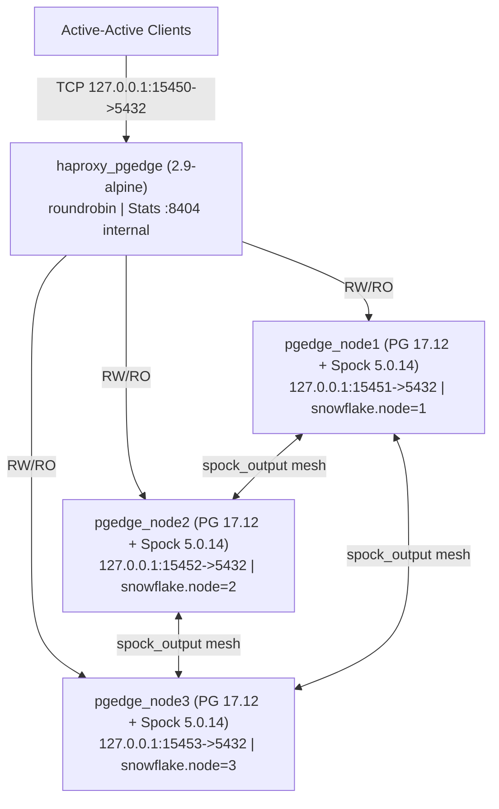

# 2 — pgEdge Platform & Spock v5 (Multi-Master Logical + CRDT Delta-Apply)

**Series:** PostgreSQL Multi-Master & Active-Active Architectures  
**Author:** Jean-Marie Renouard (`jmrenouard`) — [LightPath](https://www.lightpath.fr)  
**License:** MIT License

---

| Attribute | Value |
| :--- | :--- |
| **Catalog ID** | `#2` (`pgEdge / Spock (#2)` in `results/functional_limits_matrix.csv`) |
| **Benchmark Topology IDs** | `pgedge` (default LWW), `pgedge-delta-apply` (CRDT mode in `D_hot_conflict`) |
| **Family / Tier** | `T4` — Logical Extension Multi-Master (`Niveau 4`) |
| **Versions** | `PostgreSQL 17.12` (`pgedge-postgres:17-spock5-minimal`), `Spock 5.0.14`, `Snowflake 2.6.1`, `HAProxy 2.9` (`haproxy:2.9-alpine`) |
| **CAP / PACELC Profile** | `AP / PA-EL` — asynchronous 3-node active-active mesh (LWW or CRDT Delta-Apply) |
| **License / Deployment** | PostgreSQL License / GPL-2.0 (HAProxy) / 4 containers (`docker-compose-pgedge.yml`) |

---

## 1. Technology Description & What It Does

**pgEdge / Spock** (`pglogical` fork, PG 15–17) runs `spock` (`5.0.14`) for mesh replication, conflicts, and auto-DDL, plus `snowflake` (`2.6.1`) for 64-bit K-sortable PKs.

Unlike `#1 pg-birep` (halts on `23505`), Spock stays writable via `last_update_wins` (`transdiscard`) or `spock.delta_apply` CRDT. Ecosystem `lolor` (`Ch. 03a`) is unloaded and untested.

---

## 2. Architecture & Data Flow

HAProxy balances TCP round-robin across `pgedge_node1..3` in a 6-sub mesh on `pgedge_net`:

Runs (`B1`–`D`, `H`) hit `node1`/`node2`; `node3` replicates passively (`tc netem` delays `node2`/`node3`).

---

## 3. Operating Principles & Implementation Modes

1. **`spock_output`:** Six `spock.sub_create` links (`2/2`) decode WAL; UBI requires `output_plugin_libraries=pgoutput,spock_output` + `scram-sha-256` (`42501` fix).
2. **Commit Latency Model:**

$$
L_{\text{T4-pgedge}} \approx L_{\text{disk}} \quad (\text{local WAL fsync; peer apply and } \Delta\text{-merge are async})
$$

3. **LWW, CRDT & DDL:** With `track_commit_timestamp=on`, `last_update_wins` arbitrates (`spock.resolutions`), `transdiscard` logs `23505` (`spock.exception_log`), and `delta_apply` merges $\Delta = v_{\text{new}} - v_{\text{old}}$.

| Mode / Option | Scope | Mechanics & Key Strategy | Conflict / Failover Impact | Trade-Off |
| :--- | :--- | :--- | :--- | :--- |
| **`last_update_wins` + `transdiscard`** *(Default)* | `conflict_resolution` / `exception_behaviour` | Commit-ts LWW; failed TX to `exception_log` | Peers writable; lost updates (`B2`/`D`/`L3`), `23505` drift (`L4`) | AP over consistency |
| **`spock.delta_apply` CRDT** *(`pgedge-delta-apply` PoC)* | Column (`log_old_value=true`) | Ships $\Delta = v_{\text{new}} - v_{\text{old}}$ on `accounts.balance` / `abalance` | **Zero drift (`0`)** (`D`: `1,391,780` exact; `L3`: `1070.00` x3) | `-19.4%` TPS (`2,280.11 -> 1,837.64`); numeric only |
| **Auto-DDL** *(PoC)* | `enable_ddl_replication=on`, `include_ddl_repset=on` | Event triggers capture `ALTER TABLE`; `TRUNCATE` streams natively via WAL (`L5`) | Replicates DDL without manual wrappers | No Raft global lock on concurrent DDL |
| **`snowflake.nextval`** *(PoC)* | Extension `snowflake` (`2.6.1`, `node=1..3`) | 64-bit K-sortable ID (`ts + node + counter`) | Avoids `23505` PK collisions (`T18` seq trap) | Unique `snowflake.node` per peer |
| **`default_insert_only`** *(PoC Keyless)* | `spock.tables` | Keyless tables route into `default_insert_only` (`L2`) | `INSERT` replicates; `UPDATE`/`DELETE` **silently skip peers** | Add PK for full DML replication |
| **`lolor`** *(Ecosystem — Not in PoC)* | `pg_largeobject` | Replicates LOBs (`Ch. 03a`) | **Not loaded** (`shared_preload_libraries=spock,snowflake`) | Needs explicit setup outside PoC |
| **`discard` / `sub_disable`** *(Arch.)* | `spock.exception_behaviour` | Drops statement or disables sub on error | `sub_disable` halts apply (`23505`) like `pg-birep` | Safer than `transdiscard` on `UNIQUE` |

---

## 4. Strengths & Weaknesses

| Strengths | Weaknesses & Operational Traps |
| :--- | :--- |
| **Zero-Drift CRDT (`pgedge-delta-apply`):** Eliminates `-278,698` (`16.0%`) lost-update drift on `D_hot_conflict` (`1,837.64 TPS`, `0` drift x3) and converges `L3` (`1070.00` x3). | **LWW Lost Updates & `transdiscard` (`B2`/`D`/`L4`):** Default LWW loses `-66,328` (`B2`) and `-278,698` (`D`); `L4` logs `23505` to `spock.exception_log=1` and leaves `n1=u1` vs `n2=u2`. |
| **WAN-Resilient Mesh & Auto-DDL:** Holds across `10/25/50 ms` WAN (`644.63`/`646.77`/`687.0 TPS`), `T15` `p50=1.16 ms`, `T13` FK `10/10`, `L5` auto-replicates `ALTER TABLE` + `TRUNCATE`. | **Keyless DML Drop (`L2`) & `SQL_ASCII` (`T14`):** Keyless tables enter `default_insert_only` (local `UPDATE`/`DELETE` never replicate); Rocky UBI `SQL_ASCII` raises `54000` on `chr(20013)`. |
| **Global IDs & Outage Survival:** `snowflake.nextval` avoids `T18` `23505`; `L7` retains `309,560 B` WAL (`5/5` catchup); `T16` SIGKILL keeps `20/20` RPO=0 (`21/21` post-restart). | **`output_plugin_libraries` & Absent `lolor`:** UBI defaults omit `spock_output` (`42501`); `lolor` is absent in PoC; `sysbench` `ignored errors` (`114` `E`/`160` `E3`) match standalone Lua noise (`112` `E`/`192` `E3`). |
| **High Read/Append Speed:** `54,124.99 TPS` (`C`), `140,124.63 TPS` (`E4`), `2,206.6 TPS` (`H` x3), and `67,406 rows/s` bulk (`T11`, `350.0 ms` catch-up). | **Local Locks & No Quorum (`L6`/`L8`):** `advisory_lock`/`LISTEN` stay node-local, `TEMP` session-local, and `transdiscard` hides divergence unless `spock.exception_log` is monitored. |

---

## 5. Empirical Benchmark Results, Functional Limits & PoC Spec

Ran at `pg_scale = 2` (`retries_40001 = 0`). Only `Avg`, `Stddev` (`0` for `sysbench`), and `p95` are measured (p99 latency is unmeasured).

### Table A — Core & Extended Workloads (`benchmark_summary.csv`, `benchmark_extended_workloads.csv`)

| Suite | Cl / Dur | TPS | QPS | Avg / Stddev / p95 (ms) | Committed (Fail) | Drift | Status |
| :--- | :---: | :---: | :---: | :---: | :---: | :---: | :--- |
| `A_single_rw` | 8 / 20s | 556.06 | N/A | 14.368 / 13.796 / 38.157 | 11122 (0) | 0 | `PASS_CONVERGED` |
| `B1_disjoint_rw` | 8 / 20s | 346.95 | N/A | 23.028 / 18.442 / 52.575 | 6944 (0) | 0 | `PASS_CONVERGED` |
| `B2_overlap_rw` | 8 / 20s | 818.65 | N/A | 9.759 / 11.037 / 28.907 | 16366 (0) | -66328 | `EXPECTED_LIMITATION_LOST_UPDATE` |
| `C_multinode_ro` | 16 / 20s | 54124.99 | N/A | 0.273 / 0.089 / 0.431 | 1081446 (0) | 0 | `PASS` |
| `D_hot_conflict` *(LWW)* | 8 / 15s | 2280.11 | N/A | 3.492 / 3.187 / 5.311 | 34175 (0) | -278698 | `EXPECTED_LIMITATION_LOST_UPDATE` |
| `D_hot_conflict` *(`pgedge-delta-apply`)* | 8 / 15s | 1837.64 | N/A | 4.336 / 4.186 / 9.347 | 27545 (0) | 0 | `PASS_CONVERGED` |
| `E_sysbench_oltp_rw` | 8 / 20s | 888.56 | 17873.46 | 8.99 / 0 / 15.27 | 17834 (114) | 0 | `PASS` |
| `E2_sysbench_oltp_ro` | 8 / 12s | 1754.57 | 28073.19 | 4.55 / 0 / 6.09 | 21068 (0) | 0 | `PASS` |
| `E3_sysbench_oltp_wo` | 8 / 12s | 1279.51 | 7729.6 | 6.24 / 0 / 7.7 | 15492 (160) | 0 | `PASS` |
| `E4_sysbench_point_select` | 16 / 12s | 140124.63 | 140124.63 | 0.11 / 0 / 0.28 | 1682576 (0) | 0 | `PASS` |
| `H_append_only_insert` | 8 / 12s | 2206.6 | N/A | 3.607 / 1.848 / 5.074 | 26449 (0) | 0 | `PASS_CONVERGED` |
| `F_wan_netem_25ms` | 8 / 15s | 646.77 | N/A | 12.324 / 11.513 / 32.402 | 9737 (0) | 0 | `PASS_NETEM_25MS` |

*(Divergence details: `B2` `exp=-78525`, `n1/n2/n3=-144853`; `D` LWW `exp=1737102`, `n1/n2/n3=1458404`; `D` CRDT `exp=1391780`, `n1/n2/n3=1391780`.)*

### Table B — Concurrency & WAN Latency Sweeps (`benchmark_concurrency_sweep.csv`, `benchmark_wan_sweep.csv`)

| Sweep Suite | Param | TPS | Avg / Stddev / p95 (ms) | Committed | Status |
| :--- | :---: | :---: | :---: | :---: | :--- |
| `G_conc_c1` (8s) | 1 cl | 312.94 | 3.183 / 1.137 / 4.969 | 2501 | `PASS` |
| `G_conc_c4` (8s) | 4 cl | 616.09 | 6.467 / 3.116 / 11.799 | 4914 | `PASS` |
| `G_conc_c8` (8s) | 8 cl | 672.46 | 11.869 / 8.935 / 29.606 | 5363 | `PASS` |
| `G_conc_c16` (8s) | 16 cl | 676.05 | 23.6 / 22.774 / 70.967 | 5403 | `PASS` |
| `G_conc_c32` (8s) | 32 cl | 575.54 | 55.336 / 66.012 / 183.941 | 4612 | `PASS` |
| `F_wan_netem_10ms` (12s) | 10 ms | 644.63 | 12.386 / 9.132 / 30.828 | 7718 | `PASS_NETEM_10MS` |
| `F_wan_netem_25ms` (15s) | 25 ms | 646.77 | 12.324 / 11.513 / 32.402 | 9737 | `PASS_NETEM_25MS` |
| `F_wan_netem_50ms` (12s) | 50 ms | 687.0 | 11.62 / 8.57 / 29.072 | 8234 | `PASS_NETEM_50MS` |

### Table C — Functional Limits (`F1`, `L1–L8`) & Extended Probes (`T11–T18`)

| Probe | Observed Empirical Result |
| :--- | :--- |
| `F1` Health | `PASS: 3 nodes 2/2 replicating; snowflake.node=1/2/3; LWW+DDL=on` |
| `L1` Serial PK | `EXPECTED_LIMITATION: LWW silent overwrite (spock.resolutions=1 winner=from_n2)` |
| `L2` Keyless Table | `EXPECTED_LIMITATION: default_insert_only skips UPDATE/DELETE silently; PK fixed` |
| `L3` Lost Update | `EXPECTED_LIMITATION (LWW=970.00)` \| `PASS (spock.delta_apply=1070.00 on all 3 nodes)` |
| `L4` Unique Conf. | `EXPECTED_LIMITATION: transdiscard SQLSTATE 23505 (exception_log=1) diverged n1=u1 n2=u2` |
| `L5` DDL & Savept | `PASS: ALTER TABLE ADD COLUMN & TRUNCATE auto-replicated to n2/n3` |
| `L6` PG Features | `EXPECTED_LIMITATION: advisory_lock & LISTEN/NOTIFY node-local; TEMP session-local` |
| `L7` Node Outage | `PASS: slot active=false WAL retained=309560B; caught up 5/5` |
| `L8` Quorum Loss | `N/A: AP async continues without quorum` |
| `T11` Bulk 10k | `PASS: 67406 rows/s (148ms); peer_catchup=350.0ms` |
| `T12` Upd vs Del | `EXPECTED_LIMITATION: n1/n2/n3=DELETED/DELETED/DELETED (spock.resolutions=0)` |
| `T13` FK Race | `PASS: 10/10 immediate cross-node child inserts consistent (0 FK errors)` |
| `T14` Rich MD5 | `PASS: 3/3 identical md5=f798eb5a (BYTEA=65536B; SQL_ASCII chr()=54000; UTF-8 escaped)` |
| `T15` Vis. Lag | `p50=1.16ms p95=1.63ms max=1.71ms (n=30)` |
| `T16` SIGKILL RPO | `PASS: peer_surv=20/20 RPO=0 peer_write_OK; post_restart=21/21` |
| `T17` Long Open TX | `PASS: NO_DIRTY_READ; side_tx_unblocked(104ms); post_commit_vis=115ms` |
| `T18` Seq Sync (50) | `EXPECTED_LIMITATION: std seq 1\|false -> SQLSTATE 23505 (use snowflake.nextval)` |
| **Verified SQLSTATEs** | `L1–L8: 23505` \| `T11–T18: 23505;54000` |

### Table D — PoC Docker & HAProxy Specification (`env/multi-db-docker-env/`)

| Parameter | PoC Setting / Observation |
| :--- | :--- |
| **Compose & Scripts** | `docker-compose-pgedge.yml` + `scripts/pgedge/setup_pgedge.sh` + `scripts/pgedge/haproxy.cfg` + `tests/test_pgedge.sh` |
| **Nodes & Image** | `pgedge_node1..3` (`127.0.0.1:15451..15453:5432`), `ghcr.io/pgedge/pgedge-postgres:17-spock5-minimal` (`PG 17.12`, Rocky UBI) |
| **HAProxy LB** | `haproxy_pgedge` (`haproxy:2.9-alpine`), `127.0.0.1:15450:5432` (TCP RR `inter 2s fall 2 rise 2`); `:8404/stats` internal only |
| **Key GUCs & Mesh** | `shared_preload_libraries=spock,snowflake`, `output_plugin_libraries=pgoutput,spock_output`, `track_commit_timestamp=on`, `spock.conflict_resolution=last_update_wins`, `spock.exception_behaviour=transdiscard` (default), `spock.enable_ddl_replication=on`, `spock.include_ddl_repset=on`, `spock.save_resolutions=on`, `snowflake.node=1..3`. |

## 6. GitHub Popularity, Git Presence & Maintenance Vitality (`results/project_popularity.csv`)

Live GitHub telemetry (`2026-11-20T17:26:02Z`, `archived = false` unless `N/A`):

| Project | Git Presence / Role | Repo (`Account / Repos`) | Stars / Forks / Watch | Commits (`Tot / 12m`) | Contrib / Issues | Lang / SPDX | Release / Last Push |
| :--- | :--- | :--- | :---: | :---: | :---: | :--- | :--- |
| **pgEdge Spock (#2)** | `Yes` -- `Primary` | [`pgEdge/spock`](https://github.com/pgEdge/spock) (`Org / 51`) | 769 / 59 / 15 | 1616 / 621 | 32 / 68 | C / `NOASSERTION` | `v6.0.0-beta.2` / `2026-11-20T17:04:58Z` |
| **pgEdge Snowflake (#2b)** | `Yes` -- `Primary (Companion)` | [`pgEdge/snowflake`](https://github.com/pgEdge/snowflake) (`Org / 51`) | 103 / 14 / 17 | 239 / 48 | 20 / 4 | PLpgSQL / `PostgreSQL` | `v2.6.1` / `2026-11-18T22:39:13Z` |
| **pgEdge LOLOR (#2c)** | `Yes` -- `Primary (Companion)` | [`pgEdge/lolor`](https://github.com/pgEdge/lolor) (`Org / 51`) | 51 / 8 / 7 | 159 / 79 | 16 / 16 | C / `PostgreSQL` | `v1.2.3` / `2026-11-20T07:41:54Z` |

- **Maintenance Level:** **Tier A (Active OSS)** -- `pgEdge/spock` (`621`/12m, `32` contributors, `769` stars) plus active `snowflake` (`48`/12m) and `lolor` (`79`/12m).
- **Currency / Freshness:** **Current -- High Velocity** -- Last push `2026-11-20T17:04:58Z`, `621` commits/12m, latest release `v6.0.0-beta.2`.
- **Operational Manageability:** **Moderate** -- Active C extensions (`spock` + `snowflake`); note `NOASSERTION` SPDX on `spock`, `v6.0.0-beta.2` track, and `exception_log` monitoring.

---

**Navigation:** [Index](../../../README.md) · [Ch. 03a — Native & Extensions](../03a_solutions_native_and_extensions.md) · [Ch. 10 — Streaming vs Logical vs Multi-Master](../10_streaming_vs_logical_vs_multimaster.md) · [Version française](../../fr/solutions/pgedge_spock.md)
