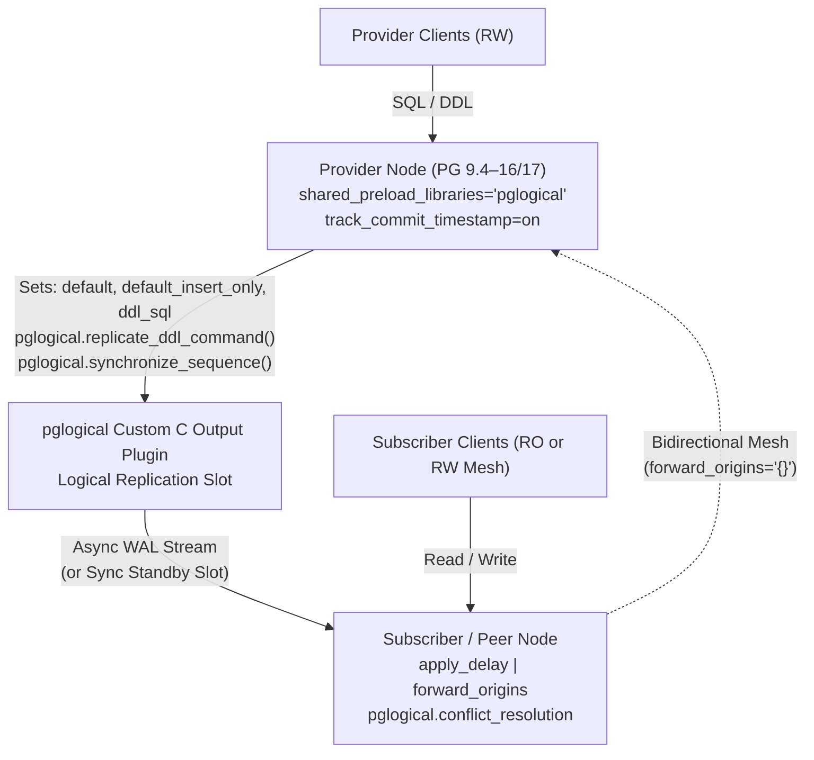

# 3 — pglogical 2 (Extension-Based Logical Replication — Architectural Reference)

**Series:** PostgreSQL Multi-Master & Active-Active Architectures  
**Author:** Jean-Marie Renouard (`jmrenouard`) — [LightPath](https://www.lightpath.fr)  
**License:** MIT License

---

| Attribute | Value |
| :--- | :--- |
| **Catalog ID** | `#3` (`pglogical 2` in `Ch. 01`, `Ch. 03a`, `Ch. 04`, `Ch. 07`) |
| **Benchmark Status** | **Not live-benchmarked (Architectural Reference)** |
| **Family / Tier** | `T3 / T4` — Logical Replication Extension (`Niveau 3 / 4`) |
| **Versions** | `pglogical 2.4.x` (`PG 9.4–16/17`; maintenance status on PG 17) |
| **CAP / PACELC Profile** | `AP / PA-EL` — asynchronous logical replication (optional sync commit) |
| **License / Deployment** | PostgreSQL License (2ndQuadrant / EDB) / C extension (`shared_preload_libraries = 'pglogical'`) |

---

## 1. Technology Description & What It Does

**pglogical 2** is the foundational C-extension logical replication framework developed by 2ndQuadrant before PostgreSQL 10 introduced built-in `pgoutput` logical replication. Loaded via `shared_preload_libraries = 'pglogical'`, it runs a custom WAL output plugin alongside supervisor and per-subscription apply workers to stream row-level changes selectively across homogeneous or cross-major-version PostgreSQL clusters (`PG 9.4` through `PG 16/17`).

It pioneered **Replication Sets** (`default`, `default_insert_only`, `ddl_sql`), time-delayed logical replicas (`apply_delay`), configurable conflict handlers (`pglogical.conflict_resolution`), and zero-downtime upgrades from pre-PG-10 instances. Historically, 2ndQuadrant engineers contributed PG 10+ native logical replication, **pgEdge (`#2 Spock`)** forked `pglogical` into an open-source CRDT/Auto-DDL multi-master engine, and **EDB (`#4 PGD`)** carried forward the commercial BDR multi-master line.

---

## 2. Architecture & Data Flow

In a `pglogical` deployment, `pglogical.create_node(...)` and `pglogical.create_subscription(...)` connect provider output plugins to subscriber apply workers using named replication sets and configurable origin forwarding:

When configured in bidirectional mesh mode (`forward_origins = '{}'`), every node acts simultaneously as both provider and subscriber, relying on `track_commit_timestamp = on` for timestamp-based conflict arbitration.

---

## 3. Operating Principles & Implementation Modes

1. **Replication Sets & Subscription Controls:** Tables join `default` (`INSERT`/`UPDATE`/`DELETE`), `default_insert_only` (keyless `INSERT`s only), or `ddl_sql`. Subscriptions support `synchronize_structure`, `synchronize_data`, `apply_delay`, and `forward_origins` loop filtering.
2. **Commit Latency Model:**

$$
L_{\text{pglogical2-async}} \approx L_{\text{disk}}, \qquad L_{\text{pglogical2-sync}} \approx L_{\text{disk}} + \text{RTT}_{\text{subscriber}}
$$

3. **Conflict Policies, DDL & Sequences:** With `track_commit_timestamp = on`, `pglogical.conflict_resolution` arbitrates collisions via five policies (`error`, `apply_remote`, `keep_local`, `last_update_wins`, `first_update_wins`), with **zero CRDT (`delta_apply`) support**. Raw SQL DDL does not replicate automatically and must be wrapped in `pglogical.replicate_ddl_command('...')`; `pglogical.synchronize_sequence()` syncs values in batches rather than preventing multi-writer PK collisions.

| Mode / Option | Scope | Mechanics & Key Strategy | Conflict / Failover Impact | Trade-Off |
| :--- | :--- | :--- | :--- | :--- |
| **Async Provider -> Subscriber** *(Primary Role)* | `pglogical.create_subscription(forward_origins='{all}')` | Streams selected tables/rows (`PG 9.4–16/17`) to target | Single writer avoids conflicts (`RPO > 0` async) | Zero-downtime major upgrade bridge (`PG 9.x -> 17`) |
| **Bidirectional / Mesh** *(Multi-Master)* | All peers subscribe (`forward_origins='{}'`) | Filters relayed origins to prevent `A -> B -> A` loops | Exposed to Lost Updates (`LWW`) & clock skew | Requires stepped seqs or UUIDs; no CRDTs |
| **Synchronous Commit** *(Optional `PC/EC`)* | `synchronous_commit=on` + `synchronous_standby_names` | Targets `pglogical` replication slot for sync flush | Guarantees `RPO = 0`; blocks writer if peer down | Pays `RTT` per commit; rare in multi-master |
| **Time-Delayed Replica** *(`apply_delay`)* | `create_subscription(apply_delay := '1 hour')` | Holds decoded changes before apply on subscriber | Protects against accidental `DROP`/`DELETE` | Delayed replica lags behind `RPO` window |
| **Conflict Resolution** *(`pglogical.conflict_resolution`)* | `error`, `apply_remote`, `keep_local`, `last_update_wins`, `first_update_wins` | Requires `track_commit_timestamp=on` | `error` halts apply like `#1 pg-birep`; `LWW` drops losing writes silently | Vulnerable to NTP clock drift ($\Delta t_{\text{skew}}$) |
| **DDL & Sequence Helpers** *(Manual)* | `replicate_ddl_command`, `synchronize_sequence` | Explicit function wrappers & periodic sequence sync | Multi-writer `SERIAL` still collides (`23505`) without stepped stride | Operational wrapper discipline required |

---

## 4. Strengths & Weaknesses

| Strengths | Weaknesses & Operational Traps |
| :--- | :--- |
| **Pre-PG-10 Upgrade Bridge (`PG 9.4–16/17`):** Enables online major-version migrations from legacy `PG 9.4–9.6` clusters lacking native `pgoutput`. | **Functionally Superseded on PG 17:** Native `pgoutput` (`#16`), `origin=none` (`#1`), and fork `#2 Spock v5` replace its PG 17 niche. |
| **Fine-Grained Replication Sets & `apply_delay`:** Filters tables/columns/DML operations and supports built-in time-delayed logical recovery replicas. | **No CRDTs & Silent LWW Lost Updates:** Lacks `spock.delta_apply`; under hot-row contention in `LWW` mode, exhibits silent lost updates like `#2 pgEdge LWW`. |
| **Configurable Conflict Modes:** Supports both strict `error` halt (integrity) and timestamp-driven `last_update_wins` / `first_update_wins` (availability). | **Manual DDL & Sequence Sync Traps:** Raw `ALTER TABLE` breaks sync unless wrapped in `pglogical.replicate_ddl_command`; `synchronize_sequence` is not multi-writer safe. |
| **High PostgreSQL Extension Compatibility:** Preserves `~95–100%` standard PostgreSQL heap behavior and extension support per node. | **No `pg_largeobject` & Maintenance Status:** Lacks LOB replication (`lolor` in pgEdge), `pgBackRest` remains per-node only, and active R&D moved to `Spock` / `EDB PGD`. |

---

## 5. Architectural Exclusion, Mode Comparison & Reference Baseline

**Why `pglogical 2` Was Not Live-Benchmarked:** The Docker PoC (`env/multi-db-docker-env/`) targets **PostgreSQL 17**, where `pglogical 2` is in maintenance mode and superseded across every role it once filled:
1. **Uni-directional & upgrade role:** Replaced by native PG 17 `pgoutput` (`#16 pg17-logical`), which includes `WHERE` row filters, column lists (PG 15+), `pg_createsubscriber`, and `failover=true` slot sync without external extensions.
2. **Zero-extension bidirectional role:** Replaced by native PG 16+ `origin = none` (`#1 pg-birep`).
3. **Extension-enhanced multi-master role:** Replaced by its direct open-source fork **`#2 pgEdge / Spock 5`** (`pgedge` / `pgedge-delta-apply`), which adds `spock.delta_apply` CRDTs (`0` drift vs `-278,698` in Suite D), `snowflake` 64-bit IDs, and automatic DDL replication.

Because `pglogical 2` shares the identical PostgreSQL 17 heap, `wal_level = logical`, and `track_commit_timestamp = on` commit engine, its performance and limit profile map directly onto the live-benchmarked Tier 3/4 baselines below (no synthetic numbers are invented for `pglogical 2`):

| Capability / Baseline | `#3 pglogical 2` *(Arch. Ref.)* | `#16 pg17-logical` *(PoC Baseline)* | `#1 pg-birep` *(PoC Baseline)* | `#2 pgEdge / Spock 5` *(PoC Fork)* |
| :--- | :--- | :--- | :--- | :--- |
| **PG Version Span** | `PG 9.4–16/17` (upgrade bridge) | `PG 10–18` (`17.11` in PoC) | `PG 16–18` (`17.11` in PoC) | `PG 15–17` (`17.12`, Spock `5.0.14`) |
| **Conflict Handling** | `error` / `apply_remote` / `keep_local` / `LWW` / `FUW` | Apply halt (`23505` / `55000`) | Apply halt (`23505`, `L1`/`L4`) | `LWW` + `transdiscard` \| **`spock.delta_apply` CRDT** |
| **CRDT Lost-Update Fix** | None (shares LWW drift risk) | Single writer (`0` drift) | None (`-71,063` drift in `D`) | **`0` drift in `D` (`1,837.64 TPS`)** |
| **DDL Replication** | Manual `replicate_ddl_command()` | None (`L5` fails `ALTER TABLE`) | None (`L5` fails `ALTER TABLE`) | **Automatic (`enable_ddl_replication=on`)** |
| **Time-Delayed Replica** | Native `apply_delay` parameter | PG 16+ `min_apply_delay` | PG 16+ `min_apply_delay` | PG 16+ `min_apply_delay` |
| **Reference Empirical Anchor** | Not benchmarked (maintenance) | `532.38 TPS` (`A`), `1.68 ms` lag (`T15`) | `875.91 TPS` (`A`), `1.47 ms` lag (`T15`) | `556.06 TPS` (`A`), `1.16 ms` lag (`T15`) |

## 6. GitHub Popularity, Git Presence & Maintenance Vitality (`results/project_popularity.csv`)

Live GitHub telemetry (`2026-11-20T17:26:02Z`, `archived = false` unless `N/A`):

| Project | Git Presence / Role | Repo (`Account / Repos`) | Stars / Forks / Watch | Commits (`Tot / 12m`) | Contrib / Issues | Lang / SPDX | Release / Last Push |
| :--- | :--- | :--- | :---: | :---: | :---: | :--- | :--- |
| **pglogical 2 (#3)** | `Yes` -- `Primary` | [`2ndQuadrant/pglogical`](https://github.com/2ndQuadrant/pglogical) (`Org / 46`) | 1243 / 180 / 75 | 876 / 15 | 52 / 191 | C / `NOASSERTION` | `REL2_4_8` / `2026-07-28T18:10:14Z` |

- **Maintenance Level:** **Tier C (Fragile / Maintenance)** -- `2ndQuadrant/pglogical` logs only `15` commits/12m (`876` total, `52` contributors, `1,243` stars, `191` open issues).
- **Currency / Freshness:** **Low Cadence** -- Last push `2026-07-28T18:10:14Z`, `15` commits/12m, latest release `REL2_4_8`.
- **Operational Manageability:** **High Risk** -- Maintenance-only C extension (`PostgreSQL License` / `NOASSERTION` SPDX); superseded by native PG 17 logical replication and `pgEdge/spock`.

---

**Navigation:** [Index](../../../README.md) · [Ch. 03a — Native & Extensions](../03a_solutions_native_and_extensions.md) · [Ch. 10 — Streaming vs Logical vs Multi-Master](../10_streaming_vs_logical_vs_multimaster.md) · [Version française](../../fr/solutions/pglogical2.md)
