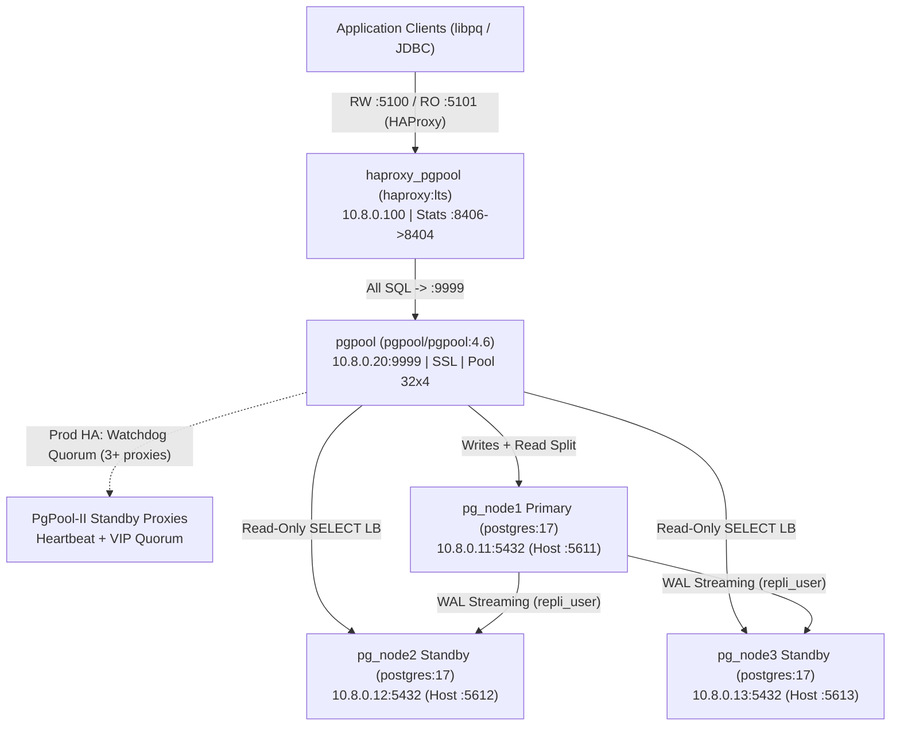

# 11 — PgPool-II (Connection Pooling, Load Balancing & Statement-Broadcast Proxy — Architectural Reference)

**Series:** PostgreSQL Multi-Master & Active-Active Architectures  
**Author:** Jean-Marie Renouard (`jmrenouard`) — [LightPath](https://www.lightpath.fr)  
**License:** MIT License

---

| Attribute | Value |
| :--- | :--- |
| **Catalog ID** | `#11` (`PgPool-II` in `Ch. 01`, `Ch. 03b`, `Ch. 04`, `Ch. 07`) |
| **Benchmark Status** | **Not live-benchmarked (Architectural Reference)**; Streaming PoC in `env/multi-db-docker-env/docker-compose-pgpool.yml` |
| **Family / Tier** | `Family 6` — Statement Middleware & Proxy (`T1/T2` Streaming LB vs Statement Broadcast / SI) |
| **Versions** | `PgPool-II 4.6` (`pgpool/pgpool:4.6`), `PostgreSQL 17` (`postgres:17`), `HAProxy LTS` (`haproxy:lts`) |
| **CAP / PACELC Profile** | Streaming: single-primary WAL \| SI Mode: `CP / PC-EC` \| Native Broadcast: fragile pseudo-sync |
| **License / Deployment** | BSD / MIT-style Open Source / Proxy tier (`3+` Watchdog nodes in prod) + PostgreSQL backends |
| **TDE / Encryption at Rest** | **N/A (Proxy only)**: AES `pool_passwd` + two-hop TLS; backends require TDE/LUKS ([Ch. 14](../14_transparent_data_encryption_tde.md)) |

---

## 1. Technology Description & What It Does

**PgPool-II** is a C-based PostgreSQL wire-protocol middleware proxy (`libpq` compatible) positioned between application clients and backend PostgreSQL servers. It adds pooling (`num_init_children * max_pool`), SQL read/write routing, health checks, and failover hooks. It also supports online node recovery (`pcp_recovery_node`) and optional **Watchdog** quorum.

Crucially, PgPool-II spans fundamentally incompatible replication modes that must never be conflated. In modern production deployments (**Streaming Replication Mode**, matching the companion Docker PoC), PgPool-II fronts a **single writable primary** plus read-only WAL standbys (`not multi-master`). Only its legacy **Native Replication Mode** (SQL statement broadcast) and **Snapshot Isolation (SI) Mode** attempt multi-node active writes at the proxy layer.

---

## 2. Architecture & Data Flow

In `env/multi-db-docker-env/docker-compose-pgpool.yml`, `haproxy_pgpool` (`10.8.0.100`) exposes RW (`:5100`), RO (`:5101`), and stats (`:8406`) to `pgpool` (`10.8.0.20:9999`), which routes SQL across `pg_node1..3` (`10.8.0.11..13:5432`) in `streaming_replication` mode (while production HA adds a 3-node Watchdog peer ring):

---

## 3. Operating Principles & Implementation Modes

1. **Connection Pooling & SQL Parser Routing:** PgPool-II pre-forks `num_init_children` (`32` in PoC) worker processes, each caching up to `max_pool` (`4`) backend user/database tuples (`connection_cache = on`). In `streaming_replication` with `load_balance_mode = on`, its parser sends writes, DDL, and `BEGIN` blocks to the primary. It balances read-only `SELECT`s within `sr_check_period` (`5 s`) lag limits.
2. **Statement-Broadcast vs. Streaming Latency Model:**

$$
L_{\text{PgPool-Stream-RW}} \approx L_{\text{disk}} + L_{\text{proxy}}, \qquad L_{\text{PgPool-Broadcast/SI}} \approx L_{\text{disk}} + \text{RTT}_{\text{max-backend}} + L_{\text{lock/SI}}
$$

3. **Watchdog Quorum & Recovery:** Production needs `>= 3` PgPool-II nodes with `use_watchdog = on` to eliminate single-proxy SPOF. Then `pcp_recovery_node` runs `pg_basebackup` to rebuild failed standbys.

| Mode (`backend_clustering_mode`) | Write Topology | Mechanics & Key Strategy | Conflict / Non-Determinism / RPO | Trade-Off |
| :--- | :--- | :--- | :--- | :--- |
| **`streaming_replication`** *(PoC Default)* | Single Primary + RO Standbys | SQL R/W split + `sr_check_period=5s` + `health_check_period=10s` | Zero multi-writer conflicts; `RPO` follows PG async/sync WAL | **Not multi-master**; safest production mode |
| **`replication`** *(Native Statement Broadcast)* | Proxy Multi-Node Broadcast | Replays every write SQL to all backends + `insert_lock` | **Breaks silently** on `NOW()`, `RANDOM()`, triggers, `nextval()` | Severe silent data divergence risk |
| **`snapshot_isolation`** *(SI Mode)* | Proxy-Coordinated Multi-Node | Centralized commit order & cross-node snapshot visibility | Prevents read skew across nodes; still vulnerable to SQL drift | High proxy serialization & `2*RTT` cost |
| **`logical_replication`** / **`raw`** | Logical Sub / Raw Failover | Pooling/LB atop PG logical repl. or uncoordinated failover | No PgPool online recovery for logical; `raw` has no LB | Prefer native `pgoutput` + `PgBouncer` |
| **Watchdog (`use_watchdog=on`)** *(Prod HA)* | `>= 3` PgPool-II Nodes | Distributed heartbeat, quorum consensus, virtual IP failover | Eliminates single-proxy SPOF & split-brain promotion | Adds 3-proxy operational footprint |

---

## 4. Strengths & Weaknesses

| Strengths | Weaknesses & Operational Traps |
| :--- | :--- |
| **Unified Proxy Pooling + R/W Splitting:** Combines `num_init_children * max_pool` connection caching, query-level `SELECT` load balancing, and failover without changing app drivers (`Streaming` mode). | **Non-Deterministic SQL Divergence (`replication` mode):** `NOW()`, `CURRENT_TIMESTAMP`, `RANDOM()`, `gen_random_uuid()`, triggers, and concurrent `nextval()` produce divergent state across nodes (`Ch. 07` anti-pattern #5). |
| **Zero-Extension PostgreSQL 17 Compatibility:** Operates externally over `pgwire` (`port 9999`), preserving `100%` of PostgreSQL heap tables, extensions, and `pgBackRest` PITR in `streaming_replication` mode. | **Proxy Degenerate-Node & Lock Stalls:** Under `replication` / `snapshot_isolation`, backend mismatch degenerates a node offline and `insert_lock` serializes sequence-backed inserts through the proxy. |
| **Built-In Watchdog & Online Recovery (`pcp`):** Multi-proxy Watchdog quorum prevents split-brain failover and `pcp_recovery_node` automates standby rebuilds (`RTO ~ 5–15 s`). | **Process-Per-Connection Overhead vs. `PgBouncer`:** `PgPool-II` parses SQL per session with heavier memory/CPU footprint than transaction-mode `PgBouncer` behind `HAProxy` (`#15b`). |
| **Verified Streaming PoC Suite:** `tests/test_pgpool.sh` passes `25` runtime `PASS` assertions across `18` functional groups (`24` documented in `pgpool_cluster.md`; `pgpool/pgpool:4.6`, SSL, HAProxy `5100`/`5101`/`8406`, DDL & RO isolation). | **Single-Proxy SPOF Without Watchdog:** Running one `pgpool` container (as in the lab compose) creates a single network bottleneck unless scaled to 3 Watchdog proxies. |

---

## 5. Architectural Exclusion, PoC Spec & Reference Baseline

**Why `#11 PgPool-II` Was Not Live-Benchmarked:** The `Makefile` `PG_STACKS` benchmarks isolate core engines (`#15b`, `#1`–`#9`) without mixing proxy cost into `results/*.csv`. Meanwhile, the companion PoC (`env/multi-db-docker-env/docker-compose-pgpool.yml`) validates functional `streaming_replication` (`pgpool/pgpool:4.6`, `num_init_children=32`, `max_pool=4`, `connection_cache=on`, `load_balance_mode=on`, `sr_check_period=5`, `health_check_period=10`, `health_check_max_retries=3`, `failover_on_backend_error=off`, `pg_node1..3` on `5611..5613`, HAProxy `5100`/`5101`/`8406`). Zero synthetic TPS or latency values are invented for `#11` (and 99th-percentile latency is not recorded in `results/`).

Instead, PgPool-II's streaming vs. multi-node write behavior anchors directly onto the live-benchmarked baselines in `results/benchmark_summary.csv`:

| Capability / Baseline | `#11 PgPool-II` *(Arch. Ref. / Streaming PoC)* | `#15b pg17-async-streaming` *(PoC)* | `#15b pg17-sync-streaming` *(PoC)* | `#1 pg-birep` *(PoC Multi-Writer)* |
| :--- | :--- | :--- | :--- | :--- |
| **Write Authority** | Streaming: `1` Primary \| Broadcast: `N` nodes | `1` Primary (`RO` standby `25006`) | `1` Primary (`RO` standby `25006`) | `N` Active Writers (`origin=none`) |
| **Conflict / Divergence Risk** | Streaming: `0` \| Broadcast: **High SQL drift** | `0` (single-primary) | `0` (single-primary) | `23505` halt; `-71,063` drift (`D`) |
| **Pooling & R/W Split** | Native SQL parser (`32 x 4` pool, `:9999`) | External (`HAProxy` + `Patroni` `:5000/:5001`) | External (`HAProxy` + `Patroni`) | `HAProxy` round-robin (`:5000`) |
| **Reference Anchor (`A_single_rw`)** | Not benchmarked (`25/25` runtime checks; `24` documented) | `610.15 TPS` (`p95=33.928 ms`) | `409.48 TPS` (`p95=50.307 ms`) | `875.91 TPS` (`0` drift on `A`) |
| **Reference Anchor (`F_wan_netem_25ms`)** | Not benchmarked (sync bcast degrades on WAN) | `599.61 TPS` (`-1.7%` vs LAN) | `57.0 TPS` (`-86.1%`, `p95=353.493 ms`) | `824.04 TPS` (`-5.9%` vs LAN) |

## 6. GitHub Popularity, Git Presence & Maintenance Vitality (`results/project_popularity.csv`)

Live GitHub telemetry (`2026-11-20T17:26:02Z`, `archived = false` unless `N/A`):

| Project | Git Presence / Role | Repo (`Account / Repos`) | Stars / Forks / Watch | Commits (`Tot / 12m`) | Contrib / Issues | Lang / SPDX | Release / Last Push |
| :--- | :--- | :--- | :---: | :---: | :---: | :--- | :--- |
| **PgPool-II (#11)** | `Yes (Mirror)` -- `Mirror (canonical: git.postgresql.org)` | [`pgpool/pgpool2`](https://github.com/pgpool/pgpool2) (`Org / 8`) | 448 / 102 / 25 | 4627 / 140 | 35 / 89 | C / `NOASSERTION` | `V4_7_3` / `2026-11-18T04:00:10Z` |

- **Maintenance Level:** **Tier B (Niche)** -- The `pgpool/pgpool2` mirror logs `140` commits/12m (`4,627` total, `35` mirror committers per `APP-007`, `448` stars, `89` open issues).
- **Currency / Freshness:** **Current -- Steady** -- Last push `2026-11-18T04:00:10Z`, `140` commits/12m, latest release `V4_7_3`.
- **Operational Manageability:** **Moderate** -- Steady C proxy (`Pgpool-II` license, `NOASSERTION` SPDX). Use streaming mode with Watchdog quorum and avoid statement broadcast.

---

**Navigation:** [Index](../../../README.md) · [Ch. 03b — Distributed, Triggers & Cloud](../03b_solutions_distributed_triggers_cloud.md) · [Ch. 10 — Streaming vs Logical vs Multi-Master](../10_streaming_vs_logical_vs_multimaster.md) · [Version française](../../fr/solutions/pgpool_ii.md)
