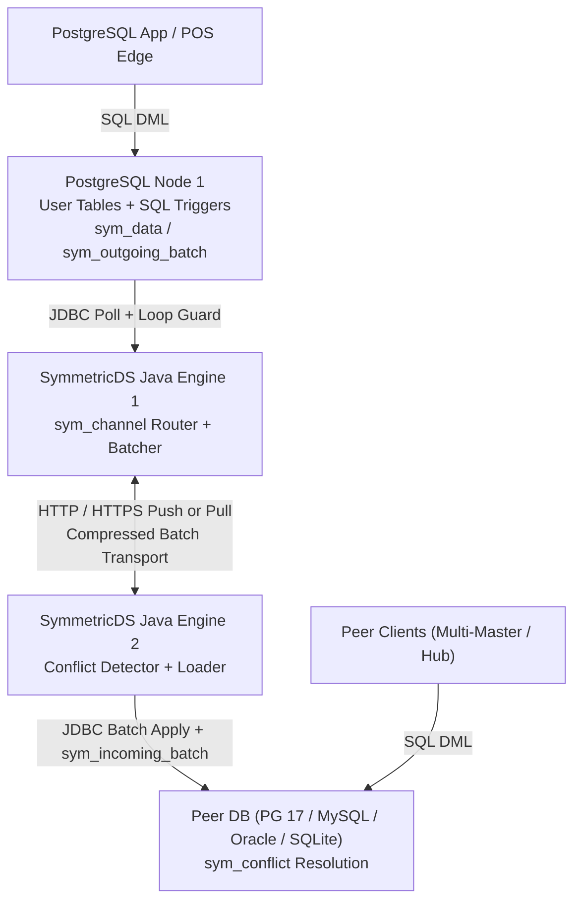

# 10 — SymmetricDS (Heterogeneous Trigger-Based Asynchronous Replication — Architectural Reference)

**Series:** PostgreSQL Multi-Master & Active-Active Architectures  
**Author:** Jean-Marie Renouard (`jmrenouard`) — [LightPath](https://www.lightpath.fr)  
**License:** MIT License

---

| Attribute | Value |
| :--- | :--- |
| **Catalog ID** | `#10` (`SymmetricDS` in `Ch. 01`, `Ch. 03b`, `Ch. 04`, `Ch. 07`) |
| **Benchmark Status** | **Not live-benchmarked (Architectural Reference)** |
| **Family / Tier** | `Family 5 / T4` — Trigger-Based Async Daemon / Heterogeneous Edge Sync (`Niveau 4`) |
| **Versions** | `SymmetricDS 3.x` (Java JVM engine + JDBC drivers; `PostgreSQL 17` compatible) |
| **CAP / PACELC Profile** | `AP / PA-EL` — asynchronous trigger-captured batch shipping over HTTP/HTTPS |
| **License / Deployment** | LGPL / GPLv3 Open Source & Commercial Pro (JumpMind) / External Java nodes + SQL triggers |
| **TDE / Encryption at Rest** | None on PG (`Pro` batch enc.); OS/LUKS on PG + JVM staging & HTTPS mTLS ([Ch. 14](../14_transparent_data_encryption_tde.md)) |

---

## 1. Technology Description & What It Does

**SymmetricDS** is a Java-based asynchronous database replication and synchronization engine designed for **multi-master**, **multi-tier hub-and-spoke**, and **heterogeneous** environments. Rather than decoding PostgreSQL WAL streams, SymmetricDS connects over JDBC and installs SQL capture triggers (`INSERT`/`UPDATE`/`DELETE`) on monitored tables inside each participating database.

Its core strength is **cross-engine portability and offline resilience**. A SymmetricDS node syncs PostgreSQL with MySQL, MariaDB, Oracle, SQL Server, SQLite, or DB2 over HTTP/HTTPS (Push or Pull). It queues compressed batches locally during hours or days of WAN outage without holding PostgreSQL slots open.

---

## 2. Architecture & Data Flow

Each database node pairs a local `SymmetricDS` Java engine with internal metadata tables (`sym_data`, `sym_channel`, `sym_outgoing_batch`, `sym_incoming_batch`, `sym_conflict`), exchanging batches over HTTP/HTTPS:

Loop-prevention guards inside the capture triggers tag incoming SymmetricDS sessions (`source_node_id`) so replicated writes do not re-trigger endless ping-pong cycles.

---

## 3. Operating Principles & Implementation Modes

1. **Trigger Capture, Channels & Batch Transport:** Data changes fire `AFTER` triggers writing CSV-serialized row payloads into `sym_data`. Background routing jobs group events by `sym_channel` into `sym_outgoing_batch` payloads. Nodes transfer these batches over HTTP/HTTPS Push or Pull and track apply status in `sym_incoming_batch`.
2. **Commit Latency Model:**

$$
L_{\text{SymmetricDS-local}} \approx L_{\text{disk}} + L_{\text{trigger}}, \qquad T_{\text{sync-lag}} \approx T_{\text{route}} + T_{\text{batch-HTTP}} + T_{\text{apply}}
$$

3. **Conflict Detection, Resolution, Initial Load & DDL:** `sym_conflict` pairs detection modes (`USE_PK_DATA`, `USE_CHANGED_DATA`, `USE_TIMESTAMP`, `USE_VERSION`) with resolution policies (`FALLBACK`, `NEWER_WINS`, `MANUAL` error quarantine, `IGNORE`), without built-in CRDT delta-apply (`spock.delta_apply`). Initial loads run through `symadmin reload-node`, and DDL changes require explicit `symadmin send-schema` calls.

| Mode / Policy | Scope | Mechanics & Key Strategy | Conflict / Failover Impact | Trade-Off |
| :--- | :--- | :--- | :--- | :--- |
| **Multi-Tier Hub & Edge** *(Push/Pull HTTP)* | Retail POS / Branch -> Central | Offline nodes queue `sym_data` locally; pull/push on reconnect | Zero `pg_replication_slots` WAL bloat during long outages | Batch latency (`seconds`), not sub-ms sync |
| **Bidirectional Multi-Master Mesh** | PG <-> PG or Cross-Engine | Trigger loop guard + stepped seqs / node-offset IDs / UUID | Local commits stay available (`PA/EL`); `RPO > 0` | Vulnerable to Lost Updates without CRDTs |
| **Heterogeneous Cross-DB Sync** | PG <-> MySQL / Oracle / SQLite | Dialect translation & type mapping inside Java loader | Enables zero-downtime cross-engine migrations | Lowest common SQL/type denominator |
| **Conflict Detection (`sym_conflict`)** | `USE_PK_DATA`, `USE_CHANGED_DATA`, `USE_TIMESTAMP`, `USE_VERSION` | Compares PK, changed columns, timestamp, or row version | `USE_CHANGED_DATA` avoids false collisions on disjoint columns | `USE_TIMESTAMP` remains sensitive to NTP skew |
| **Conflict Resolution (`sym_conflict`)** | `FALLBACK`, `NEWER_WINS`, `MANUAL`, `IGNORE` | Overwrites, picks latest timestamp, quarantines, or ignores | `MANUAL` halts batch into `sym_incoming_error` like `23505` | `NEWER_WINS`/`FALLBACK` drops competing `+delta` |
| **Initial Load & DDL (`symadmin`)** | `reload-node` / `send-schema` | Extracts bulk snapshot or pushes XML schema diffs explicitly | Keeps heterogeneous schemas aligned manually | No automatic `ALTER TABLE` trigger sync |

---

## 4. Strengths & Weaknesses

| Strengths | Weaknesses & Operational Traps |
| :--- | :--- |
| **Unmatched Heterogeneous & Offline Edge Support:** Replicates PostgreSQL <-> MySQL, Oracle, SQL Server, and SQLite over firewall-friendly HTTP/HTTPS, surviving multi-day disconnects without WAL slot exhaustion (`L7`). | **Trigger Write Amplification & Lag:** Every `INSERT`/`UPDATE`/`DELETE` writes extra `sym_data` rows (increasing `VACUUM` load) and incurs JVM batch/HTTP sync latency unsuitable for low-latency OLTP. |
| **Flexible Column-Level Conflict Policies:** `USE_CHANGED_DATA` + `USE_VERSION` + `MANUAL` quarantine offer richer per-table conflict tuning than `#1 pg-birep` (`23505` halt) or `#9 Bucardo` (`bucardo_latest`). | **No CRDT Delta-Apply (Lost Updates):** Concurrent arithmetic (`balance = balance + delta`) under `NEWER_WINS` or `FALLBACK` loses updates just like `#9 Bucardo` (`-531,620`) and `#2 pgEdge LWW` (`-278,698`). |
| **Zero WAL Slot & PG Kernel Coupling:** Works across PostgreSQL versions and managed RDS/Cloud instances where `wal_level = logical` or custom C extensions (`Spock`) are restricted. | **JVM Memory Footprint & Ops Overhead:** Requires operating JVM agents (`sym`), `sym_data` purge retention, and manual `symadmin send-schema` DDL orchestration. |
| **100% Node-Local PostgreSQL Extensions:** Preserves full PostgreSQL heap storage, `PostGIS`, `pgvector`, and triggers (with session loop guards) on each PostgreSQL peer. | **Keyless Table & FK Ordering Traps:** Requires PK (`USE_PK_DATA`) for safe updates and careful `sym_channel` table grouping to avoid async FK races (`23503`). |

---

## 5. Architectural Exclusion, Mode Comparison & Reference Baseline

**Why `#10 SymmetricDS` Was Not Live-Benchmarked:** The Docker PoC (`env/multi-db-docker-env/`, `Makefile` `PG_STACKS`) evaluates homogeneous **PostgreSQL 17** active-active and distributed SQL stacks. SymmetricDS targets **heterogeneous cross-engine synchronization** and **intermittent HTTP/HTTPS edge topologies** rather than homogeneous PG 17 OLTP throughput, and lacks a compose module in `env/multi-db-docker-env/`. Zero synthetic TPS or latency figures are invented for `#10` (and 99th-percentile latency is not recorded in `results/`).

Instead, SymmetricDS's Family 5 trigger-daemon physics (`PA/EL`, trigger write amplification, batch polling lag, and LWW lost updates) map cleanly onto the live-benchmarked Family 5 / Tier 4 baselines in `results/benchmark_summary.csv` and `results/extended_functional_matrix.csv`:

| Capability / Baseline | `#10 SymmetricDS` *(Arch. Ref.)* | `#9 Bucardo 5` *(PoC, Trigger Daemon)* | `#2 pgEdge / Spock 5` *(PoC, Logical)* | `#1 pg-birep` *(PoC, Native)* |
| :--- | :--- | :--- | :--- | :--- |
| **Capture & Transport** | SQL triggers (`sym_data`) + Java HTTP/HTTPS | `PL/pgSQL` triggers (`bucardo_delta`) + Perl | `spock_output` WAL logical stream | `pgoutput` WAL (`origin=none`) |
| **Heterogeneous DBs** | **Yes (PG/MySQL/Oracle/MSSQL/SQLite)** | No (PG-to-PG `source:source`) | No (PG-to-PG only) | No (PG-to-PG only) |
| **Offline Outage Impact** | Queues in `sym_data` (**zero WAL bloat**) | Queues in `bucardo_delta` (no WAL bloat) | Retains WAL slot (`309,560 B` in `L7`) | Retains WAL slot (`54,432 B` in `L7`) |
| **CRDT Lost-Update Fix** | None (`NEWER_WINS`/`FALLBACK` loses `+delta`) | None (`-531,620` drift in `D`) | **`spock.delta_apply` (`0` drift, `1,837.64 TPS`)** | None (`-71,063` drift in `D`) |
| **Reference Anchor (`A` / `T15` Lag)** | Not benchmarked (trigger + HTTP batch) | `735.38 TPS` (`A`), `p50=548.74 ms` (`T15`) | `556.06 TPS` (`A`), `p50=1.16 ms` (`T15`) | `875.91 TPS` (`A`), `p50=1.47 ms` (`T15`) |

## 6. GitHub Popularity, Git Presence & Maintenance Vitality (`results/project_popularity.csv`)

Live GitHub telemetry (`2026-11-20T17:26:02Z`, `archived = false` unless `N/A`):

| Project | Git Presence / Role | Repo (`Account / Repos`) | Stars / Forks / Watch | Commits (`Tot / 12m`) | Contrib / Issues | Lang / SPDX | Release / Last Push |
| :--- | :--- | :--- | :---: | :---: | :---: | :--- | :--- |
| **SymmetricDS (#10)** | `Yes` -- `Primary` | [`jumpmindinc/symmetric-ds`](https://github.com/jumpmindinc/symmetric-ds) (`Org / 8`) | 882 / 241 / 59 | 14926 / 425 | 96 / 17 | Java / `N/A` | `3.18.4` / `2026-11-20T16:39:06Z` |

- **Maintenance Level:** **Tier B (Niche)** -- `jumpmindinc/symmetric-ds` records `425` commits/12m (`14,926` total, `96` contributors, `882` stars, `17` open issues).
- **Currency / Freshness:** **Current -- Active** -- Last push `2026-11-20T16:39:06Z`, `425` commits/12m, latest release `3.18.4`.
- **Operational Manageability:** **Moderate** -- Active Java trigger-sync engine (LGPL/GPLv3 dual-licensed, SPDX `N/A`). JVM agents and `sym_data` purge jobs require strict ops.

---

**Navigation:** [Index](../../../README.md) · [Ch. 03b — Distributed, Triggers & Cloud](../03b_solutions_distributed_triggers_cloud.md) · [Ch. 10 — Streaming vs Logical vs Multi-Master](../10_streaming_vs_logical_vs_multimaster.md) · [Version française](../../fr/solutions/symmetricds.md)
