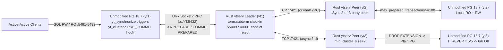

# #18 - YT Cluster & YT Cluster Lite (Unmodified PG + ytserv)

**Series:** PostgreSQL Multi-Master & Active-Active Architectures  
**Author:** Jean-Marie Renouard (`jmrenouard`) - [LightPath](https://www.lightpath.fr)  
**License:** MIT License  
**Language:** [Version française](../../fr/solutions/yt_cluster_lite.md)

---

| Attribute | Value |
| :--- | :--- |
| **Catalog ID** | `#18` (`YT Cluster & YT Cluster Lite` - DBinvent, formerly YaXAHA) |
| **Benchmark Topologies** | `yt-cluster` (default `cc=half`, `sc=NO_SC`), `yt-cluster-async` (`cc=nodes>=0`, `sc=NO_SC`) (`results/benchmark_yt_cluster.csv`, 22 rows) |
| **Engine Version** | `PostgreSQL 18.7 (Debian 18.7-1.pgdg13+5) + yt_cluster 1.21` ([`dbinvent/yt:1.21.3`](https://hub.docker.com/r/dbinvent/yt)) |
| **CAP / PACELC Profile** | `PC/EC` writes (default `cc=half` 2-of-3 sync XA 2PC, `RPO=0`) + `EL` eventual reads (`NO_SC`); `PA/EL` async option (`cc=nodes>=0`) |
| **Mechanism** | Per-table `yt_synchronize` row triggers + `yt_cluster.c` `XACT_EVENT_PRE_COMMIT` hook -> Unix-socket gRPC -> Rust `ytserv` Leader `checkin` + XA `PREPARE`/`COMMIT PREPARED` (`max_prepared_transactions >= 100`) |
| **License Split** | **MIT** embedded core (`DBinvent/yt-cluster-lite`: `ytpgc` extension + Protobuf + single-DB `yt-lite` leaf) vs **PolyForm Noncommercial 1.0.0 / Commercial** closed-source `ytserv` + `ytctl` ([`agent.md`](https://dbinvent.com/agent.md)) |
| **Docker PoC Stack** | `docker-compose-yt-cluster.yml` (3 active-active [`dbinvent/yt:1.21.3`](https://hub.docker.com/r/dbinvent/yt) nodes `yt1`/`yt2`/`yt3`, ports `5491-5493`, `min_cluster_size=2`) |

---

## 1. Overview & Operating Principles (MIT Split, Jepsen Nuance & Reversibility)

**YT Cluster** (DBinvent) turns unmodified PostgreSQL 14-19 instances into an active-active multi-master cluster via a C extension (`yt_cluster`) paired with a local Rust coordinator daemon (`ytserv`). Row-level triggers (`yt_synchronize`) capture old/new row images and stream them over a Unix-domain HTTP/2 gRPC socket (`.s.YT.<port>`) to `ytserv`. At `XACT_EVENT_PRE_COMMIT`, `yt_cluster.c` invokes `yt_complete(true)`: an elected cluster Leader (`term.subterm`) arbitrates global write order and write-time conflicts (`checkin`, rejecting races with `55409` or `40001`), then commits across nodes using PostgreSQL XA two-phase commit (`PREPARE TRANSACTION` / `COMMIT PREPARED`, requiring `max_prepared_transactions >= 100`).

$$
L_{\text{YT-half}} \approx L_{\text{trig}} + \text{RTT}_{\text{leader}} + 2 \cdot L_{\text{2PC-fsync}}, \qquad L_{\text{YT-async}} \approx L_{\text{trig}} + \text{RTT}_{\text{leader}} + L_{\text{disk}}
$$

- **CRITICAL MIT vs Dual-License Split:** `DBinvent/yt-cluster-lite` (**MIT**) is designed to be embedded and connected to a real cluster node: it ships `yt-core-proto`, the `ytpgc` C extension, and `yt-lite` (a single-DB leaf node connecting upstream to `ytserv >= 1.21` over TLS 1.3; rejects multi-DB with `0A000` and **cannot form a standalone peer-to-peer multi-master cluster alone**). Building a real cluster requires the full `ytserv` + `ytctl` image ([`dbinvent/yt:1.21.3`](https://hub.docker.com/r/dbinvent/yt), documented in [`dbinvent.com/agent.md`](https://dbinvent.com/agent.md)), which is closed-source under **PolyForm Noncommercial 1.0.0** (free for labs/evaluation) and **DBinvent Commercial License** and is the exact image deployed by our 3-node Docker PoC.
- **Jepsen Chaos Test Nuance (`https://dbinvent.com/cluster/articles/jepsen`):** **Self-run by DBinvent** (not an independent Jepsen LLC / Kyle Kingsbury audit) on 5-node `1.20.1` (`Jepsen 0.3.14` + Elle), verified against **Elle `cursor-stability` only** (eventually consistent reads allowed, not strict serializability). Initial `1.20.1` failed every run, exposing **51 findings** (**24 severe** incl. dual-leader `#42`, duplicate insert `#1`, surviving failed write `#40`, stuck 2PC locks; **21 warnings**; **6 low**; **0 rated "critical"** under DBinvent's custom rubric). All 51 were reported fixed and retested green (**49/49** passing).
- **Verified `T_REVERT` Reversibility:** Live testing proved `DROP EXTENSION yt_cluster CASCADE;` on `yt3` removed extension and triggers (`ext=0`, `triggers=0`) while preserving `5/5` committed user rows and accepting plain PostgreSQL writes (`6/6`).

---

## 2. Architecture & Data Flow

---

## 3. Implementation Modes

| Mode | CAP / PACELC | Commit / RPO / Conflicts | Scope & Trade-Off |
| :--- | :--- | :--- | :--- |
| **`yt-cluster` (`cc=half`, `NO_SC`)** *(Default PoC)* | `PC/EC` writes / `EL` reads | 2-of-3 sync XA 2PC, **`RPO=0`**, `0` drift (`55409`/`40001` conflict reject) | Strongest default safety, but `20.63 TPS` (`A`), `2.25 TPS` at `25ms` WAN |
| **`yt-cluster-async` (`cc=nodes>=0`, `NO_SC`)** | `PA/EL` async apply | Leader `checkin` + async peer apply (`RPO > 0` risk on crash); `0` drift | `2.0x` (`41.45` `A`) to `5.1x` (`55.03` `B2`) faster; still `4.78 TPS` WAN |
| **`cc=all` + `SC` (`sequential_consistency`)** | Strict `PC/EC` | All-node sync 2PC + sequential read barrier (tested in DBinvent Jepsen) | Highest latency; any single node outage blocks writes |
| **`yt-lite` Leaf (`DBinvent/yt-cluster-lite`)** | Upstream leaf (MIT) | Single-DB TLS 1.3 leaf syncing via `yt_outbox` to `ytserv >= 1.21` | MIT open core, never a leader, no P2P multi-master alone (`0A000` multi-DB) |

---

## 4. Empirical Benchmarks & Verified Limits (`results/benchmark_yt_cluster.csv` & `results/functional_limits_yt_cluster.csv`)

All 36 rows (18 `yt-cluster` + 18 `yt-cluster-async`) ran sequentially at `pg_scale = 2` on 3-node `dbinvent/yt:1.21.3` (`balance_drift = 0` on every write suite; see [`chart_11`](../../../assets/charts/chart_11_yt_cluster_vs_multimaster_log.png) and [Ch. 09](../09_benchmarks_methodology_and_charts.md)). Only `Avg`, `Stddev` (`0` for `sysbench`), and `p95` are recorded (`p99` latency is unmeasured).

| Suite (`PG_SCALE=2`) | `yt-cluster` (`cc=half`) TPS | `cc=half` Avg / p95 (ms) | `cc=half` Retries / Fail | `yt-cluster-async` (`cc=nodes>=0`) TPS | `async` Avg / p95 (ms) |
| :--- | :---: | :---: | :---: | :---: | :---: |
| **`A_single_rw`** (8c/15s) | **20.63** | 384.867 / 1,330.433 | 185 / 0 | **41.45** | 185.733 / 758.357 |
| **`B1_disjoint_rw`** (8c/15s) | 36.14 | 220.597 / 663.403 | 197 / 0 | **88.19** | 90.398 / 252.257 |
| **`B2_overlap_rw`** (8c/15s) | **10.69** | 565.791 / 1,741.838 | 284 (`33`/`251`) / 14 | **55.03** | 130.887 / 538.021 |
| **`C_multinode_ro`** (16c/15s) | **48,787.74** | 0.305 / 0.504 | 0 / 0 | **40,774.49** | 0.367 / 0.682 |
| **`D_hot_conflict`** (8c/12s) | **67.76** (`0` drift) | 117.401 / 249.196 | 32 (`55409`) / 0 | **163.01** (`0` drift) | 48.819 / 152.900 |
| **`E_sysbench_oltp_rw`** (8c/15s) | **28.48** (`582.89 QPS`) | 280.34 / 530.08 | 0 / 12 | **124.05** (`2,519.71 QPS`) | 64.46 / 108.68 (`34` err) |
| **`E2_ro` / `E3_wo`** (8c/12s) | 2,122.68 / 26.43 | 3.76 / 4.33; 301.54 / 846.57 | 0 / 0; 0 / 8 | 2,083.85 / **133.55** | 3.83 / 4.57; 59.77 / 81.48 |
| **`E4_point_select`** (16c/12s) | **165,472.75** | 0.10 / 0.24 | 0 / 0 | **177,442.88** | 0.09 / 0.23 |
| **`H_append_only_insert`** (`uuidv7()`) | **110.53** | 72.217 / 135.582 | 0 / 0 | **224.93** | 35.538 / 60.944 |
| **`F_wan_netem_25ms`** (`10`/`25`/`50ms`) | **2.25** (`4.81`/`2.25`/`1.41`) | 2,708.087 / 5,557.313 | 7 / 0 | **4.78** (`8.47`/`4.78`/`2.90`) | 1,356.434 / 4,136.144 |
| **`G_conc_c1..c32`** (1/4/8/16/32c) | **28.07 -> 4.60** | 35.61 -> 3,542.782 | 0..91 / 0 | **53.94 -> 91.68 -> 44.20** | 18.52 -> 431.504 |

| Verified Probe / Limit | Empirical YT Cluster 1.21.3 Result (`results/functional_limits_yt_cluster.csv`) |
| :--- | :--- |
| **`AA`, `L1` & `T18` Sequences** | `AA` `30/30` (`sum=300`, `0` drift); concurrent `SERIAL` collided (`yt2=55409`, `1:yt1`), `uuidv7()` converged `60/60/60`; `T18` synced seq (`50|true`, `next_id=51`) |
| **`L2` Keyless, `L3` Lost Upd & `L4` Unique** | Keyless DML synced (`1/1/1`, `upd/upd/upd`, `0/0/0`; node-copy needs PK); `L3` blocked `+100/-30` (`55409`), retry converged **`1070.00`** (`0` drift); `L4` rejected duplicate via **`40001`** |
| **`L5` DDL/`SAVEPOINT` & `L6` Features** | `ALTER TABLE` not propagated (`1/0/0`), `TRUNCATE` OK; **`SAVEPOINT` rollback over writes failed on `COMMIT` with `0A000`** (`rows=0`); `advisory_lock`/`LISTEN` local; `TEMP` & `ENUM` OK |
| **`L7` Outage & `L8` Quorum** | `1/3` down (`yt3`): `10/10` writes OK (`yt1+yt2`), catchup `78 ms`; `2/3` down (`min_cluster_size=2`): write blocked (**`57P03`**, `YT-E1852 Not enough working nodes`), clean recovery |
| **`T11` Bulk 10k, `T12` & `T13` FK** | `T11`: **`86 rows/s`** (`115,961 ms`, per-row trigger + 2PC; catchup `yt2=111 ms`, `yt3=12,059 ms`); `T12` `DELETED/DELETED/DELETED`; `T13` `10/10` cross-node FK consistent |
| **`T14-T17` & `T_REVERT` Proof** | `T14` `3/3` `md5=00493e3a`; `T15` `p50=82.14`, `p95=101.29`, `max=104.38 ms`; `T16` `20/20`, **`RPO=0`**, `57P03` during 8s failover (`YT-E1104` stale pidfile risk); `T17` `NO_DIRTY_READ` (`78/79 ms`); **`T_REVERT`**: `DROP EXTENSION` -> `ext=0`, `triggers=0`, `5/5` -> `6/6` plain PG OK |
| **Verified SQLSTATEs** | `0A000` (`SAVEPOINT` rollback), `40001` (`UNIQUE`/conflict), `55000` (async `recon` row quarantine on reused dirty tables), `55409` (YT write-conflict checkin), `57P03` (`YT-E1852` quorum/failover) |

---

## 5. Strengths & Weaknesses

| Strengths | Weaknesses & Operational Traps |
| :--- | :--- |
| **Zero-Drift Active-Active on Unmodified PG:** `0` drift across `A`/`B1`/`B2`/`D`/`L3` (`1070.00`), `T13` `10/10` FK safety, `RPO=0` (`T16`), keyless DML (`L2`), and synced sequences (`T18`). | **Severe 2PC Write Ceiling (`20.6-41.5 TPS`):** Per-row triggers + Leader `checkin` + XA 2PC cap `A` at `20.63 TPS` (`41.45` async), `T11` bulk load at **`86 rows/s`**, and `25ms` WAN at `2.25-4.78 TPS`. |
| **Clean Reversibility (`T_REVERT`):** `DROP EXTENSION yt_cluster CASCADE;` removes extension and triggers with user tables intact (`5/5` -> `6/6` plain PG writes), minimizing data lock-in. | **Closed Coordinator & Bus Factor = 1:** `ytserv`/`ytctl` are closed-source (PolyForm Noncommercial / Commercial); MIT `yt-cluster-lite` has `2` contributors (`vkrinitsyn` 18 commits + bot) and 7-day repo age. |
| **Native Read Speed & PG 18.7 Compatibility:** Local reads bypass 2PC (`48,787.74 TPS` `C`, `165,472.75 TPS` `E4`), keeping standard PG `uuidv7()`, `ENUM`, and `TEMP TABLE` support. | **Operational & Protocol Traps:** `SAVEPOINT` rollback fails (`0A000`), no automatic `ALTER TABLE` DDL sync (`L5`), self-run Jepsen tested `cursor-stability` only, and `YT-E1104` stale pidfile risk after `SIGKILL`. |
| **Explicit Conflict Signaling (`55409`/`40001`):** Rejects conflicting concurrent writes instead of silently overwriting balances or halting logical apply workers. | **App Retry & XA Hygiene Mandatory:** Clients must retry `55409`/`40001` (`284-2,173` retries in `B2`/`D`), tune `max_prepared_transactions >= 100`, and drain `pg_prepared_xacts` before uninstall. |

---

## 6. GitHub Popularity, Git Presence & Maintenance Vitality (`results/project_popularity.csv`)

Live GitHub telemetry (`2026-11-20T17:26:02Z`, `archived = false` unless `N/A`):

| Project | Git Presence / Role | Repo (`Account / Repos`) | Stars / Forks / Watch | Commits (`Tot / 12m`) | Contrib / Issues | Lang / SPDX | Release / Last Push |
| :--- | :--- | :--- | :---: | :---: | :---: | :--- | :--- |
| **YT Cluster Lite (MIT Core) (`#18`)** | `Yes (MIT Core; ytserv dual-licensed)` -- `Primary (MIT leaf/ext; ytserv PolyForm Noncommercial/Commercial)` | [`DBinvent/yt-cluster-lite`](https://github.com/DBinvent/yt-cluster-lite) (`Org / 10`) | 15 / 0 / 1 | 21 / 21 | 2 / 0 | Rust / `MIT` | `v1.21` / `2026-11-20T00:05:13Z` |

- **Maintenance Level:** **Tier C (Fragile / Young)** -- Repo created `2026-11-13` (`15` stars, `0` forks, `21` total / `21` 12m commits, `0` open issues, `2` contributors: single core author `vkrinitsyn` + bot).
- **Currency / Freshness:** **Current -- Young** -- Last push `2026-11-20T00:05:13Z`, `21` commits/12m, latest release `v1.21`.
- **Operational Manageability:** **High Risk** -- Reversible extension install, but closed `ytserv` dual-licensing, bus factor = 1, `20.6-41.5 TPS` write ceiling, and `0A000` savepoint limit restrict production adoption.

---

**Navigation:** [Index](../../../README.md) | [Ch. 03a - Native & Extensions](../03a_solutions_native_and_extensions.md) | [Ch. 11 - Ecosystem Popularity](../11_ecosystem_popularity_and_vitality.md) | [PG 18.6 Native](pg18_native_clustering.md) | [pgEdge Spock](pgedge_spock.md) | [YugabyteDB](yugabytedb.md) | [Version française](../../fr/solutions/yt_cluster_lite.md)
