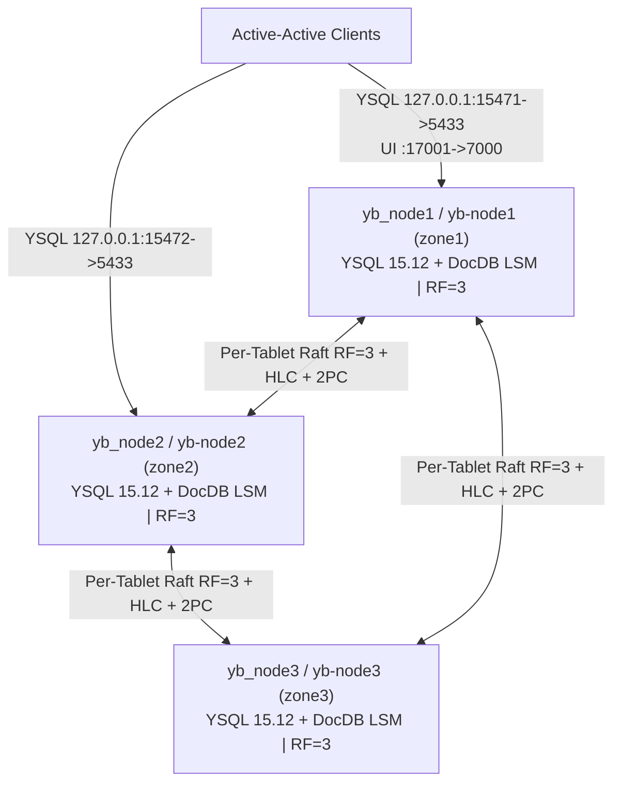

# 5 — YugabyteDB (Distributed SQL: YSQL PG Fork + DocDB Per-Tablet Raft)

**Series:** PostgreSQL Multi-Master & Active-Active Architectures  
**Author:** Jean-Marie Renouard (`jmrenouard`) — [LightPath](https://www.lightpath.fr)  
**License:** MIT License

---

| Attribute | Value |
| :--- | :--- |
| **Catalog ID** | `#5` (`YugabyteDB 2026.1.3 DocDB Raft (#5)` in `results/functional_limits_matrix.csv`) |
| **Benchmark Topology ID** | `yugabyte` (`results/*.csv`) |
| **Family / Tier** | `T5` — Distributed Consensus SQL (`Niveau 5`) |
| **Versions** | `YugabyteDB 2026.1.3.0-b100`, YSQL `15.12-YB-2026.1.3.0-b0` (`PG 15` C fork + C++ `DocDB`) |
| **CAP / PACELC Profile** | `CP / PC-EC` (`3 (RF=3 YSQL)` — per-tablet Raft `RF=3`, HLC bounded) |
| **License / Deployment** | Apache 2.0 (Open Source) / 3 containers (`docker-compose-yugabyte.yml`) |

---

## 1. Technology Description & What It Does

**YugabyteDB** is an open-source distributed SQL engine. It pairs a **forked PostgreSQL 15 C query layer (`YSQL`)** with **DocDB**, a C++ storage engine built on **RocksDB** and per-tablet **Raft** (`RF = 3`). Every node runs `yb-master` and `yb-tserver` processes, allowing any node to accept active-active reads and writes while routing operations to each tablet's Raft leader.

Unlike `#6 CockroachDB` (clean-room Go SQL over `pgwire`), reusing PostgreSQL's C parser, planner, and PL/pgSQL executor preserves triggers, `TEMP TABLE`, `pg_trgm`, `uuid-ossp`, and `pgvector`. Furthermore, YSQL defaults to **`READ COMMITTED` Wait-on-Conflict** pessimistic locking, eliminating `40001` retry storms observed under optimistic `SERIALIZABLE` engines.

---

## 2. Architecture & Data Flow

In `env/multi-db-docker-env/docker-compose-yugabyte.yml`, three `yugabyted` containers (`yb_node1..3`) span zones `zone1..zone3` on `yb_net` with `RF=3`, `yb_num_shards_per_tserver=1`, and `ysql_num_shards_per_tserver=1`:

Multi-writer suites (`B1`–`D`, `H`) drive `yb-node1` and `yb-node2` (`user=yugabyte`) while `yb-node3` votes in Raft quorum. Then `conv_chk` verifies all 3 nodes and `tc netem` delays `yb_node2` and `yb_node3`.

---

## 3. Operating Principles & Implementation Modes

1. **Per-Tablet Raft & HLC Ordering:** Tables shard into tablets replicated with Raft (`RF = 3`). Hybrid Logical Clocks (HLC, `--max_clock_skew_usec` default `500 ms`) order distributed reads/writes without central locking, while cross-tablet mutations execute distributed 2PC intents inside `DocDB`.
2. **Commit Latency Model:**

$$
L_{\text{T5-yb-1tablet}} \approx L_{\text{disk-leader}} + \text{RTT}_{\text{Raft-quorum}}, \qquad L_{\text{T5-yb-2PC}} \approx L_{\text{disk}} + 2 \cdot \text{RTT}_{\text{Raft-quorum}} + \text{HLC}_{\text{wait}}
$$

3. **Isolation, Colocation & Sequences:** Default `READ COMMITTED` uses **Wait-on-Conflict** (`0` `40001` retries in `A`–`H`). `REPEATABLE READ` and `SERIALIZABLE` abort conflicts with `40001` (`L3`). Default sequence `CACHE 100` pre-allocates 100-ID blocks per node (`T18` `next_id=101` on `node2` vs `CACHE 1` `1.89 ms`).

| Mode / Feature | Scope | Mechanics & Key Strategy | Conflict / Failover Impact | Trade-Off |
| :--- | :--- | :--- | :--- | :--- |
| **`READ COMMITTED` Wait-on-Conflict** *(PoC Default)* | `iso=read_committed` (`F1`) | Pessimistic DocDB row lock queue waits for conflicting TX commit | **`0` `40001` retries** (`A`–`H`), `0` drift, `0` failed `E_sysbench_oltp_rw` | Higher tail wait under hot contention vs abort |
| **`REPEATABLE READ` / `SERIALIZABLE`** *(PoC `L3`)* | Explicit `BEGIN ISOLATION LEVEL` | Optimistic SI / SSI checks using HLC and provisional intents | `L3` hits `8x` raw `40001`; converges `bal=1100` after `33` retries | Requires client `40001` retry loop |
| **Hash Sharding vs. Colocation** *(PoC `1` shard/ts)* | `ysql_num_shards_per_tserver=1` | Hash distributes rows (`pgbench_history` `hid BIGSERIAL PK`); colocation groups tables | Colocated single-tablet DML avoids 2PC RPCs (`H` `2,987.24 TPS`) | Cross-tablet TX incurs 2PC intent overhead |
| **Global Sequences** *(`CACHE 100` vs `CACHE 1`)* | `CREATE SEQUENCE` (`L1`/`T18`) | YSQL defaults to `CACHE 100` (`1.98 ms`); `CACHE 1` allocates from master (`1.89 ms`) | Zero `23505` PK collisions (`T18` `node2` allocates `next_id=101`) | `CACHE 100` leaves ID gaps across nodes |
| **xCluster Async DR** *(Arch. — Not in PoC)* | Cross-cluster replication | Asynchronous CDC stream between two independent YugabyteDB universes | Converts inter-DC path to `AP / PA-EL` (survives region loss) | `RPO > 0`; loses cross-region linearizability |
| **Geo-Partitioning** *(Arch. — Not in PoC)* | Row-level tablespaces | Pins partitions/tablets and Raft leaders to specific `cloud.region.zone` | Keeps regional reads/writes low-latency within regulatory zones | Cross-region joins/writes still pay WAN RTT |

---

## 4. Strengths & Weaknesses

| Strengths | Weaknesses & Operational Traps |
| :--- | :--- |
| **Pessimistic `READ COMMITTED` (`0` Retries):** Delivers `4.1x` CockroachDB TPS in `A` (`173.64` vs `42.08`), `0` failed in `E` (`128.24 TPS`), and `0` drift across `A`/`B1`/`B2`/`D`/`H`. | **Severe WAN Consensus Collapse (`Suite F`):** Drops `-96.7%` at `25 ms` (`5.78 TPS`, `p95=3,401.333 ms`) and `3.06 TPS` at `50 ms` (`p95=5,474.705 ms`). |
| **Strong Append, Read & Catch-Up Speed:** Hits `2,987.24 TPS` (`H`), `17,150.58 TPS` (`C`), `11,557.45 TPS` (`E4`), `23,434 rows/s` (`T11`, `417.2 ms`), `T15` `p50=2.01 ms` / `p95=2.83 ms`. | **Heavy RAM Footprint & Saturation (`G_conc`):** Needs `2048m` container cap (`320 MiB` master + `1024 MiB` tserver); `G_conc` peaks `c=8` (`122.98 TPS`) -> `99.49` (`c=32`, `p95=797.971 ms`). |
| **Broad YSQL Extension Parity (`L6`):** `TEMP TABLE`, `pg_trgm`, `uuid-ossp`, `vector`, `pg_try_advisory_lock(42)` (single-node probed), `L5` DDL + `SAVEPOINT`, `T13` FK `10/10`, `L2` keyless OK. | **`LISTEN/NOTIFY` Disabled & `E3`/`RR` Limits:** `LISTEN` fails `0A000`; `REPEATABLE READ` hits `8x` `40001` (`L3`, `33` retries); `E3` recorded `tx_failed=1`. |
| **Zero-RPO Raft Resilience (`L7`/`T16`):** Survives `1/3` node stop (`L7` `bal=500`) and `SIGKILL` (`T16` `20/20` RPO=0, `21/21` post-restart), plus global `23505` (`L4`). | **Majority Quorum Halt (`L8`) & `T18` Cache Gaps:** Losing `2/3` nodes halts YSQL (`connection timeout`); default `CACHE 100` skips to `next_id=101` on `node2` (`T18`). |

---

## 5. Empirical Benchmark Results, Functional Limits & PoC Spec

Ran at `pg_scale = 2` (`retries_40001 = 0` across all benchmark CSVs). Only `Avg`, `Stddev` (`0` for `sysbench`), and `p95` are measured (99th-percentile latency is not recorded in `results/`).

### Table A — Core & Extended Workloads (`benchmark_summary.csv`, `benchmark_extended_workloads.csv`)

| Suite | Cl / Dur | TPS | QPS | Avg / Stddev / p95 (ms) | Committed (Fail) | Drift | Status |
| :--- | :---: | :---: | :---: | :---: | :---: | :---: | :--- |
| `A_single_rw` | 8 / 20s | 173.64 | N/A | 45.881 / 41.181 / 131.768 | 3485 (0) | 0 | `PASS_CONVERGED` |
| `B1_disjoint_rw` | 8 / 20s | 194.75 | N/A | 41.039 / 31.351 / 101.369 | 3895 (0) | 0 | `PASS_CONVERGED` |
| `B2_overlap_rw` | 8 / 20s | 170.19 | N/A | 46.962 / 49.146 / 152.133 | 3407 (0) | 0 | `PASS_CONVERGED` |
| `C_multinode_ro` | 16 / 20s | 17150.58 | N/A | 0.922 / 0.438 / 1.423 | 341974 (0) | 0 | `PASS` |
| `D_hot_conflict` | 8 / 15s | 832.65 | N/A | 9.591 / 7.008 / 15.138 | 12457 (0) | 0 | `PASS_CONVERGED` |
| `E_sysbench_oltp_rw` | 8 / 20s | 128.24 | 2564.8 | 62.25 / 0 / 81.48 | 2574 (0) | 0 | `PASS` |
| `E2_sysbench_oltp_ro` | 8 / 12s | 191.86 | 3069.76 | 41.63 / 0 / 56.84 | 2310 (0) | 0 | `PASS` |
| `E3_sysbench_oltp_wo` | 8 / 12s | 360.02 | 2160.39 | 22.19 / 0 / 33.72 | 4328 (1) | 0 | `PASS` |
| `E4_sysbench_point_select` | 16 / 12s | 11557.45 | 11557.45 | 1.38 / 0 / 2.07 | 138762 (0) | 0 | `PASS` |
| `H_append_only_insert` | 8 / 12s | 2987.24 | N/A | 2.662 / 1.804 / 3.71 | 35624 (0) | 0 | `PASS_CONVERGED` |
| `F_wan_netem_25ms` | 8 / 15s | 5.78 | N/A | 1327.297 / 1114.498 / 3401.333 | 95 (0) | 0 | `PASS_NETEM_25MS` |

### Table B — Concurrency & WAN Latency Sweeps (`benchmark_concurrency_sweep.csv`, `benchmark_wan_sweep.csv`)

| Sweep Suite | Param | TPS | Avg / Stddev / p95 (ms) | Committed | Status |
| :--- | :---: | :---: | :---: | :---: | :--- |
| `G_conc_c1` (8s) | 1 cl | 68.14 | 14.654 / 6.22 / 19.205 | 544 | `PASS` |
| `G_conc_c4` (8s) | 4 cl | 111.55 | 35.792 / 28.844 / 95.447 | 889 | `PASS` |
| `G_conc_c8` (8s) | 8 cl | 122.98 | 64.764 / 59.333 / 182.469 | 985 | `PASS` |
| `G_conc_c16` (8s) | 16 cl | 105.22 | 150.573 / 131.232 / 400.039 | 843 | `PASS` |
| `G_conc_c32` (8s) | 32 cl | 99.49 | 316.73 / 258.259 / 797.971 | 805 | `PASS` |
| `F_wan_netem_10ms` (12s) | 10 ms | 15.38 | 504.823 / 433.067 / 1311.879 | 194 | `PASS_NETEM_10MS` |
| `F_wan_netem_25ms` (15s) | 25 ms | 5.78 | 1327.297 / 1114.498 / 3401.333 | 95 | `PASS_NETEM_25MS` |
| `F_wan_netem_50ms` (12s) | 50 ms | 3.06 | 2380.804 / 1783.389 / 5474.705 | 44 | `PASS_NETEM_50MS` |

### Table C — Functional Limits (`F1`, `L1–L8`) & Extended Probes (`T11–T18`)

| Probe | Observed Empirical Result |
| :--- | :--- |
| `F1` Health | `PASS: PG 15.12-YB-2026.1.3.0 srv=3 rf=3 iso=read_committed` |
| `L1` Serial PK | `PASS: seq cache=1 1.89ms cache=100 1.98ms` |
| `L2` Keyless Table | `PASS: keyless and upfront bigserial PK both work` |
| `L3` Lost Update | `PASS with retry: RR raw hit 8x 40001; retry converged bal=1100 (33 retries)` |
| `L4` Unique Conf. | `PASS: global SQLSTATE 23505 enforced across nodes` |
| `L5` DDL & Savept | `PASS: ALTER TABLE ADD COLUMN visible on node3; tx DDL and SAVEPOINT OK` |
| `L6` PG Features | `PASS: temp adv_lock pg_trgm uuid-ossp vector OK; LISTEN/NOTIFY=ERR(0A000 disabled)` *(advisory lock probed on node1 only)* |
| `L7` Node Outage | `PASS: 1/3 node down survives (RPO=0 bal=500)` |
| `L8` Quorum Loss | `EXPECTED_LIMITATION: 2/3 down lost Raft quorum -> HALTED (connection timeout); recovers` |
| `T11` Bulk 10k | `PASS: 23434 rows/s (427ms); peer_catchup=417.2ms` |
| `T12` Upd vs Del | `PASS: consensus (upd=OK del=OK) nodes=DELETED/DELETED/DELETED` |
| `T13` FK Race | `PASS: 10/10 immediate cross-node child inserts consistent (0 FK errors)` |
| `T14` Rich MD5 | `PASS: 3/3 identical md5=00493e3a (BYTEA=65536B JSONB/NULL/TS/UTF8)` |
| `T15` Vis. Lag | `p50=2.01ms p95=2.83ms max=43.75ms (n=30)` |
| `T16` SIGKILL RPO | `PASS: peer_surv=20/20 RPO=0 peer_write_OK; post_restart=21/21` |
| `T17` Long Open TX | `PASS: NO_DIRTY_READ; side_tx_unblocked(211ms); post_commit_vis=194ms (ok=True)` |
| `T18` Seq Sync (50) | `PASS: global sequence safe on node2 (next_id=101; zero 23505)` |
| **Verified SQLSTATEs** | `L1–L8: 40001;23505;0A000` \| `T11–T18: NONE` |

### Table D — PoC Docker Specification (`env/multi-db-docker-env/`)

| Parameter | PoC Setting / Observation |
| :--- | :--- |
| **Compose & Scripts** | `docker-compose-yugabyte.yml` + `scripts/yugabyte/setup_yugabyte.sh` + `tests/test_yugabyte.sh` |
| **Nodes & Ports** | `yb_node1` (`127.0.0.1:15471:5433`, UI `17001:7000`), `yb_node2` (`15472:5433`), `yb_node3` (`15473:5433`) |
| **Image & Resources** | `yugabytedb/yugabyte:2026.1.3.0-b100`, `mem_limit: 2048m`, master `320 MiB`, tserver `1024 MiB`, bridge `yb_net` |
| **Key Flags & Setup** | `yugabyted start --insecure --fault_tolerance=zone`, `yb_num_shards_per_tserver=1`, `ysql_num_shards_per_tserver=1`, `yb_servers() == 3`, `hid BIGSERIAL PRIMARY KEY` on `pgbench_history`. |

## 6. GitHub Popularity, Git Presence & Maintenance Vitality (`results/project_popularity.csv`)

Live GitHub telemetry (`2026-11-20T17:26:02Z`, `archived = false` unless `N/A`):

| Project | Git Presence / Role | Repo (`Account / Repos`) | Stars / Forks / Watch | Commits (`Tot / 12m`) | Contrib / Issues | Lang / SPDX | Release / Last Push |
| :--- | :--- | :--- | :---: | :---: | :---: | :--- | :--- |
| **YugabyteDB (#5)** | `Yes` -- `Primary` | [`yugabyte/yugabyte-db`](https://github.com/yugabyte/yugabyte-db) (`Org / 314`) | 10670 / 1483 / 222 | 41479 / 5350 | 1217 / 9765 | C / `NOASSERTION` | `v2026.1.3.0` / `2026-11-20T17:22:06Z` |

- **Maintenance Level:** **Tier A (Active OSS)** -- `yugabyte/yugabyte-db` logs `5,350` commits/12m (`41,479` total, `1,217` contributors, `10,670` stars, `9,765` open issues).
- **Currency / Freshness:** **Current -- Daily Active** -- Last push `2026-11-20T17:22:06Z`, `5,350` commits/12m, latest release `v2026.1.3.0`.
- **Operational Manageability:** **Moderate** -- High engineering velocity (Apache 2.0 core, SPDX `NOASSERTION`). A `2 GiB`/node RAM floor and WAN sensitivity remain key ops constraints.

---

**Navigation:** [Index](../../../README.md) · [Ch. 03b — Distributed, Triggers & Cloud](../03b_solutions_distributed_triggers_cloud.md) · [Ch. 10 — Streaming vs Logical vs Multi-Master](../10_streaming_vs_logical_vs_multimaster.md) · [Version française](../../fr/solutions/yugabytedb.md)
