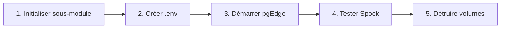

# Tutoriel 01 : Premier Lab PoC Docker (pgEdge Spock)

Initialisez l'environnement local, démarrez deux nœuds pgEdge actif-actif, lancez les tests et nettoyez.



## Prérequis

- Docker Engine, Compose v2, `git`, GNU `make` et ports libres ([Guide des piles](../../../stacks/README.md))

## Étape 1 : Initialiser `.env` et sous-module

```bash
make init-env
cp .env.example .env
make stacks
```

**Résultat attendu :** `make stacks` liste les `13` topologies Compose PostgreSQL.

## Étape 2 : Démarrer et configurer pgEdge

```bash
make up-pgedge
make setup-pgedge
```

**Résultat attendu :** Les deux nœuds PostgreSQL démarrent avec l'extension `spock`.

## Étape 3 : Exécuter les tests

```bash
make test-pgedge
```

**Résultat attendu :** `env/multi-db-docker-env/tests/test_pgedge.sh` réussit avec le code `0`.

## Étape 4 : Nettoyer

```bash
make down-pgedge
```

Passez au [Tutoriel 02 : pgbench & sysbench](02-lab-benchmarks-pgbench-sysbench.md).
