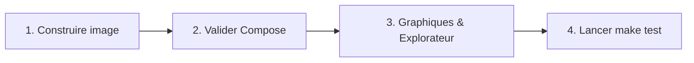

# Tutoriel 02 : Lab Benchmarks pgbench et sysbench

Construisez l'image de benchmark, validez Compose, générez les graphiques Log10 et lancez `make test`.



## Prérequis

- [Tutoriel 01 : Premier Lab PoC Docker](01-premier-lab-poc-docker.md) terminé
- Python `3.10+` (`PyYAML`, `matplotlib`)

## Étape 1 : Construire l'image

Construisez `multi-db-pgbench-sysbench:latest` depuis `scripts/Dockerfile.bench` :

```bash
make build-bench-image
```

**Résultat attendu :** L'image inclut `pgbench`, `sysbench` et `psycopg`.

## Étape 2 : Valider Compose

```bash
docker compose -f env/multi-db-docker-env/docker-compose-pg17-baseline.yml config -q
```

**Résultat attendu :** Code de sortie `0`.

## Étape 3 : Régénérer graphiques et tests

```bash
make charts
make dashboard
make test
```

**Résultat attendu :** `assets/charts/chart_01_tps_log_all_suites.png`..`chart_13_*`, `dashboard/index.html` et `unittest` passent.

Consultez le [Guide 01 : Exécuter les benchmarks](../02-guides-pratiques/01-executer-benchmarks-topologies.md).
