# Synthèse exécutive et taxonomie des architectures PostgreSQL Multi-Maîtres

> **Auteur** : Jean-Marie Renouard (`jmrenouard`) - [LightPath](https://www.lightpath.fr) | **Licence** : MIT

## 1. Synthèse exécutive

PostgreSQL s'impose comme le SGBD relationnel open-source de référence grâce à son extensibilité et son moteur MVCC (*Multi-Version Concurrency Control*). Conçu autour d'un modèle **mono-écrivain** sur journal WAL unique, il excelle en Haute Disponibilité **Primaire-Secondaire** avec Patroni, etcd et HAProxy.

À l'inverse, l'**écriture multi-nœuds** (*Active-Active* ou *Multi-Master*) heurte directement les invariants internes du noyau PostgreSQL. La géo-distribution, l'isolation multi-régions et le sharding butent sur quatre verrous : `XID` 32 bits locaux, `LWLock`, `LSN` unique et séquences locales.

Cette étude évalue **PostgreSQL 16, 17 (`17.11`) et 18.6** aux côtés de **16+ solutions** réparties en **7 familles**. Elle réunit **19 fiches bilingues** et **296 mesures empiriques** (`187` V2, `87` PG 18.6, `22` YT Cluster 1.21.3). Elle compare disponibilité, cohérence, parité PostgreSQL et TCO.

**Saut générationnel PostgreSQL 18.6 (`#17`) :** Mesuré sur `PostgreSQL 18.6 (Debian 18.6-1.pgdg13+2)` ([Fiche #17](solutions/pg18_native_clustering.md) | [Ch. 12](12_clustering_postgresql_18_et_benchmarks.md)), PG 18.6 ajoute **`uuidv7()`** RFC 9562 (`50/50` convergence, `0` `23505`, **`2 066,70 TPS`** = `3,30x` PG 17 `627,13 TPS`). Il inclut **`io_method=worker`** (`-18,5 %` scan froid), **`data_checksums=on`**, **7 compteurs `confl_*`** et `substream=p`. En revanche, `FOR ALL SEQUENCES` lève `SQLSTATE 42601` (PG 19) et le noyau reste sans LWW/CRDT ni Auto-DDL.

> [!IMPORTANT]
> **Thèse centrale de l'étude** : Il n'existe pas de réplication multi-maîtres magique sur PostgreSQL. Toute architecture multi-écrivains choisit explicitement entre **cohérence forte coordonnée par consensus** (soumise à la latence réseau WAN et aux annulations par sérialisation) et **réplication asynchrone optimiste** (exposée aux conflits Write-Write, à la dérive d'horloge et à la perte de mises à jour sans logique CRDT).

---

## 2. Le problème fondamental du WAL mono-écrivain

Dans un nœud PostgreSQL standard, la cohérence ACID repose sur quatre mécanismes strictement locaux à une instance :

1. **Journalisation séquentielle (WAL)** : Chaque modification produit des enregistrements ordonnés par un *Log Sequence Number* (`LSN`) monotone propre à un seul maître.
2. **Visibilité MVCC par `XID`** : Les champs système `xmin` et `xmax` des tuples dépendent d'un gestionnaire de transactions local (`CLOG` / `pg_xact`) et des captures d'instantanés (*snapshots*).
3. **Verrouillage et contraintes en mémoire partagée** : La détection des conflits sur clés primaires (`PK`), index `UNIQUE` et clés étrangères (`FK`) s'effectue dans la mémoire partagée d'une seule instance.
4. **Séquences locales et état de session** : `nextval()`, `pg_advisory_lock()`, `LISTEN/NOTIFY` et les tables temporaires ne traversent pas nativement les frontières d'une instance.

Lorsque deux nœuds acceptent simultanément `INSERT`, `UPDATE` ou `DELETE`, le moteur arbitre deux approches. Il **coordonne chaque validation avant le commit** (Raft/Paxos ou 2PC), ou il **réconcilie a posteriori** par décodage logique ou déclencheurs.

---

## 3. Taxonomie des 7 familles et des 15 solutions étudiées

L'écosystème PostgreSQL et ses dérivés s'organisent en sept familles distinctes, auxquelles s'ajoute une référence de contrôle (*baseline*) mono-primaire :

```mermaid
flowchart TD
    Root["Architectures d'ecriture PostgreSQL (15 solutions)"] --> F1["1. Logique native PG"]
    Root --> F2["2. Extensions multi-maitres"]
    Root --> F3["3. SQL distribue Raft/Paxos"]
    Root --> F4["4. Sharding MPP sur PG"]
    Root --> F5["5. Triggers et daemons externes"]
    Root --> F6["6. Proxy SQL broadcast"]
    Root --> F7["7. Cloud manage et baselines"]

    F1 --> S1["#1 PG 16-18 Bidirectionnel (origin=none)"]
    F2 --> S2["#2 pgEdge / Spock 5 (Open-Source)"]
    F2 --> S3["#3 pglogical 2 (Open-Source)"]
    F2 --> S4["#4 EDB PGD / BDR (Commercial)"]
    F3 --> S5["#5 YugabyteDB (YSQL + DocDB)"]
    F3 --> S6["#6 CockroachDB (PG-wire + Pebble)"]
    F4 --> S7["#7 Citus (Shard + 2PC Reference)"]
    F4 --> S8["#8 OpenTenBase / PG-XL / PG-XC"]
    F5 --> S9["#9 Bucardo 5 (Daemon Perl)"]
    F5 --> S10["#10 SymmetricDS (Agent Java)"]
    F5 --> S14["#14 RubyRep / Slony-I / Londiste"]
    F6 --> S11["#11 PgPool-II (Replication/SI)"]
    F7 --> S12["#12 AWS Aurora Limitless / MM"]
    F7 --> S13["#13 GCP Spanner PG / AlloyDB"]
    F7 --> S15["#15 Baselines PG 17 Standalone & Patroni"]
```

### Tableau récapitulatif des 15 solutions

| # | Solution | Famille | Synchronisation | Modèle de cohérence | Statut / Licence |
| :--- | :--- | :--- | :--- | :--- | :--- |
| **#1** | **PG 16/17/18 natif (`origin=none`)** | Logique native | Asynchrone | Éventuelle (arrêt sur conflit) | Open-Source (PG License) |
| **#2** | **pgEdge Platform / Spock v5** | Extension PG | Asynchrone + CRDT | Éventuelle (LWW / Delta-Apply) | Open-Source (PostgreSQL) |
| **#3** | **pglogical 2** | Extension PG | Asynchrone | Éventuelle (stratégies LWW/Error) | Open-Source (PostgreSQL) |
| **#4** | **EDB Postgres Distributed (PGD)** | Extension PG | Hybride (Async / Raft / CAMO) | Configurable (Éventuelle à Forte) | **Commercial / Propriétaire** |
| **#5** | **YugabyteDB (YSQL)** | SQL distribué | Consensus Raft synchrone | Forte (`Serializable` / `Snapshot`) | Open-Source (Apache 2.0) |
| **#6** | **CockroachDB** | SQL distribué | Consensus Raft synchrone | Forte (`Serializable` par défaut) | BSL / Entreprise |
| **#7** | **Citus** | Sharding MPP | Synchrone par shard / 2PC ref | Forte (mono-shard / 2PC) | Open-Source (AGPLv3) |
| **#8** | **OpenTenBase / PG-XL / PG-XC** | Sharding MPP | 2PC + Global Tx Manager | Forte globale (goulot GTM) | Open-Source (PG-XL gelé) |
| **#9** | **Bucardo 5** | Triggers externes | Asynchrone par lots | Éventuelle (`bucardo_latest`) | Open-Source (BSD) |
| **#10** | **SymmetricDS** | Triggers externes | Asynchrone multi-nœuds | Éventuelle / configurable | Open-Source / Pro |
| **#11** | **PgPool-II (mode Réplication/SI)** | Proxy middleware | Synchrone par diffusion SQL | Snapshot Isolation / Fragile | Open-Source (MIT/BSD) |
| **#12** | **AWS Aurora Limitless (& MM)** | Cloud managé | Shards + horloge distribuée | Forte (Limitless) / Déprécié (MM) | Cloud Propriétaire (AWS) |
| **#13** | **GCP Spanner PG & AlloyDB** | Cloud managé | Paxos + TrueTime (Spanner) | Cohérence externe (Spanner) | Cloud Propriétaire (GCP) |
| **#14** | **RubyRep / Slony-I / Londiste** | Triggers historiques | Asynchrone triggers | Éventuelle / Mono-maître historique | Open-Source (historique) |
| **#15** | **PG 17 Standalone & Patroni HA** | Baseline contrôle | Mono-primaire WAL physique | Forte ACID (1 écrivain) | Open-Source |
| **#17** | **[Clustering Natif PostgreSQL 18.6](solutions/pg18_native_clustering.md)** | Logique native & HA | AIO `worker`, `uuidv7()`, 7 `confl_*`, `substream=p` | `PA/EL` (Log/Async) ou `PC/EC` (Sync) | Open-Source (PG License) |
| **#18** | **[YT Cluster / YT Cluster Lite](solutions/yt_cluster_lite.md)** | Extension / 2PC | Triggers PG 18 + daemon Rust `ytserv` XA 2PC (`cc=half`) | `CP`-écritures / `EL`-lectures (dérive `0`) | Cœur MIT + `ytserv` PolyForm/Commercial |

---

## 4. Guide de lecture de la série documentaire

Pour exploiter cette étude selon votre rôle (architecte, DBA, SRE ou décideur technique), les chapitres s'enchaînent de la théorie vers la validation reproductible :

1. **[Chapitre 01 — Synthèse exécutive et taxonomie](01_synthese_et_taxonomie.md)** *(ce document)* : Problématique du WAL unique et carte des 7 familles.
2. **[Chapitre 02 — Fondements théoriques (CAP, PACELC, conflits)](02_fondements_theoriques_cap_pacelc_conflits.md)** : Modèles CAP/PACELC, anatomie des 4 classes de conflits et équations de latence WAN, dérive d'horloge et collisions.
3. **[Chapitre 03a — Catalogue natif et extensions](03a_catalogue_natif_et_extensions.md)** : Monographies détaillées des solutions proches du noyau PostgreSQL (`#1` à `#4`, `#15` et `#16`).
4. **[Chapitre 03b — Catalogue SQL distribué, triggers et Cloud](03b_catalogue_distribue_triggers_cloud.md)** : Monographies des moteurs SQL distribués, du sharding MPP, des systèmes à triggers, des proxys et des offres cloud (`#5` à `#14`).
5. **[Chapitre 04 — Étude comparative fonctionnelle](04_etude_comparative_fonctionnalites.md)** : Matrices comparatives exhaustives sur 36 critères couvrant les 15 solutions.
6. **[Chapitre 05 — Architectures PoC et protocole de test](05_architectures_poc_et_protocole_de_test.md)** : Protocole de test transparent en laboratoire Docker WSL2, tests fonctionnels (10 points), sondes de limites (8 points), suites `pgbench`/`sysbench` et limites de validité.
7. **[Chapitre 06 — Résultats empiriques](06_resultats_tests_et_benchmarks.md)** et **[Chapitre 08 — Limites et modes de défaillance](08_limites_et_modes_de_defaillance.md)** : Résultats mesurés des PoCs reproductibles (`Suites A–F`), sondes `L1–L8` / `T11–T18` et codes `SQLSTATE` capturés.
8. **[Chapitre 07 — Guide de choix et architecture cible](07_guide_de_choix_et_architecture_cible.md)** : Arbre de décision, matrice cas d'usage, anti-patterns critiques, dimensionnement, PITR et migration.
9. **[Chapitre 09 — Méthodologie benchmarks et graphiques](09_methodologie_benchmarks_et_graphiques.md)** et **[Chapitre 10 — Streaming vs Logique vs Multi-Maîtres](10_comparatif_streaming_logique_multimaster.md)** : Balayages V2 (`187` lignes `results/*.csv`), graphiques `log10`, spectre `N1–N5` (`#16` `pg17-logical`) et fiches dédiées `solutions/`.
10. **[Chapitre 11 — Popularité et vitalité](11_popularite_et_vitalite_ecosysteme.md)** et **[Chapitre 12 — Clustering PostgreSQL 18.6](12_clustering_postgresql_18_et_benchmarks.md)** : Télémétrie GitHub API (`21` entrées), évolution PG 16->17->18.6, AIO `worker`, `uuidv7()`, 7 `confl_*`, `87` mesures PG 18.6 et [Fiche #17](solutions/pg18_native_clustering.md).

---

## 5. Avertissement méthodologique

Aucune architecture ne supprime gratuitement les lois de la physique réseau : la vitesse de la lumière dans la fibre impose environ 5 ms par tranche de 1 000 km aller simple. Un consensus synchrone intercontinental subit donc toujours la latence RTT (*Round-Trip Time*). À l'inverse, la réplication logique asynchrone offre une faible latence locale contre un RPO non nul et des conflits d'écriture.
