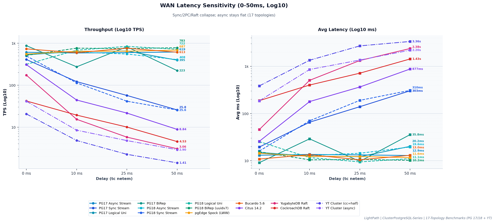
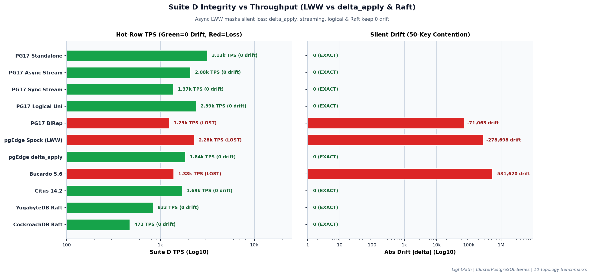

# Résultats empiriques des tests et benchmarks comparatifs

> **Auteur** : Jean-Marie Renouard (`jmrenouard`) - [LightPath](https://www.lightpath.fr) | **Licence** : MIT

Ce chapitre rapporte les mesures empiriques collectées séquentiellement dans notre laboratoire Docker WSL2 (20 vCPU, 16,4 Go RAM) à échelle uniforme (`PG_SCALE = 2`, soit $200\,000$ lignes `pgbench_accounts`, clé primaire artificielle `hid` sur `pgbench_history`). Les jeux de données complets sont archivés dans `results/benchmark_summary.csv`, `results/benchmark_summary_part1.json` et `results/benchmark_summary_part2.json`.

---

## 1. Synthèse des suites TPC-B (`pgbench` A, B1, B2, C)

Les quatre premières suites comparent le débit nominal sur un nœud (`A`), l'écriture multi-nœuds sur plages disjointes (`B1`), l'écriture multi-nœuds avec chevauchement complet (`B2`) et la lecture pure (`C`, 16 clients).

| Topologie | A : Single RW (TPS / lat) | B1 : Disjoint RW (TPS / lat) | B2 : Overlap RW (TPS / lat) | Dérive B2 (`balance_drift`) | C : Read-Only 16c (TPS / lat) |
|:---|---:|---:|---:|---:|---:|
| **`pg17-standalone`** | 866,82 / 9,22 ms | 920,07 / 8,68 ms | 879,01 / 9,09 ms | **0** (Mono) | 55 614,16 / 0,26 ms |
| **`pg17-async-streaming`** | 610,15 / 13,09 ms | 627,39 / 12,73 ms | 584,80 / 13,66 ms | **0** (Async) | 45 358,52 / 0,33 ms |
| **`pg17-sync-streaming`** | 409,48 / 19,52 ms | 407,41 / 19,61 ms | 465,22 / 17,17 ms | **0** (Sync) | 54 483,07 / 0,27 ms |
| **`pg17-logical`** | 532,38 / 14,99 ms | 251,63 / 31,75 ms | 355,57 / 22,48 ms | **0** (Logique) | 42 302,43 / 0,35 ms |
| **`pg-birep` (`#1`)** | 875,91 / 9,12 ms | 820,09 / 9,74 ms | 1 228,60 / 6,50 ms | **-4 567 (Diverge)** | 53 072,52 / 0,28 ms |
| **`pgedge` LWW (`#2`)** | 556,06 / 14,37 ms | 346,95 / 23,03 ms | 818,65 / 9,76 ms | **-66 328 (Lost Upd.)** | 54 124,99 / 0,27 ms |
| **`bucardo` (`#9`)** | 735,38 / 10,86 ms | 1 078,90 / 7,40 ms | 1 267,77 / 6,30 ms | **+123 679 (Lost Upd.)** | 53 731,92 / 0,27 ms |
| **`citus` (`#7`)** | 309,04 / 25,85 ms | 265,29 / 30,12 ms | 312,98 / 25,53 ms | **0** (Converge) | 21 324,70 / 0,72 ms |
| **`yugabyte` (`#5`)** | 173,64 / 45,88 ms | 194,75 / 41,04 ms | 170,19 / 46,96 ms | **0** (Converge) | 17 150,58 / 0,92 ms |
| **`cockroach` (`#6`)** | 42,08 / 187,60 ms | 60,35 / 132,32 ms | 74,17 / 106,44 ms | **0** (96 retries `40001`) | 13 185,54 / 1,20 ms |

### Enseignements majeurs des suites A à C
1. **L'illusion de la vitesse en asynchrone sous chevauchement (`B2`)** : `bucardo` (1 267,77 TPS) et `pg-birep` (1 228,60 TPS) affichent les débits bruts les plus élevés sur `B2`, car chaque nœud acquitte localement sans coordination. Mais le bilan comptable révèle l'ampleur de la corruption : `bucardo` perd/fausse le solde global de `+123 679` (`acc=786206` vs `exp_delta=662527`), `pgedge` LWW de `-66 328` (`-144853` vs `-78525`), et `pg-birep` laisse les deux nœuds diverger durablement (`node1=-193944` vs `node2=-208996`, `branches=-27614` vs `-19115`).
2. **Convergence parfaite des systèmes à coordination** : `pg17-sync-streaming`, `citus`, `yugabyte` et `cockroach` maintiennent une dérive **rigoureusement nulle (`0`)**. Sous CockroachDB (`SERIALIZABLE`), `pgbench` absorbe 44 (`A`), 87 (`B1`) et 96 (`B2`) ré-essais `SQLSTATE 40001`.
3. **Coût de la réplication synchrone physique (`pg17-sync-streaming`)** : La garantie `RPO = 0` intra-hôte divise le débit d'écriture par deux par rapport au nœud standalone (409,48 vs 866,82 TPS en Suite A), tout en conservant 54 483 TPS en lecture seule (`C`).

---

## 2. Suite D : Contention sur ligne chaude et validation de `spock.delta_apply`

La Suite D concentre 8 clients concurrents sur 50 comptes chauds (`aid = random(1, 50)`) durant 15 s (`+1..100` par transaction), maximisant la probabilité de collisions simultanées sur un même tuple.

| Topologie | TPS | Lat. moy. (ms) | p95 (ms) | Tx validées | Attendu (`exp_delta`) | Observé (`abalance`) | Dérive (`drift`) | Statut |
|:---|---:|---:|---:|---:|---:|---:|---:|:---|
| **`pg17-standalone`** | 3 128,63 | 2,541 | 3,946 | 46 888 | 2 362 664 | 2 362 664 | **0** | `PASS_SINGLE_PRIMARY` |
| **`pg17-logical`** | 2 386,93 | 3,327 | 5,468 | 35 747 | 1 808 364 | 1 808 364 | **0** | `PASS_SINGLE_PRIMARY` |
| **`pg17-async-streaming`** | 2 081,26 | 3,820 | 6,117 | 31 189 | 1 578 778 | 1 578 778 | **0** | `PASS_SINGLE_PRIMARY` |
| **`pgedge` (LWW défaut)** | 2 280,11 | 3,492 | 5,311 | 34 175 | 1 737 102 | 1 458 404 | **-278 698** | `LOST_UPDATE` (-16,0 %) |
| **`pgedge-delta-apply`** | **1 837,64** | 4,336 | 9,347 | 27 545 | **1 391 780** | **1 391 780 (x3)** | **0** | **`PASS_CONVERGED`** |
| **`citus`** | 1 691,45 | 4,716 | 6,722 | 25 354 | 1 283 370 | 1 283 370 | **0** | `PASS_CONVERGED` |
| **`bucardo`** | 1 378,79 | 5,794 | 8,033 | 20 671 | 1 046 798 | 515 178 | **-531 620** | `LOST_UPDATE` (-50,8 %) |
| **`pg17-sync-streaming`** | 1 370,10 | 5,827 | 8,725 | 20 541 | 1 035 721 | 1 035 721 | **0** | `PASS_SINGLE_PRIMARY` |
| **`pg-birep`** | 1 231,15 | 6,476 | 13,007 | 18 469 | 922 873 | n1=851810 / n2=851747 | **-71 063** | `DIVERGED` |
| **`yugabyte`** | 832,65 | 9,591 | 15,138 | 12 457 | 624 295 | 624 295 | **0** | `PASS_CONVERGED` |
| **`cockroach`** | 471,61 | 16,913 | 34,165 | 7 091 | 359 402 | 359 402 | **0** | `PASS_CONVERGED` |

### Preuve empirique du Delta-Apply CRDT
Sous LWW standard, `bucardo_latest` perd **50,8 %** des incréments (`-531 620` sur `1 046 798`), `pgedge` LWW perd **16,0 %** (`-278 698`), et `pg-birep` laisse les deux nœuds dans des états incohérents (`851 810` vs `851 747`). En activant `log_old_value = true` et `delta_apply_function = spock.delta_apply` sur `pgbench_accounts.abalance`, **`pgedge-delta-apply` maintient 1 837,64 TPS (-19,4 % vs LWW) avec une dérive exactement égale à `0`** sur l'ensemble des 3 nœuds (`1 391 780` identique partout).

---

## 3. Suite E (`sysbench`) et Suite F (`tc netem 25ms` simulé WAN)

La Suite E évalue un profil OLTP multi-requêtes (`sysbench oltp_read_write`, 4 tables $\times$ 10 000 lignes, 8 threads, 20 s), tandis que la Suite F injecte une latence réseau artificielle unidirectionnelle de **25 ms** via `tc qdisc replace dev eth0 root netem delay 25ms` sur les pairs répliqués (soit ~50 ms RTT effectif sur les liens inter-nœuds).

| Topologie | E : `sysbench` TPS | E : `sysbench` QPS | E : Lat. avg / p95 | E : Erreurs ignorées | F : TPS sous `netem 25ms` | F : Lat. avg / p95 (`netem`) | Ratio F / A |
|:---|---:|---:|---:|---:|---:|---:|---:|
| **`pg17-standalone`** | 1 129,51 | 22 687,48 | 7,05 / 7,56 ms | 112 | N/A | N/A | N/A |
| **`pg17-async-streaming`** | 962,84 | 19 353,12 | 8,30 / 10,27 ms | 107 | **599,61** | 13,32 / 34,38 ms | -1,7 % |
| **`pg17-sync-streaming`** | 819,36 | 16 493,23 | 9,76 / 11,65 ms | 118 | **57,00** | 139,56 / 353,49 ms | **-86,1 %** |
| **`pg17-logical`** | 595,81 | 11 974,58 | 13,42 / 23,95 ms | 65 | **654,11** | 12,21 / 30,58 ms | +22,9 % |
| **`pg-birep` (`#1`)** | 1 105,32 | 22 192,83 | 7,23 / 10,84 ms | 96 | **824,04** | 9,69 / 24,95 ms | -5,9 % |
| **`pgedge` (`#2`)** | 888,56 | 17 873,46 | 8,99 / 15,27 ms | 114 | **646,77** | 12,32 / 32,40 ms | +16,3 % |
| **`bucardo` (`#9`)** | 1 232,84 | 24 757,64 | 6,48 / 7,70 ms | 112 | **763,23** | 10,47 / 27,26 ms | +3,8 % |
| **`citus` (`#7`)** | 189,44 | 3 796,81 | 42,17 / 50,11 ms | 9 | **21,67** | 364,81 / 633,96 ms | **-93,0 %** |
| **`yugabyte` (`#5`)** | 128,24 | 2 564,80 | 62,25 / 81,48 ms | 0 | **5,78** | 1 327,30 / 3 401,33 ms | **-96,7 %** |
| **`cockroach` (`#6`)** | 44,84 | 1 531,47 | 177,91 / 502,20 ms | **685** | **10,06** | 715,77 / 2 930,54 ms | **-76,1 %** (14 retries) |

### Analyse de l'effondrement WAN et du comportement `sysbench`
1. **Validation physique de l'équation de latence WAN (`Suite F`)** : L'ajout de 25 ms sur le réseau des pairs fait s'effondrer toute architecture **PC/EC** : `yugabyte` passe de 173,64 à **5,78 TPS** (-96,7 %, p95 à **3,40 s**), `cockroach` à **10,06 TPS** (p95 à **2,93 s**), `citus` à **21,67 TPS** (p95 à **633,96 ms** par cumul d'allers-retours coordinateur $\leftrightarrow$ workers), et `pg17-sync-streaming` à **57,00 TPS**. À l'opposé, les architectures **PA/EL** (`pg-birep` 824,04 TPS, `bucardo` 763,23 TPS, `pgedge` 646,77 TPS) conservent une latence locale quasi constante autour de 10 ms.
2. **Piège `sysbench` sous `SERIALIZABLE` (`Suite E`)** : Alors que `pgbench --max-tries=100` gère nativement les ré-essais `40001` sur CockroachDB, `sysbench oltp_read_write` ne ré-essaie pas les conflits de sérialisation et comptabilise **685 erreurs ignorées** (`tx_failed`), expliquant son débit réduit à 44,84 TPS (et 502,20 ms au p95). Sous `yugabyte` (`read_committed` activé dans l'image `2026.1.3.0`), le mode *Wait-on-Conflict* absorbe la charge avec **0 erreur**, au prix d'une latence moyenne de 62,25 ms.
3. **Surcharge de coordination sur transactions multi-requêtes** : Sur `citus`, une transaction TPC-B modifiant `accounts`, `tellers` et `branches` touche potentiellement plusieurs workers, générant un coût d'orchestration qui limite le débit local à 309,04 TPS (`A`) et 189,44 TPS (`E`), contre 866,82 TPS (`A`) en PostgreSQL standalone.

---

## 4. Synthèse visuelle : Débit local vs WAN vs Intégrité comptable

- **Zone à risque silencieux** (`#1`, `#2 LWW`, `#9`) : Débit local élevé et insensibilité au RTT WAN, mais **dérive financière garantie** dès que deux nœuds écrivent sur des clés communes.
- **Compromis applicatif ciblé** (`#2 Spock Delta-Apply`) : Préserve les performances asynchrones locales tout en garantissant une dérive nulle sur les compteurs CRDT, sans offrir de cohérence globale sur les clés étrangères ou index `UNIQUE`.
- **Zone ACID distribuée** (`#5`, `#6`, `#7`, `#15 sync`) : Intégrité comptable stricte (`balance_drift = 0`), mais soumission directe aux lois de la latence RTT inter-nœuds et obligation d'implémenter le retry `40001` pour les moteurs optimistes/sérialisables.

---

## 5. Balayages étendus V2 (`E2–E4`, `H`, WAN `10/25/50 ms`, `c=1..32`) et Graphiques Log10

Les 187 mesures sur 10 topologies (`benchmark_extended_workloads.csv`, `benchmark_wan_sweep.csv`, `benchmark_concurrency_sweep.csv`) confirment ces tendances (méthodologie au [Chapitre 09](09_methodologie_benchmarks_et_graphiques.md) ; comparatif 5 niveaux au [Chapitre 10](10_comparatif_streaming_logique_multimaster.md) ; explorateur interactif [**`dashboard/index.html`**](../../dashboard/index.html)) :

- **`sysbench` étendu (`E2–E4`) et `H_append_only` :** Les piles PG natives atteignent `1 659–1 806 TPS` (`E2` RO), `801–1 784 TPS` (`E3` WO ; `pg17-sync` chute à `370,71`) et `124 105–148 022 TPS` (`E4` point-select) contre `180–522` (`E2`), `119–563` (`E3`) et `11 557–19 831 TPS` (`E4`) en moteurs distribués. L'append-only (`H`) brille sur `yugabyte` (`2 987,24 TPS`) et `pgedge` (`2 206,60`) près de `standalone` (`3 108,22`).
- **Balayage WAN (`10 -> 25 -> 50 ms`) :** Les piles asynchrones restent stables (`pg17-async` `587->600->619`, `pgedge` `645->647->687`, `bucardo` `593->763->613 TPS`), tandis que les moteurs `PC/EC` décrochent (`pg17-sync` `121,8->57,0->25,8`, `citus` `44,4->21,7->8,8`, `cockroach` `19,4->10,1->4,5`, `yugabyte` `15,4->5,8->3,1 TPS`, `p95 = 5 474,7 ms`).
- **Concurrence (`c = 1..32`) :** `standalone` grimpe de `298` à `801 TPS` ; `pg17-sync` sature à `425 TPS` ; `cockroach` culmine à `c = 4` (`74,11 TPS`) puis recule à `40,25 TPS` (`88` retries, `p95 = 3 400 ms`) à `c = 32`.

