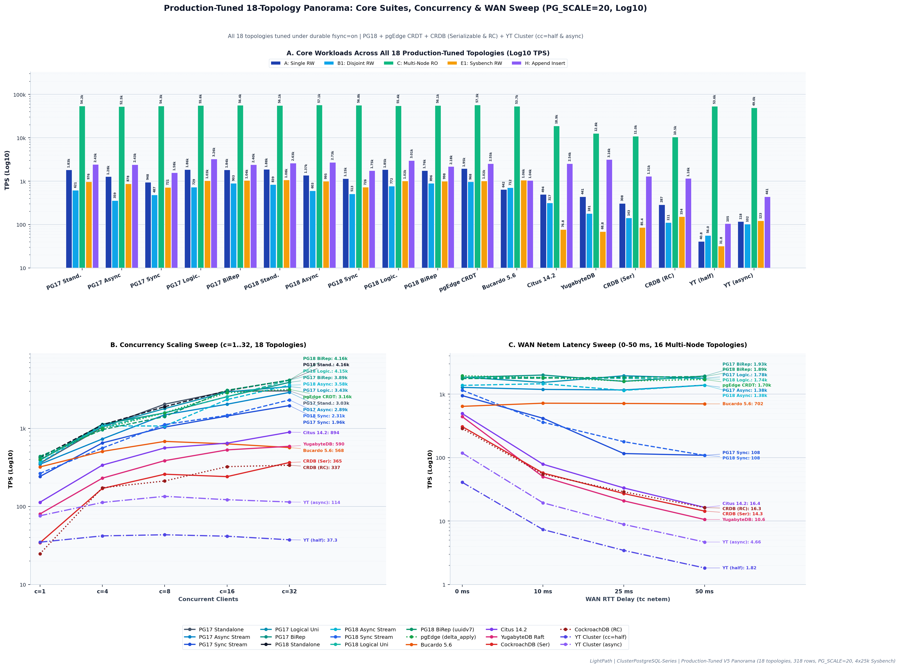

# Résultats empiriques des tests et benchmarks comparatifs

> **Auteur** : Jean-Marie Renouard (`jmrenouard`) - [LightPath](https://www.lightpath.fr) | **Licence** : MIT

Ce chapitre rapporte les mesures empiriques collectées séquentiellement dans notre laboratoire Docker WSL2 (20 vCPU, 16,4 Go RAM) à échelle uniforme (`PG_SCALE = 2`, soit $200\,000$ lignes `pgbench_accounts`, clé primaire artificielle `hid` sur `pgbench_history`). Les jeux de données complets sont archivés dans `results/benchmark_summary.csv`, `results/benchmark_summary_part1.json` et `results/benchmark_summary_part2.json`.

---

## 1. Synthèse des suites TPC-B (`pgbench` A, B1, B2, C)

Les quatre premières suites comparent le débit sur un nœud (`A`), l'écriture disjointe (`B1`) et l'écriture chevauchante (`B2`). La Suite `C` mesure la lecture pure (`16` clients).

| Topologie | A : Single RW (TPS / lat) | B1 : Disjoint RW (TPS / lat) | B2 : Overlap RW (TPS / lat) | Dérive B2 (`balance_drift`) | C : Read-Only 16c (TPS / lat) |
|:---|---:|---:|---:|---:|---:|
| **`pg17-standalone`** | 866,82 / 9,22 ms | 920,07 / 8,68 ms | 879,01 / 9,09 ms | **0** (Mono) | 55 614,16 / 0,26 ms |
| **`pg17-async-streaming`** | 610,15 / 13,09 ms | 627,39 / 12,73 ms | 584,80 / 13,66 ms | **0** (Async) | 45 358,52 / 0,33 ms |
| **`pg17-sync-streaming`** | 409,48 / 19,52 ms | 407,41 / 19,61 ms | 465,22 / 17,17 ms | **0** (Sync) | 54 483,07 / 0,27 ms |
| **`pg17-logical` (`#16`)** | 532,38 / 14,99 ms | 251,63 / 31,75 ms | 355,57 / 22,48 ms | **0** (Logique) | 42 302,43 / 0,35 ms |
| **`pg-birep` (`#1`)** | 875,91 / 9,12 ms | 820,09 / 9,74 ms | 1 228,60 / 6,50 ms | **-4 567 (Diverge)** | 53 072,52 / 0,28 ms |
| **`pgedge` LWW (`#2`)** | 556,06 / 14,37 ms | 346,95 / 23,03 ms | 818,65 / 9,76 ms | **-66 328 (Lost Upd.)** | 54 124,99 / 0,27 ms |
| **`bucardo` (`#9`)** | 735,38 / 10,86 ms | 1 078,90 / 7,40 ms | 1 267,77 / 6,30 ms | **+123 679 (Lost Upd.)** | 53 731,92 / 0,27 ms |
| **`citus` (`#7`)** | 309,04 / 25,85 ms | 265,29 / 30,12 ms | 312,98 / 25,53 ms | **0** (Converge) | 21 324,70 / 0,72 ms |
| **`yugabyte` (`#5`)** | 173,64 / 45,88 ms | 194,75 / 41,04 ms | 170,19 / 46,96 ms | **0** (Converge) | 17 150,58 / 0,92 ms |
| **`cockroach` (`#6`)** | 42,08 / 187,60 ms | 60,35 / 132,32 ms | 74,17 / 106,44 ms | **0** (96 retries `40001`) | 13 185,54 / 1,20 ms |

*Désambiguïsation des ID : `#16` (`N3`) désigne `pg17-logical` (le fichier historique `results/functional_limits_matrix.csv` mentionne `#14 Baseline`), tandis que `#14` est réservé aux systèmes historiques à triggers (`Slony-I / Londiste / RubyRep`).*

### Enseignements majeurs des suites A à C
1. **L'illusion de la vitesse en asynchrone sous chevauchement (`B2`)** : `bucardo` (1 267,77 TPS) et `pg-birep` (1 228,60 TPS) affichent les débits bruts les plus élevés sur `B2`, car chaque nœud acquitte localement sans coordination. Mais le bilan comptable révèle l'ampleur de la corruption : `bucardo` perd/fausse le solde global de `+123 679` (`acc=786206` vs `exp_delta=662527`), `pgedge` LWW de `-66 328` (`-144853` vs `-78525`), et `pg-birep` laisse les deux nœuds diverger durablement (`node1=-193944` vs `node2=-208996`, `branches=-27614` vs `-19115`).
2. **Convergence parfaite des systèmes à coordination** : `pg17-sync-streaming`, `citus`, `yugabyte` et `cockroach` maintiennent une dérive **rigoureusement nulle (`0`)**. Sous CockroachDB (`SERIALIZABLE`), `pgbench` absorbe 44 (`A`), 87 (`B1`) et 96 (`B2`) ré-essais `SQLSTATE 40001`.
3. **Coût de la réplication synchrone physique (`pg17-sync-streaming`)** : La garantie `RPO = 0` divise le débit d'écriture par deux (409,48 vs 866,82 TPS en Suite A). Le standby garde 54 483 TPS en lecture seule (`C`).

---

## 2. Suite D : Contention sur ligne chaude et validation de `spock.delta_apply`

La Suite D concentre 8 clients concurrents sur 50 comptes chauds (`aid = random(1, 50)`) durant 15 s (`+1..100` par transaction), maximisant la probabilité de collisions simultanées sur un même tuple.

| Topologie | TPS | Lat. moy. (ms) | p95 (ms) | Tx validées | Attendu (`exp_delta`) | Observé (`abalance`) | Dérive (`drift`) | Statut |
|:---|---:|---:|---:|---:|---:|---:|---:|:---|
| **`pg17-standalone`** | 3 128,63 | 2,541 | 3,946 | 46 888 | 2 362 664 | 2 362 664 | **0** | `PASS_SINGLE_PRIMARY` |
| **`pg17-logical`** | 2 386,93 | 3,327 | 5,468 | 35 747 | 1 808 364 | 1 808 364 | **0** | `PASS_SINGLE_PRIMARY` |
| **`pg17-async-streaming`** | 2 081,26 | 3,820 | 6,117 | 31 189 | 1 578 778 | 1 578 778 | **0** | `PASS_SINGLE_PRIMARY` |
| **`pgedge` (LWW défaut)** | 2 280,11 | 3,492 | 5,311 | 34 175 | 1 737 102 | 1 458 404 | **-278 698** | `LOST_UPDATE` (-16,0 %) |
| **`pgedge-delta-apply`** | **1 837,64** | 4,336 | 9,347 | 27 545 | **1 391 780** | **1 391 780 (x3)** | **0** | **`PASS_CONVERGED`** |
| **`citus`** | 1 691,45 | 4,716 | 6,722 | 25 354 | 1 283 370 | 1 283 370 | **0** | `PASS_CONVERGED` |
| **`bucardo`** | 1 378,79 | 5,794 | 8,033 | 20 671 | 1 046 798 | 515 178 | **-531 620** | `LOST_UPDATE` (-50,8 %) |
| **`pg17-sync-streaming`** | 1 370,10 | 5,827 | 8,725 | 20 541 | 1 035 721 | 1 035 721 | **0** | `PASS_SINGLE_PRIMARY` |
| **`pg-birep`** | 1 231,15 | 6,476 | 13,007 | 18 469 | 922 873 | n1=851810 / n2=851747 | **-71 063** | `DIVERGED` |
| **`yugabyte`** | 832,65 | 9,591 | 15,138 | 12 457 | 624 295 | 624 295 | **0** | `PASS_CONVERGED` |
| **`cockroach`** | 471,61 | 16,913 | 34,165 | 7 091 | 359 402 | 359 402 | **0** | `PASS_CONVERGED` |

### Preuve empirique du Delta-Apply CRDT
Sous LWW standard, `bucardo_latest` perd **50,8 %** des incréments (`-531 620` sur `1 046 798`), `pgedge` LWW perd **16,0 %** (`-278 698`), et `pg-birep` laisse les deux nœuds dans des états incohérents (`851 810` vs `851 747`). Avec `log_old_value = true` et `delta_apply_function = spock.delta_apply` sur `pgbench_accounts.abalance`, **`pgedge-delta-apply` maintient 1 837,64 TPS (-19,4 % vs LWW)**. La dérive vaut exactement **`0`** sur les 3 nœuds (`1 391 780` partout).

---

## 3. Suite E (`sysbench`) et Suite F (`tc netem 25ms` simulé WAN)

La Suite E mesure un profil OLTP multi-requêtes (`sysbench oltp_read_write`, 4 tables $\times$ 10 000 lignes, 8 threads, 20 s). La Suite F injecte **25 ms** de délai unidirectionnel (`tc qdisc ... netem delay 25ms`, ~50 ms RTT) sur les pairs.

| Topologie | E : `sysbench` TPS | E : `sysbench` QPS | E : Lat. avg / p95 | E : Erreurs ignorées | F : TPS sous `netem 25ms` | F : Lat. avg / p95 (`netem`) | Ratio F / A |
|:---|---:|---:|---:|---:|---:|---:|---:|
| **`pg17-standalone`** | 1 129,51 | 22 687,48 | 7,05 / 7,56 ms | 112 | N/A | N/A | N/A |
| **`pg17-async-streaming`** | 962,84 | 19 353,12 | 8,30 / 10,27 ms | 107 | **599,61** | 13,32 / 34,38 ms | -1,7 % |
| **`pg17-sync-streaming`** | 819,36 | 16 493,23 | 9,76 / 11,65 ms | 118 | **57,00** | 139,56 / 353,49 ms | **-86,1 %** |
| **`pg17-logical`** | 595,81 | 11 974,58 | 13,42 / 23,95 ms | 65 | **654,11** | 12,21 / 30,58 ms | +22,9 % |
| **`pg-birep` (`#1`)** | 1 105,32 | 22 192,83 | 7,23 / 10,84 ms | 96 | **824,04** | 9,69 / 24,95 ms | -5,9 % |
| **`pgedge` (`#2`)** | 888,56 | 17 873,46 | 8,99 / 15,27 ms | 114 | **646,77** | 12,32 / 32,40 ms | +16,3 % |
| **`bucardo` (`#9`)** | 1 232,84 | 24 757,64 | 6,48 / 7,70 ms | 112 | **763,23** | 10,47 / 27,26 ms | +3,8 % |
| **`citus` (`#7`)** | 189,44 | 3 796,81 | 42,17 / 50,11 ms | 9 (sur 3 806 ; 3 797 val.) | **21,67** | 364,81 / 633,96 ms | **-93,0 %** |
| **`yugabyte` (`#5`)** | 128,24 | 2 564,80 | 62,25 / 81,48 ms | 0 (sur 2 574) | **5,78** | 1 327,30 / 3 401,33 ms | **-96,7 %** |
| **`cockroach` (`#6`)** | 44,84 | 1 531,47 | 177,91 / 502,20 ms | **685** (sur 1 587 ; 902 val.) | **10,06** | 715,77 / 2 930,54 ms | **-76,1 %** (14 retries) |

### Analyse de l'effondrement WAN et du comportement `sysbench`
1. **Validation physique de l'équation WAN (`Suite F`)** : L'ajout de 25 ms effondre toute architecture **PC/EC** (`yugabyte` 173,64 -> **5,78 TPS**, `-96,7 %`, `p95` `3,40 s`). `cockroach` tombe à **10,06 TPS** (`p95` `2,93 s`), `citus` à **21,67 TPS** (`p95` `633,96 ms`) et `pg17-sync-streaming` à **57,00 TPS**. À l'opposé, les architectures **PA/EL** (`pg-birep` 824,04 TPS, `bucardo` 763,23 TPS, `pgedge` 646,77 TPS) conservent une latence locale quasi constante autour de 10 ms.
2. **Piège `sysbench` sous `SERIALIZABLE` (`Suite E`)** : `pgbench --max-tries=100` gère les ré-essais `40001` sur CockroachDB. À l'inverse, `sysbench oltp_read_write` ne ré-essaie pas et subit **685 erreurs** (`tx_failed`), limitant le débit à 44,84 TPS (`p95` `502,20 ms`). Sous `yugabyte` (`read_committed` activé dans l'image `2026.1.3.0`), le mode *Wait-on-Conflict* absorbe la charge avec **0 erreur**, au prix d'une latence moyenne de 62,25 ms.
3. **Surcharge de coordination multi-requêtes** : Sur `citus`, une transaction TPC-B modifie `accounts`, `tellers` et `branches` sur plusieurs workers. Ce coût d'orchestration limite le débit local à 309,04 TPS (`A`) et 189,44 TPS (`E`), vs 866,82 TPS (`A`) en standalone.

---

## 4. Synthèse visuelle : Débit local vs WAN vs Intégrité comptable

- **Zone à risque silencieux** (`#1`, `#2 LWW`, `#9`) : Débit local élevé et insensibilité au RTT WAN, mais **dérive financière garantie** dès que deux nœuds écrivent sur des clés communes.
- **Compromis applicatif ciblé** (`#2 Spock Delta-Apply`) : Garde les performances locales avec une dérive nulle sur les compteurs CRDT. N'offre toutefois aucune cohérence globale sur FK ou `UNIQUE`.
- **Zone ACID distribuée** (`#5`, `#6`, `#7`, `#15 sync`) : Intégrité comptable stricte (`balance_drift = 0`), mais soumission directe aux lois de la latence RTT inter-nœuds et obligation d'implémenter le retry `40001` pour les moteurs optimistes/sérialisables.

---

## 5. Balayages étendus V2 (`E2–E4`, `H`, WAN `10/25/50 ms`, `c=1..32`) et Graphiques Log10

Les 187 mesures sur 10 topologies (`benchmark_extended_workloads.csv`, `benchmark_wan_sweep.csv`, `benchmark_concurrency_sweep.csv`) confirment ces tendances. Consultez le [Chapitre 09](09_methodologie_benchmarks_et_graphiques.md), le [Chapitre 10](10_comparatif_streaming_logique_multimaster.md) et [**`dashboard/index.html`**](../../dashboard/index.html) :

- **`sysbench` étendu (`E2–E4`) et `H_append_only` :** PG natif atteint `1 659–1 806` (`E2`), `801–1 784` (`E3`, `pg17-sync` `370,71`) et `124 105–148 022 TPS` (`E4`). Les moteurs distribués atteignent `180–522` (`E2`), `119–563` (`E3`) et `11 557–19 831 TPS` (`E4`). L'append-only (`H`) brille sur `yugabyte` (`2 987,24 TPS`) et `pgedge` (`2 206,60`) près de `standalone` (`3 108,22`).
- **Balayage WAN (`10 -> 25 -> 50 ms`) :** Les piles asynchrones restent stables (`pg17-async` `587->600->619`, `pgedge` `645->647->687`, `bucardo` `593->763->613 TPS`), tandis que les moteurs `PC/EC` décrochent (`pg17-sync` `121,8->57,0->25,8`, `citus` `44,4->21,7->8,8`, `cockroach` `19,4->10,1->4,5`, `yugabyte` `15,4->5,8->3,1 TPS`, `p95 = 5 474,7 ms`).
- **Concurrence (`c = 1..32`) :** `standalone` grimpe de `298` à `801 TPS`, et `pg17-sync` sature à `425 TPS`. `cockroach` culmine à `c = 4` (`74,11`) puis recule à `40,25 TPS` (`88` retries, `p95 = 3 400 ms`) à `c = 32`.

---

## 6. Extension V3 : Benchmarks PostgreSQL 18.6 et Vitalité de l'Écosystème

- **Face-à-face PostgreSQL 18.6 ([Ch. 12](12_clustering_postgresql_18_et_benchmarks.md)) :** **87 mesures séquentielles supplémentaires** sur les 5 piles natives PG 18.6 ([`results/benchmark_pg18.csv`](../../results/benchmark_pg18.csv), [`results/functional_limits_pg18.csv`](../../results/functional_limits_pg18.csv)) évaluent l'AIO (`-18,5 %` sur scan froid), `data_checksums=on`, `substream=p` et `uuidv7()`. En `H_append_only`, `pg18-birep` atteint **`2 066,70 TPS`** (`3,30x` vs PG 17 `627,13`) et `pg18-logical` **`3 518,49 TPS`** (`+85,1 %`). `pg18-sync-streaming` gagne `+21,6 %` en `A` (`497,94`) et `3,20x` en `E3` (`1 184,57`), avec `T11` à **`87 903 lignes/s`** (`pg18-async-streaming`).
- **Vitalité Git et graphiques Log10 V3 ([Ch. 11](11_popularite_et_vitalite_ecosysteme.md)) :** Croisez performances et cadence d'ingénierie GitHub (`21` entrées) avec [`chart_08_popularity_stars_forks_log.png`](../../assets/charts/chart_08_popularity_stars_forks_log.png), [`chart_09_popularity_commits_activity_log.png`](../../assets/charts/chart_09_popularity_commits_activity_log.png) et [`chart_10_pg18_vs_pg17_log.png`](../../assets/charts/chart_10_pg18_vs_pg17_log.png).

---

## 7. Extension V4 : YT Cluster 1.21.3 (`cc=half` et `cc=nodes>=0`) vs Multi-Maîtres et Raft (18/18 Suites)

La complétion des **36 lignes** de [`results/benchmark_yt_cluster.csv`](../../results/benchmark_yt_cluster.csv) (`18` `yt-cluster` + `18` `yt-cluster-async` sur `dbinvent/yt:1.21.3`, PG 18.7, [Fiche #18](solutions/yt_cluster_lite.md)) couvre 18 suites. Elle compare YT à `pg18-birep`, `pgedge` (LWW), `yugabyte` et `cockroach` :

| Topologie (`PG_SCALE=2`) | `A` RW (`c=8`) | `B1` Disjoint | `B2` Overlap (`Dérive`) | `D` Chaud 50 (`Dérive`) | `C` RO (`c=16`) | `E1` SB RW | `E3` SB WO | `E4` Point Sel | `H` Append `uuidv7()` | WAN `10->25->50ms` | `G` `c=1->4->32` |
| :--- | :---: | :---: | :---: | :---: | :---: | :---: | :---: | :---: | :---: | :---: | :---: |
| **`yt-cluster`** (`cc=half`) | `20,63` | `36,14` | `10,69` (`0`) | `67,76` (`0`) | `48 787,74` | `28,48` | `26,43` | `165 472,75` | `110,53` | `4,81->2,25->1,41` | `28,07->27,47->4,60` |
| **`yt-cluster-async`** (`nodes>=0`) | **`41,45`** | **`88,19`** | **`55,03`** (`0`) | **`163,01`** (`0`) | `40 774,49` | **`124,05`** | **`133,55`** | **`177 442,88`** | **`224,93`** | `8,47->4,78->2,90` | `53,94->91,68->44,20` |
| **`pg18-birep`** (`origin=none`) | `514,28` | `417,18` | `792,45` (`-338`) | `1 774,11` (**`-83 252`**) | `42 190,66` | `1 055,55` | `1 492,99` | `146 907,74` | `2 066,70` | `763,80->747,42->782,57` | `334,72->689,16->721,49` |
| **`pgedge`** (`Spock LWW`) | **`556,06`** | `346,95` | `818,65` (`-66 328`) | `2 280,11` (**`-278 698`**) | **`54 124,99`** | `888,56` | `1 279,51` | `140 124,63` | `2 206,60` | `644,63->646,77->687,00` | `312,94->616,09->575,54` |
| **`yugabyte`** (`DocDB Raft`) | `173,64` | `194,75` | `170,19` (`0`) | `832,65` (`0`) | `17 150,58` | `128,24` | `360,02` | `11 557,45` | **`2 987,24`** | `15,38->5,78->3,06` | `68,14->111,55->99,49` |
| **`cockroach`** (`Pebble Raft`) | `42,08` | `60,35` | `74,17` (`0`) | `471,61` (`0`) | `13 185,54` | `44,84` | `118,69` | `13 245,96` | `734,60` | `19,38->10,06->4,53` | `36,07->74,11->40,25` |

### Quatre enseignements empiriques sur YT Cluster
1. **Sync vs Async dans YT Cluster :** Passer de `cc=half` à `cc=nodes>=0` accélère les écritures **`2,0x` à `5,1x`** (`A` `20,63->41,45`, `B2` `10,69->55,03`, `D` `67,76->163,01`, `E1` `28,48->124,05`, `E3` `26,43->133,55 TPS`) avec **`0` dérive**. Le coût reste plus de retries (`2 173` en `B2`) et `RPO > 0`.
2. **Lectures au niveau de PG natif (`177k` `E4`), écritures en retrait face à Raft :** Les lectures atteignent **`177 442,88 TPS`** (`E4`) et `48 787,74 TPS` (`C`, `13,4x` CockroachDB en `E4`). Le checkin `ytserv` place `yt-cluster` (`cc=half`) sous CockroachDB en `A` (`20,63` vs `42,08 TPS`) et `11x–12x` sous YugabyteDB en `D` (`67,76` vs `832,65`). Pourtant YT garde `0` dérive face à `pg18-birep` (`-83 252`) et `pgedge` LWW (`-278 698`).
3. **Affinité Leader WAN et quarantaine `SQLSTATE 55000` `recon` :** Sur WAN (`10/25/50 ms`), `yt-cluster` (`cc=half`) chute à `2,25 -> 1,41 TPS` et `yt-cluster-async` paie le checkin Leader (`8,47 -> 4,78 -> 2,90 TPS`). Sous `cc=nodes>=0`, lancer `E3` sur des tables `sbtest` réutilisées après `E1` a levé `SQLSTATE 55000` (`recon` bloqué). Une préparation isolée atteint **`133,55 TPS`** (`0` dérive).
4. **Traçabilité visuelle sur 17 topologies :** Les 17 topologies figurent dans [`chart_01`](../../assets/charts/chart_01_tps_log_all_suites.png)–[`chart_07`](../../assets/charts/chart_07_integrity_vs_throughput.png) (`PG17` + `PG18` + `YT`), avec filtrage **`YT vs Multi-Master`** dans [`dashboard/index.html`](../../dashboard/index.html) et matrice complète au [Chapitre 09](09_methodologie_benchmarks_et_graphiques.md).

---

## 8. Synthèse V5 des benchmarks optimisés de production (`PG_SCALE=20`, `v2.6.1`, `318` lignes)

Dans `env/multi-db-docker-env` **`v2.6.1`**, [`scripts/bench_pg_optimized_runner.sh`](https://github.com/jmrenouard/multi-db-docker-env) a réexécuté toutes les suites sous **réglages durables de production** (`fsync=on`, `PG_SCALE=20` = `2M` comptes, `sysbench` `4x25k`, `pgbench -M prepared --max-tries=200`, `WARMUP_S=5`, `fillfactor=90`, `wal_compression=lz4`, PG 18/YT `io_method=worker`/`io_workers=4`, Spock `delta_apply`, Citus colocalisation 1-shard, Yugabyte `RC` + `CACHE 1000` + HAProxy `:15470`, CockroachDB `v25.4` HAProxy `:15480` + `cockroach-rc` rôle non-root `bench`, YT `YT_MAX_PREPARED=300` + `ytctl` parallèle + affinité Leader + hook Lua `55409`), ajoutant **318 lignes** sur **18 topologies** dans [`results/benchmark_optimized.csv`](../../results/benchmark_optimized.csv) ([log](../../results/logs/benchmark-optimized.log)). Le cahier complet figure au [**Chapitre 13 — Optimisation de Production et Benchmarks Réalistes**](13_optimisation_production_et_benchmarks_realistes.md).

| Mesure représentative (`PG_SCALE=2 -> 20`) | Baseline (`Scale=2`) | Optimisé (`Scale=20`) | Gain et levier technique |
| :--- | :---: | :---: | :--- |
| **`pgedge`** (`A_single_rw` / `D_hot_conflict`) | `556.06` / `2280.11` (`-278698`) | **`1948.84`** / **`2125.19`** (**`0` dérive**) | **`3.50x`** (`A`), **`0` dérive** avec `spock.delta_apply` face à `pg18-birep` (`-95989`) |
| **`pg18-birep`** / **`pg-birep`** (`G_conc_c32`) | `721.49` / `254.43` | **`4163.31`** / **`3890.14`** | **`5.77x`** / **`15.29x`** (`-M prepared` + `fillfactor=90` + WAL `lz4`) |
| **`pg18-sync-streaming`** (`F_25ms` WAN / `c=32`) | `41.56` (`p95 529.136ms`) / `305.22` | **`178.00`** (`p95 92.707ms`) / **`2313.61`** | **`4.28x`** WAN (`p95` `5.7x` plus rapide), **`7.58x`** (`G_conc_c32`) |
| **`citus`** (`A_single_rw` / `G_conc_c32` / `E_sb`) | `309.04` / `260.76` / `189.44` | **`493.76`** / **`894.14`** / `76.76` | **`1.60x`** / **`3.43x`** (colocalisation 1-shard ; scan `4x25k` `-59.5%`) |
| **`yugabyte`** (`A_single_rw` / `G_c32` / `H_app`) | `173.64` / `99.49` / `2987.24` | **`441.44`** / **`589.52`** / **`3161.72`** | **`2.54x`** (`A`), **`5.93x`** (`G_c32`), `RC + CACHE 1000 + :15470` |
| **`cockroach` `v25.4`** (`A_single_rw` / `G_c32`) | `42.08` (`v24.3`) / `40.25` | **`307.95`** (`rt=0`) / **`365.47`** | **`7.32x`** (`p95 625.042->51.183ms`), **`9.08x`** avec HAProxy `:15480` |
| **`cockroach-rc`** (`E_sysbench_rw` vs CRDB) | `44.84` (`fl=685`) / `85.38` (`rt=650`) | **`153.70`** (`fl=0, rt=0`, `p95 80.03ms`) | **`3.43x`** vs base, **`1.80x`** vs `v25.4` Serializable (`0` retry `40001`) |
| **`yt-cluster`** / **`-async`** (`A` / `E4` / `H`) | `20.63` / `177442.88` / `224.93` | **`40.77`** / **`189286.48`** / **`440.62`** | **`1.98x`** (`yt` `A`), **`1.96x`** (`async H`), `0.08ms` moy. / `0.21ms` `p95` (`E4`) |

### Enseignements clés de la campagne `PG_SCALE=20`
1. **Préparé + HOT + `lz4` dominent sur PG natif :** Sans re-parsing et avec HOT, PG 17/18 + Spock atteint `1276.91–1948.84 TPS` (`A`) et `2891.42–4163.31 TPS` (`G_conc_c32`). Ces gains tiennent malgré une base `10x` plus grande (`2M` comptes).
2. **`delta_apply` préserve `0` dérive là où LWW échoue encore :** À `2125.19 TPS` sur `D_hot_conflict`, `pgedge` garde **`0` dérive** (`B2` et `D`). En face, `pg-birep` (`-94514`), `pg18-birep` (`-95989`) et `bucardo` (`-303741`) perdent des incréments.
3. **HAProxy + RC propulsent le SQL distribué (`2.5x–9.1x`), hors scans `4x25k` :** CockroachDB `v25.4` + `cockroach-rc` suppriment les aborts `40001` (`rt=0`) sous `sysbench`. Des tables `sysbench` `2.5x` plus grandes (`100k` lignes) ralentissent les scans sur `citus` (`76.76 TPS`) et `yugabyte` (`68.85 TPS`).
4. **Traçabilité duale complète (`628` mesures brutes) :** Comparez Baseline (`310` / `301` dédupliquées) et Optimisé (`318` lignes sur `18` topologies) dans [**`dashboard/index.html`**](../../dashboard/index.html) et retrouvez tous les paramètres au [**Chapitre 13**](13_optimisation_production_et_benchmarks_realistes.md) et au [**Chapitre 09**](09_methodologie_benchmarks_et_graphiques.md).
