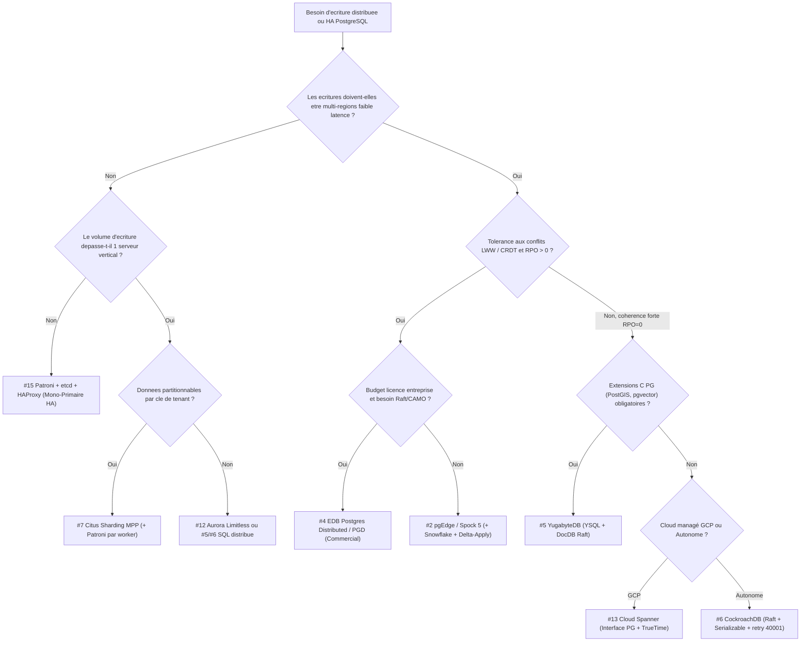

# Guide de choix, anti-patterns et architecture cible

> **Auteur** : Jean-Marie Renouard (`jmrenouard`) - [LightPath](https://www.lightpath.fr) | **Licence** : MIT

Ce guide synthétise les critères pour choisir, dimensionner et sécuriser une architecture PostgreSQL selon vos besoins de cohérence, de latence et de résilience. Voir les chapitres [05](05_architectures_poc_et_protocole_de_test.md), [06](06_resultats_tests_et_benchmarks.md) et [13](13_optimisation_production_et_benchmarks_realistes.md).

---

## 1. Arbre de décision architectural

---

## 2. Cartographie cas d'usage vers solution recommandée

| Cas d'usage métier | Exigence dominante | Architecture recommandée | Alternatives à éviter |
| :--- | :--- | :--- | :--- |
| **ERP / SI critique mono-région** | ACID 100 %, zéro conflit, `RPO = 0` intra-AZ | **#15 Patroni + etcd + HAProxy** (réplicas lecture) | PG natif bidirectionnel, PgPool-II Rep |
| **SaaS B2B multi-tenant massif** | Isolation par `tenant_id`, scale-out écritures | **#7 Citus** (shards colocalisés + HA par nœud) | Bucardo, réplication logique maillée |
| **Applications géo-distribuées utilisateur** | Écritures locales $< 10\text{ ms}$, affinité par région | **#2 pgEdge / Spock 5** (ou **#4 EDB PGD** si budget) | CockroachDB sur liens transocéaniques sans tuning |
| **Ledger financier / Inventaire strict** | Zéro *Lost Update*, linéarisabilité globale | **#5 YugabyteDB** / **#6 CockroachDB** / **#13 Spanner** | Tout LWW asynchrone (`#1`, `#3`, `#9`) |
| **Synchronisation Edge / Hétérogène** | PG $\leftrightarrow$ MySQL/Oracle, coupures réseau longues | **#10 SymmetricDS** | PG natif, Citus, Raft |
| **Migration sans arrêt entre versions** | Transition PG 14 $\rightarrow$ 17 avec bascule contrôlée | **#1 PG logique natif** (ou `#3 pglogical 2`) | Solutions à triggers lourds (`#9`, `#14`) |

---

## 3. Les 5 anti-patterns majeurs à proscrire

### Anti-pattern 1 : Topologie paire à 2 nœuds sans arbitrage ni gestion de conflits
Déployer 2 nœuds en logique natif (`#1`) sans suivi de `pg_stat_subscription_stats` provoque un arrêt silencieux sur `SQLSTATE 23505`. Les deux nœuds divergent ensuite durablement. De même, tout cluster Raft ou `etcd` à 2 nœuds est incapable de former une majorité stricte lors d'une coupure réseau : il faut impérativement **3 ou 5 nœuds votants** (ou un nœud arbitre/témoin).

### Anti-pattern 2 : Séquences `SERIAL` / `IDENTITY` par défaut en multi-maîtres
Conserver `id SERIAL PRIMARY KEY` à l'identique sur plusieurs nœuds actifs provoque une collision certaine (`P = 100 %`) dès les deux premières insertions concurrentes. Toute table multi-écrivains doit adopter soit des identifiants **Snowflake 64 bits** (`#2`), des `UUIDv7` ordonnables (PG 18+ ou fonction dédiée) ou des séquences à pas décalés (`INCREMENT BY N START WITH k` si le nombre de nœuds $N$ est figé).

### Anti-pattern 3 : Tables sans clé primaire sous réplication logique
Une table sans clé primaire comme `pgbench_history` bloque `UPDATE`/`DELETE` en réplication logique (`SQLSTATE 55000`). Activer `REPLICA IDENTITY FULL` fait aussi exploser le WAL en sérialisant la ligne complète. Ajouter systématiquement une clé primaire artificielle (`BIGSERIAL` ou `UUIDv7`).

### Anti-pattern 4 : Contention sur ligne chaude (*Hot Row*) sous consensus WAN
Mettre à jour un compteur global (`UPDATE stats SET hits = hits + 1 WHERE id = 1`) sous Raft multi-régions (`#5`, `#6`, `#13`) sérialise les transactions au RTT WAN. Cela déclenche des annulations `SQLSTATE 40001` en cascade. Solution : partitionner les compteurs par nœud/shard (*sharded counters*) et agréger à la lecture, ou utiliser **Delta-Apply CRDT** (`#2`, `#4`) lorsque l'asynchrone est acceptable.

### Anti-pattern 5 : Diffusion SQL (*Statement-Broadcast*) sur SQL non déterministe
Utiliser PgPool-II *Native Replication* pour diffuser `INSERT INTO logs VALUES (DEFAULT, NOW(), RANDOM())` crée des horodatages et aléas distincts par nœud. Les valeurs de séquences divergent aussi, corrompant les réplicas sans audit.

---

## 4. Dimensionnement, sauvegarde/PITR et stratégies de migration

### 4.1 Règles de dimensionnement critiques
- **Quorum et réseau** : Prévoir un nombre impair de votants ($3$ ou $5$ nœuds) pour Raft/`etcd`. En réplication logique asynchrone, surveillez la taille des *slots* avec `pg_wal_lsn_diff(pg_current_wal_lsn(), restart_lsn)`. Bornez `max_slot_wal_keep_size` pour éviter la saturation WAL des survivants.
- **Empreinte mémoire** : En PostgreSQL standard/Spock/Citus, allouer ~25 % de la RAM à `shared_buffers` (plus cache système OS). En YugabyteDB/CockroachDB, dimensionner généreusement la RAM pour les *block caches* RocksDB/Pebble et la coordination Raft (minimum 8–16 Go par nœud en production, loin des profils minimalistes de PoC).
- **Boucle de retry applicative** : Pour YugabyteDB et CockroachDB, intégrer dès la couche DAO/ORM une logique exponentielle de ré-essai idempotent sur `SQLSTATE 40001` (et `40P01` deadlock).

### 4.2 Le piège de la sauvegarde et du PITR multi-maîtres
Dans une architecture **mono-primaire** (`#15`), `pgBackRest` fournit un **PITR (*Point-in-Time Recovery*)** transactionnellement cohérent à la microseconde près sur l'ensemble de la base. Dans une topologie **logique multi-maîtres asynchrone** (`#1`, `#2`, `#3`, `#9`), restaurer $N_1$ et $N_2$ au même instant `T` rompt la cohérence globale. À cause du lag et de la dérive NTP, des écritures sur $N_1$ manquent sur $N_2$. Reconstruisez les pairs depuis un nœud de référence, ou utilisez une sauvegarde distribuée (`yb_backup`, `BACKUP`, Cloud Spanner).

### 4.3 Playbooks de migration progressifs
1. **Depuis PG Standalone $\rightarrow$ Patroni HA (`#15`)** : Aucune modification de schéma. Ajoutez etcd + HAProxy, lancez `pg_basebackup` puis basculez le DNS/VIP.
2. **Depuis PG Mono-Primaire $\rightarrow$ Citus (`#7`)** : Identifiez la clé *tenant* et ajoutez-la aux PK/`UNIQUE` (évite `0A000`). Convertissez les petites tables en `reference tables`, puis basculez sans réécrire `libpq`.
3. **Depuis PG Mono-Primaire $\rightarrow$ pgEdge / Spock (`#2`)** : Vérifiez la présence d'une PK sur 100 % des tables et remplacez `SERIAL` par `snowflake` ou pas décalés. Activez `Delta-Apply` sur les compteurs, puis déployez le *geo-sharding* applicatif.
4. **Depuis PG $\rightarrow$ YugabyteDB / CockroachDB (`#5`, `#6`)** : Auditez les extensions C non portables (`PostGIS`, verrous consultatifs, `LISTEN/NOTIFY`). Ajoutez les retries `40001` côté client et revalidez la latence multi-tables avant production.

---

## 5. Choix de version cible en production : PostgreSQL 16 -> 17 -> 18.6

Pour arbitrer entre **[#17 Clustering Natif PostgreSQL 18.6](solutions/pg18_native_clustering.md)** ([données empiriques Ch. 12](12_clustering_postgresql_18_et_benchmarks.md)), Patroni HA et les moteurs multi-maîtres spécialisés, appliquer la frontière vérifiée suivante :

| Besoin de production | Architecture cible recommandée | Justification et frontière empirique vérifiée |
| :--- | :--- | :--- |
| **80 %+ OLTP HA (`RPO=0` métro, parité PG 100 %)** | **#15 Patroni + etcd sur PG 18.6 (ou PG 17)** | Zéro conflit d'écriture ; `pg18-sync-streaming` gagne `+21,6 %` en `A_single_rw` (`497,94` vs `409,48 TPS`), `+90,5 %` en bulk `T11` (`75 629 lignes/s`), avec `data_checksums=on` et `io_method=worker` (`-18,5 %` sur scans froids). |
| **Upgrades majeurs sans coupure & flux filtrés** | **#17 PG 18.6 Logique natif (`pg18-logical`)** | `substream=p` par défaut et `publish_generated_columns=stored` accélèrent `E_sysbench_oltp_rw` (`1 027,84 TPS`, `+72,5 %`) et `H_append_only` (`3 518,49 TPS`, `+85,1 %`). Conserver le script `setval()` (`FOR ALL SEQUENCES` lève encore `SQLSTATE 42601` avant PG 19). |
| **Actif-actif append-only / clés disjointes (`PA/EL`)** | **#17 PG 18.6 Birep (`origin=none`) + `uuidv7()`** | `uuidv7()` RFC 9562 élimine les collisions PK actif-actif (`50/50` convergées, `0` `23505`, `2 066,70 TPS` = `3,30x` PG 17) avec 7 compteurs `confl_*` (`+confl_multiple_unique_conflicts`) pour l'alerte. |
| **Compteurs chevauchants, LWW, Auto-DDL, 3+ nœuds** | **#2 pgEdge Spock 5 (`delta_apply`)** ou **#4 EDB PGD** | PG 18.6 natif reste dépourvu de LWW/CRDT et d'Auto-DDL (`pg18-birep` dérive de `-338` en `B2` et `-83 252` en `D`). |
| **ACID global `RPO=0`, `UNIQUE` global, FK inter-nœuds** | **#5 YugabyteDB** ou **#6 CockroachDB** | L'apply logique PG 18.6 s'arrête toujours sur `23505` et subit la course FK `T13` (`23503x8`) ; recourir au consensus Raft avec boucle de retry `40001`. |
| **Extension PG 18 réversible dérive zéro (faible débit)** | **[#18 YT Cluster](solutions/yt_cluster_lite.md)** *(lab / niche)* | Pertinent sur PG 18 standard exigeant dérive `0` (`55409`/`40001`), fortes lectures locales (`48,8K`/`165,5K`) et réversibilité `DROP EXTENSION` (`T_REVERT`). **Inadapté** à l'OLTP intensif : plafond écriture 2PC `20,63`-`41,45 TPS` (`2,25` à `25ms` WAN, `86 lignes/s` bulk), rollback `SAVEPOINT` `0A000`, Jepsen interne limité à `cursor-stability`, `ytserv` fermé (PolyForm/Commercial) et `bus factor = 1`. |

**Garde-fous d'upgrade (`PG 16/17 -> 18.6`) :** Montez les volumes sur `/var/lib/postgresql` (`PGDATA=/var/lib/postgresql/18/docker`) et activez `pg_checksums --enable`. Testez `io_method=sync` vs `worker` en RAM (`-10,3 %` IPC) et autorisez `io_uring` dans seccomp.

---

## 6. Sélecteur interactif d'architecture PACELC & Explorateur GitHub Pages

Appliquez cet arbre sur les mesures avec l'onglet **Sélecteur PACELC** de [`dashboard/index.html`](../../dashboard/index.html) (ou sur [GitHub Pages](https://jmrenouard.github.io/ClusterPostgreSQL-Series/) dès l'activation du workflow `#506`) :

- **4 critères empiriques :** `RPO` (`0` vs `>0`), `WAN RTT` (`0`/`10`/`25`/`50 ms`), `Conflits` (`Mono`, `UUIDv7`, `CRDT`, `Forte`) et `TCO` (`Bas`/`Moy`/`Haut`), synchronisés avec `Baseline (S=2)` / `V5 Optimisé (S=20)`.
- **Preuves & commandes :** Classe les 17 topologies et variantes V5/CRDT (`0-100`), puis marque `INCOMPATIBLE` la dérive LWW (`-71K` à `-531K`). Affiche les codes `SQLSTATE` (`23505`, `40001`, `0A000`, `55409`), les commandes `make` / `./mdb` et les liens vers les fiches.
- **Vérification statique :** Exécutez `make dashboard && make pages-build && make pages-check` pour construire et contrôler `_site/`.
