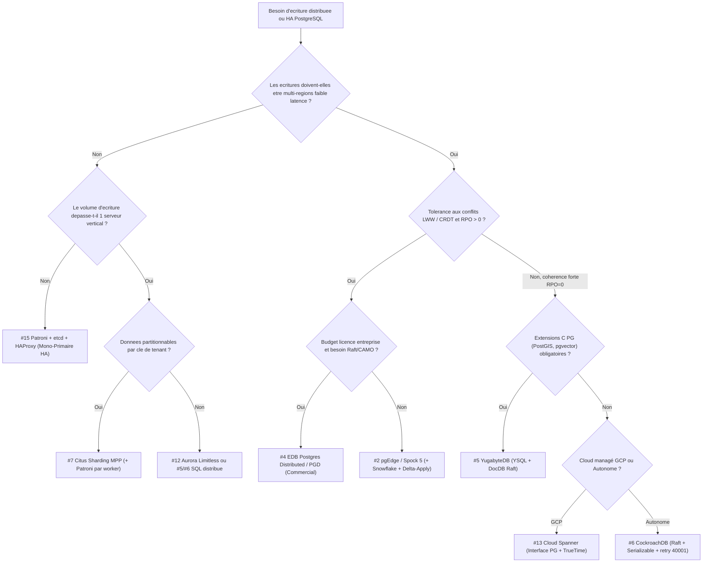

# Guide de choix, anti-patterns et architecture cible

> **Auteur** : Jean-Marie Renouard (`jmrenouard`) - [LightPath](https://www.lightpath.fr) | **Licence** : MIT

Ce guide synthétise les critères de décision opérationnels permettant de sélectionner, dimensionner et sécuriser une architecture PostgreSQL adaptée aux exigences réelles de cohérence, de latence et de résilience.

---

## 1. Arbre de décision architectural

---

## 2. Cartographie cas d'usage vers solution recommandée

| Cas d'usage métier | Exigence dominante | Architecture recommandée | Alternatives à éviter |
| :--- | :--- | :--- | :--- |
| **ERP / SI critique mono-région** | ACID 100 %, zéro conflit, `RPO = 0` intra-AZ | **#15 Patroni + etcd + HAProxy** (réplicas lecture) | PG natif bidirectionnel, PgPool-II Rep |
| **SaaS B2B multi-tenant massif** | Isolation par `tenant_id`, scale-out écritures | **#7 Citus** (shards colocalisés + HA par nœud) | Bucardo, réplication logique maillée |
| **Applications géo-distribuées utilisateur** | Écritures locales $< 10\text{ ms}$, affinité par région | **#2 pgEdge / Spock 5** (ou **#4 EDB PGD** si budget) | CockroachDB sur liens transocéaniques sans tuning |
| **Ledger financier / Inventaire strict** | Zéro *Lost Update*, linéarisabilité globale | **#5 YugabyteDB** / **#6 CockroachDB** / **#13 Spanner** | Tout LWW asynchrone (`#1`, `#3`, `#9`) |
| **Synchronisation Edge / Hétérogène** | PG $\leftrightarrow$ MySQL/Oracle, coupures réseau longues | **#10 SymmetricDS** | PG natif, Citus, Raft |
| **Migration sans arrêt entre versions** | Transition PG 14 $\rightarrow$ 17 avec bascule contrôlée | **#1 PG logique natif** (ou `#3 pglogical 2`) | Solutions à triggers lourds (`#9`, `#14`) |

---

## 3. Les 5 anti-patterns majeurs à proscrire

### Anti-pattern 1 : Topologie paire à 2 nœuds sans arbitrage ni gestion de conflits
Déployer 2 nœuds en logique natif (`#1`) sans surveillance active de `pg_stat_subscription_stats` conduit tôt ou tard à un arrêt silencieux de la réplication sur `SQLSTATE 23505`, laissant les deux nœuds diverger durablement. De même, tout cluster Raft ou `etcd` à 2 nœuds est incapable de former une majorité stricte lors d'une coupure réseau : il faut impérativement **3 ou 5 nœuds votants** (ou un nœud arbitre/témoin).

### Anti-pattern 2 : Séquences `SERIAL` / `IDENTITY` par défaut en multi-maîtres
Conserver `id SERIAL PRIMARY KEY` à l'identique sur plusieurs nœuds actifs provoque une collision certaine (`P = 100 %`) dès les deux premières insertions concurrentes. Toute table multi-écrivains doit adopter soit des identifiants **Snowflake 64 bits** (`#2`), des `UUIDv7` ordonnables (PG 18+ ou fonction dédiée) ou des séquences à pas décalés (`INCREMENT BY N START WITH k` si le nombre de nœuds $N$ est figé).

### Anti-pattern 3 : Tables sans clé primaire sous réplication logique
Les tables d'audit ou historiques de type `pgbench_history` sans clé primaire bloquent tout `UPDATE`/`DELETE` en réplication logique (`SQLSTATE 55000`) et génèrent une explosion de volume WAL si l'on active `REPLICA IDENTITY FULL` (qui sérialise l'intégralité de la ligne avant/après dans chaque enregistrement WAL). Ajouter systématiquement une clé primaire artificielle (`BIGSERIAL` ou `UUIDv7`).

### Anti-pattern 4 : Contention sur ligne chaude (*Hot Row*) sous consensus WAN
Mettre à jour un compteur global unique (`UPDATE stats SET hits = hits + 1 WHERE id = 1`) depuis plusieurs régions dans un cluster Raft (`#5`, `#6`, `#13`) sérialise toutes les transactions à la vitesse du RTT inter-régions et déclenche des avalanches d'annulations `SQLSTATE 40001`. Solution : partitionner les compteurs par nœud/shard (*sharded counters*) et agréger à la lecture, ou utiliser **Delta-Apply CRDT** (`#2`, `#4`) lorsque l'asynchrone est acceptable.

### Anti-pattern 5 : Diffusion SQL (*Statement-Broadcast*) sur SQL non déterministe
Utiliser PgPool-II en mode *Native Replication* pour diffuser `INSERT INTO logs VALUES (DEFAULT, NOW(), RANDOM())` génère des horodatages, des aléas et potentiellement des valeurs de séquences différents sur chaque nœud, créant une corruption silencieuse des réplicas impossible à détecter sans audit différentiel complet.

---

## 4. Dimensionnement, sauvegarde/PITR et stratégies de migration

### 4.1 Règles de dimensionnement critiques
- **Quorum et réseau** : Prévoir un nombre impair de votants ($3$ ou $5$ nœuds) pour Raft/`etcd`. En réplication logique asynchrone, surveiller en permanence la taille des *slots* via `pg_wal_lsn_diff(pg_current_wal_lsn(), restart_lsn)` et borner `max_slot_wal_keep_size` afin qu'un nœud arrêté ne sature jamais le disque WAL des survivants.
- **Empreinte mémoire** : En PostgreSQL standard/Spock/Citus, allouer ~25 % de la RAM à `shared_buffers` (plus cache système OS). En YugabyteDB/CockroachDB, dimensionner généreusement la RAM pour les *block caches* RocksDB/Pebble et la coordination Raft (minimum 8–16 Go par nœud en production, loin des profils minimalistes de PoC).
- **Boucle de retry applicative** : Pour YugabyteDB et CockroachDB, intégrer dès la couche DAO/ORM une logique exponentielle de ré-essai idempotent sur `SQLSTATE 40001` (et `40P01` deadlock).

### 4.2 Le piège de la sauvegarde et du PITR multi-maîtres
Dans une architecture **mono-primaire** (`#15`), `pgBackRest` fournit un **PITR (*Point-in-Time Recovery*)** transactionnellement cohérent à la microseconde près sur l'ensemble de la base. Dans une topologie **logique multi-maîtres asynchrone** (`#1`, `#2`, `#3`, `#9`), restaurer les nœuds $N_1$ et $N_2$ à un même instant horloge `T` ne garantit **aucune cohérence globale** en raison du lag de réplication et de la dérive NTP : certaines transactions validées sur $N_1$ avant `T` peuvent manquer sur $N_2$ et vice versa. Il faut soit reconstruire les pairs depuis la sauvegarde d'un nœud de référence par réinitialisation logique, soit basculer sur un moteur à sauvegarde distribuée cohérente (`yb_backup`, CockroachDB `BACKUP`, Cloud Spanner).

### 4.3 Playbooks de migration progressifs
1. **Depuis PG Standalone $\rightarrow$ Patroni HA (`#15`)** : Aucune modification de schéma ; ajout d'etcd + HAProxy, synchronisation physique `pg_basebackup` puis bascule DNS/VIP.
2. **Depuis PG Mono-Primaire $\rightarrow$ Citus (`#7`)** : Identifier la clé de *tenant*, ajouter la colonne de distribution à toutes les PK/`UNIQUE` (éviter `0A000`), convertir les petites tables de paramétrage en `reference tables`, puis basculer sans réécrire les pilotes `libpq`.
3. **Depuis PG Mono-Primaire $\rightarrow$ pgEdge / Spock (`#2`)** : Vérifier que 100 % des tables possèdent une PK, remplacer les `SERIAL` par `snowflake` ou pas décalés, activer `Delta-Apply` sur les soldes/compteurs, puis basculer progressivement le routage applicatif par région géographique (*geo-sharding* applicatif) afin de minimiser les conflits croisés.
4. **Depuis PG $\rightarrow$ YugabyteDB / CockroachDB (`#5`, `#6`)** : Auditer les extensions C non portables (`PostGIS`, verrous consultatifs, `LISTEN/NOTIFY`), implémenter la gestion des retries `40001` côté client, et revalider la latence de chaque requête multi-tables sur la topologie réseau cible avant mise en production.
