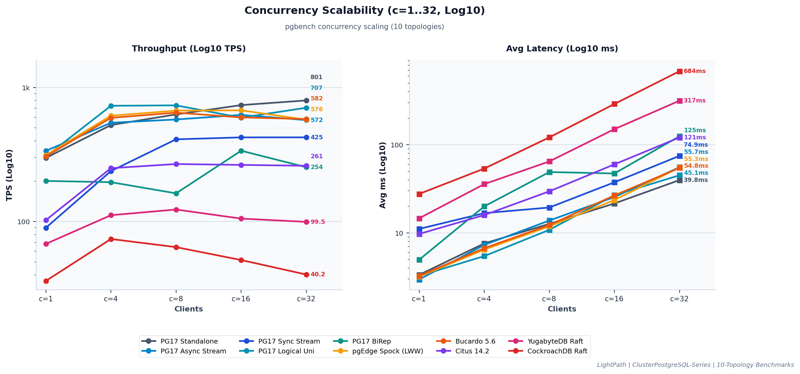
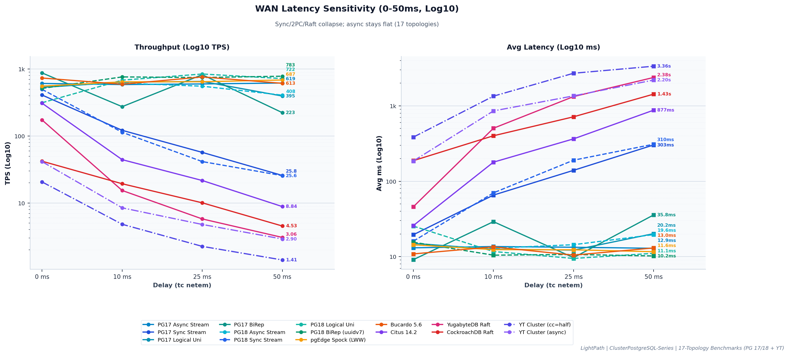
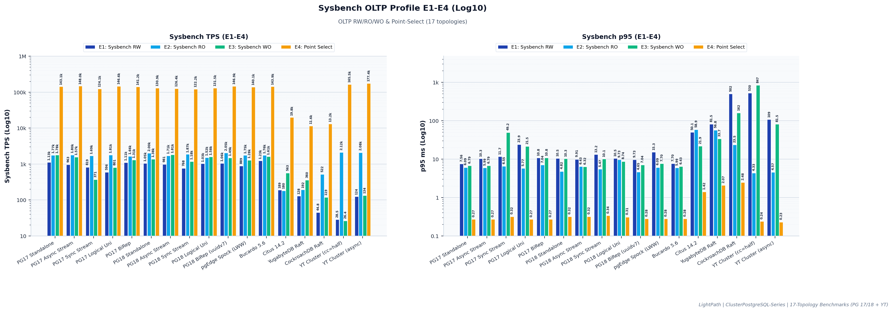
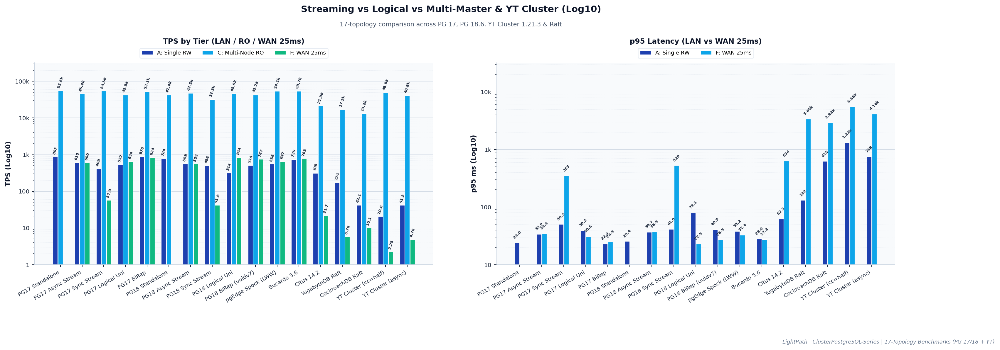
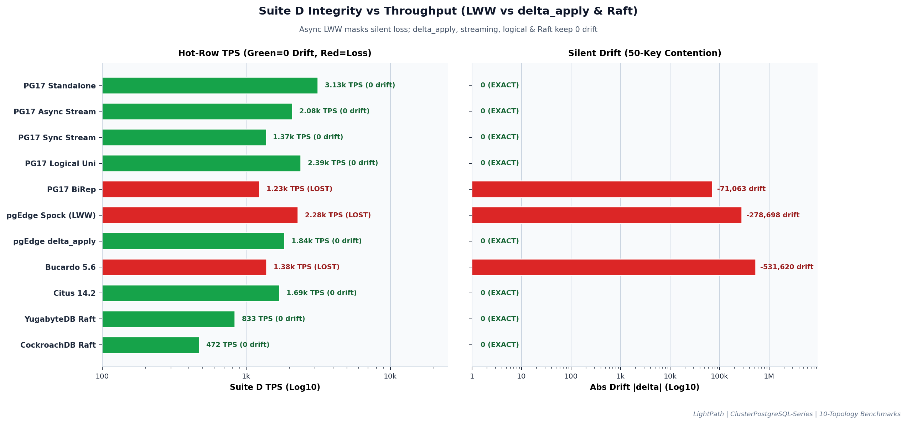

# 09 — Méthodologie des Benchmarks, Charges et Graphiques Logarithmiques

**Série :** Architectures PostgreSQL Multi-Maîtres & Active-Active  
**Auteur :** Jean-Marie Renouard (`jmrenouard`) — [LightPath](https://www.lightpath.fr)  
**Licence :** MIT License

---

## 1. Harnais d'exécution et isolation expérimentale

Les **310 lignes brutes de benchmarks** (**301 lignes dédupliquées dans le tableau de bord**) couvrant **17 topologies opérationnelles** (`18` variantes en Suite D avec `pgedge-delta-apply`) sont produites séquentiellement sur hôte Docker WSL2 (20 vCPU, 16,4 Gio RAM) par trois scripts de `env/multi-db-docker-env` (`v2.4.1`) :
- `scripts/bench_pg_v2_runner.sh` : **187 lignes** sur 10 topologies PG 17 et SQL distribué (`results/benchmark_summary.csv` `70`, `results/benchmark_extended_workloads.csv` `40`, `results/benchmark_wan_sweep.csv` `27`, `results/benchmark_concurrency_sweep.csv` `50`).
- `scripts/bench_pg18_runner.sh` : **87 lignes** sur 5 topologies natives PG 18.6 (`results/benchmark_pg18.csv`).
- `scripts/bench_yt_runner.sh` : **36 lignes** (`18` `yt-cluster` `cc=half` + `18` `yt-cluster-async` `cc=nodes>=0`) sur 3 nœuds PG 18.7 (`results/benchmark_yt_cluster.csv`).

- **Isolation stricte :** Une seule pile tourne à la fois (`up -> setup -> chauffe -> suites -> down -v`) pour exclure toute contention RAM/NVMe entre RocksDB, Pebble, `ytserv` et `shared_buffers`.
- **Zéro biais NAT :** `pgbench` et `sysbench` tournent dans un conteneur éphémère `bench_client` (`multi-db-pgbench-sysbench:latest`) relié au pont Docker interne de chaque cluster (`--cap-add NET_ADMIN`).
- **Parité de jeu et réconciliation :** Chaque suite tourne à `PG_SCALE = 2` (`200 000` comptes, `20` guichets, `2` agences). Entre chaque suite d'écriture, `reset_ds()` réinitialise les soldes ; `conv_chk()` contrôle `SUM(abalance) - SUM(delta)` sur chaque nœud (`balance_drift`).
- **Latence exacte (`p95`) :** Les journaux par transaction (`pgbench -l`) fournissent moyenne, écart-type et 95e centile (`lat_p95_ms`).

---

## 2. Adaptations de schéma par moteur

Par défaut, `pgbench -i` crée `pgbench_history` **sans clé primaire**, ce qui bloque `UPDATE`/`DELETE` en logique (`SQLSTATE 55000`) et Bucardo. Pour comparer les 17 piles équitablement tout en testant `L2` à part, l'initialiseur ajoute une clé primaire artificielle `hid` idiomatique :

| Groupe de topologies | Clé primaire artificielle `pgbench_history` et distribution | Adaptation `sysbench` |
| :--- | :--- | :--- |
| **`pg17-*`, `pg18-streaming/logical`, `yugabyte`** | `hid BIGSERIAL PRIMARY KEY` | Standard `sbtest1..4` (répliqué en streaming/logique) |
| **`pg-birep` et `bucardo`** | Séquence décalée `INCREMENT BY 2 START WITH {1, 2}` (`BIGINT PK`) | Standard `sbtest1..4` (synchronisé entre nœuds) |
| **`pg18-birep` et `yt-cluster*`** | Natif PG 18 `hid UUID PRIMARY KEY DEFAULT uuidv7()` (`yt_setup()` sur `yt*`) | `yt_setup('public.sbtest%')` ; `prep_sb()` isolé avant `E3` async (évite `55000` `recon`) |
| **`pgedge` (Spock 5)** | `hid BIGINT PRIMARY KEY DEFAULT snowflake.nextval('snowflake.id_seq')` | Standard ; `delta_apply` validé sur `abalance` |
| **`citus`** | Clé composite `PRIMARY KEY(aid, hid)` + `create_distributed_table` (`bid`/`tid`/`aid`) | `create_distributed_table('sbtest1..4','id')` |
| **`cockroach`** | `hid INT8 DEFAULT unique_rowid() PRIMARY KEY` | Repli auto `--db-ps-mode=disable` si requis |

---

## 3. Spécification complète des outils et charges

### 3.1 Suites `pgbench` (`A`, `B1`, `B2`, `C`, `D`, `G`, `H`)

Chaque suite `pgbench` utilise `-n -r --max-tries=100 --failures-detailed -l` pour mesurer les retries `SQLSTATE 40001` (`55409`+`40001` pour YT Cluster) :

| Suite | Profil de charge | Clients / Flux | Durée | Plage empirique sur 17 topologies |
| :--- | :--- | :---: | :---: | :--- |
| **`A_single_rw`** | TPC-B standard (`1` nœud cible) | `8` (`1x8`, `-j 4`) | `15–20 s` | `20,63` (`yt-cluster`) à `875,91 TPS` (`pg-birep`) |
| **`B1_disjoint_rw`** | Clés partitionnées (`1..100k` vs `100k+1..200k`) | `8` (`2x4`, `-j 2`) | `15–20 s` | `36,14` (`yt-cluster`) à `1 078,90 TPS` (`bucardo`) |
| **`B2_overlap_rw`** | Chevauchement complet sur `2` écrivains | `8` (`2x4`, `-j 2`) | `15–20 s` | `10,69` (`yt-cluster`, `0`) à `1 267,77 TPS` (`bucardo`, `+123 679`) |
| **`C_multinode_ro`** | `pgbench -S` lecture seule | `16` (`2x8`/`1x16`) | `15–20 s` | `13 185,54` (`cockroach`) à `55 614,16 TPS` (`standalone`) |
| **`D_hot_conflict`** | `50` comptes chauds (`aid 1..50`, `delta 1..100`) | `8` (`2x4`/`1x8`) | `12–15 s` | `67,76` (`yt-cluster`, `0`) à `3 128,63 TPS` ; CRDT `1 837,64` (`0`) |
| **`G_conc_c1..c32`** | Balayage concurrence ($c \in \{1, 4, 8, 16, 32\}$) | `1..32` | `8 s` | `4,60` (`yt c=32`) à `814,33 TPS` (`pg17-standalone` `801`, `pg18-standalone`) |
| **`H_append_only_insert`** | Pur `INSERT INTO bench_append_events` | `8` (`2x4`/`1x8`) | `12 s` | `110,53` (`yt-cluster`) à `3 518,49 TPS` (`pg18-logical`) ; `yb=2 987,24` |

### 3.2 Suites `sysbench` OLTP (`E1–E4`, `--db-driver=pgsql`)

La validation croisée exécute `sysbench --db-driver=pgsql --tables=4 --table-size=10000` sur quatre profils Lua : **`E_sysbench_oltp_rw`** (`oltp_read_write`, `8` threads, `15–20 s`), **`E2_sysbench_oltp_ro`** (`oltp_read_only`, `8` threads, `12 s`), **`E3_sysbench_oltp_wo`** (`oltp_write_only`, `8` threads, `12 s`) et **`E4_sysbench_point_select`** (`oltp_point_select`, `16` threads, `12 s`).

- **Contraste critique `40001` et `55000` asynchrone :** Contrairement à MySQL (`--mysql-ignore-errors=all`), `sysbench --db-driver=pgsql` ne ré-essaie pas `SQLSTATE 40001` (`685` erreurs pour `902` commits sous CockroachDB `E`, contre `0` erreur en `READ COMMITTED` YugabyteDB `128,24 TPS`). Sur `yt-cluster-async`, réutiliser les tables `sbtest` après `E` déclenche `SQLSTATE 55000` (`recon` bloqué) ; une préparation isolée `prep_sb()` mesure **`133,55 TPS` (`E3`)**. En `E4`, `yt-cluster-async` atteint **`177 442,88 TPS`** (`0,09 ms` moy.) et `pg17-async-streaming` **`148 022,41 TPS`** contre `11 557–19 831 TPS` en moteurs distribués.

### 3.3 Injection de latence WAN (`F_wan_netem_10ms / 25ms / 50ms`)

La physique WAN (`~20`, `~50` et `~100 ms` RTT) est émulée via `tc qdisc netem` sur les pairs/standby/workers/votants, puis retirée via `tc qdisc del dev eth0 root` (ciblant un nœud non-Leader déterministe `wn` dans `bench_yt_runner.sh` pour éviter le contournement Leader) :

```bash
docker run --rm --network container:<peer> --cap-add NET_ADMIN \
  multi-db-pgbench-sysbench:latest tc qdisc replace dev eth0 root netem delay 25ms
```

À `50 ms` unidirectionnels (`~100 ms` RTT), les moteurs `PC/EC` et `ytserv` tombent à **`25,79 TPS`** (`pg17-sync-streaming`), **`8,84 TPS`** (`citus`), **`4,53 TPS`** (`cockroach`), **`3,06 TPS`** (`yugabyte`), **`2,90 TPS`** (`yt-cluster-async`) et **`1,41 TPS`** (`yt-cluster`), tandis que les piles `PA/EL` maintiennent `612,56–782,57 TPS` (`pg18-birep` `782,57`, `pgedge` `687,00`).

---

## 4. Pourquoi les échelles logarithmiques (`log10`) sont indispensables

Sur les **310 mesures brutes**, les écarts couvrent **plus de cinq ordres de grandeur** :
- **Débit (`TPS`) :** de `1,41 TPS` (`yt-cluster`, `F_wan_netem_50ms`) à `177 442,88 TPS` (`yt-cluster-async`, `E4_sysbench_point_select`) — rapport $R_{\text{TPS}} = 177{,}442.88 / 1.41 \approx 125{,}846\times$ ($5,10$ décades ; `pgbench` `2,25` à `55 614,16 TPS` couvre $4,39$ décades).
- **Latence (`ms`) :** de `0,090 ms` (`yt-cluster-async` `E4` moy. ; `0,110 ms` PG 17) à `12 893,483 ms` (`yt-cluster-async`, `F_wan_netem_50ms` `p95` ; `5 474,705 ms` sur `yugabyte`) — rapport $R_{\text{lat}} = 12{,}893.483 / 0.090 \approx 143{,}261\times$ ($5,16$ décades).

L'étendue $D_{\text{décades}}$ et la distance visuelle $\Delta y_{\log}$ entre deux mesures $(v_1, v_2)$ obéissent à :

$$
D_{\text{décades}} = \log_{10}\!\left(\frac{v_{\max}}{v_{\min}}\right), \qquad \Delta y_{\log} = \log_{10}(v_2) - \log_{10}(v_1) = \log_{10}\!\left(\frac{v_2}{v_1}\right)
$$

Sur un axe linéaire à `55 614` ou `177 443 TPS`, une barre à `57,00 TPS` représente `< 0,04 %` de hauteur et `1,41 TPS` disparaît (`0,0008 %`). L'axe `log10` associe à tout gain `2x` un pas constant ($\log_{10}(2) \approx 0,301$), préservant tous les rapports relatifs.

---

## 5. Explorateur interactif, 11 graphiques logarithmiques et Matrice de traçabilité

Explorez les **17 topologies** et **301 lignes dédupliquées** (**310 lignes CSV brutes** ; 9 lignes `F_wan_netem_25ms` communes entre `summary` et `wan_sweep`) — avec **bascule `log10` / linéaire**, préréglages `YT vs Multi-Maître` et `PG 18 vs PG 17`, interface EN/FR, badges de dérive, matrices `L1–L8`, `T11–T18`, `PG 18.6`, `YT`, onglet Popularité (22 entrées) et export CSV — via [**Explorateur interactif hors-ligne (`dashboard/index.html`)**](../../dashboard/index.html).

### 5.1 Matrice maîtresse de traçabilité Benchmarks -> Graphiques

| Jeu de données / Runner | CSV brut (`results/`) | Suites couvertes | Topologies cibles | Lignes |
| :--- | :--- | :--- | :--- | :---: |
| **`bench_pg_v2_runner.sh`** (`v2.2.0`) | `benchmark_summary.csv` | `A`, `B1`, `B2`, `C`, `D`, `E`, `F_25ms` | `10` PG 17 & SQL dist. + `pgedge-delta-apply` (`D`) | `70` |
| **`bench_pg_v2_runner.sh`** (`v2.2.0`) | `benchmark_extended_workloads.csv` | `E2`, `E3`, `E4`, `H` | `10` PG 17 & SQL dist. | `40` |
| **`bench_pg_v2_runner.sh`** (`v2.2.0`) | `benchmark_wan_sweep.csv` | `F_wan_netem_10ms/25ms/50ms` | `9` topologies PG 17 & SQL dist. répliquées | `27` |
| **`bench_pg_v2_runner.sh`** (`v2.2.0`) | `benchmark_concurrency_sweep.csv` | `G_conc_c1/c4/c8/c16/c32` | `10` PG 17 & SQL dist. | `50` |
| **`bench_pg18_runner.sh`** (`v2.3.0`) | `benchmark_pg18.csv` | Les `18` (`15` sur `pg18-standalone`, hors WAN) | `5` piles natives PG 18.6 (`worker` AIO, `uuidv7()`) | `87` |
| **`bench_yt_runner.sh`** (`v2.4.1`) | `benchmark_yt_cluster.csv` | Les `18` (`A`–`H`, `F_wan*`, `G_conc*`) | `yt-cluster` (`cc=half`) & `yt-cluster-async` (`nodes>=0`) | `36` |
| **`collect_popularity.py`** + Tests | `project_popularity.csv` + `functional_limits_*.csv` | Télémétrie GitHub API ; sondes `L1–L8` / `T11–T18` | `22` solutions (`19` dépôts Git) ; `16` lignes limites | `22` / `26` |

| Artefact (`assets/charts/` et `dashboard/`) | CSV source(s) | Suites représentées | Script générateur | Chapitre lié |
| :--- | :--- | :--- | :--- | :--- |
| **`chart_01_tps_log_all_suites.png`** | Les `6` CSV bench (`17` topos) | `A`, `B1`, `C`, `E1`, `H` | `scripts/generate_charts.py` | [Ch. 06](06_resultats_tests_et_benchmarks.md) |
| **`chart_02_latency_log_all_suites.png`** | Les `6` CSV bench (`17` topos) | `A`, `B1`, `C`, `E1`, `F_25ms` (`avg`/`p95`) | `scripts/generate_charts.py` | [Ch. 06](06_resultats_tests_et_benchmarks.md) |
| **`chart_03_concurrency_sweep_log.png`** | `summary`+`conc`+`pg18`+`yt_cluster` | `G_conc_c1`, `c4`, `c8`, `c16`, `c32` | `scripts/generate_charts.py` | [Ch. 09 §5](#graphique-03--balayage-de-concurrence-g_conc_c1c32-log10) |
| **`chart_04_wan_netem_sweep_log.png`** | `summary`+`wan`+`pg18`+`yt_cluster` | `0ms` (`A`), `10ms`, `25ms`, `50ms` | `scripts/generate_charts.py` | [Ch. 06](06_resultats_tests_et_benchmarks.md) |
| **`chart_05_sysbench_profile_log.png`** | `summary`+`ext`+`pg18`+`yt_cluster` | `E_rw`, `E2_ro`, `E3_wo`, `E4_pt` | `scripts/generate_charts.py` | [Ch. 09 §5](#graphique-05--profil-sysbench-e1e4-log10) |
| **`chart_06_streaming_vs_logical_vs_mm.png`** | Les `6` CSV bench (`17` topos) | `A`, `C`, `F_wan_netem_25ms` | `scripts/generate_charts.py` | [Ch. 10](10_comparatif_streaming_logique_multimaster.md) |
| **`chart_07_integrity_vs_throughput.png`** | `summary`+`pg18`+`yt_cluster` (`18` barres) | `D_hot_conflict` TPS vs dérive | `scripts/generate_charts.py` | [Ch. 06](06_resultats_tests_et_benchmarks.md) |
| **`chart_08_popularity_stars_forks_log.png`** | `project_popularity.csv` (`19` dépôts) | Étoiles, forks, commits par rôle | `scripts/generate_charts_v3.py` | [Ch. 11](11_popularite_et_vitalite_ecosysteme.md) |
| **`chart_09_popularity_commits_activity_log.png`** | `project_popularity.csv` (`19` dépôts) | Commits 12m vs jours sans push | `scripts/generate_charts_v3.py` | [Ch. 11](11_popularite_et_vitalite_ecosysteme.md) |
| **`chart_10_pg18_vs_pg17_log.png`** | `summary`+`ext`+`wan` vs `benchmark_pg18.csv` | `A`, `C`, `E`, `E3`, `H`, `F_25ms` | `scripts/generate_charts_v3.py` | [Ch. 12](12_clustering_postgresql_18_et_benchmarks.md) |
| **`chart_11_yt_cluster_vs_multimaster_log.png`** | `yt_cluster`+`pg18`+`summary/ext/wan/conc` | `18/18` (`yt-*` vs `pg18-birep`/`pgedge`/`yb`/`crdb`) | `scripts/generate_charts_v4.py` | [Ch. 06 §7](06_resultats_tests_et_benchmarks.md) · [#18](solutions/yt_cluster_lite.md) |
| **`dashboard/index.html`** (`dashboard/*.js`) | Les `6` bench + `4` limites + `popularity` CSVs | Explorateur `301` lignes / `17` topos | `scripts/build_dashboard.py` | [Ch. 06](06_resultats_tests_et_benchmarks.md) |

### Graphique 01 — Débit multi-suites (`log10` TPS)

*Compare `A_single_rw`, `B1_disjoint_rw`, `C_multinode_ro`, `E_sysbench_oltp_rw` et `H_append_only_insert` sur les 17 topologies (`20,63` sur `yt-cluster` à `55 614,16 TPS` sur `pg17-standalone`).*

### Graphique 02 — Latence moyenne et `p95` (`log10` ms)

*Expose plus de `4` décades de latence, de `0,257 ms` (`pg17-standalone` `-S`) et `0,305 ms` (`yt-cluster` `C`) à `5 557,31 ms` (`yt-cluster` WAN `25 ms` `p95`) et `4 136,14 ms` (`yt-cluster-async`).*

### Graphique 03 — Balayage de concurrence (`G_conc_c1..c32`, `log10`)

*Courbes à 5 points (`c = 1..32`) sur 17 topologies : `pg17-standalone` (`801,27`) et `pg18-standalone` (`814,33`) croissent ; `cockroach` culmine à `c = 4` (`74,11`) ; `yt-cluster-async` atteint `91,68 -> 44,20 TPS` contre `28,07 -> 4,60 TPS` pour `yt-cluster` `cc=half`.*

### Graphique 04 — Sensibilité RTT WAN (`tc netem 0/10/25/50 ms`, `log10`)

*Bifurcation PACELC sur `0/10/25/50 ms` : les piles async PG (`587–783 TPS`) restent stables tandis que `pg17-sync` (`25,79`), `pg18-sync` (`25,60`), `citus` (`8,84`), `cockroach` (`4,53`), `yugabyte` (`3,06`), `yt-cluster-async` (`2,90`) et `yt-cluster` (`1,41 TPS`) décroissent.*

### Graphique 05 — Profil `sysbench` (`E1–E4`, `log10`)

*Compare les 17 topologies sur `E1–E4` : PG natif (`1 659–2 053` `E2`, `122k–148k` `E4`) face au SQL distribué et `yt-cluster*` (`26,43`/`133,55` `E3` et `165,5k`/`177,4k TPS` `E4`).*

### Graphique 06 — Streaming vs Logique Natif vs Multi-Maîtres (`log10`)

*Compare les 17 topologies selon les 5 niveaux du Chapitre 10 entre PG 17, PG 18.6 (`pg18-logical` `844,10`, `pg18-birep` `747,42` WAN `25ms`), YT Cluster 1.21.3 et Raft.*

### Graphique 07 — Intégrité des données vs Débit (Suite D Lignes Chaudes)

*Pertes silencieuses (`-531 620` `bucardo`, `-278 698` `pgedge` LWW, `-71 063` `pg-birep`, `-83 252` `pg18-birep`) face à **`0` dérive** sur `pgedge-delta-apply` (`1 837,64 TPS`), `yt-cluster` (`67,76`), `yt-cluster-async` (`163,01`), streaming, logique, Citus, YugabyteDB et CockroachDB.*

---

## 6. Extensions V3 & V4 : Télémétrie (`chart_08`, `chart_09`), PG 18.6 (`chart_10`) et YT Cluster (`chart_11`)


- **Vitalité écosystème (`chart_08`–`09`, [Ch. 11](11_popularite_et_vitalite_ecosysteme.md)) :** Télémétrie GitHub (`21` entrées / `19` dépôts publics sur `3+` décades) distinguant le socle `Tier A` (`postgres`, `cockroachdb`, `yugabytedb`, `citus`, `patroni`) d'extensions `Tier C` récentes comme `DBinvent/yt-cluster-lite` (`15` étoiles, `0` fork, `21` commits, `2` contributeurs).
- **Saut générationnel PG 18.6 (`chart_10`, [Ch. 12](12_clustering_postgresql_18_et_benchmarks.md)) :** `87` mesures PG 18.6 quantifiant AIO `worker`, `data_checksums=on`, `substream=p` et `uuidv7()` (`pg18-birep` `H=2 066,70`, `pg18-logical` `H=3 518,49`, `pg18-sync` `E3=1 184,57 TPS`).
- **YT Cluster Sync/Async vs Multi-Maîtres (`chart_11`, [Ch. 06 §7](06_resultats_tests_et_benchmarks.md)) :** `36` mesures (`18` `cc=half` + `18` `cc=nodes>=0`) chiffrant le gain async `2,0x–5,1x` à `0` dérive (`A` `20,63->41,45`, `B2` `10,69->55,03`, `D` `67,76->163,01`, `E3` `26,43->133,55`, `H` `110,53->224,93 TPS`), les lectures `E4` (`177 442,88 TPS`) et l'atténuation WAN `ytserv` (`1,41–8,47 TPS`).
