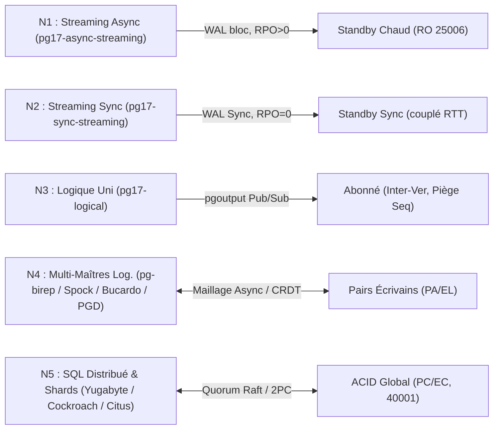

# 10 — Streaming Physique vs Logique Natif vs Multi-Maîtres et SQL Distribué

**Série :** Architectures PostgreSQL Multi-Maîtres & Active-Active  
**Auteur :** Jean-Marie Renouard (`jmrenouard`) — [LightPath](https://www.lightpath.fr)  
**Licence :** MIT License

---

## 1. Les cinq niveaux de réplication PostgreSQL

Les équipes envisagent souvent le multi-maîtres actif-actif avant d'évaluer les deux niveaux natifs mono-écrivain du cœur PostgreSQL : la **réplication physique en streaming** (async ou sync) et la **réplication logique native unidirectionnelle**. Chaque saut vers la droite échange la simplicité du WAL unique contre le filtrage sélectif, l'écriture multi-nœuds ou le consensus distribué.



La latence de commit sépare les écritures locales asynchrones (`N1`, `N3`, `N4` async) de l'acquittement WAL synchrone (`N2`) et du quorum distribué (`N5`) :

$$
L_{\text{N1/N3/N4-async}} \approx L_{\text{disque}}, \qquad L_{\text{N2-sync}} \approx L_{\text{disque}} + \text{RTT}_{\text{standby}}, \qquad L_{\text{N5-Raft}} \approx L_{\text{disque}} + 2 \cdot \text{RTT}_{\text{quorum}} + L_{\text{coord}}
$$

---

## 2. Analyse architecturale des cinq niveaux

### Niveau 1 — Streaming physique asynchrone (`pg17-async-streaming`)

- **Mécanisme :** `walsender` expédie octet par octet les blocs WAL 8 Kio vers `walreceiver` via un slot physique (`pg_basebackup`). Le standby rejoue des pages heap/index identiques en recouvrement continu.
- **Forces :** Zéro limite de schéma — tables sans PK, DDL, séquences `SERIAL`/`IDENTITY`, `pg_largeobject`, `TRUNCATE` et 100 % des extensions (`PostGIS`, `pgvector`) répliquent à vitesse locale sans conflit.
- **Limites :** Standby strictement en **lecture seule** (**`SQLSTATE 25006`** en écriture). Impose même version majeure PG, architecture CPU et `glibc`. Une panne induit $\text{RPO} > 0$ (WAL non transmis).

### Niveau 2 — Streaming physique synchrone (`pg17-sync-streaming`)

- **Mécanisme :** Transport WAL physique complété par `synchronous_standby_names` et `synchronous_commit = on` (flush disque standby) ou `remote_apply` (visibilité lecture avant retour `COMMIT`).
- **Forces :** **`RPO = 0`** strict, fidélité PostgreSQL totale, zéro conflit. Avec **Patroni + etcd** (`#15`), basculement automatisé avec fencing OS (`RTO ~ 10–30 s`).
- **Limites :** Chaque commit paie le RTT standby : en local (`results/benchmark_summary.csv`), Suite A chute de **`52,8 %`** (`866,82 -> 409,48 TPS`) ; à `25 ms` WAN (`Suite F`), elle s'effondre de **`-86,1 %`** (`57,00 TPS`, `p95 = 353,49 ms`). Sans quorum `FIRST 1 (s1, s2)`, la perte du standby synchrone **gèle toutes les écritures du primaire**.

### Niveau 3 — Réplication logique native unidirectionnelle (`pg17-logical`)

- **Mécanisme :** `wal_level = logical` décode le WAL via `pgoutput` en flux ligne (`INSERT`/`UPDATE`/`DELETE`) filtrés par `CREATE PUBLICATION` et appliqués via `CREATE SUBSCRIPTION`.
- **Forces :** Granularité par table, filtres `WHERE`/colonnes, abonné inscriptible pour tables locales, portabilité OS/CPU et **upgrade inter-versions majeures sans coupure** (PG 15 -> 17 -> 18).
- **Trois pièges majeurs :**
  1. **Tables sans PK (`SQLSTATE 55000`) :** `UPDATE`/`DELETE` échoue côté éditeur sans clé primaire ni `REPLICA IDENTITY FULL`.
  2. **Zéro Auto-DDL :** `ALTER TABLE ADD COLUMN` ne se propage pas ; appliquer le DDL sur l'abonné en premier sinon le worker se bloque.
  3. **Piège des séquences (`SQLSTATE 23505`) :** La réplication logique PG 15–17 **ne synchronise pas `last_value`**. Après `50` insertions éditeur (`id = 1..50`), la séquence abonné reste à `1` ; une promotion sans `setval()` déclenche aussitôt **`23505`**.

### Niveau 4 — Bidirectionnel natif (`pg-birep`) vs Extensions (`pgEdge`, `Bucardo`, `EDB PGD`)

- **Bidirectionnel natif (`#1 pg-birep`, `origin = none`) :** Coupe les boucles `A -> B -> A` (PG 16–18 ; `875,91 TPS` Suite A ; `824,04 TPS` à `25 ms` WAN), mais **aucune résolution de conflit** : toute collision PK/`UNIQUE(email)` fige le worker (`23505`) et les soldes divergent (`-71 063` en Suite D). Réservé aux clés disjointes.
- **Extensions (`#2 pgEdge Spock 5`, `#9 Bucardo 5`, `#4 EDB PGD`) :** Ajoutent LWW, IDs globaux (`snowflake`/`timeshard`) et Auto-DDL (`Spock`, `PGD`). Seuls **CRDT Delta-Apply** (`spock.delta_apply` : `1 837,64 TPS`, dérive **`0`** en Suite D) ou **EDB PGD CAMO/Eager Raft** éliminent les *Lost Updates* (`-278 698` Spock LWW ; `-531 620` Bucardo).

### Niveau 5 — SQL distribué (`YugabyteDB`, `CockroachDB`) et Sharding (`Citus`)

- **Consensus Raft (`#5 YugabyteDB`, `#6 CockroachDB`) :** Raft par tablette/plage (`RF = 3`) garantit `UNIQUE` global, `RPO = 0` et survie 1/3, au prix des retries `40001` (`685` échecs `sysbench` sur CockroachDB), du gel en perte de quorum 2/3 (`57014`) et d'une chute WAN (`5,78` / `10,06 TPS` à `25 ms`).
- **Sharding (`#7 Citus`) :** Scale les écritures par tenant sur PG 17 (`0` dérive), mais bloque `UNIQUE` hors clé de shard (`0A000`), exige une HA Coordinateur et perd `-93,0 %` (`21,67 TPS`) en 2PC sous `25 ms` WAN.

---

## 3. Matrice 25 critères : Streaming vs Logique vs Multi-Maîtres

| # | Critère | N1 : Phys Async | N2 : Phys Sync | N3 : Logique Uni | N4 : Logique MM | N5 : SQL Dist / Citus |
| :-: | :--- | :--- | :--- | :--- | :--- | :--- |
| 1 | **Unité répl.** | WAL 8 Kio | WAL 8 Kio | Tuples ligne | Tuples / triggers | Plages Raft / shards |
| 2 | **Écrivains** | `1` Primaire | `1` Primaire | `1` Pub (+ Sub) | `N` Pairs | `N` Nœuds / Coord |
| 3 | **CAP / PACELC** | `PA/EL` | `PC/EC` | `PA/EL` | `PA/EL` (PGD hyb) | `PC/EC` |
| 4 | **`RPO` (1 panne)** | `> 0` | **`0`** | `> 0` | `> 0` (CAMO `0`) | **`0`** (`RF>=3`) |
| 5 | **Lat. commit** | `fsync` local | `+ 1*RTT` | `fsync` local | Local (Eager Raft) | `2*RTT` Raft / 2PC |
| 6 | **Écrit. standby** | Non (`25006`) | Non (`25006`) | Oui (risque!) | Actif-Actif | Actif-Actif |
| 7 | **Upgrade majeur** | **Non** | **Non** | **Oui** (15->17->18) | Oui (`Spock`) | Rolling upgrade |
| 8 | **Inter-OS/ABI** | **Non** | **Non** | **Oui** | **Oui** | **Oui** |
| 9 | **Filtre `WHERE`** | Non | Non | **Oui** (`WHERE`) | Partiel (`repset`) | Zones / shards |
| 10 | **Auto-DDL** | **100 %** WAL | **100 %** WAL | **Non** (manuel) | Non `#1/#9`; Oui `#2/#4` | **Oui** (global) |
| 11 | **DML sans PK** | **100 %** Natif | **100 %** Natif | **`55000`** (`RI`) | `55000`/muet/rejet | `rowid` caché/`0A000` |
| 12 | **Sync séquences** | **100 %** WAL | **100 %** WAL | **Non (`23505`)** | Pas / `snowflake` | Globale/`unique_rowid` |
| 13 | **Conflits écrit.** | Aucun | Aucun | Sub -> `23505` | Arrêt/LWW/CRDT | Retry `40001` |
| 14 | **Anti Lost Upd.** | Oui | Oui | Si Sub RO | `delta_apply`/Eager | **Oui** |
| 15 | **`UNIQUE` sec.** | Oui | Oui | Pub seul | `23505` arrêt/perte | Global (`0A000` Citus) |
| 16 | **Large Objects** | **100 %** WAL | **100 %** WAL | **Non** | Non (`lolor` Oui) | **Non** (Citus Coord) |
| 17 | **`TRUNCATE`** | **100 %** WAL | **100 %** WAL | Oui (opt. pub) | Oui (`#1/#2/#9`) | Oui |
| 18 | **Locks/`LISTEN`** | Local prim. | Local prim. | Local pub. | Local nœud | Global/`0A000`/`42601` |
| 19 | **Extensions PG** | **100 %** | **100 %** | **100 %** | **100 %** | Fort `YB` / Non `CRDB` |
| 20 | **Rétention WAL** | Slot phys. | Slot phys. | Slot logique | WAL / `delta` | GC journal Raft |
| 21 | **Panne pair** | Prim. OK | **Prim. gelé** | Prim. OK | Pairs OK | 1/3 OK ; **2/3 gel** |
| 22 | **Promotion** | `pg_promote` | `pg_promote` | Bascule man. | Routage LB | Élection Raft auto |
| 23 | **Seq post-basc.** | Sûr auto | Sûr auto | **`setval` requis** | Pas / `snowflake` | Sûr auto |
| 24 | **Impact `25ms`** | Faible | **-86,1 %** | Faible | Faible (`0..-6 %`) | **-76 % à -97 %** |
| 25 | **Ops / TCO** | **Minimal** | **Faible** | Faible-Moyen | Moyen-Élevé | Élevé (Raft/retry) |

---

## 4. Alignement empirique et matrice étendue (`T11–T18`)

Résultats vérifiés issus de `results/benchmark_summary.csv`, `results/benchmark_wan_sweep.csv` et `results/extended_functional_matrix.csv` (10 topologies) :

| Topologie | Niv. | Suite A TPS | WAN `10 / 25 / 50 ms` TPS | Dérive Suite D | `T15` RAW `p50 / p95` | `T18` Séquences sur Pair |
| :--- | :-: | :-: | :-: | :-: | :-: | :--- |
| **`pg17-async-streaming`** | N1 | `610,15` | `587,2 / 599,6 / 619,4` | `0` | `9,65 / 25,13 ms` | Sûr : WAL `66\|true` (`next=67`) |
| **`pg17-sync-streaming`** | N2 | `409,48` | `121,8 / 57,0 / 25,8` | `0` | `1,88 / 2,74 ms` | Sûr : WAL `66\|true` (`next=67`) |
| **`pg17-logical`** | N3 | `532,38` | `636,6 / 654,1 / 395,5` | `0` | `1,68 / 2,14 ms` | **PIÈGE :** `1\|false` -> **`23505`** |
| **`pg-birep`** | N4 | `875,91` | `274,5 / 824,0 / 223,3` | `-71 063` | `1,47 / 2,28 ms` | Seq std `1\|false` -> `23505` (pas `+2`) |
| **`pgedge` (Spock 5)** | N4 | `556,06` | `644,6 / 646,8 / 687,0` | `-278 698` (`0` CRDT) | `1,16 / 1,63 ms` | Seq std `1\|false` -> `23505` (`snowflake`) |
| **`bucardo`** | N4 | `735,38` | `593,0 / 763,2 / 612,6` | `-531 620` | `548,7 / 1 275 ms` | Seq std `1\|false` -> `23505` |
| **`citus`** | N5 | `309,04` | `44,4 / 21,7 / 8,8` | `0` | `1,71 / 13,89 ms` | Sûr : coord. unique (`next=51`) |
| **`yugabyte` / `cockroach`** | N5 | `173,6 / 42,1` | `15,4/5,8/3,1` vs `19,4/10,1/4,5` | `0` / `0` | `2,0/2,8` vs `4,1/5,0 ms` | Sûr : Raft (`next=101` / `51`) |

Preuve empirique (`T12`, `T18`, `L7`) : le streaming retient `3 088 o` de WAL, réplique DDL et DML sans PK, bloque le standby (`25006`) et préserve `66|true` après `pg_promote()`. À l'inverse, `pg17-logical` **diverge** sur `T12` (`pub=upd_n1` vs `sub=DELETED`), échoue sans PK (`55000`), retient `27 320 o` de WAL et frappe **`23505`** jusqu'à `setval()` (`id=51`).

---

## 5. Runbooks de bascule et migration sans coupure

### 5.1 Promotion en Streaming Physique (`N1` / `N2`)

1. Isoler l'ancien primaire (watchdog Patroni / STONITH) contre tout split-brain.
2. Promouvoir (`SELECT pg_promote(wait => true);` ou Patroni DCS) et vérifier `pg_is_in_recovery() = f`.
3. Zéro recalage de séquence ou DDL requis ; basculer HAProxy/PgBouncer aussitôt.

### 5.2 Bascule Logique et Upgrade Majeur Zero-Downtime (`PG 15 -> 17 -> 18`)

1. **Préparation :** Vérifier une PK sur 100 % des tables, importer `pg_dump --schema-only` sur PG 18, créer `PUBLICATION` + `SUBSCRIPTION` (`copy_data = true`).
2. **Gel et vidange :** Basculer la source en lecture seule (`SET default_transaction_read_only = on`) jusqu'à `replay_lsn = sent_lsn`.
3. **Sync obligatoire des séquences (évite `23505`) :** Avancer chaque séquence sur la cible avant réouverture :

```sql
SELECT format('SELECT setval(%L, %s, true);', schemaname || '.' || sequencename, COALESCE(last_value, start_value) + 1000)
FROM pg_sequences WHERE schemaname = 'public';
```

4. **Bascule :** Exécuter `DROP SUBSCRIPTION`, diriger le pooler vers PG 18 et garder la source en lecture seule.

### 5.3 Guide de sélection et migration

- **Rester en Niveau 1/2 (Streaming + Patroni)** pour **80 %+ des SI OLTP** : zéro piège PK/DDL/séquence, extensions complètes, `RPO = 0` métropolitain déterministe.
- **Choisir le Niveau 3 (Logique Natif)** pour **montées de version majeure**, **migrations OS/glibc** ou **flux filtrés** — jamais en HA sans automatisation DDL et `setval()`.
- **Choisir le Niveau 4 (`pgEdge Spock 5` / `EDB PGD`)** si la **latence locale multi-régions (`PA/EL`)** prime et les compteurs emploient des CRDTs (`spock.delta_apply`).
- **Choisir le Niveau 5 (`YugabyteDB`, `CockroachDB`, `Citus`)** si **`RPO = 0` global ACID** ou **sharding horizontal multi-To** justifient le coût WAN et les retries `40001`.

---

## 6. Apports de PostgreSQL 18.6 par niveau et vitalité de l'écosystème

- **Niveaux 1 à 4 sous PG 18.6 ([Ch. 12](12_clustering_postgresql_18_et_benchmarks.md)) :** Validé sur `87` lignes de benchmarks ([`results/benchmark_pg18.csv`](../../results/benchmark_pg18.csv)) et `5 x 26` sondes ([`results/functional_limits_pg18.csv`](../../results/functional_limits_pg18.csv)), PG 18.6 apporte `data_checksums=on`, l'AIO `io_method=worker` (`-18,5 %` sur scan froid), `substream=p`, `publish_generated_columns=stored`, 7 compteurs `confl_*` (+`confl_multiple_unique_conflicts`) et `uuidv7()` natif (`pg18-birep` `H_append_only` **`2 066,70 TPS`**, `3,30x` vs PG 17 ; `pg18-logical` **`3 518,49 TPS`**, `+85,1 %`).
- **Frontières inchangées :** `FOR ALL SEQUENCES` / `REFRESH SEQUENCES` lèvent encore **`SQLSTATE 42601`** en PG 18.6 (reporté PG 19) ; le Niveau 3 exige toujours `setval()`, les écritures chevauchantes de Niveau 4 exigent Spock/PGD CRDT, et l'ACID `RPO=0` global reste au Niveau 5.
- **Vitalité et graphiques :** Croisez le *bus-factor* et la vélocité 12m au [Ch. 11](11_popularite_et_vitalite_ecosysteme.md) et dans [`chart_08`](../../assets/charts/chart_08_popularity_stars_forks_log.png) / [`chart_09`](../../assets/charts/chart_09_popularity_commits_activity_log.png) / [`chart_10`](../../assets/charts/chart_10_pg18_vs_pg17_log.png).
