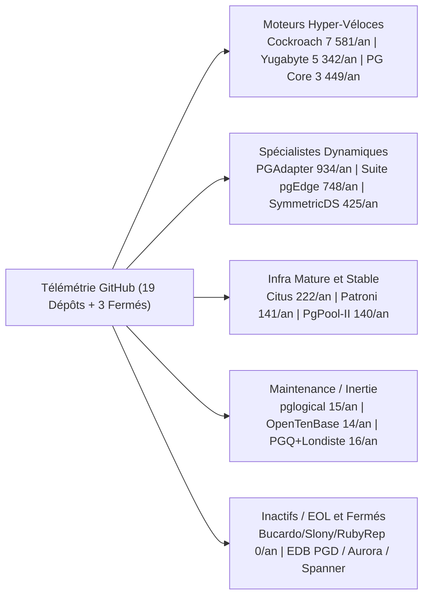

# 11 — Popularité, Présence Git et Vitalité de l'Écosystème

**Série :** Architectures PostgreSQL Multi-Maîtres & Active-Active  
**Auteur :** Jean-Marie Renouard (`jmrenouard`) — [LightPath](https://www.lightpath.fr)  
**Licence :** MIT License

---

## 1. Protocole de télémétrie GitHub (`2026-11-20T13:34:55Z`)

De nombreux choix d'architecture échouent en confondant notoriété passée ou étoiles GitHub cumulées avec la cadence réelle d'ingénierie. Le **`2026-11-20T17:26:02Z`**, [`scripts/collect_popularity.py`](../../scripts/collect_popularity.py) a interrogé les API REST et GraphQL GitHub sur **22 entrées du catalogue** (**19 dépôts publics** et **3 moteurs propriétaires/managés**) dans [`results/project_popularity.csv`](../../results/project_popularity.csv) :

- **Pagination exacte (`total_commits`, `commits_12m`, `contributors`) :** Interroge `per_page=1` sur la `default_branch` (`since=2025-11-20T13:34:55Z` sur 12 mois) et lit `Link: rel="last"` sans cloner les dépôts.
- **Vrais watchers et redirections :** Collecte `subscribers_count` (vrais observateurs, pas `watchers_count` qui duplique les étoiles), résout `JumpMind/symmetric-ds` -> `jumpmindinc/symmetric-ds` et cible `GoogleCloudPlatform/pgadapter`.
- **Tags chronologiques :** Lit `/releases/latest` avec repli GraphQL `TAG_COMMIT_DATE DESC` pour les dépôts à tags (`postgres/postgres`, `pgEdge/spock`, `cockroachdb/cockroach`, `pgpool/pgpool2`).

Pour opposer portée cumulée ($S$ étoiles) et élan actif ($C_{12\text{m}}$ commits sur 12 mois parmi $C_{\text{total}}$), nous suivons le **Momentum 12 mois ($M_{12\text{m}}$)**, la **Vélocité par étoile ($R_{\text{vel/star}}$)** et l'**Amplitude ($D_{\text{décades}}$)** :

$$
M_{12\text{m}} = \frac{C_{12\text{m}}}{C_{\text{total}}} \times 100\%, \qquad R_{\text{vel/star}} = \frac{C_{12\text{m}}}{\max(S, 1)}, \qquad D_{\text{décades}} = \log_{10}\!\left(\frac{v_{\max}}{v_{\min}^{+}}\right)
$$

Les 18 dépôts couvrent **trois ordres de grandeur** : étoiles de `26` (`pgq/londiste`) à `32 638` (`cockroachdb/cockroach`, $1\,255\times$, $D = 3,10$). Les commits totaux vont de `89` à `118 999` ($1\,337\times$, $D = 3,13$), les commits 12m de `8` à `7 581` ($948\times$, $D = 2,98$) et les contributeurs de `2` à `1 217` ($609\times$, $D = 2,78$). Comme au [Chapitre 09](09_methodologie_benchmarks_et_graphiques.md), l'échelle `log10` est indispensable.

---

## 2. Matrice complète de télémétrie (`22` lignes)

| Solution (`#`) | Présence Git (`Oui/Non`) | Compte Git (`Org/User`, Dépôts) | Dépôt | Étoiles / Forks | Commits (`Tot`/`12m`) | Contrib | Lang / SPDX | Tag (`Push`) |
| :--- | :--- | :--- | :--- | :---: | :---: | :---: | :--- | :--- |
| **PostgreSQL Core (`#1/#15/#16/#17`)** | Oui (Miroir*) | `postgres` (Org, 6) | `postgres/postgres` | 22 893 / 6 122 | 66 089 / **3 449** | 58* | C / NOASSERTION | `REL_19_0` (2026-11-20) |
| **Patroni HA (`#15b`)** | Oui | `patroni` (Org, 1) | `patroni/patroni` | 8 845 / 1 048 | 2 712 / 141 | 246 | Py / MIT | `v4.1.5` (2026-11-20) |
| **pgEdge Spock (`#2`)** | Oui | `pgEdge` (Org, 51) | `pgEdge/spock` | 769 / 59 | 1 616 / **621** | 32 | C / NOASSERTION | `v6.0.0-beta.2` (2026-11-20) |
| **pgEdge Snowflake (`#2b`)** | Oui | `pgEdge` (Org, 51) | `pgEdge/snowflake` | 103 / 14 | 239 / 48 | 20 | PLpgSQL / PG | `v2.6.1` (2026-11-18) |
| **pgEdge LOLOR (`#2c`)** | Oui | `pgEdge` (Org, 51) | `pgEdge/lolor` | 51 / 8 | 159 / 79 | 16 | C / PG | `v1.2.3` (2026-11-20) |
| **pglogical 2 (`#3`)** | Oui | `2ndQuadrant` (Org, 46) | `2ndQuadrant/pglogical` | 1 243 / 179 | 876 / **15** | 52 | C / NOASSERTION | `REL2_4_8` (2026-07-28) |
| **YugabyteDB (`#5`)** | Oui | `yugabyte` (Org, 314) | `yugabyte/yugabyte-db` | 10 670 / 1 481 | 41 469 / **5 342** | **1 217** | C / NOASSERTION | `v2026.1.3.0` (2026-11-20) |
| **CockroachDB (`#6`)** | Oui | `cockroachdb` (Org, 227) | `cockroachdb/cockroach` | **32 638** / 4 239 | **118 999** / **7 581** | 1 123 | Go / NOASSERTION | `v25.2.29` (2026-11-18) |
| **Citus (`#7`)** | Oui | `citusdata` (Org, 67) | `citusdata/citus` | 12 865 / 810 | 7 400 / 222 | 152 | C / AGPL-3.0 | `v14.3.0` (2026-11-20) |
| **OpenTenBase (`#8`)** | Oui | `OpenTenBase` (Org, 14) | `OpenTenBase/OpenTenBase` | 797 / 633 | 817 / **14** | 64 | C / NOASSERTION | `v5.0` (2026-11-09) |
| **Bucardo 5 (`#9`)** | Oui | `bucardo` (Org, 15) | `bucardo/bucardo` | 807 / 110 | 2 535 / **0** | 30 | Perl / NOASSERTION | `5.6.0` (2025-05-31) |
| **SymmetricDS (`#10`)** | Oui | `jumpmindinc` (Org, 8) | `jumpmindinc/symmetric-ds` | 882 / 241 | 14 926 / **425** | 96 | Java / N/A | `3.18.4` (2026-11-19) |
| **PgPool-II (`#11`)** | Oui (Miroir*) | `pgpool` (Org, 8) | `pgpool/pgpool2` | 448 / 102 | 4 627 / 140 | 35* | C / NOASSERTION | `V4_7_3` (2026-11-18) |
| **Slony-I (`#14a`)** | Oui | `ssinger` (User, 36) | `ssinger/slony1-engine` | 42 / 19 | 2 569 / **0** | 23 | C / NOASSERTION | `REL_2_2_11` (2024-03-11) |
| **PGQ Queue (`#14b`)** | Oui | `pgq` (Org, 13) | `pgq/pgq` | 427 / 23 | 89 / 8 | 7 | PLpgSQL / ISC | `v3.5.2` (2026-07-09) |
| **Londiste (`#14c`)** | Oui | `pgq` (Org, 13) | `pgq/londiste` | 26 / 8 | 195 / 8 | 5 | Py / ISC | `v3.12` (2026-07-22) |
| **RubyRep (`#14d`)** | Oui | `rubyrep` (User, 2) | `rubyrep/rubyrep` | 179 / 74 | 556 / **0** | **2** | Ruby / MIT | `v2.0.0` (2023-07-10) |
| **Spanner PGAdapter (`#13a`)** | Partiel (Proxy) | `GoogleCloudPlatform` (Org, 1 545) | `GoogleCloudPlatform/pgadapter` | 94 / 36 | 4 040 / **934** | 22 | Java / Apache-2.0 | `v0.56.4` (2026-11-20) |
| **YT Cluster Lite (Cœur MIT) (`#18`)** | Oui (Cœur MIT ; `ytserv` double lic.) | `DBinvent` (Org, 10) | `DBinvent/yt-cluster-lite` | 15 / 0 | 21 / **21** | **2** | Rust / MIT | `v1.21` (2026-11-20) |
| **EDB PGD / BDR (`#4`)** | Non (Propriétaire) | N/A (Propriétaire) | N/A | N/A | N/A | N/A | N/A / Proprietary | N/A |
| **AWS Aurora Limitless (`#12`)** | Non (Cloud managé) | N/A (Propriétaire) | N/A | N/A | N/A | N/A | N/A / Proprietary | N/A |
| **GCP Spanner & AlloyDB (`#13`)** | Partiel (Proxy seul) | N/A (Moteur fermé) | N/A | N/A | N/A | N/A | N/A / Proprietary | N/A |

**Vitalité du cœur PostgreSQL 18.6 (`#17`) :** Le [Clustering Natif PostgreSQL 18.6](solutions/pg18_native_clustering.md) ([Ch. 12](12_clustering_postgresql_18_et_benchmarks.md)) hérite directement du niveau **S** de `postgres/postgres` : **`66 089`** commits totaux, **`3 449`** commits/12m, **`22 893`** étoiles, **`6 122`** forks, `Organization` `postgres` (`6` dépôts publics), miroir officiel de `git.postgresql.org`.

*\*Notes : `postgres/postgres` (58) et `pgpool/pgpool2` (35) sont des miroirs officiels en lecture seule de `git.postgresql.org`. Les contributeurs reflètent les committeurs, non tous les auteurs. `NOASSERTION` signale des licences doubles ou personnalisées (PostgreSQL sur Core/Spock/pglogical, BSL/CSL CockroachDB, Apache-2.0 + Polyform YugabyteDB, BSD PgPool/Bucardo/Slony). `cockroachdb` porte `v25.2.29` (LTS) près de `v26.2.12`. `pgEdge/spock` couple `v6.0.0-beta.2` et la stable `v5.0.14`.*

---

## 3. Graphiques logarithmiques et Explorateur interactif

Filtrez les 22 entrées (19 dépôts publics + 3 fermés), basculez `log10` / linéaire et croisez vitalité Git et débits empiriques dans l'[**Explorateur interactif hors-ligne (`dashboard/index.html`)**](../../dashboard/index.html).

### Graphique 08 — Portée communautaire : Étoiles et Forks (`log10`)

*Compare la notoriété cumulée (`15` à `32 638` étoiles et `0` à `6 122` forks) sur 19 dépôts face aux moteurs fermés/managés.*

### Graphique 09 — Vitalité d'ingénierie : Commits, Vélocité 12m et Contributeurs (`log10`)

*Expose l'écart entre étoiles héritées et activité réelle : `pgEdge/spock` (`621`/12m) et `pgadapter` (`934`/12m) dépassent les outils anciens figés.*

---

## 4. Popularité vs Vitalité d'ingénierie : cinq constats clés

1. **Biais des miroirs GitHub (`postgres/postgres`, `pgpool/pgpool2`) :** `postgres/postgres` affiche `0` issue GitHub et `58` contributeurs — un artefact trompeur. Comme `pgpool/pgpool2` (`4 627` commits, `140`/12m, `V4_7_3`), `postgres/postgres` (`66 089` commits, `3 449`/12m, `6 122` forks, `REL_19_0`) est un **miroir officiel de `git.postgresql.org`** alimenté par listes de diffusion et Commitfest.
2. **Ingénierie Raft vs licences (`CockroachDB`, `YugabyteDB`) :** `cockroachdb/cockroach` mène en étoiles (`32 638`), commits (`118 999`) et cadence 12m (`7 581` = `20,8`/j). `yugabyte/yugabyte-db` domine en contributeurs (`1 217`), dépôts org (`314`) et momentum ($M_{12\text{m}} = 12,9\%$, `5 342`/12m). Tous deux portent `8 029-9 772` issues et des licences `NOASSERTION` à auditer.
3. **Piège de l'inertie des étoiles (`pgEdge/spock` vs `pglogical` et `Bucardo`) :** `2ndQuadrant/pglogical` (`1 243` étoiles) et `bucardo/bucardo` (`807` étoiles) devancent `pgEdge/spock` (`769` étoiles). Pourtant, **`pgEdge/spock` a livré `621` commits/12m** ($M_{12\text{m}} = 38,4\%$, $R_{\text{vel/star}} = 0,81$). Il devance `pglogical` de **`41,4x`** (`15`/12m, `191` issues), tandis que `bucardo` affiche **`0` commit** depuis le `2025-05-31`. Avec `snowflake` (`48`/12m) et `lolor` (`79`/12m, $M_{12\text{m}} = 49,7\%$), pgEdge cumule **`748` commits/12m**.
4. **Maturité ciblée et moteurs discrets (`Patroni`, `Citus`, `SymmetricDS`, `PGAdapter`) :** `patroni/patroni` (`8 845` étoiles, `246` contributeurs, `1` dépôt, `MIT`) maintient la référence HA avec `141` commits/12m (`v4.1.5`). `citusdata/citus` (`12 865` étoiles, `AGPL-3.0`) suit PG 17/18 (`222`/12m, `v14.3.0`). `jumpmindinc/symmetric-ds` (`882` étoiles, `14 926` commits, `425`/12m) reste industriel et discret, tandis que `GoogleCloudPlatform/pgadapter` atteint **`934` commits/12m** pour `94` étoiles ($R_{\text{vel/star}} = 9,94$) devant un moteur propriétaire.
5. **Stagnation à fort ratio de forks et EOL (`OpenTenBase`, `PGQ`, `Slony-I`, `RubyRep`) :** `OpenTenBase` montre un ratio forks/étoiles de `0,79` (`633/797`) pour `14` commits `master`/12m (`421` issues). `pgq`/`londiste` subsistent en survie (`8`/12m, `5-7` contributeurs). `ssinger/slony1-engine` (`User`, `0`/12m) et `rubyrep/rubyrep` (`User`, `2` contributeurs, `0`/12m) sont EOL.

---

## 5. Bus-Factor et niveaux de pérennité en production

| Niveau | Projets (`#`) | Vélocité 12m | Bus-Factor & Gouvernance | Verdict Production |
| :---: | :--- | :---: | :--- | :--- |
| **S — Cœur** | `PostgreSQL Core` (`#1/#15/#16/#17`), `Patroni` (`#15b`) | 141-3 449 | Communauté multi-éditeurs ; licences PostgreSQL / MIT | **Risque minimal.** Socle par défaut pour 80 %+ des OLTP. |
| **A — OSS Actif** | `CockroachDB` (`#6`), `YugabyteDB` (`#5`), `Citus` (`#7`), `pgEdge` (`#2`) | 222-7 581 | Équipes financées (32-1 217 contribs) ; surveiller BSL/AGPL | **Viable.** Auditer licence, roadmap et coût WAN. |
| **B — Niche** | `SymmetricDS` (`#10`), `PgPool-II` (`#11`) | 140-425 | Mainteneurs dédiés (35-96 contribs) | **Usage ciblé.** Sync hétérogène (`#10`) ou pooling (`#11`). |
| **C — Fragile / Jeune** | `pglogical 2` (`#3`), `OpenTenBase` (`#8`), `PGQ`/`Londiste` (`#14b/c`), `YT Cluster Lite` (`#18`) | 8-21 | Noyau réduit (2-64 contribs) ; `#18` bus-factor `1` + `ytserv` fermé | **Éviter en cœur neuf.** Migrer l'ancien ; suivre `#18`. |
| **D — EOL** | `Bucardo 5` (`#9`), `Slony-I` (`#14a`), `RubyRep` (`#14d`) | **0** | Zéro commit 12m ; dépôts `User` (`#14a/d`), bus-factor 1-2 | **Ne pas déployer.** Décommissionner les parcs existants. |
| **Fermé / Cloud** | `EDB PGD` (`#4`), `Aurora Limitless` (`#12`), `Spanner`/`AlloyDB` (`#13`) | Opaque (934 proxy) | Zéro télémétrie Git moteur ; SLA éditeur et verrouillage | **Audit contractuel.** Évaluer réversibilité, `PGAdapter`, TCO. |

**Nuance vitalité YT Cluster Lite (`#18`) :** [YT Cluster Lite](solutions/yt_cluster_lite.md) (`DBinvent/yt-cluster-lite`, `15` étoiles, `0` fork, `21` commits totaux/`21` sur 12m, `v1.21`) est un dépôt MIT âgé de 7 jours. Il compte `2` contributeurs (`1` humain + `dependabot`, **bus-factor = 1**), tandis que `ytserv` reste fermé sous licence PolyForm Noncommercial/Commerciale.

---

**Navigation :** [Index](../../README.fr.md) · [Ch. 10 — Streaming vs Logique vs Multi-Maîtres](10_comparatif_streaming_logique_multimaster.md) · [Ch. 12 — Benchmarks PG 18.6](12_clustering_postgresql_18_et_benchmarks.md) · [English version](../en/11_ecosystem_popularity_and_vitality.md)
