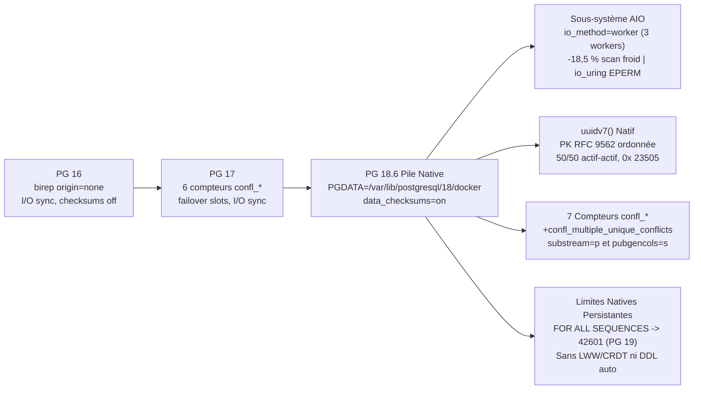

# 12 — Évolution du Clustering PostgreSQL 18 et Benchmarks Empiriques

**Série :** Architectures PostgreSQL Multi-Maîtres & Active-Active  
**Auteur :** Jean-Marie Renouard (`jmrenouard`) — [LightPath](https://www.lightpath.fr)  
**Copyright :** Copyright (c) 2026 Jean-Marie Renouard  
**Licence :** MIT License  
**Liens :** [English version](../en/12_postgresql_18_clustering_and_benchmarks.md) · [Ch. 10 — Streaming vs Logique vs Multi-Maîtres](10_comparatif_streaming_logique_multimaster.md) · [Ch. 11 — Popularité et Vitalité](11_popularite_et_vitalite_ecosysteme.md)

---

## 1. Évolution du clustering : PostgreSQL 16 -> 17 -> 18

Nous avons déployé **`PostgreSQL 18.6 (Debian 18.6-1.pgdg13+2)`** sur les cinq topologies natives (`pg18-standalone`, `pg18-async-streaming`, `pg18-sync-streaming`, `pg18-logical`, `pg18-birep`), collectant **87 lignes de benchmarks séquentiels** ([`results/benchmark_pg18.csv`](../../results/benchmark_pg18.csv)) et **5 x 26 sondes fonctionnelles** ([`results/functional_limits_pg18.csv`](../../results/functional_limits_pg18.csv), journal [`results/logs/pg18-benchmark.log`](../../results/logs/pg18-benchmark.log)).

### Matrice évolutive PostgreSQL 16 vs PostgreSQL 17 vs PostgreSQL 18

| Capacité / Défaut | PostgreSQL 16 | PostgreSQL 17 (`17.11`) | PostgreSQL 18 (`18.6`) |
| :--- | :--- | :--- | :--- |
| **Docker `PGDATA` / `VOLUME`** | `/var/lib/postgresql/data` | `/var/lib/postgresql/data` | **`/var/lib/postgresql/18/docker`**, `VOLUME /var/lib/postgresql` |
| **Défaut `data_checksums`** | `off` | `off` | **`on`** à `initdb` (détection de corruption silencieuse) |
| **AIO (`io_method`)** | `sync` seul | `sync` seul | **`worker` (`io_workers=3`)** défaut ; `sync` ; `io_uring` (`EPERM` seccomp Docker) |
| **Clés PK actif-actif** | `SERIAL` décalé / ext. | Décalé / `snowflake` | **`uuidv7()` natif** (UUID RFC 9562 chronologique) |
| **Télémétrie conflits** | Erreurs apply seules | 6 compteurs `confl_*` | **7 compteurs `confl_*`** (+`confl_multiple_unique_conflicts`) |
| **Apply & col. générées** | `streaming=on` opt-in | `streaming=parallel` opt-in | **`substream=p` défaut** ; `publish_generated_columns=stored` (`s`) ; virtuel défaut |
| **Sync séquences (`T18`)** | Absent (`23505`) | Absent (`23505`) | **Absent (`SQLSTATE 42601` sur `FOR ALL SEQUENCES` / `REFRESH SEQUENCES` ; PG 19)** |
| **LWW / CRDT / DDL birep** | Manuel (`origin=none`) | Manuel (`origin=none`) | **Toujours manuel** : sans LWW/CRDT auto ni DDL (`TRUNCATE` seul) |

---

## 2. Constats empiriques PG 18.6 : AIO, `uuidv7()` et compteurs de conflits

Nous mesurons la variation AIO $\Delta_{\text{AIO}}$ et le ratio générationnel $S_{18/17}$ selon :

$$
\Delta_{\text{AIO}} = \frac{t_{\text{worker}} - t_{\text{sync}}}{t_{\text{sync}}} \times 100\%, \qquad S_{18/17} = \frac{\text{TPS}_{\text{PG18}}}{\text{TPS}_{\text{PG17}}}
$$

### 2.1 Sonde contrôlée A/B `io_method` (`pg18-standalone`)

- **Scan froid post-checkpoint :** `worker` (`829,4 ms`) bat `sync` (`1 018,3 ms`) de **$\Delta_{\text{AIO}} = -18,5\%$** (prefetch parallèle).
- **Scan chaud cache OS :** `385,0 ms` (`worker`) vs `352,5 ms` (`sync`) (`+9,2 %` IPC sur pages en RAM).
- **Micro-OLTP `pgbench` `fsync` :** `290,75` (`worker`) vs `323,98 TPS` (`sync`) (`-10,3 %`, IPC + `data_checksums=on`).
- **`io_method=io_uring` :** Rejeté (`EPERM`) sous le profil seccomp Docker par défaut.

### 2.2 Preuve actif-actif avec `uuidv7()` (`pg18-birep`)

- **Convergence 50/50 :** `id UUID PRIMARY KEY DEFAULT uuidv7()` converge **50/50 insertions bi-nœuds** (`0` `23505`, `0` inversion B-tree) vs `SERIAL` (`23505`, `confl_insert_exists=1`).
- **`H_append_only_insert` :** Deux écrivains `pg18-birep` atteignent **`2 066,70 TPS`** (`p95 = 5,42 ms`, `PASS_CONVERGED`, `24 767/24 767`) vs PG 17 `627,13 TPS` (`p95 = 32,79 ms`) = **`3,30x`** ($S_{18/17} = 3,30$).

### 2.3 Vérification en direct `pg_stat_subscription_stats` et `L1-L8` / `T11-T18`

| Compteur (`pg_stat_subscription_stats`) | `pg18-logical` | `pg18-birep` | Déclencheur réel et effet observé |
| :--- | :---: | :---: | :--- |
| `confl_insert_exists` | **2** | **2** | Collision `SERIAL` + `UNIQUE(email)` (`SQLSTATE 23505` ; arrêt apply) |
| `confl_update_origin_differs` | **1** | **1/2** | *Lost Update* `+100/-30` (`n1=970,00` vs `n2=1100,00` ; divergence) |
| `confl_update_missing` | **1** | **1** | `T12` `UPDATE` vs `DELETE` (`logical` diverge ; `birep` -> `DELETED`) |
| `confl_delete_missing` | **1** | 0 | `DELETE` distant sur une ligne déjà supprimée côté abonné |
| `confl_delete_origin_differs` | 0 | **1** | `T12` `DELETE` concurrent d'un `UPDATE` distant sur `pg18-birep` |
| `confl_multiple_unique_conflicts` *(PG 18)* | 0 | **1** | `INSERT` unique heurtant simultanément la PK et `UNIQUE(email)` |

Résultats clés `L1-L8` / `T11-T18` (`results/functional_limits_pg18.csv`) :
- **`T11` Bulk 10k :** `pg18-async-streaming` mène à **`87 903 lignes/s`** (`114 ms`, rattrapage `88,4 ms` vs `28 693` PG 17). `standalone` atteint `80 108` (`+52,6 %`), `sync-streaming` `75 629` (`+90,5 %`, `99,8 ms`), `birep` `70 470` (`321,2 ms`) et `logical` `69 827` (`316,0 ms`).
- **`T13` Course FK inter-nœuds :** `pg18-birep` révèle une course FK asynchrone (**`2/10 ok`, `23503x8`**). Le streaming bloque (`25006x10`), tandis que `standalone` et `logical` passent `10/10`.
- **`T14` / `T15` / `T16` / `T17` :** 5/5 sont bit-identiques (`md5=00493e3a`, `BYTEA` `65 536 o`, `JSONB`, UTF-8). Le lag RAW `T15` baisse partout (`pg18-async` `4,41/5,80` vs `9,65/25,13 ms`, `sync` `1,47/2,07`, `logical` `1,46/1,68`, `birep` `1,25/1,75 ms`). 5/5 valident `T16` (`RPO=0`, `21/21`) et `T17` (`NO_DIRTY_READ`, `82-114 ms`).
- **`T18` Séquences & `L7` WAL :** Le streaming garde `66|true` (`next_id=67`, `3 008 o` WAL, sync gèle sur `wait_event=SyncRep`). `pg18-logical` (`19 448 o`) et `pg18-birep` (`352 664 o`) lèvent **`SQLSTATE 42601`** (`FOR ALL SEQUENCES` / `REFRESH SEQUENCES`) et restent à `1|false` -> **`SQLSTATE 23505`**.

---

## 3. Benchmarks face-à-face : PostgreSQL 18.6 vs PostgreSQL 17.11

Les 87 mesures PG 18.6 tournent séquentiellement à `PG_SCALE=2` dans le harnais `bench_client` identique (`results/benchmark_pg18.csv` vs `benchmark_summary.csv`, `benchmark_extended_workloads.csv`, `benchmark_wan_sweep.csv`, `benchmark_concurrency_sweep.csv`).

### 3.1 Suites `pgbench` et `H_append_only` (TPS : PG 18.6 / PG 17.11)

| Paire | `A_single_rw` | `B1_disjoint` | `B2_overlap` (Dérive) | `C_ro` (16c) | `D_hot_conflict` (Dérive) | `H_append_only` (Ratio) |
| :--- | :---: | :---: | :---: | :---: | :---: | :---: |
| **`standalone`** | 784,43 / 866,82 | 712,70 / 920,07 | 506,21 / 879,01 (0) | 42 373,67 / 55 614,16 | 2 117,66 / 3 128,63 (0) | 1 956,76 / 3 108,22 (0,63x) |
| **`async-streaming`** | 558,34 / 610,15 | 349,25 / 627,39 | 353,30 / 584,80 (0) | **47 548,05** / 45 358,52 | **2 277,43** / 2 081,26 (0) | 1 423,07 / 2 511,15 (0,57x) |
| **`sync-streaming`** | **497,94** / 409,48 | **523,12** / 407,41 | **472,20** / 465,22 (0) | 32 258,16 / 54 483,07 | 1 223,75 / 1 370,10 (0) | **1 760,26** / 1 301,45 (**1,35x**) |
| **`logical`** | 314,26 / 532,38 | **287,13** / 251,63 | **475,08** / 355,57 (0) | **45 862,68** / 42 302,43 | **2 998,37** / 2 386,93 (0) | **3 518,49** / 1 901,20 (**+85,1 %**) |
| **`birep`** | 514,28 / 875,91 | 417,18 / 820,09 | 792,45 / 1 228,60 (-338 / -4 567) | 42 190,66 / 53 072,52 | **1 774,11** / 1 231,15 (-83 252 / -71 063) | **2 066,70** / 627,13 (**3,30x**) |

### 3.2 `sysbench` (`E`, `E2`, `E3`, `E4`) et `T11` Bulk 10k (PG 18.6 / PG 17.11)

| Paire | `E_oltp_rw` TPS | `E2_oltp_ro` TPS | `E3_oltp_wo` TPS | `E4_point_select` QPS | `T11` Bulk 10k (`lignes/s`) |
| :--- | :---: | :---: | :---: | :---: | :---: |
| **`standalone`** | 1 046,67 / 1 129,51 | **2 000,88** / 1 774,04 (+12,8 %) | 1 382,15 / 1 784,36 | 130 850,73 / 143 147,96 | **80 108** / 52 496 (+52,6 %) |
| **`async-streaming`** | **980,72** / 962,84 | 1 706,90 / 1 804,13 | **1 809,82** / 1 569,06 (+15,3 %) | 126 416,90 / 148 022,41 | **87 903** / 28 693 (**3,06x**) |
| **`sync-streaming`** | 767,63 / 819,36 | **1 869,54** / 1 693,64 (+10,4 %) | **1 184,57** / 370,71 (**3,20x**) | 122 246,91 / 124 105,25 | **75 629** / 39 697 (+90,5 %) |
| **`logical`** | **1 027,84** / 595,81 (+72,5 %) | 1 517,26 / 1 806,08 | **1 582,39** / 801,11 (**+97,5 %**) | 131 542,35 / 146 564,77 | **69 827** / 52 816 (+32,2 %) |
| **`birep`** | 1 055,55 / 1 105,32 | **2 053,07** / 1 658,72 (+23,8 %) | **1 492,99** / 1 308,81 (+14,1 %) | **146 907,74** / 141 203,99 | **70 470** / 65 881 (+7,0 %) |

### 3.3 Balayages WAN (`10 / 25 / 50 ms`) et Concurrence (`c = 1, 4, 8, 16, 32`)

| Paire | WAN `10/25/50ms` PG 18 | WAN `10/25/50ms` PG 17 | Conc `c=1/4/8/16/32` PG 18 | Conc `c=1/4/8/16/32` PG 17 |
| :--- | :---: | :---: | :---: | :---: |
| **`standalone`** | N/A | N/A | 308,6 / 753,5 / 832,5 / 692,8 / 813,9 | 298,4 / 525,0 / 630,2 / 739,6 / 801,3 |
| **`async-streaming`** | 617,0 / 554,9 / 408,0 | 587,2 / 599,6 / 619,4 | 399,7 / 586,1 / 651,5 / 634,1 / 624,9 | 336,8 / 545,9 / 577,7 / 624,8 / 571,6 |
| **`sync-streaming`** | 113,7 / 41,6 / 25,6 | 121,8 / 57,0 / 25,8 | 286,8 / 315,1 / 307,0 / 425,2 / 305,2 | 89,9 / 238,2 / 410,8 / 424,7 / 425,0 |
| **`logical`** | **683,3 / 844,1 / 721,6** | 636,6 / 654,1 / 395,5 | 407,6 / 788,6 / 718,2 / 736,4 / 627,7 | 306,1 / 731,1 / 736,3 / 596,1 / 706,7 |
| **`birep`** | **763,8 / 747,4 / 782,6** | 274,5 / 824,0 / 223,3 | **334,7 / 689,2 / 799,8 / 790,5 / 721,5** | 201,0 / 196,6 / 162,4 / 337,6 / 254,4 |

### Synthèse des performances

1. **Gains nets de PG 18.6 :** `substream=p`, `uuidv7()` et le groupement I/O accélèrent `H_append_only` (`pg18-birep` **3,30x**, `pg18-logical` **+85,1 %**, `pg18-sync` **+35,3 %**). En `sysbench` écriture, `pg18-sync` `E3` gagne **3,20x** et `pg18-logical` **+72,5 %** (`E`) / **+97,5 %** (`E3`), avec `c=8` (**4,92x**), WAN `50 ms` (**3,50x**) et `T11` (+7 % à **3,06x**).
2. **Coût honnête sur micro-OLTP chaud :** Sur petites écritures en cache (`A`/`B1`/`B2`) et `C`, `data_checksums=on` et `io_method=worker` réduisent les pointes de `-8,5 %` à `-41 %`. Ce retrait concorde avec PG 17 (`checksums=off`, `sync`) et la sonde A/B (`290,75` vs `323,98 TPS`).
3. **Lois physiques inchangées :** `pg18-sync-streaming` chute de `-94,9 %` à `50 ms` WAN (`25,60 TPS`, `p95 = 766,21 ms`). `pg18-birep` diverge encore sur chevauchement (`B2` `-338`, `D` `-83 252`).

---

## 4. Guide d'upgrade et d'architecture en production (PG 16 -> 17 -> 18)

### 4.1 Liste de contrôle (`PG 16/17 -> PG 18.6`)

1. **Stockage conteneur :** Monter `/var/lib/postgresql` et résoudre `$PGDATA` (`/var/lib/postgresql/18/docker`) dans `pg_basebackup` et Patroni.
2. **Checksums et AIO :** Activer les checksums avant `pg_upgrade` (`pg_checksums --enable`). Garder `io_method=worker` en mixte ou scans. Tester `sync` en micro-OLTP RAM et ouvrir `io_uring` dans seccomp avant bascule.
3. **Séquences manuelles :** Avant PG 19, exécuter le script `setval()` (Ch. 10, §5.2) sur chaque bascule logique pour éviter `SQLSTATE 23505`.

### 4.2 Frontière honnête : PG 18 natif vs extensions et SQL distribué

| Besoin cible | PG 18 natif suffisant ? | Architecture recommandée |
| :--- | :---: | :--- |
| HA mono-primaire (`RPO=0` métro, parité PG) | **Oui** | **Streaming PG 18 + Patroni** (`pg18-sync` +21,6 % `A`, +90,5 % `T11`) |
| Upgrade majeur sans coupure / flux filtrés | **Oui (avec `setval`)** | **Logique PG 18** (`substream=p`, `pubgencols=s`, +72,5 % `E`, +85,1 % `H`) |
| Actif-actif append-only / clés disjointes | **Oui (`uuidv7()`)** | **Birep PG 18 (`origin=none`) + `uuidv7()` + `confl_*`** (2 066,70 TPS, 0 clash PK) |
| Compteurs chevauchants, LWW, Auto-DDL, 3+ nœuds | **Non** | **pgEdge Spock 5 (`delta_apply` CRDT)** ou **EDB PGD** (PG 18 dérive -83 252 en D) |
| ACID `RPO=0` global, `UNIQUE` global, FK inter-nœuds | **Non** | **YugabyteDB** ou **CockroachDB** (`pg18-birep` subit `23505` et `T13` `23503x8`) |

---

**Navigation :** [Index](../../README.fr.md) · [Ch. 09 — Méthodologie & Graphiques Log10](09_methodologie_benchmarks_et_graphiques.md) · [Ch. 10 — Streaming vs Logique vs Multi-Maîtres](10_comparatif_streaming_logique_multimaster.md) · [Ch. 11 — Popularité et Vitalité](11_popularite_et_vitalite_ecosysteme.md) · [English version](../en/12_postgresql_18_clustering_and_benchmarks.md)
