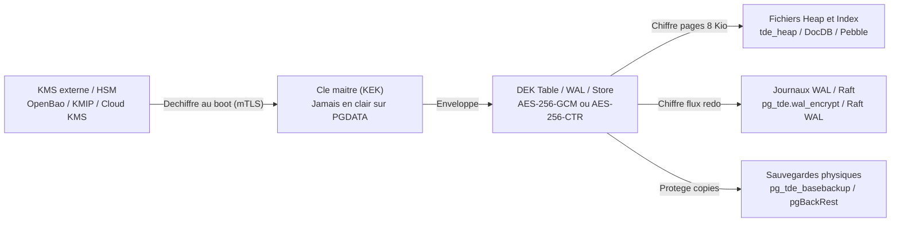

# 14 — Chiffrement Transparent des Données (TDE) et Chiffrement au Repos

**Série :** Architectures PostgreSQL Multi-Maîtres & Active-Active  
**Auteur :** Jean-Marie Renouard (`jmrenouard`) — [LightPath](https://www.lightpath.fr)  
**Licence :** MIT License  
**Liens :** [English version](../en/14_transparent_data_encryption_tde.md) · [Ch. 04 — Étude comparative](04_etude_comparative_fonctionnalites.md) · [Ch. 07 — Guide de choix](07_guide_de_choix_et_architecture_cible.md) · [Ch. 10 — 5 niveaux](10_comparatif_streaming_logique_multimaster.md) · [Ch. 12 — PG 18.6](12_clustering_postgresql_18_et_benchmarks.md) · [Portail Docs](../index.md)

---

## 1. Couches de chiffrement et modèle de menaces

Les normes (PCI-DSS, HIPAA, GDPR, DORA) imposent le chiffrement fort des bases et sauvegardes. PostgreSQL communautaire (`15` à `18.6`) reste dépourvu de TDE natif dans le noyau. Les équipes combinent quatre couches :

1. **Chiffrement de transport (`TLS 1.3`) :** `hostssl` et `sslmode=verify-full` protègent les clients SQL, le flux WAL physique et `pgoutput` sur le réseau.
2. **Chiffrement OS et bloc :** `dm-crypt`/LUKS, ZFS ou un KMS cloud (EBS/PD) chiffrent les disques bruts. Une fois montés, le noyau livre les blocs en clair à l'utilisateur `root`.
3. **TDE moteur (`KEK / DEK`) :** Le moteur chiffre les pages heap, les index et le WAL en mémoire avant écriture. Les instantanés bruts et copies froides restent illisibles sans clé KMS.
4. **Chiffrement applicatif :** Des bibliothèques client ou `pgcrypto` chiffrent les colonnes sensibles avant `INSERT`. Ce modèle protège les données même face à un superutilisateur `postgres` ou un export `pg_dump`.

| Vecteur de menace | TLS 1.3 seul | Disque OS / LUKS / Cloud | TDE moteur (`KMS`) | Chiffrement client |
| :--- | :---: | :---: | :---: | :---: |
| **Écoute réseau (*packet sniffing*)** | Protégé | Exposé | Exposé | Protégé |
| **Vol de disque physique ou snapshot brut** | Exposé | Protégé | Protégé | Protégé |
| **Copie fichier sur OS monté (`root` / DBA)** | Exposé | **Exposé** | **Protégé** *(exige KMS)* | Protégé |
| **Export `pg_dump` ou `SELECT` superutilisateur** | Exposé | Exposé | Exposé | **Protégé** |

> [!IMPORTANT]
> **Périmètre laboratoire :** Les piles PoC `env/multi-db-docker-env` fonctionnent sans KMS externe ni TDE par défaut. En production, raccordez un KMS externe (`OpenBao`, `KMIP`, `AWS KMS`, `GCP Cloud KMS`, `Azure KMS` ou `OCI KMS`).

---

## 2. Hiérarchie des clés TDE (`KEK` / `DEK`)

Le TDE moderne sépare la clé maître durable (*Key Encryption Key*, `KEK`) des clés de pages (*Data Encryption Key*, `DEK`). Ce chiffrement par enveloppe autorise la rotation `KEK` sans réécrire des téraoctets de données :

Sous chiffrement par enveloppe, le surcoût total $O_{\text{TDE}}$ dépend de l'accélération matérielle AES-NI et du cache de clés :

$$
O_{\text{TDE}} \approx L_{\text{AES-NI}}(b) + P_{\text{miss}} \cdot \text{RTT}_{\text{KMS}}, \qquad T_{\text{effective}} = \frac{T_{\text{plain}}}{1 + \delta_{\text{CPU}}}
$$

Avec les extensions AES-NI ou ARMv8 Crypto actives, $\delta_{\text{CPU}}$ reste entre `2 %` et `8 %` en OLTP. Les appels KMS ($P_{\text{miss}}$) surviennent uniquement au démarrage, lors d'une rotation ou à la création de table.

---

## 3. PostgreSQL 17/18 face aux forks entreprise et au SQL distribué

### 3.1 PostgreSQL communautaire (`15`, `16`, `17`, `18.6`)

Le cœur PostgreSQL (`#1`, `#15`, `#16`, `#17`) ne contient **aucun** TDE natif. PostgreSQL 18.6 active `data_checksums=on` par défaut et l'I/O asynchrone (`io_method=worker`). Ces fonctions détectent la corruption disque, mais heap et WAL restent en clair sur disque.

### 3.2 Extension open source `pg_tde` 2.1 (Percona Server for PostgreSQL)

**Percona `pg_tde` 2.1** fournit un TDE open source (Apache 2.0 / PG) pour **Percona Server for PostgreSQL 17** et **18.1+** (avec AIO PG 18) :

- **Tables et WAL :** Utilise `tde_heap` (`AES-128` ou `AES-256-GCM`) et le **chiffrement WAL GA** (`pg_tde.wal_encrypt = on`). Les tables hors `tde_heap` (temporaires ou `pg_stat_*`) exigent le chiffrement OS.
- **KMS externe :** Supporte **KMIP** (`mTLS`) et les espaces **OpenBao** pour les KEK globales ou par base (`file` pour labo seul).
- **Binaires dédiés :** Les outils standard (`pg_basebackup`, `pg_waldump`, `pg_rewind`, `pg_upgrade`) échouent sur fichiers chiffrés. Utilisez `pg_tde_basebackup`, `pg_tde_waldump`, `pg_tde_rewind`, `pg_tde_resetwal`, `pg_tde_checksums` et `pg_tde_upgrade`.

### 3.3 Distributions commerciales (EDB et Cybertec PGEE)

- **EDB Postgres (`EPAS` / `PGE`, base de `#4 EDB PGD`) :** Active le TDE cluster `AES-128`/`AES-256` dès `initdb --data-encryption`. Protège la DEK par `--key-wrap-command` et `--key-unwrap-command` (KMIP, OpenBao ou KMS cloud) sur heap, WAL et temporaires.
- **Cybertec PGEE :** Propose un chiffrement commercial `AES-256` sur tout le cluster (heap, WAL, temporaires) avec `pgBackRest`.

### 3.4 Moteurs SQL distribués et offres cloud managées

- **#5 YugabyteDB (`DocDB`) :** Chiffrement natif open source au repos (`AES-128`/`256`) par clé universelle (`KEK`) et DEK par tablet. Chiffre SSTables, WAL Raft et backups avec KMIP, OpenBao ou KMS cloud.
- **#6 CockroachDB :** Chiffre Pebble, journaux Raft et backups en AES-CTR avec `--enterprise-encryption`. Les builds BSL gratuits excluent cette option hors licence Enterprise ou Cloud (`CMEK`).
- **#12 AWS Aurora Limitless et #13 GCP Spanner / AlloyDB :** Chiffrent le stockage (`Aurora` 6 copies, `Spanner`, `AlloyDB` LPS) avec `AWS KMS` CMK ou `GCP Cloud KMS` CMEK (`HSM` / `EKM`). `AlloyDB Omni` repose sur LUKS hôte ou CSI KMS Kubernetes.

---

## 4. Matrice TDE sur les 18 architectures du catalogue

Ce tableau synthétise le support du chiffrement au repos pour les solutions `#1` à `#18` ([Ch. 04 Matrice F](04_etude_comparative_fonctionnalites.md)) :

| # | Architecture | TDE moteur | Portée des clés et KMS | Impact réplication et sauvegarde | Socle production recommandé |
| :---: | :--- | :--- | :--- | :--- | :--- |
| **#1** | PG 16-18 Birep natif | Absent du cœur PG | OS/LUKS ou Percona `pg_tde` (`KMIP`/`OpenBao`) | `pgoutput` envoie des lignes sous TLS ; KEK indépendantes OK | LUKS + `hostssl` + `pgBackRest` AES (`pg_tde` si OSS) |
| **#2** | pgEdge / Spock v5 | Absent de `spock` std | OS/LUKS ou KMS cloud (`hostssl` maillé) | `spock_output` transmet lignes/deltas sous TLS | LUKS/KMS cloud + `sslmode=verify-full` + dépôt chiffré |
| **#3** | pglogical 2 | Absent du cœur PG | OS/LUKS ou KMS cloud | Le flux logique exige TLS (`hostssl`) | LUKS/KMS cloud + dépôt `pgBackRest` chiffré |
| **#4** | EDB PGD (BDR) | **Intégré (`EPAS`/`PGE`)** | `initdb --data-encryption` + `key_wrap_command` (`KMIP`/KMS) | Raft/logique sous TLS ; `Barman` hérite du TDE + KMS | TDE cluster EPAS/PGE + KMIP/KMS externe + TLS 1.3 |
| **#5** | YugabyteDB (`YSQL`) | **Intégré OSS (`DocDB`)** | Clé universelle + DEK tablet (`KMIP`, `OpenBao`, Cloud KMS) | WAL Raft, SSTables et `yb_backup` chiffrés bout en bout | Activer le chiffrement DocDB + TLS inter-nœuds |
| **#6** | CockroachDB | **Enterprise / Cloud seul** | `--enterprise-encryption` + Store Keys + KMS / KMIP | Chiffre Pebble, WAL Raft et `BACKUP` ; absent en BSL gratuit | Licence Enterprise `--enterprise-encryption` (ou Cloud CMEK) |
| **#7** | Citus | Absent OSS (`pg_tde` opt.) | OS/LUKS/KMS cloud (Azure SSE/CMK managé) | Liens 2PC coordinateur-workers sous TLS ; `pgBackRest` | LUKS/KMS cloud + TLS `citus_add_node` + `pgBackRest` |
| **#8** | OpenTenBase / PG-XL | Absent fork PG 10-11 | OS/LUKS sur disques CN, DN et GTM | Trafic GTM/DN sous TLS (vérifier anciens chiffrements) | OS LUKS/dm-crypt sur tous les nœuds CN/DN/GTM |
| **#9** | Bucardo 5 | Absent du cœur PG | OS/LUKS sur nœuds PG + base contrôle `bucardo` | **Tables `bucardo.delta_*`** en clair sans disque/TDE | LUKS sur données et base `bucardo` + TLS + `pgBackRest` |
| **#10** | SymmetricDS | Absent PG (`Pro` lots) | OS/LUKS sur PG + disque tampon JVM | Files `sym_data` hors-ligne persistantes ; imposer HTTPS TLS | LUKS sur BD + disque Edge + HTTPS mTLS |
| **#11** | PgPool-II | **N/A (Proxy seul)** | `pool_passwd` AES-256 + TLS ; backends sous LUKS/`pg_tde` | Termine le TLS client ; rechiffre vers les backends PG | Imposer TLS sur les deux sauts + LUKS/TDE sur backends |
| **#12** | AWS Aurora Limitless | **Stockage managé (`KMS`)** | `AWS KMS` CMK (AES-256, fixé à la création) | Chiffre stockage 6x AZ, shards et snapshots continus | Créer le groupe de shards avec une CMK dédiée |
| **#13** | GCP Spanner & AlloyDB | **Managé (`CMEK`)** | AES-256 Google + `GCP Cloud KMS` / `EKM` | Chiffre Colossus/LPS et backups (`Omni` : KMS hôte) | Activer CMEK Cloud KMS ; LUKS/CSI KMS pour AlloyDB Omni |
| **#14** | Triggers historiques (EOL) | Absent du cœur PG | OS/LUKS sur hôtes historiques | Files `_slony` / `pgq` exposées sans chiffrement disque | Migrer hors EOL ; imposer LUKS + TLS durant transition |
| **#15** | PG 17 Standalone/Patroni | Absent cœur (`pg_tde` OSS) | OS/LUKS, `pg_tde` 2.1 (`KMIP`/`OpenBao`) ou Cybertec PGEE | Le WAL physique copie des blocs chiffrés (KEK partagée) | Patroni + `pg_tde` 2.1 (ou LUKS) + `pgBackRest` AES-256 |
| **#16** | PG 17 Logique Uni | Absent cœur (`pg_tde` OSS) | KEK/KMS indépendantes Éditeur / Abonné | **Séparation des clés :** migration en clair -> cible TDE | Activer `pg_tde` ou LUKS sur cible + `hostssl` |
| **#17** | PG 18.6 Natif | Absent cœur (`pg_tde` 2.1) | Percona PG 18 + `pg_tde` 2.1 (AIO + WAL GA) ou LUKS | Physique = KEK commune + `pg_tde_basebackup` ; birep séparé | Percona PG 18.1+ `pg_tde` 2.1 (`KMIP`/`OpenBao`) + AIO `worker` |
| **#18** | YT Cluster 1.21 | Absent cœur PG 18.7 | OS/LUKS sur `PGDATA` + répertoire `ytserv` | `yt_synchronize` pousse les deltas en gRPC Unix local | LUKS sur disques PG + `ytserv` et mTLS entre pairs `ytserv` |

---

## 5. Garde-fous réplication, sauvegarde et conformité

1. **Clés en streaming physique vs logique :** Le streaming physique (`#15`, `#17`) copie les blocs 8 Kio octet pour octet. Primaire et standbys doivent partager la même `KEK` (`pg_tde` ou EDB TDE). La réplication logique (`#1`, `#2`, `#16`) décode les lignes déchiffrées et les envoie sous TLS. Cela permet des clés KMS distinctes ou une migration à chaud vers une cible chiffrée.
2. **Ne jamais exposer de sauvegardes en clair :** Un simple `pg_dump` ou snapshot non chiffré annule le bénéfice du TDE. Utilisez `pg_tde_basebackup` ou `pgBackRest` (`repo1-cipher-type=aes-256-cbc`) avec une clé isolée hors de `PGDATA`.
3. **Séparer clés et données :** Ne stockez aucun keyring local sur le même volume que `PGDATA`. Connectez `mTLS` vers **KMIP**, **OpenBao** ou un KMS cloud.
4. **Durcir journaux et fichiers temporaires :** Si le TDE se limite à `tde_heap`, des littéraux SQL passent dans `pg_stat_statements` ou les logs. Masquez les logs, paramétrez le SQL et chiffrez `/var/log` sous LUKS.
