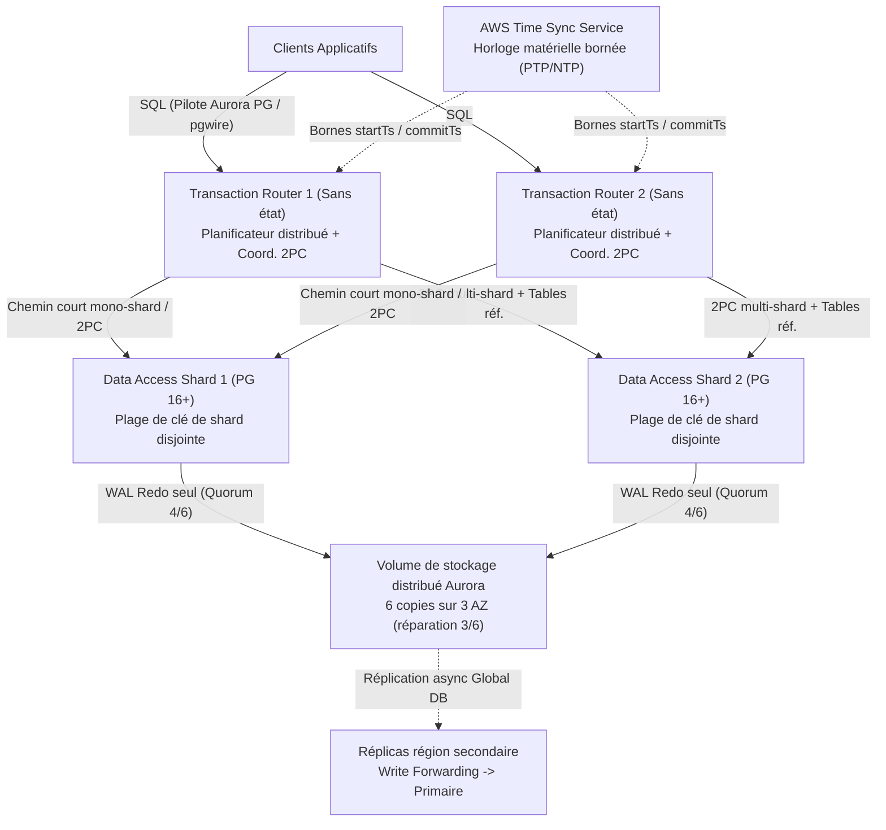

# 12 — AWS Aurora PostgreSQL Limitless (& Multi-Master v1 — Référence Architecturale)

**Série :** Architectures PostgreSQL Multi-Maîtres & Active-Active  
**Auteur :** Jean-Marie Renouard (`jmrenouard`) — [LightPath](https://www.lightpath.fr)  
**Licence :** MIT License

---

| Attribut | Valeur |
| :--- | :--- |
| **ID Catalogue** | `#12` (`AWS Aurora Limitless (& MM v1)` dans `Ch. 01`, `Ch. 03b`, `Ch. 04`, `Ch. 07`) |
| **Statut Benchmark** | **Non benchmarké en direct (Exclusion Cloud Managé `APP-005`)** |
| **Famille / Niveau** | `T5 / Cloud` — PG distribué shardé managé et stockage désagrégé (`Niveau 5 / Cloud`) |
| **Versions** | `Aurora PostgreSQL 16.4+ Limitless Database` (GA 2024) ; `Aurora Global DB` ; `Multi-Master v1` (retiré 2024) |
| **Profil CAP / PACELC** | `PC/EC` (Limitless 2PC + MVCC Time Sync ; Aurora de base quorum 4/6 ; Global DB async `PA/EL`) |
| **Licence / Déploiement** | Service cloud propriétaire AWS / DB Shard Group (`Transaction Routers` + `Data Access Shards`) |

---

## 1. Description de la technologie et rôle

**Amazon Aurora PostgreSQL** supprime le disque local couplé par un stockage désagrégé (*log-is-the-database*). Le calcul envoie uniquement le WAL vers un volume répliqué **6 fois sur 3 AZ**, avec quorum d'écriture **4/6** et lecture **3/6**. Toutefois, l'architecture Aurora standard reste strictement **mono-écrivain**.

Pour passer les écritures à l'échelle, AWS propose **Aurora PostgreSQL Limitless Database** (GA 2024) sur **DB Shard Groups**. Les **Transaction Routers** sans état pilotent les **Data Access Shards** avec **AWS Time Sync Service** et **2PC**. Cette approche remplace l'ancien **Aurora Multi-Master v1** (limité à MySQL 5.6, jamais GA sur PostgreSQL et retiré en 2024), victime de tempêtes d'invalidation de pages partagées entre écrivains concurrents.

---

## 2. Architecture et flux de données

Aurora Limitless achemine le SQL par les **Transaction Routers** et obtient ses bornes MVCC d'**AWS Time Sync Service**. Il valide en chemin mono-shard ou en 2PC sur le stockage 6 voies :

À l'échelle inter-régions, **Aurora Global Database Write Forwarding** ne crée pas de multi-maîtres actif-actif : les réplicas secondaires transfèrent les écritures sur le backbone AWS vers l'unique primaire selon une cohérence réglable (`eventual`, `session`, `global`).

---

## 3. Principes de fonctionnement et modes d'implémentation

1. **Quorum de stockage désagrégé 6 voies :** Chaque groupe de protection de 10 Gio répartit 6 segments sur 3 AZ. Tout commit attend **4/6 acquittements d'écriture** (`RPO = 0` face à une perte d'AZ + 1 nœud). La reprise lit **3/6** segments sans rejeu complet de pages.
2. **MVCC temporel et modèle de latence :** Limitless remplace le coordinateur `XID` monolithique par des horodatages physiques bornés par **AWS Time Sync Service** ($\varepsilon_{\text{TimeSync}}$) :

$$
L_{\text{Aurora-Limitless}} \approx L_{\text{quorum-4/6}} + \text{RTT}_{\text{TR-Shard}} + k_{\text{2PC}} \cdot \text{RTT}_{\text{2PC}} + \varepsilon_{\text{TimeSync}}
$$

où $k_{\text{2PC}} = 0$ pour une écriture mono-shard et $k_{\text{2PC}} = 1$ pour un commit 2PC multi-shards.
3. **Placement des tables :** Les tables se déclarent `sharded` (`rds_aurora.limitless_create_sharded_table`), `reference` (copiées sur tous les shards) ou `standard` (mono-shard).

| Mode / Variante | Portée et mécanique | Chemin de commit et sync | Conflits / bascule | Compromis |
| :--- | :--- | :--- | :--- | :--- |
| **Aurora Standard** *(Mono-écrivain)* | 1 primaire RW + jusqu'à 15 réplicas RO | Flux WAL vers quorum stockage 4/6 | Bascule auto `< 30 s`, `RPO = 0` | Plafond d'écriture sur 1 nœud |
| **Limitless — Mono-shard** | Table `sharded` ciblée par clé de shard | TR -> 1 Shard -> stockage 4/6 (sans 2PC) | Bascule de shard gérée en ACU | Scale horizontal des écritures (sous-ensemble SQL) |
| **Limitless — Multi-shard 2PC** | DML multi-shards et tables `reference` | 2PC piloté par TR + `commitTs` Time Sync | Verrous distribués / aborts type `40001` | Le 2PC ajoute un aller-retour réseau |
| **Global DB Write Forwarding** | DR inter-régions + réplicas RO | Sync stockage async (`~1 s`) ; écritures relayées | L'écrivain reste mono-région | RTT inter-régions sur écritures relayées |
| **Aurora Multi-Master v1** *(Retiré)* | Multi-écrivains MySQL 5.6 (jamais PG) | Invalidation de pages sur stockage partagé | Tempêtes d'aborts sous contention | **Retiré par AWS en 2024** |

---

## 4. Forces et faiblesses

| Forces | Faiblesses et pièges opérationnels |
| :--- | :--- |
| **Mise à l'échelle horizontale managée :** Les DB Shard Groups dépassent le plafond vCPU d'un primaire unique tout en conservant la durabilité 4/6 (`RPO = 0`). | **Verrouillage AWS & coût ACU (`APP-005`) :** Facturation ACU des routeurs + shards et stockage fermé AWS inexportable hors cloud AWS. |
| **Absence de goulot `XID` global :** Le MVCC par Time Sync évite un coordinateur GTM central (`#8 OpenTenBase`) sur les requêtes mono-shard et lectures. | **Limites SQL, extensions et DDL :** Liste d'extensions restreinte (allowlist), clé de sharding figée et écart de parité face au noyau PG 17 standard. |
| **Reprise rapide et sauvegardes sans I/O :** Le stockage *log-is-the-database* supprime les tempêtes de checkpoints et répare par quorum 3/6 en quelques secondes. | **Coût du 2PC et portée régionale :** Les transactions multi-shards paient le 2PC ; Limitless cible le multi-AZ intra-région, pas l'actif-actif intercontinental. |
| **Passage à l'échelle des lectures globales :** Aurora Global Database combine réplicas bas délai et *Write Forwarding* sans réécrire l'application. | **Latence du Write Forwarding :** Les écritures relayées paient le RTT inter-régions vers l'unique primaire ; le mode `global` bloque les lectures en retard. |

---

## 5. Exclusion architecturale (`APP-005`), comparatif des modes et base de référence

**Pourquoi `#12 AWS Aurora Limitless` reste hors benchmark direct (`APP-005`) :** Selon `docs/RCA_REGISTER.md`, Limitless dépend du stockage AWS, de Time Sync et d'API managées absents d'`env/multi-db-docker-env/`. Aucun chiffre synthétique de TPS ou latence n'est inventé ici.

Limitless se positionne directement face aux références `T5` (`PC/EC`) et au témoin mono-nœud mesurés dans `results/benchmark_summary.csv` et `results/functional_limits_matrix.csv` (la latence au 99e percentile n'est pas enregistrée dans `results/`) :

| Capacité / Référence | `#12 Aurora Limitless` *(Réf. Arch., `APP-005`)* | `#7 Citus` *(PoC, PG `17.10`)* | `#5 YugabyteDB` *(PoC, `RF=3`)* | `#6 CockroachDB` *(PoC, `RF=3`)* | `#15a pg17-standalone` *(Témoin)* |
| :--- | :--- | :--- | :--- | :--- | :--- |
| **Consensus / Stockage** | Stockage AZ 4/6 + Time Sync 2PC | 2PC Coord (sans Raft worker) | Raft par tablette (`RF=3`) + HLC | Raft par plage (`RF=3`) + HLC | Primaire unique (`CA`) |
| **Parité PG / Extensions** | Aurora PG 16+ (allowlist) | **Cœur `PG 17`** (haute parité) | Fork C `PG 15` (`YSQL`, `vector`) | Go `pgwire` (zéro ext. C) | **Cœur `PG 17.11` (`100 %`)** |
| **Sharding et règle de clé** | `sharded` / `reference` / `standard` | **`0A000` sans clé (`L2`/`L4`)** | Hachage/plage auto (`23505` global) | Plages auto (`23505` global) | Aucune (`23505` local) |
| **Ancre réf. (`A_single_rw`)** | Non benchmarké (`APP-005`) | `309.04 TPS` (`0` dérive) | `173.64 TPS` (`0` reprise) | `42.08 TPS` (`44` reprises) | `866.82 TPS` (`23.958 ms` `p95`) |
| **Ancre réf. (`F_wan_netem_25ms`)** | Non benchmarké (multi-AZ régional) | `21.67 TPS` (`-93,0 %` 2PC WAN) | `5.78 TPS` (`-96,7 %` Raft WAN) | `10.06 TPS` (`-76,1 %` Raft WAN) | N/A |

## 6. Popularité GitHub, présence Git et vitalité de maintenance (`results/project_popularity.csv`)

Télémétrie GitHub en direct (`2026-11-20T17:26:02Z`, `archived = false` sauf `N/A`) :

| Projet | Présence / Rôle Git | Dépôt (`Compte / Dépôts`) | Stars / Forks / Watch | Commits (`Tot / 12m`) | Contrib / Issues | Lang / SPDX | Tag / Dernier Push |
| :--- | :--- | :--- | :---: | :---: | :---: | :--- | :--- |
| **AWS Aurora Limitless (#12)** | `No (Managed Cloud)` -- `Proprietary (Managed Cloud)` | N/A (Propriétaire) | N/A / N/A / N/A | N/A / N/A | N/A / N/A | N/A / Proprietary | N/A / N/A |

- **Niveau de maintenance :** **Fermé / Cloud Managé** -- Service propriétaire managé AWS (`APP-005`) sans dépôt GitHub public (`N/A`).
- **Fraîcheur / Actualité :** **Opaque (Géré par l'éditeur)** -- Dernier push `N/A`, `N/A` commits/12m, dernière version `N/A`.
- **Maintenabilité opérationnelle :** **Verrouillage éditeur** -- Dépend des DB Shard Groups Aurora Limitless, du stockage/Time Sync AWS et d'une facturation cloud en ACU.

---

**Navigation :** [Index](../../../README.fr.md) · [Ch. 03b — Distribué, triggers et cloud](../03b_catalogue_distribue_triggers_cloud.md) · [Ch. 10 — Streaming vs Logique vs Multi-Maîtres](../10_comparatif_streaming_logique_multimaster.md) · [English version](../../en/solutions/aws_aurora_limitless.md)
