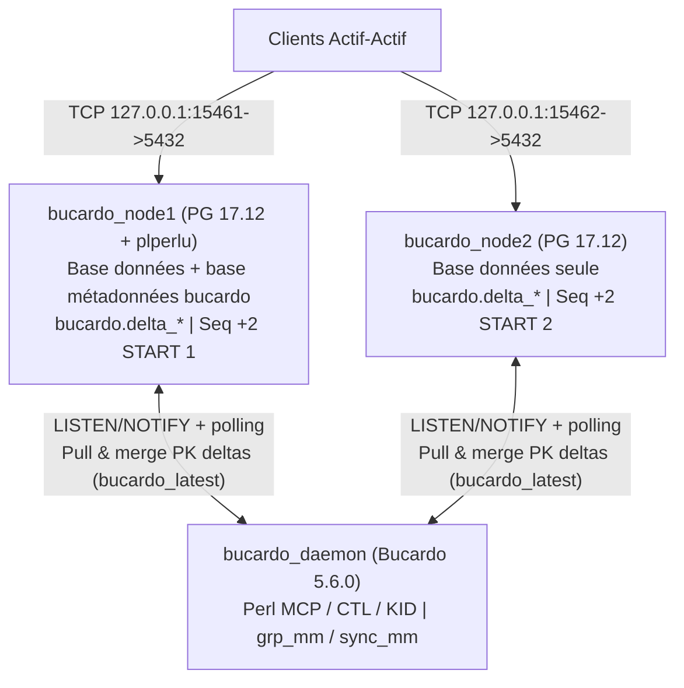

# 9 — Bucardo 5 (Multi-Maîtres Asynchrone par Triggers)

**Série :** Architectures PostgreSQL Multi-Maîtres & Active-Active  
**Auteur :** Jean-Marie Renouard (`jmrenouard`) — [LightPath](https://www.lightpath.fr)  
**Licence :** MIT License

---

| Attribut | Valeur |
| :--- | :--- |
| **ID Catalogue** | `#9` (`Bucardo 5 (#9)` dans `results/functional_limits_matrix.csv`) |
| **ID Topologie Benchmark** | `bucardo` (`results/*.csv`) |
| **Famille / Niveau** | `T4` / `Niveau 4` — Multi-maîtres asynchrone par triggers |
| **Versions** | `PostgreSQL 17.12` (`postgres:17` + `postgresql-plperl-17`), `Bucardo 5.6.0` (`debian:trixie-slim`) |
| **Profil CAP / PACELC** | `AP / PA-EL` — réplication multi-maîtres asynchrone par triggers |
| **Licence / Déploiement** | BSD License / PostgreSQL License / 3 conteneurs (`docker-compose-bucardo.yml`) |

---

## 1. Description de la technologie et rôle

**Bucardo 5** est un démon Perl asynchrone externe (`Bucardo 5.6.0`) qui orchestre la réplication multi-maîtres et primaire-réplica sous PostgreSQL sans plugin C WAL. Au lieu de décoder le WAL, Bucardo installe des triggers `PL/pgSQL` `bucardo_delta*` qui enregistrent les clés primaires modifiées dans des tables ombres `bucardo.delta_*` sur chaque base.

Sur signal `LISTEN/NOTIFY` ou timer de scrutation, `bucardo_daemon` (processus MCP/CTL/KID) extrait les deltas depuis les pairs d'un `dbgroup` (`db1:source db2:source`), arbitre les conflits via `bucardo_latest` et fusionne les lignes. Dans le PoC, `bucardo_node1` héberge à la fois les données et la base de métadonnées `bucardo` (`plperlu`), créant un couplage structurel sur le nœud 1.

---

## 2. Architecture et flux de données

Dans `env/multi-db-docker-env/docker-compose-bucardo.yml`, `bucardo_daemon` se connecte sur `bucardo_net` à `bucardo_node1` (`15461`) et `bucardo_node2` (`15462`), configurés avec des séquences à pas `INCREMENT BY 2` :

Les tables sans clé primaire sont refusées d'emblée par `bucardo add sync` (`validate_sync`), imposant une PK sur chaque table répliquée.

---

## 3. Principes de fonctionnement et modes d'implémentation

1. **Capture par trigger et boucle démon :** Les écritures locales déclenchent `bucardo_delta*` (`5/5` en `F1`), insérant les PK modifiées dans `bucardo.delta_public_*`. `bucardo_daemon` réagit à `NOTIFY` (`Autokick = Yes`) ou au polling (`T15` `p50=548.74 ms`, `p95=1275.25 ms`, max `1282.96 ms`).
2. **Modèle de latence de commit :**

$$
L_{\text{N4-bucardo}} \approx L_{\text{disque}} + L_{\text{trigger}} \quad (\text{écriture trigger locale ; polling et fusion asynchrones})
$$

3. **`dbgroup` multi-sources & `plperlu` :** Bucardo 5 unifie les anciens syncs `swap`/`pushdelta` via `dbgroup` (`source:source` vs `source:target`), et exige `postgresql-plperl-17` (`plperlu`) pour `db_getconn()`.

| Mode / Gestionnaire | Portée | Mécanique et stratégie de clés | Impact conflit / bascule | Compromis |
| :--- | :--- | :--- | :--- | :--- |
| **`source:source` (`grp_mm`, `bucardo_latest`)** *(PoC)* | `db1:source db2:source` | `sync_mm` compare horodatages/lignes ; séquences `+2` | Pairs inscriptibles (`L1`) ; pertes (`B2`, `D`, `L3`) | Bon débit local ; forte dérive à chaud |
| **`source:target` (`pushdelta`)** *(Arch. — Hors PoC)* | `db1:source db2:target` | Poussée asynchrone unidirectionnelle par triggers | Zéro conflit multi-écrivain | Pas d'écriture active sur la cible |
| **`bucardo_source` / `bucardo_target`** *(Arch. — Hors PoC)* | `conflict_strategy` | Vainqueur déterministe par priorité fixe de nœud | Écrasement prévisible sans dérive d'horloge | Perd les écritures concurrentes du pair |
| **`bucardo_abort` / `skip` / `random` / Perl** *(Arch.)* | `conflict_strategy` | Stoppe le sync, ignore la ligne, tire au sort ou exécute un hook Perl | `abort` protège l'intégrité ; Perl permet fusion métier | Latence et code Perl additionnels |
| **Séquences à pas (`+2`)** *(PoC)* vs **Sans PK** *(Rejeté)* | DDL (`START 1` / `2`) | PK paires/impaires (`setup_bucardo.sh`) ; `validate_sync` bloque sans PK (`L2`) | Évite `23505` sur inserts ; rejet immédiat sans PK | Pas fixe ; PK obligatoire |

---

## 4. Forces et faiblesses

| Forces | Faiblesses et pièges opérationnels |
| :--- | :--- |
| **Écritures locales rapides (disjoint & `sysbench`) :** `1078.9 TPS` (`B1`), `1232.84 TPS` (`E`), `1607.89 TPS` (`E3`), `53731.92 TPS` (`C`) et `0` dérive sur `B1`/`E`/`H`. | **Dérive massive à chaud (`D`/`B2`/`L3`) :** `D_hot_conflict` perd `-531620` (`50,8 %` de `1046798`) ; `B2` dérive `+123679` ; `L3` perd `+100` (`970.00`). |
| **Portabilité inter-versions PG :** Opère en `PL/pgSQL` + `plperlu` sans slots de décodage WAL ni `pgoutput` (`wal_level` indifférent). | **Lag de polling (`T15`) & échec course FK (`T13`) :** `p50=548.74 ms` / `p95=1275.25 ms` (300x–500x plus lent que WAL) cause `0/10` (`23503x10`) en `T13`. |
| **Résilience WAN et débit bulk :** `763.23 TPS` à `25 ms` WAN (`612.56` à `50 ms`), `42536 rows/s` (`T11`, `139.1 ms`) et rattrapage panne `5/5` (`L7`). | **SPOF métadonnées (`T16`) & arrêt sync (`L4`) :** Base `bucardo` sur `node1` (`SIGKILL` finit `20/21`) ; `L4` `23505` bloque `sync_mm` (`Bad`, `Error=7`). |
| **Garde-fou PK strict (`L2`) :** `validate_sync` refuse les tables sans PK au lieu d'ignorer silencieusement `UPDATE`/`DELETE` comme Spock. | **Zéro Auto-DDL (`L5`), amplification I/O & bruit `E` :** `ALTER TABLE` non propagé ; tables delta chargent `VACUUM` ; `112` (`E`)/`193` (`E3`) = bruit Lua. |

---

## 5. Résultats empiriques, limites fonctionnelles et spec PoC

Tests à `pg_scale = 2` (`retries_40001 = 0`). Seules `Avg`, `Stddev` (`0` pour `sysbench`) et `p95` sont mesurées (la latence p99 n'est pas mesurée).

### Tableau A — Charges principales et étendues (`benchmark_summary.csv`, `benchmark_extended_workloads.csv`)

| Suite | Cl / Dur | TPS | QPS | Avg / Stddev / p95 (ms) | Validées (Échecs) | Dérive | Statut |
| :--- | :---: | :---: | :---: | :---: | :---: | :---: | :--- |
| `A_single_rw` | 8 / 20s | 735.38 | N/A | 10.864 / 9.234 / 28.017 | 14705 (0) | 0 | `PASS_CONVERGED` |
| `B1_disjoint_rw` | 8 / 20s | 1078.9 | N/A | 7.402 / 3.739 / 14.458 | 21570 (0) | 0 | `PASS_CONVERGED` |
| `B2_overlap_rw` | 8 / 20s | 1267.77 | N/A | 6.297 / 2.914 / 11.503 | 25346 (0) | 123679 | `EXPECTED_LIMITATION_LOST_UPDATE` |
| `C_multinode_ro` | 16 / 20s | 53731.92 | N/A | 0.274 / 0.098 / 0.439 | 1073565 (0) | 0 | `PASS` |
| `D_hot_conflict` | 8 / 15s | 1378.79 | N/A | 5.794 / 1.232 / 8.033 | 20671 (0) | -531620 | `EXPECTED_LIMITATION_LOST_UPDATE` |
| `E_sysbench_oltp_rw` | 8 / 20s | 1232.84 | 24757.64 | 6.48 / 0 / 7.7 | 24667 (112) | 0 | `PASS` |
| `E2_sysbench_oltp_ro` | 8 / 12s | 1757.72 | 28123.53 | 4.55 / 0 / 5.99 | 21108 (0) | 0 | `PASS` |
| `E3_sysbench_oltp_wo` | 8 / 12s | 1607.89 | 9707.55 | 4.97 / 0 / 6.43 | 20529 (193) | 0 | `PASS` |
| `E4_sysbench_point_select` | 16 / 12s | 143920.93 | 143920.93 | 0.11 / 0 / 0.28 | 1728510 (0) | 0 | `PASS` |
| `H_append_only_insert` | 8 / 12s | 1105.99 | N/A | 7.222 / 1.98 / 10.472 | 13255 (0) | 0 | `PASS_CONVERGED` |
| `F_wan_netem_25ms` | 8 / 15s | 763.23 | N/A | 10.466 / 8.486 / 27.255 | 11444 (0) | 0 | `PASS_NETEM_25MS` |

*(Détails dérive : `B2` `exp=662527`, `n1/n2=786206` ; `D` `exp=1046798`, `n1/n2=515178`.)*

### Tableau B — Balayages concurrence & WAN (`benchmark_concurrency_sweep.csv`, `benchmark_wan_sweep.csv`)

| Suite | Param | TPS | Avg / Stddev / p95 (ms) | Validées | Statut |
| :--- | :---: | :---: | :---: | :---: | :--- |
| `G_conc_c1` (8s) | 1 cl | 306.29 | 3.253 / 0.958 / 5.143 | 2448 | `PASS` |
| `G_conc_c4` (8s) | 4 cl | 594.05 | 6.713 / 3.394 / 12.678 | 4750 | `PASS` |
| `G_conc_c8` (8s) | 8 cl | 649.72 | 12.288 / 9.173 / 30.693 | 5187 | `PASS` |
| `G_conc_c16` (8s) | 16 cl | 598.61 | 26.658 / 26.474 / 80.308 | 4781 | `PASS` |
| `G_conc_c32` (8s) | 32 cl | 582.0 | 54.769 / 64.546 / 183.552 | 4640 | `PASS` |
| `F_wan_netem_10ms` (12s) | 10 ms | 593.03 | 13.469 / 10.124 / 33.581 | 7100 | `PASS_NETEM_10MS` |
| `F_wan_netem_25ms` (15s) | 25 ms | 763.23 | 10.466 / 8.486 / 27.255 | 11444 | `PASS_NETEM_25MS` |
| `F_wan_netem_50ms` (12s) | 50 ms | 612.56 | 13.038 / 9.506 / 32.517 | 7337 | `PASS_NETEM_50MS` |

### Tableau C — Limites fonctionnelles (`F1`, `L1–L8`) et sondes étendues (`T11–T18`)

| Sonde | Résultat empirique observé |
| :--- | :--- |
| `F1` Santé | `PASS: sync_mm Good/Active; plperlu=1; delta_triggers=5/5` |
| `L1` PK `SERIAL` | `EXPECTED_LIMITATION: bucardo_latest overwrite (Conflicts=1 winner=from_n2)` |
| `L2` Sans PK | `EXPECTED_LIMITATION: validate_sync rejected keyless table; PK unlocked sync` |
| `L3` *Lost Update* | `EXPECTED_LIMITATION: +100/-30 converged to 970.00 (lost +100)` |
| `L4` Conflit `UNIQUE` | `EXPECTED_LIMITATION: stalled sync_mm (Current state=Bad DB db2 state=23505 Error=7)` |
| `L5` DDL & `SAVEPOINT` | `EXPECTED_LIMITATION: ALTER TABLE ADD COLUMN not propagated; TRUNCATE propagated` |
| `L6` Fonctions PG | `EXPECTED_LIMITATION: advisory_lock & LISTEN/NOTIFY node-local; TEMP session-local` |
| `L7` Panne nœud | `PASS: 8 delta rows queued in bucardo.delta_public_accounts; caught up 5/5` |
| `L8` Quorum | `N/A: AP async continues without quorum` |
| `T11` Bulk 10k | `PASS: 42536 rows/s (235ms); peer_catchup=139.1ms` |
| `T12` Upd vs Del | `EXPECTED_LIMITATION: bucardo_latest race n1=DELETED n2=DELETED` |
| `T13` Course FK | `EXPECTED_LIMITATION: 0/10 ok; failures=23503x10 (polling lag outraces child insert)` |
| `T14` MD5 riche | `PASS: 2/2 identical md5=00493e3a (BYTEA=65536B JSONB/NULL/TS/UTF8)` |
| `T15` Lag visibilité | `p50=548.74ms p95=1275.25ms max=1282.96ms (n=30)` |
| `T16` SIGKILL RPO | `PASS: peer_surv=20/20 RPO=0 peer_write_OK; post_restart=20/21 (node1 metadata SPOF)` |
| `T17` Tx longue | `PASS: NO_DIRTY_READ; side_tx_unblocked(112ms); post_commit_vis=110ms` |
| `T18` Seq (50) | `EXPECTED_LIMITATION: std seq 1\|false -> SQLSTATE 23505 (use stepped +2)` |
| **SQLSTATEs** | `L1–L8: 23505` \| `T11–T18: 23503;23505` |

### Tableau D — Spécification Docker PoC (`env/multi-db-docker-env/`)

| Paramètre | Configuration / Observation PoC |
| :--- | :--- |
| **Compose & Scripts** | `docker-compose-bucardo.yml` + `scripts/bucardo/Dockerfile` + `scripts/bucardo/Dockerfile.pg` + `scripts/bucardo/setup_bucardo.sh` + `tests/test_bucardo.sh` |
| **Nœuds DB** | `bucardo_node1` (`127.0.0.1:15461:5432`, données + base `bucardo`), `bucardo_node2` (`127.0.0.1:15462:5432`), `postgres:17` (`17.12`) + `postgresql-plperl-17` |
| **Conteneur Démon** | `bucardo_daemon` (`debian:trixie-slim` + `bucardo` `5.6.0`), processus MCP/CTL/KID, `/var/run/bucardo/`, `/var/log/bucardo/log.bucardo` |
| **Setup & Sync clés** | `dbgroup grp_mm db1:source db2:source`, `sync_mm` (`conflict_strategy=bucardo_latest`, `Autokick=Yes`, `Stayalive=Yes`), `INCREMENT BY 2 START WITH 1/2`. |

---

**Navigation :** [Index](../../../README.fr.md) · [Ch. 03b — Distribué, triggers et cloud](../03b_catalogue_distribue_triggers_cloud.md) · [Ch. 10 — Streaming vs Logique vs Multi-Maîtres](../10_comparatif_streaming_logique_multimaster.md) · [English version](../../en/solutions/bucardo.md)
