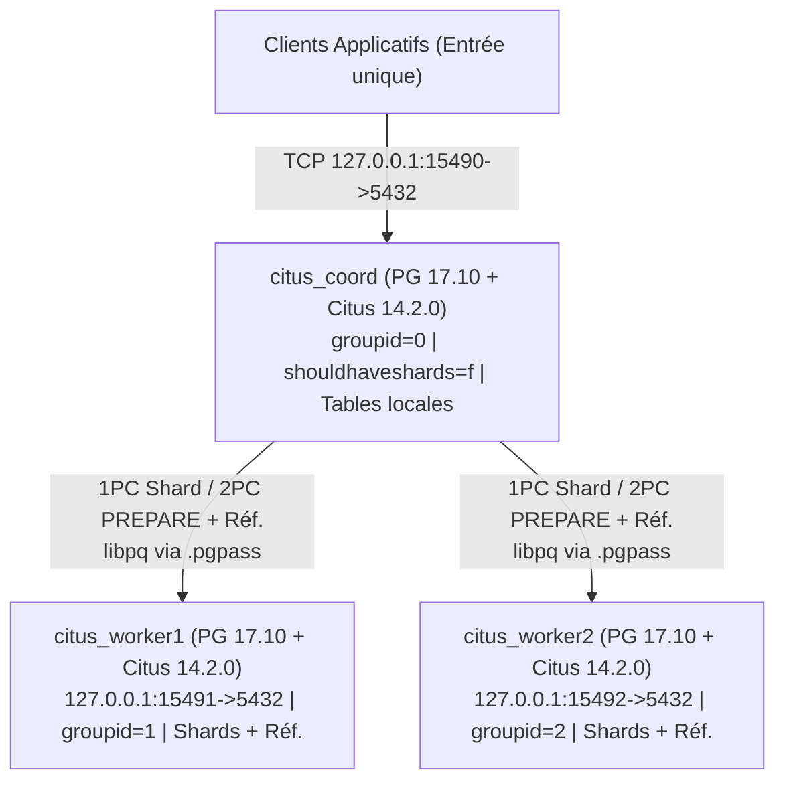

# 7 — Citus (Extension PostgreSQL de sharding distribué — Coordinateur + Workers + 2PC)

**Série :** Architectures PostgreSQL Multi-Maîtres & Active-Active  
**Auteur :** Jean-Marie Renouard (`jmrenouard`) — [LightPath](https://www.lightpath.fr)  
**Licence :** MIT License

---

| Attribut | Valeur |
| :--- | :--- |
| **ID Catalogue** | `#7` (`Citus 14.2.0 Distributed PG 17 (#7)` dans `results/functional_limits_matrix.csv`) |
| **Topologie Benchmark** | `citus` (`results/*.csv`) |
| **Famille / Niveau** | `T5` / `Niveau 5` — Sharding MPP / 2PC distribué |
| **Versions** | `PostgreSQL 17.10` (`citusdata/citus:14.2.0-pg17`), `Citus 14.2.0` (`citus_version()`) |
| **Profil CAP / PACELC** | `CP / PC-EC` (`CP (Coord SPOF / 2PC)` — coordinateur unique + 2PC ; MX optionnel) |
| **Licence / Déploiement** | AGPLv3 (Open Source) / 3 conteneurs (`docker-compose-citus.yml`) |

---

## 1. Description de la technologie et rôle

**Citus** est une extension C PostgreSQL (AGPLv3) créant un cluster **Coordinateur + Workers** (`citus_add_node`). Sans modifier le stockage heap ni ajouter Raft, elle intercepte les *hooks* SQL pour router vers des shards natifs avec `max_prepared_transactions > 0`.

Trois classes existent : **distribuées par hachage** (`create_distributed_table`), **référence** (`create_reference_table`, répliquées en 2PC) et **locales** au coordinateur. Contrairement à `#5 YugabyteDB` ou `#6 CockroachDB`, Citus garde 100 % de PG 17 par shard, sans Raft natif.

---

## 2. Architecture et flux de données

Dans `env/multi-db-docker-env/docker-compose-citus.yml`, les clients se connectent uniquement à `citus_coord` (`groupid=0`, `shouldhaveshards=f`), qui route en 1PC ou 2PC vers `citus_worker1` (`groupid=1`) et `citus_worker2` (`groupid=2`) sur `citus_net` (`citus.shard_count=8`) :

Dans le PoC, **Citus MX** (`start_metadata_sync_to_node`) n'est pas activé (`B1`–`D` et `H` passent par `citus_coord` seul) ; `tc netem` injecte la latence WAN vers `citus_worker1` et `citus_worker2`.

---

## 3. Principes de fonctionnement et modes d'implémentation

1. **Routage 1PC vs 2PC :** Les requêtes ciblant la clé de distribution (`D_hot_conflict` sur `aid`, `H_append_only_insert`) passent en 1PC. Le TPC-B (`A`, `B1`, `B2`, `F`) touche `accounts(aid)`, `tellers(tid)` et `branches(bid)`, déclenchant **2PC (`PREPARE TRANSACTION` / `COMMIT PREPARED`)**.
2. **Modèle de latence de commit :**

$$
L_{\text{N5-citus-1PC}} \approx L_{\text{disque}} + \text{RTT}_{\text{coord-worker}}, \qquad L_{\text{N5-citus-2PC}} \approx L_{\text{disque}} + 3 \cdot \text{RTT}_{\text{coord-worker}}
$$

3. **Schéma (`0A000`), colocalisation et MX :** `PRIMARY KEY`/`UNIQUE` distribuées exigent la clé de sharding (`0A000` sinon, `L2`/`L4`). Les tables colocalisées gèrent les FK distribuées (`T13` : `10/10`) ; **Citus MX** synchronise les métadonnées vers les workers.

| Mode / Type de table | Portée | Mécanique et stratégie de clés | Impact conflit / bascule | Compromis |
| :--- | :--- | :--- | :--- | :--- |
| **Distribuée par hachage (1PC)** *(PoC `D`/`H`)* | `create_distributed_table(..., col)` | Routage mono-shard (`citus.shard_count=8`) ; FK colocalisées (`T13`) | Verrous PG natifs ; dérive `0` ; sans surcoût 2PC | Exige la clé de sharding en `WHERE`, `PK` et `UNIQUE` |
| **Distribuée par hachage (2PC)** *(PoC `A`/`B1`/`B2`)* | DML multi-shards | Le coordinateur exécute `PREPARE` / `COMMIT PREPARED` sur les workers | Dérive `0` (`PASS_CONVERGED`) ; `RR` lève `40001` (`L3`) | `-64,3 %` TPC-B LAN (`309.04` vs `866.82` seul) et `-93,0 %` WAN |
| **Tables de référence** *(PoC `L7`)* | `create_reference_table(...)` | Copie complète maintenue synchrone par 2PC sur tous les workers | Lecture résiliente (`L7` : `worker2` arrêté, réf. OK) | Bloque les écritures si un worker est injoignable |
| **Tables locales coordinateur** *(PoC)* | Tables non shardées sur `citus_coord` | Stockage local au coordinateur (`groupid=0`, `shouldhaveshards=f`) | Séquence unique (`L1` `1.62 ms`, `T18` `next_id=51`) | Non distribué ; coordinateur SPOF |
| **Citus MX Multi-Coord** *(Arch. — Hors PoC)* | `start_metadata_sync_to_node` | Synchronise les métadonnées pour entrer en SQL sur chaque worker | Supprime le goulot d'entrée du coordinateur unique | Exige toujours une HA externe ; coût sync métadonnées |
| **HA Patroni Worker/Coord** *(Arch. — Hors PoC)* | Standby streaming par nœud | Couple coordinateur et workers avec Patroni + `etcd` | Évite coupure `08006` (`T16`) et SPOF (`L8`, `RTO 10–30 s`) | Double ou triple l'empreinte de conteneurs |

---

## 4. Forces et faiblesses

| Forces | Faiblesses et pièges opérationnels |
| :--- | :--- |
| **Débit colocalisé et ajout élevé :** `1691.45 TPS` (`D`, dérive `0`), `2040.36 TPS` (`H`), `21324.7 TPS` (`C`), `19831.34 TPS` (`E4`) et `35308 rows/s` en bulk (`T11`). | **Surcoût 2PC & plafond concurrence :** Le TPC-B multi-clés chute de `-64,3 %` (`309.04` vs `866.82 TPS`) ; `G_conc` sature à `268.71` (`c=8`) -> `260.76 TPS` (`c=32`, `p95=343.094 ms`). |
| **Sémantique cœur PG 17 & dérive `0` :** `0` reprise `40001` en `A`–`H`, `L3` `READ COMMITTED` sérialise (`1100`), `L5` propage `ALTER TABLE` + `SAVEPOINT`, `T13` FK `10/10`. | **Effondrement 2PC sur WAN (`Suite F`) :** Chute de `-93,0 %` à `25 ms` WAN (`21.67 TPS`, `p95=633.963 ms`) et `8.84 TPS` à `50 ms` (`p95=1486.044 ms`). |
| **Riche compatibilité PG & séquence unique :** `pg_trgm`, `uuid-ossp`, `TEMP TABLE`, `LISTEN/NOTIFY` et `pg_try_advisory_lock(42)` sur coord passent (`L6`) ; `L1` `1.62 ms`, `T18` `next_id=51`. | **Pièges de schéma `0A000` (`L2`/`L4`/`L6`) :** `ADD PRIMARY KEY`/`serial` post-sharding et `UNIQUE` sans clé bloqués (`0A000`) ; `vector` renvoie `ERR(0A000)` dans l'image `citus:14.2.0-pg17`. |
| **2PC déterministe & lectures réf. (`L7`) :** Garantit `0` dérive (`A`/`B1`/`B2`/`D`) et maintient tables de référence + `worker1` lisibles si `worker2` tombe (`L7`). | **Zéro HA native (`L8`/`T16`) :** Arrêt du coordinateur bloque tout (`L8`) ; `SIGKILL` `worker2` lève `08006` (`T16`, `21/21` au redémarrage) ; `E`/`E3` `9`/`68` erreurs vs `112`/`192` seul. |

---

## 5. Résultats empiriques, limites fonctionnelles et spec PoC

Tests à `pg_scale = 2` (`retries_40001 = 0`). Seules `Avg`, `Stddev` (`0` pour `sysbench`) et `p95` sont mesurées (la latence au 99e percentile n'est pas enregistrée dans `results/`).

### Tableau A — Charges principales et étendues (`benchmark_summary.csv`, `benchmark_extended_workloads.csv`)

| Suite | Cl / Dur | TPS | QPS | Avg / Stddev / p95 (ms) | Validées (Échecs) | Dérive | Statut |
| :--- | :---: | :---: | :---: | :---: | :---: | :---: | :--- |
| `A_single_rw` | 8 / 20s | 309.04 | N/A | 25.853 / 21.845 / 62.289 | 6183 (0) | 0 | `PASS_CONVERGED` |
| `B1_disjoint_rw` | 8 / 20s | 265.29 | N/A | 30.123 / 23.832 / 68.37 | 5308 (0) | 0 | `PASS_CONVERGED` |
| `B2_overlap_rw` | 8 / 20s | 312.98 | N/A | 25.533 / 23.759 / 59.067 | 6263 (0) | 0 | `PASS_CONVERGED` |
| `C_multinode_ro` | 16 / 20s | 21324.7 | N/A | 0.724 / 0.242 / 1.04 | 425845 (0) | 0 | `PASS` |
| `D_hot_conflict` | 8 / 15s | 1691.45 | N/A | 4.716 / 1.265 / 6.722 | 25354 (0) | 0 | `PASS_CONVERGED` |
| `E_sysbench_oltp_rw` | 8 / 20s | 189.44 | 3796.81 | 42.17 / 0 / 50.11 | 3797 (9) | 0 | `PASS` |
| `E2_sysbench_oltp_ro` | 8 / 12s | 180.33 | 2885.34 | 44.26 / 0 / 58.92 | 2173 (0) | 0 | `PASS` |
| `E3_sysbench_oltp_wo` | 8 / 12s | 563.34 | 3402.62 | 14.17 / 0 / 21.89 | 6777 (68) | 0 | `PASS` |
| `E4_sysbench_point_select` | 16 / 12s | 19831.34 | 19831.34 | 0.8 / 0 / 1.42 | 238537 (0) | 0 | `PASS` |
| `H_append_only_insert` | 8 / 12s | 2040.36 | N/A | 3.905 / 2.015 / 6.134 | 24446 (0) | 0 | `PASS_CONVERGED` |
| `F_wan_netem_25ms` | 8 / 15s | 21.67 | N/A | 364.812 / 138.872 / 633.963 | 332 (0) | 0 | `PASS_NETEM_25MS` |

### Tableau B — Balayages concurrence & WAN (`benchmark_concurrency_sweep.csv`, `benchmark_wan_sweep.csv`)

| Suite | Param | TPS | Avg / Stddev / p95 (ms) | Validées | Statut |
| :--- | :---: | :---: | :---: | :---: | :--- |
| `G_conc_c1` (8s) | 1 cl | 102.5 | 9.74 / 6.602 / 14.998 | 820 | `PASS` |
| `G_conc_c4` (8s) | 4 cl | 250.29 | 15.939 / 7.291 / 28.207 | 2000 | `PASS` |
| `G_conc_c8` (8s) | 8 cl | 268.71 | 29.66 / 20.253 / 71.539 | 2154 | `PASS` |
| `G_conc_c16` (8s) | 16 cl | 264.65 | 60.028 / 54.883 / 170.4 | 2131 | `PASS` |
| `G_conc_c32` (8s) | 32 cl | 260.76 | 121.122 / 117.985 / 343.094 | 2104 | `PASS` |
| `F_wan_netem_10ms` (12s) | 10 ms | 44.37 | 179.145 / 76.089 / 355.182 | 537 | `PASS_NETEM_10MS` |
| `F_wan_netem_25ms` (15s) | 25 ms | 21.67 | 364.812 / 138.872 / 633.963 | 332 | `PASS_NETEM_25MS` |
| `F_wan_netem_50ms` (12s) | 50 ms | 8.84 | 876.664 / 408.462 / 1486.044 | 113 | `PASS_NETEM_50MS` |

### Tableau C — Limites fonctionnelles (`F1`, `L1–L8`) et sondes étendues (`T11–T18`)

| Sonde | Résultat empirique observé |
| :--- | :--- |
| `F1` Santé | `PASS: Citus=14.2.0 active_workers=2` |
| `L1` PK `SERIAL` | `PASS: single coordinator sequence (avg 1.62ms)` |
| `L2` Sans PK | `EXPECTED_LIMITATION: 0A000 ADD PRIMARY KEY/serial blocked post-distribution; upfront PK(aid hid) works` |
| `L3` *Lost Update* | `PASS: RC_bal=1100; RR raises SQLSTATE 40001 on concurrent update` |
| `L4` Conflit `UNIQUE` | `EXPECTED_LIMITATION: 0A000 UNIQUE without dist key unsupported; composite (dist_key email) OK` |
| `L5` DDL & `SAVEPOINT` | `PASS: ALTER TABLE propagated to worker shards; tx DDL and SAVEPOINT OK` |
| `L6` Fonctions PG | `PASS: adv_lock LISTEN/NOTIFY TEMP pg_trgm uuid-ossp OK; vector=ERR(0A000)` *(verrou consultatif testé sur coord seul)* |
| `L7` Panne nœud | `PARTIAL: ref reads & worker1 OK; worker2 shards error until restart` |
| `L8` Quorum | `EXPECTED_LIMITATION: single coordinator outage halts distributed queries` |
| `T11` Bulk 10k | `PASS: 35308 rows/s (283ms); catchup=0ms (single-view)` |
| `T12` Upd vs Del | `PASS: consensus (upd=OK del=OK) nodes=DELETED` |
| `T13` Course FK | `PASS: 10/10 immediate cross-node child inserts consistent (0 FK errors)` |
| `T14` MD5 riche | `PASS: 1/1 identical md5=00493e3a (BYTEA=65536B JSONB/NULL/TS/UTF8)` |
| `T15` Lag visibilité | `p50=1.71ms p95=13.89ms max=19.29ms (n=30)` |
| `T16` SIGKILL RPO | `EXPECTED_LIMITATION: worker2 SIGKILL failed query (rc=1 08006); recovered 21/21` |
| `T17` Tx longue | `PASS: NO_DIRTY_READ; side_tx_unblocked(138ms); post_commit_vis=315ms (ok=True)` |
| `T18` Seq (50) | `PASS: single sequence safe (next_id=51)` |
| **SQLSTATEs** | `L1–L8: 0A000;40001` \| `T11–T18: 08006` |

### Tableau D — Spécification Docker PoC (`env/multi-db-docker-env/`)

| Paramètre | Configuration / Observation PoC |
| :--- | :--- |
| **Compose & Scripts** | `docker-compose-citus.yml` + `scripts/citus/setup_citus.sh` + `tests/test_citus.sh` |
| **Nœuds & Ports** | `citus_coord` (`127.0.0.1:15490:5432`), `citus_worker1` (`127.0.0.1:15491:5432`), `citus_worker2` (`127.0.0.1:15492:5432`) |
| **Image & Ressources** | `citusdata/citus:14.2.0-pg17` (`PG 17.10`), `mem_limit: 512m` par nœud, pont `citus_net` |
| **GUCs & Setup** | `shared_preload_libraries=citus`, `shared_buffers=128MB`, `max_connections=100`, `citus.shard_count=8`, `citus_set_coordinator_host('citus_coord', 5432)`, `citus_add_node('citus_worker1|2', 5432)`, `PRIMARY KEY(aid, hid)` sur `pgbench_history`. |

## 6. Popularité GitHub, présence Git et vitalité de maintenance (`results/project_popularity.csv`)

Télémétrie GitHub en direct (`2026-11-20T17:26:02Z`, `archived = false` sauf `N/A`) :

| Projet | Présence / Rôle Git | Dépôt (`Compte / Dépôts`) | Stars / Forks / Watch | Commits (`Tot / 12m`) | Contrib / Issues | Lang / SPDX | Tag / Dernier Push |
| :--- | :--- | :--- | :---: | :---: | :---: | :--- | :--- |
| **Citus (#7)** | `Yes` -- `Primary` | [`citusdata/citus`](https://github.com/citusdata/citus) (`Org / 67`) | 12865 / 810 / 212 | 7400 / 222 | 152 / 475 | C / `AGPL-3.0` | `v14.3.0` / `2026-11-20T12:28:36Z` |

- **Niveau de maintenance :** **Niveau A (OSS Actif)** -- `citusdata/citus` totalise `222` commits/12m (`7 400` total, `152` contributeurs, `12 865` stars, `475` issues).
- **Fraîcheur / Actualité :** **À jour -- Actif** -- Dernier push `2026-11-20T12:28:36Z`, `222` commits/12m, dernière version `v14.3.0`.
- **Maintenabilité opérationnelle :** **Modéré** -- Extension C PG (`AGPL-3.0`) ; impose la clé de distribution (`0A000`) et une HA externe (`08006`).

---

**Navigation :** [Index](../../../README.fr.md) · [Ch. 03b — Distribué, triggers et cloud](../03b_catalogue_distribue_triggers_cloud.md) · [Ch. 10 — Streaming vs Logique vs Multi-Maîtres](../10_comparatif_streaming_logique_multimaster.md) · [English version](../../en/solutions/citus.md)
