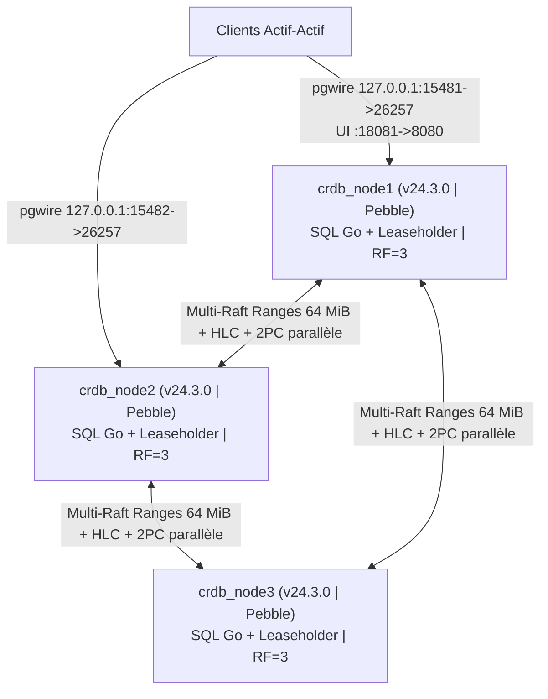

# 6 — CockroachDB (SQL distribué : PG-Wire Go + Pebble Multi-Raft Serializable)

**Série :** Architectures PostgreSQL Multi-Maîtres & Active-Active  
**Auteur :** Jean-Marie Renouard (`jmrenouard`) — [LightPath](https://www.lightpath.fr)  
**Licence :** MIT License

---

| Attribut | Valeur |
| :--- | :--- |
| **ID Catalogue** | `#6` (`CockroachDB v24.3.0 Pebble Raft (#6)` dans `results/functional_limits_matrix.csv`) |
| **Topologie Benchmark** | `cockroach` (`results/*.csv`) |
| **Famille / Niveau** | `T5` / `Niveau 5` — SQL distribué à consensus |
| **Versions** | `CockroachDB v24.3.0`, PG-wire `13.0.0` (moteur SQL Go *clean-room* + Pebble LSM) |
| **Profil CAP / PACELC** | `CP / PC-EC` (`3 (RF=3 SQL)` — Multi-Raft par *range* de `64 MiB` `RF=3`, HLC bornée) |
| **Licence / Déploiement** | BSL 1.1 / Enterprise (fonctions soumises à licence) / 3 conteneurs (`docker-compose-cockroach.yml`) |

---

## 1. Description de la technologie et rôle

**CockroachDB** est une base SQL distribuée en Go exposant `pgwire` `13.0.0` sur **Pebble** (LSM ordonné) et **Multi-Raft** par *range* de `64 MiB` (`RF = 3`). Chaque *Leaseholder* sert les lectures localement sans tour Raft et réplique les écritures sur le quorum.

Contrairement à `#5 YugabyteDB` (fork C PG 15), CockroachDB n'est **pas** un fork PostgreSQL : il impose **`SERIALIZABLE`** optimiste MVCC par défaut, exclut toute extension C PG et exige des reprises applicatives `SQLSTATE 40001`.

---

## 2. Architecture et flux de données

Dans `env/multi-db-docker-env/docker-compose-cockroach.yml`, trois nœuds `--insecure` (`crdb_node1..3`) forment un maillage Multi-Raft `RF=3` symétrique sur `crdb_net` (`--cache=256MiB`, `--max-sql-memory=256MiB`) :

Les tirs multi-écrivains (`B1`–`D`, `H`) sollicitent `crdb_node1` et `crdb_node2` (`user=root`) tandis que `crdb_node3` participe au quorum Raft (`conv_chk` vérifie les 3 nœuds ; `tc netem` retarde `crdb_node2` et `crdb_node3`).

---

## 3. Principes de fonctionnement et modes d'implémentation

1. **Ranges Multi-Raft & commits parallèles :** Les ranges (`64 MiB`) répliquent par Raft (`RF = 3`) avec HLC, posant les intentions MVCC en parallèle du quorum pour économiser un RTT face au 2PC séquentiel.
2. **Modèle de latence de commit :**

$$
L_{\text{N5-crdb-1range}} \approx L_{\text{disque-leaseholder}} + \text{RTT}_{\text{quorum-Raft}}, \qquad L_{\text{N5-crdb-2PC}} \approx L_{\text{disque}} + 2 \cdot \text{RTT}_{\text{quorum-Raft}} + T_{\text{attente-intent}}
$$

3. **Reprises `SERIALIZABLE` vs `READ COMMITTED` & `unique_rowid()` :** Le mode `SERIALIZABLE` lève `40001` (`WriteTooOldError`) sous contention (`44`/`87`/`96` reprises en `A`/`B1`/`B2` ; `685` échecs dans `E_sysbench_oltp_rw` sans reprise). `SERIAL` génère par défaut `unique_rowid()` non ordonné (`17.72 ms` `L1`, `rowid` masqué `L2`).

| Mode / Fonction | Portée | Mécanique et stratégie de clés | Impact conflit / bascule | Compromis |
| :--- | :--- | :--- | :--- | :--- |
| **`SERIALIZABLE` + reprise `40001`** *(Défaut PoC)* | MVCC global + intentions | Contrôle optimiste (`T17` `2.1 s` attente) ; client réessaie `40001` | `44`/`87`/`96` reprises (`A`/`B1`/`B2`) ; `685` échecs en `E` sans reprise | Zéro anomalie ; chute si client sans reprise |
| **`READ COMMITTED` optionnel** *(Arch. v24.x — Hors PoC)* | `sql.defaults.default_transaction_isolation` | Attente pessimiste de verrou en v23.2+/v24.x (désactivée en PoC) | Réduit fortement les abandons `40001` sur lignes chaudes | Relâche la sérialisabilité vers *read committed* |
| **Follower Reads** *(Arch. — Hors PoC)* | `AS OF SYSTEM TIME follower_read_timestamp()` | Sert des lectures datées depuis le réplica Raft le plus proche | Élimine le RTT WAN vers le leaseholder | Fraîcheur bornée (~`4.8 s` derrière HLC) |
| **Survie & localités multi-régions** *(Arch.)* | `SURVIVE ZONE \| REGION`, `REGIONAL BY ROW`, `GLOBAL` | Épingle leaseholders/votants ou réplique les tables `GLOBAL` | Automatise placement géo et bascule régionale | Surcoût RTT écriture pour `SURVIVE REGION` |
| **`unique_rowid()` vs `SEQUENCE CACHE 1`** *(PoC `L1`/`T18`)* | `INT8 DEFAULT unique_rowid()` (`17.72 ms`) | ID 64 bits (timestamp+nœud) évitant la queue d'index (`L2` `rowid`) | Zéro `23505` ; `SEQUENCE CACHE 1` prend `46.07 ms` (`T18` `next=51`) | `unique_rowid()` non monotone ; `CACHE 1` lent |

---

## 4. Forces et faiblesses

| Forces | Faiblesses et pièges opérationnels |
| :--- | :--- |
| **`SERIALIZABLE` strict & dérive `0` :** Garantit l'absence d'anomalies (`0` dérive en `A`/`B1`/`B2`/`D`/`H`) et `471.61 TPS` sur `D_hot_conflict` (`0` reprise). | **Reprises `40001` & échecs `E` :** `pgbench` a subi `44`/`87`/`96` reprises (`A`/`B1`/`B2`) et `0..88` (`G`, pic `c=4` `74.11` -> `40.25 TPS` `c=32`) ; `E` échoue `685` fois (`902` validées / `1 587` tentées). |
| **Multi-Raft `RPO = 0` & lectures rapides :** Survit à l'arrêt `1/3` (`L7` `bal=500`) et `SIGKILL` (`T16` `20/20` RPO=0, `21/21` au redémarrage), `13185.54 TPS` (`C`), `13245.96 TPS` (`E4`), `22079 rows/s` (`T11`). | **Zéro extension C PG & `XCEXF`/`42601` (`L6`) :** Pas de `pgBackRest` ni d'extensions C (`pg_trgm`/`uuid-ossp`/`vector` émulés en Go) ; `TEMP TABLE` lève `XCEXF` sans flag ; `LISTEN` échoue `42601`. |
| **Courbe WAN plus douce que YugabyteDB :** Les commits parallèles gardent `10.06 TPS` (`25 ms`) et `4.53 TPS` (`50 ms`), devançant YugabyteDB (`5.78` / `3.06 TPS`) sur WAN. | **Latence unitaire élevée & coût `CACHE 1` :** En LAN, `A` atteint `42.08 TPS` (`187.6 ms` moy.) ; `SEQUENCE CACHE 1` coûte `46.07 ms` (`L1`) et `unique_rowid()` reste désordonné. |
| **`rowid` auto & sûreté `T18` :** `L2` injecte un `rowid` caché ; `L4` applique `23505` global ; `L5` DDL + `SAVEPOINT` et `T13` FK `10/10` passent ; `T18` donne `next_id=51`. | **Arrêt sur perte de quorum (`L8`) & BSL :** Perdre `2/3` nœuds bloque le SQL (`57014` timeout) ; `cockroach.log` journalise un `NOTICE` de bridage licence BSL après grâce. |

---

## 5. Résultats empiriques, limites fonctionnelles et spec PoC

Tests à `pg_scale = 2`. Seules `Avg`, `Stddev` (`0` pour `sysbench`) et `p95` sont mesurées (la latence au 99e percentile n'est pas enregistrée dans `results/`).

### Tableau A — Charges principales et étendues (`benchmark_summary.csv`, `benchmark_extended_workloads.csv`)

| Suite | Cl / Dur | TPS | QPS | Avg / Stddev / p95 (ms) | Validées (Échecs) | Dérive | Statut |
| :--- | :---: | :---: | :---: | :---: | :---: | :---: | :--- |
| `A_single_rw` | 8 / 20s | 42.08 | N/A | 187.6 / 304.051 / 625.042 | 849 (0) | 0 | `PASS_CONVERGED` |
| `B1_disjoint_rw` | 8 / 20s | 60.35 | N/A | 132.318 / 209.453 / 431.931 | 1212 (0) | 0 | `PASS_CONVERGED` |
| `B2_overlap_rw` | 8 / 20s | 74.17 | N/A | 106.436 / 213.013 / 385.921 | 1490 (0) | 0 | `PASS_CONVERGED` |
| `C_multinode_ro` | 16 / 20s | 13185.54 | N/A | 1.199 / 0.586 / 2.161 | 263668 (0) | 0 | `PASS` |
| `D_hot_conflict` | 8 / 15s | 471.61 | N/A | 16.913 / 8.303 / 34.165 | 7091 (0) | 0 | `PASS_CONVERGED` |
| `E_sysbench_oltp_rw` | 8 / 20s | 44.84 | 1531.47 | 177.91 / 0 / 502.2 | 902 (685) | 0 | `PASS` |
| `E2_sysbench_oltp_ro` | 8 / 12s | 522.05 | 8352.78 | 15.31 / 0 / 23.52 | 6271 (0) | 0 | `PASS` |
| `E3_sysbench_oltp_wo` | 8 / 12s | 118.69 | 715.64 | 67.29 / 0 / 161.51 | 1430 (13) | 0 | `PASS` |
| `E4_sysbench_point_select` | 16 / 12s | 13245.96 | 13245.96 | 1.21 / 0 / 2.48 | 159016 (0) | 0 | `PASS` |
| `H_append_only_insert` | 8 / 12s | 734.6 | N/A | 10.861 / 4.993 / 17.335 | 8813 (0) | 0 | `PASS_CONVERGED` |
| `F_wan_netem_25ms` | 8 / 15s | 10.06 | N/A | 715.768 / 1072.655 / 2930.542 | 167 (0) | 0 | `PASS_NETEM_25MS` |

*(Reprises `retries_40001` mesurées : `A=44`, `B1=87`, `B2=96`, `F_wan_netem_25ms=14`, `0` ailleurs ; `E` note `685` échecs sans reprise client.)*

### Tableau B — Balayages concurrence & WAN (`benchmark_concurrency_sweep.csv`, `benchmark_wan_sweep.csv`)

| Suite | Param | TPS | Avg / Stddev / p95 (ms) | Validées | Statut |
| :--- | :---: | :---: | :---: | :---: | :--- |
| `G_conc_c1` (8s) | 1 cl | 36.07 | 27.7 / 10.1 / 49.442 | 289 | `PASS` |
| `G_conc_c4` (8s) | 4 cl | 74.11 | 53.722 / 33.733 / 113.615 | 598 | `PASS` |
| `G_conc_c8` (8s) | 8 cl | 64.46 | 121.346 / 168.766 / 440.652 | 525 | `PASS` |
| `G_conc_c16` (8s) | 16 cl | 51.64 | 290.743 / 584.597 / 1289.289 | 436 | `PASS` |
| `G_conc_c32` (8s) | 32 cl | 40.25 | 683.976 / 1173.039 / 3400.035 | 341 | `PASS` |
| `F_wan_netem_10ms` (12s) | 10 ms | 19.38 | 401.196 / 544.766 / 1489.622 | 240 | `PASS_NETEM_10MS` |
| `F_wan_netem_25ms` (15s) | 25 ms | 10.06 | 715.768 / 1072.655 / 2930.542 | 167 | `PASS_NETEM_25MS` |
| `F_wan_netem_50ms` (12s) | 50 ms | 4.53 | 1430.517 / 1325.619 / 4453.735 | 65 | `PASS_NETEM_50MS` |

*(Reprises `retries_40001` mesurées : `G_conc_c1..c32 = 0/5/26/64/88` ; `F_wan_netem_10ms/25ms/50ms = 16/14/5`.)*

### Tableau C — Limites fonctionnelles (`F1`, `L1–L8`) et sondes étendues (`T11–T18`)

| Sonde | Résultat empirique observé |
| :--- | :--- |
| `F1` Santé | `PASS: CockroachDB v24.3.0 live=3 rf3=True ui=200` |
| `L1` PK `SERIAL` | `PASS: unique_rowid 17.72ms; seq cache=1 46.07ms` |
| `L2` Sans PK | `PASS: auto-injected hidden rowid PK; upfront unique_rowid() PK works` |
| `L3` *Lost Update* | `PASS with retry: Serializable raw hit 9x 40001 (WriteTooOldError); retry bal=1100 (27 retries)` |
| `L4` Conflit `UNIQUE` | `PASS: global SQLSTATE 23505 enforced across nodes` |
| `L5` DDL & `SAVEPOINT` | `PASS: ALTER TABLE ADD COLUMN visible on node3; tx DDL and SAVEPOINT OK` |
| `L6` Fonctions PG | `PARTIAL: temp_default=ERR(XCEXF); temp_exp_on adv_lock pg_trgm uuid-ossp vector=OK; LISTEN=ERR(42601)` *(verrou consultatif testé sur node1 seul)* |
| `L7` Panne nœud | `PASS: 1/3 node down survives (RPO=0 bal=500)` |
| `L8` Quorum | `EXPECTED_LIMITATION: 2/3 down lost Raft quorum -> HALTED (57014 timeout); recovers` |
| `T11` Bulk 10k | `PASS: 22079 rows/s (453ms); peer_catchup=264.5ms` |
| `T12` Upd vs Del | `PASS: consensus (upd=OK del=OK) nodes=DELETED/DELETED/DELETED` |
| `T13` Course FK | `PASS: 10/10 immediate cross-node child inserts consistent (0 FK errors)` |
| `T14` MD5 riche | `PASS: 3/3 identical md5=00493e3a (BYTEA=65536B JSONB/NULL/TS/UTF8)` |
| `T15` Lag visibilité | `p50=4.09ms p95=4.98ms max=22.77ms (n=30)` |
| `T16` SIGKILL RPO | `PASS: peer_surv=20/20 RPO=0 peer_write_OK; post_restart=21/21` |
| `T17` Tx longue | `PASS: NO_DIRTY_READ(serializable_intent_wait=2.1s); side_tx_unblocked(165ms); post_commit_vis=115ms (ok=True)` |
| `T18` Seq (50) | `PASS: global sequence safe on node2 (next_id=51; zero 23505)` |
| **SQLSTATEs** | `L1–L8: 40001;23505;XCEXF;42601;57014` \| `T11–T18: NONE` |

### Tableau D — Spécification Docker PoC (`env/multi-db-docker-env/`)

| Paramètre | Configuration / Observation PoC |
| :--- | :--- |
| **Compose & Scripts** | `docker-compose-cockroach.yml` + `scripts/cockroach/setup_cockroach.sh` + `tests/test_cockroach.sh` |
| **Nœuds & Ports** | `crdb_node1` (`127.0.0.1:15481:26257`, UI `18081:8080`), `crdb_node2` (`15482:26257`), `crdb_node3` (`15483:26257`) |
| **Image & Ressources** | `cockroachdb/cockroach:v24.3.0`, `mem_limit: 1280m`, `--cache=256MiB`, `--max-sql-memory=256MiB`, pont `crdb_net` |
| **Options & Setup** | `start --insecure --join=crdb_node1..3:26257`, `cockroach init`, `SHOW ZONE CONFIGURATION` (`num_replicas=3`), `hid INT8 DEFAULT unique_rowid() PRIMARY KEY` sur `pgbench_history`. |

## 6. Popularité GitHub, présence Git et vitalité de maintenance (`results/project_popularity.csv`)

Télémétrie GitHub en direct (`2026-11-20T17:26:02Z`, `archived = false` sauf `N/A`) :

| Projet | Présence / Rôle Git | Dépôt (`Compte / Dépôts`) | Stars / Forks / Watch | Commits (`Tot / 12m`) | Contrib / Issues | Lang / SPDX | Tag / Dernier Push |
| :--- | :--- | :--- | :---: | :---: | :---: | :--- | :--- |
| **CockroachDB (#6)** | `Yes` -- `Primary` | [`cockroachdb/cockroach`](https://github.com/cockroachdb/cockroach) (`Org / 227`) | 32639 / 4240 / 664 | 118999 / 7574 | 1123 / 8029 | Go / `NOASSERTION` | `v25.2.29` / `2026-11-18T18:29:46Z` |

- **Niveau de maintenance :** **Niveau A (OSS Actif)** -- `cockroachdb/cockroach` totalise `7 574` commits/12m (`118 999` total, `1 123` contributeurs, `32 639` stars, `8 029` issues).
- **Fraîcheur / Actualité :** **À jour -- Vélocité élevée** -- Dernier push `2026-11-18T18:29:46Z`, `7 574` commits/12m, dernière version `v25.2.29`.
- **Maintenabilité opérationnelle :** **Modéré** -- Forte vélocité Go (`BSL 1.1` ; SPDX `NOASSERTION`) ; impose des reprises `40001` et exclut les extensions C PG.

---

**Navigation :** [Index](../../../README.fr.md) · [Ch. 03b — Distribué, triggers et cloud](../03b_catalogue_distribue_triggers_cloud.md) · [Ch. 10 — Streaming vs Logique vs Multi-Maîtres](../10_comparatif_streaming_logique_multimaster.md) · [English version](../../en/solutions/cockroachdb.md)
