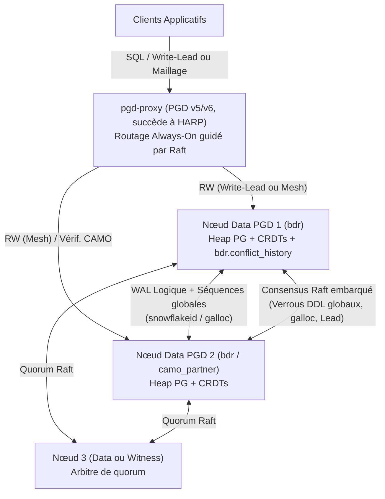

# 4 — EDB Postgres Distributed / BDR (Multi-Maîtres Raft Hybride — Référence Architecturale)

**Série :** Architectures PostgreSQL Multi-Maîtres & Active-Active  
**Auteur :** Jean-Marie Renouard (`jmrenouard`) — [LightPath](https://www.lightpath.fr)  
**Licence :** MIT License

---

| Attribut | Valeur |
| :--- | :--- |
| **ID Catalogue** | `#4` (`EDB Postgres Distributed / PGD / BDR` dans `Ch. 01`, `Ch. 03a`, `Ch. 04`, `Ch. 07`) |
| **Statut Benchmark** | **Non benchmarké en direct (Exclusion commerciale `APP-005`)** |
| **Famille / Niveau** | `T4 / Hybride` — Extension logique + Raft embarqué (`Niveau 4 / Hybride`) |
| **Versions** | `EDB PGD v5 / v6` (extension `bdr`, `pgd-proxy` remplaçant HARP) |
| **Profil CAP / PACELC** | `Hybride` (`PA/EL` en Async / CRDT vs `PC/EC` en CAMO / Eager / Write-Lead Raft) |
| **Licence / Déploiement** | Souscription commerciale propriétaire (EnterpriseDB) / min `3` nœuds (`2 data + 1 witness` ou `3 data`) |

---

## 1. Description de la technologie et rôle

**EDB Postgres Distributed (PGD)** — issu de la lignée **BDR** (*Bi-Directional Replication*) de 2ndQuadrant — est une plateforme PostgreSQL distribuée multi-maîtres commerciale bâtie sur PostgreSQL / EDB Postgres Extended. Contrairement aux extensions asynchrones, PGD v5/v6 intègre un **plan Raft natif** dans l'extension `bdr` sur les nœuds de données et témoins. Il utilise **`pgd-proxy`** au lieu de l'ancien démon **HARP**.

PGD couvre tout le spectre PACELC : maillage asynchrone avec LWW (`bdr.conflict_history`) ou colonnes CRDT (`bdr.crdt_*`), jusqu'au `RPO = 0` sous Raft par **CAMO**, **Eager** ou **Write-Lead**.

---

## 2. Architecture et flux de données

Un déploiement PGD v5/v6 canonique réunit au minimum trois votants Raft (`2 data + 1 witness` ou `3 data`) derrière `pgd-proxy` pour le routage Write-Lead ou multi-région :

En intégrant Raft dans `bdr`, PGD sérialise les verrous DDL globaux (`ALTER TABLE`) et les bascules `Write-Lead` (`RTO ~ 1–5 s`) sans magasin de consensus externe.

---

## 3. Principes de fonctionnement et modes d'implémentation

1. **Raft embarqué & `pgd-proxy` :** Raft arbitre l'élection du maître leader (`Write-Lead`), les verrous DDL globaux et l'allocation de plages `galloc` sur `>= 3` votants (`2 data + 1 witness` minimum).
2. **Modèle de latence dual :**

$$
L_{\text{PGD-Async/CRDT}} \approx L_{\text{disque}}, \qquad L_{\text{PGD-CAMO/Eager}} \approx L_{\text{disque}} + 2 \cdot \text{RTT}_{\text{Raft/Partner}}
$$

3. **CRDT exacts, audit et séquences globales :** Les colonnes CRDT (`bdr.crdt_*`) imposent `REPLICA IDENTITY FULL`. Les conflits et LWW (`column_modify_timestamp`) vont dans `bdr.conflict_history`, et `bdr.global_sequences` fournit les IDs (`snowflakeid`, `galloc`, `timeshard`).

| Mode / Fonction | Portée | Mécanique et stratégie de clés | Impact conflit / bascule / RPO | Compromis |
| :--- | :--- | :--- | :--- | :--- |
| **Async Group Replication + LWW** | Défaut `PA/EL` | `track_commit_timestamp` LWW + audit `bdr.conflict_history` | Débit local ; `RPO > 0` ; *Lost Updates* LWW silencieux | Exposé à la dérive sur lignes chaudes |
| **Colonnes CRDT** (`bdr.crdt_*`) | Colonne (`REPLICA IDENTITY FULL`) | `bdr.crdt_gcounter`, `bdr.crdt_pncounter`, `bdr.crdt_delta_counter`, `bdr.crdt_delta_sum` | Convergence commutative des compteurs/sommes sans verrou global | Migration de schéma vers types CRDT requise |
| **CAMO** *(Commit-At-Most-Once)* | Paire `PC/EC` (`camo_partner`) | Le client interroge le partenaire pour vérifier l'issue d'une tx | **`RPO = 0`** + reprises applicatives idempotentes | Exige pilotes clients CAMO & attente RTT |
| **Eager All-Node Replication** | `PC/EC` Raft global | Coordonne validation et conflits globalement | Zéro conflit d'écriture ; cohérence stricte | Paie `2 * RTT` WAN à chaque commit |
| **Write-Lead + `pgd-proxy`** | Hybride Lead Master | `pgd-proxy` route les écritures vers le Lead élu par Raft | Supprime les conflits multi-écrivains (`RTO ~ 1–5 s`) | Goulot d'écriture mono-région type `#15 Patroni` |
| **Séquences globales** (`bdr.global_sequences`) | `snowflakeid` / `galloc` / `timeshard` | `snowflakeid` (64 bits, `4096` IDs/ms/nœud) ; `galloc` (Raft) ; `timeshard` (hérité) | Évite les collisions PK `23505` en multi-maîtres | `timeshard` sans garde de débordement (déprécié) |
| **Verrous DDL globaux Raft** | DDL Cluster | Acquiert un verrou Raft avant de diffuser `ALTER TABLE` | Évite les dérives de schéma split-brain | Bloque les écritures sur WAN si quorum dégradé |

---

## 4. Forces et faiblesses

| Forces | Faiblesses et pièges opérationnels |
| :--- | :--- |
| **Spectre unifié de `PA/EL` à `PC/EC` :** Réunit Async/CRDT rapide, CAMO/Eager `RPO = 0` et Write-Lead mono-maître dans une seule architecture PostgreSQL. | **TCO commercial propriétaire & verrouillage (`APP-005`) :** Licence EnterpriseDB par cœur/vCPU et dépôts privés interdisant l'auto-hébergement communautaire. |
| **DDL sérialisé par Raft & CRDT natifs :** Contrairement à `#2 Spock` (event triggers sans verrou global), Raft sérialise le DDL concurrent aux côtés des types `bdr.crdt_*`. | **Physique WAN sur Eager / Verrous DDL :** Les commits Eager et verrous DDL subissent `2 * RTT` WAN et bloquent en cas de perte de quorum Raft. |
| **`pgd-proxy` intégré & sauvegardes orchestrées :** Raft embarqué + `pgd-proxy` (remplaçant HARP) assure `1–5 s` de bascule, couplé à `Barman`/`pgBackRest`. | **Empreinte minimale de 3 votants :** Exige `2 data + 1 witness` même pour 2 datacenters ; CAMO impose une intégration client. |
| **Écosystème complet d'extensions PG :** Préserve le stockage heap PostgreSQL et les extensions C (`PostGIS`, `pgvector`) par nœud. | **Plafond mono-nœud sans sharding :** Contrairement à `#7 Citus`, `#5 YugabyteDB` ou `#6 CockroachDB`, PGD réplique tout le jeu de données par nœud. |

---

## 5. Exclusion architecturale (`APP-005`), comparatif des modes et base de référence

**Pourquoi EDB PGD n'a pas été benchmarké en direct (`APP-005`) :** Selon `docs/RCA_REGISTER.md` (`APP-005`), EDB PGD impose une licence commerciale EnterpriseDB et des registres privés. Intégrer des binaires soumis à licence dans `env/multi-db-docker-env/` romprait le contrat de reproductibilité ouverte `make bench-all` sous licence MIT.

Chaque mode PGD se projette néanmoins rigoureusement sur les références mesurées de `results/*.csv` (aucun chiffre TPS/latence synthétique n'est inventé pour EDB PGD) :
- **PGD Async + CRDT** partage la physique WAL logique et fusion delta de **`#2 pgedge` / `pgedge-delta-apply`** (`1837.64 TPS`, `0` dérive sur `D_hot_conflict`, et `646.77 TPS` à `25 ms` WAN).
- **PGD Eager / CAMO** rejoint le régime consensus Raft `PC/EC` borné par `2 * RTT` WAN (`#5 YugabyteDB` : `5.78 TPS` à `25 ms` WAN. `#6 CockroachDB` : `10.06 TPS` à `25 ms` WAN).
- **PGD Write-Lead** se comporte en OLTP mono-région comme **`#15b Patroni HA`** tout en gardant des pairs multi-régions chauds.

| Capacité / Référence | `#4 EDB PGD` *(Réf. Arch., `APP-005`)* | `#2 pgEdge / Spock 5` *(PoC)* | `#1 pg-birep` *(PoC)* | `#5 YugabyteDB` / `#6 CockroachDB` *(PoC)* |
| :--- | :--- | :--- | :--- | :--- |
| **Consensus / Quorum** | Raft embarqué (`>=3` nœuds/témoin) | Aucun (`PA/EL` async) | Aucun (`PA/EL` async) | Raft par tablet / range (`RF=3`) |
| **CRDT / Gestion conflits** | `bdr.crdt_*` + `bdr.conflict_history` + Eager | `spock.delta_apply` (`0` dérive `D`) | Arrêt (`23505`, `-71063` dérive `D`) | ACID Raft natif (`0` dérive `D`) |
| **Sérialisation DDL** | **Verrou DDL global Raft** | Event trigger (sans verrou global) | Manuel par nœud (`L5` échoue) | DDL transactionnel distribué |
| **Sharding horizontal** | Non (copie complète par nœud) | Non (copie complète par nœud) | Non (copie complète par nœud) | **Oui (sharding tablet/range auto)** |
| **Ancre empirique de réf.** | Non benchmarké (`APP-005`) | `1837.64 TPS` CRDT (`D`), `646.77 TPS` (`25 ms`) | `875.91 TPS` (`A`), `824.04 TPS` (`25 ms`) | `5.78` / `10.06 TPS` à `25 ms` WAN (`PC/EC`) |

## 6. Popularité GitHub, présence Git et vitalité de maintenance (`results/project_popularity.csv`)

Télémétrie GitHub en direct (`2026-11-20T17:26:02Z`, `archived = false` sauf `N/A`) :

| Projet | Présence / Rôle Git | Dépôt (`Compte / Dépôts`) | Stars / Forks / Watch | Commits (`Tot / 12m`) | Contrib / Issues | Lang / SPDX | Tag / Dernier Push |
| :--- | :--- | :--- | :---: | :---: | :---: | :--- | :--- |
| **EDB Postgres Distributed (PGD/BDR) (#4)** | `No (Proprietary)` -- `Proprietary (Closed Source)` | N/A (Propriétaire) | N/A / N/A / N/A | N/A / N/A | N/A / N/A | N/A / Proprietary | N/A / N/A |

- **Niveau de maintenance :** **Fermé / Propriétaire** -- Distribution commerciale EnterpriseDB (`APP-005`) sans dépôt GitHub public (`N/A`).
- **Fraîcheur / Actualité :** **Opaque (Géré par l'éditeur)** -- Dernier push `N/A`, `N/A` commits/12m, dernière version `N/A`.
- **Maintenabilité opérationnelle :** **Verrouillage éditeur** -- Exige une souscription EDB payante, des registres privés et des montées de version gérées par l'éditeur.

---

**Navigation :** [Index](../../../README.fr.md) · [Ch. 03a — Solutions natives et extensions](../03a_catalogue_natif_et_extensions.md) · [Ch. 10 — Streaming vs Logique vs Multi-Maîtres](../10_comparatif_streaming_logique_multimaster.md) · [English version](../../en/solutions/edb_pgd.md)
